# Agent 与 Prompt 工程 · 逐题深度详解（11 题）

> 本文件为 [agent.md](agent.md)（8 题）与 [prompt-engineering.md](prompt-engineering.md)（3 题）的逐题深度详解，编号、题名承接原模块，原有 `` 引用格式保持不变，原模块文件未做任何修改。每题五段式：**【原题速答】→【考察意图】→【深度解析】→【追问链纵深】→【串联与资料】**。
>
> 研究背景文档：仓库根目录《个人 AI Agent 系统全面调研报告（事实核查修订版 v1.1，2026-11-13）》（下称【调研报告】）。模型与生态数据以 **2025-11 官方口径**为准：Opus 4.5（SWE-bench Verified 80.9%、价格降至 $5/$25、200K）、GPT-5.1-Codex-Max（77.9%、400K、官方宣称 30+ 小时连续自主任务）、Gemini 3 Pro（76.2%、1M）。
>
> 【调研报告】中与本组直接相关的素材：表四（mem0/Letta/Zep 记忆系统对比）、表五（模型层 2025-11 口径）、表六（多智能体框架对比）、考点 5（MCP）、考点 6（上下文工程）、考点 9/10（多智能体取舍与可靠性）、考点 13/15/19（权限沙箱、选型顺序、harness 天花板）。

---

### 01. ReAct vs Plan-and-Execute 怎么选?

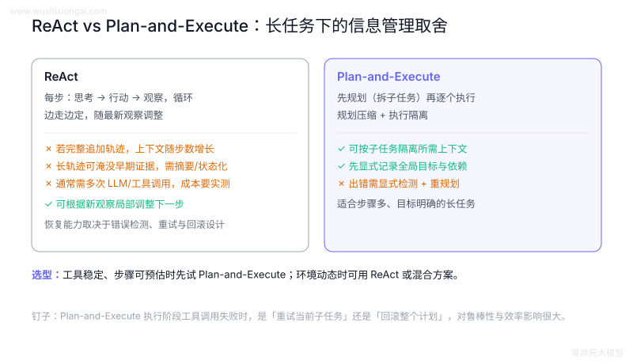

### 详解

**【原题速答】** 一句话浓缩：ReAct 动态交错"观察与动作"，Plan-and-Execute 用显式架构管理任务计划，两者可用结构化状态和检查点组合；本详解补充可操作判据——按**任务可验证性、单步错误代价、任务长度**选择。

**【考察意图】**
1. 是否真的用其中一种范式落过地：说得清两类循环的结构差异、成本曲线与各自故障模式；
2. 有没有选型判断力：回答是"都行"还是"什么条件下用哪个、代价是什么"；
3. 是否知道生产系统的真实做法：两者不是二选一，主流是"计划先行（plan-first）+ 执行中重规划 + 检查点"的混合编排（【调研报告】考点 17）。

**【深度解析】**
- **ReAct（Yao et al., 2022）**：Thought→Action→Observation 循环。有效原因有二：Thought 显式化推理、可被 Observation 纠正；Action 必须被 grounding 到真实环境观察，显著降低幻觉。代价：每步一次模型调用、上下文单调增长、错误只能靠模型自反思恢复。
- **Plan-and-Execute**：规划器先产出显式任务清单（结构化 todo/状态清单），执行器逐项完成、失败触发 replan；执行器上下文通常比 ReAct 单链更短更干净。**LLM+P** 更进一步：LLM 只做"自然语言→PDDL"翻译，计划本身由经典规划器求解，保证计划在形式化模型下最优。
- **选型三判据**（结合【调研报告】§六决策框架与考点 10）：
  1. 可验证性：任务有强验证信号（编译、测试、回放）→ ReAct 式探索纠错性价比高；没有验证信号 → 先建验证再谈自主；
  2. 错误代价：可回滚（Git/worktree/容器内）→ 允许 ReAct 试错；不可逆外副作用（支付、外发）→ 必须 plan-first 且加人审卡点；
  3. 任务长度：长程任务单链 ReAct 成功率链式衰减，拆分让每段循环更短、每步更稳。
- **量化算例（完整推导，单步成功率 p=0.95）**：
  - ReAct 直跑 20 步：0.95²=0.9025 → 0.95⁴=0.9025²=0.8145 → 0.95⁸=0.8145²=0.6634 → 0.95¹⁶=0.6634²=0.4401 → 0.95²⁰=0.95¹⁶×0.95⁴=0.4401×0.8145≈**35.8%**；
  - 拆成 5 个子任务、每个 4 步并各带一次"验证-重试"：子任务单次 P=0.95⁴≈0.8145；带重试 P=1-(1-0.8145)²=1-0.1855²=1-0.0344=0.9656；5 段串行总成功率=0.9656⁵≈**83.9%**。
  - 结论：同样 0.95 的单步质量，仅仅改变工程结构（长链→短链+每段验证），总成功率就从 36% 到 84%。选 Plan-and-Execute 的本质理由不是"规划更聪明"，而是**把长链变短链、给每段装上验证信号**。
- 对比表：

| 维度 | ReAct | Plan-and-Execute |
| --- | --- | --- |
| 决策时机 | 边想边做，全局无地图 | 先全局计划，执行中局部自适应 |
| 上下文 | 只增不减，必须配压缩 | 计划常驻，已完成步骤可摘要 |
| 长任务成本 | 上下文随步数近似 O(n²) 膨胀 | 语境更短，配合缓存放大收益 |
| 死循环风险 | 高，必须加 loop 检测 | 低，计划节点天然有界 |
| 适用 | 反馈密集、可验证、中短程 | 长程、需全局结构、可回滚 |

**【追问链纵深】**（沿原文"幂等工具、检查点、回滚与上下文压缩"）
1. **为什么幂等工具是可靠性地基？** 重试是提升可靠性的第一杠杆：k 次重试把子任务成功率从 p 提到 1-(1-p)ᵏ（推导：P=1-P(全败)=1-(1-p)ᵏ），前提是重试无害。支付/下单类工具必须带 idempotency key，否则每次重试都产生重复副作用——模型层做得再好也会被非幂等工具毁掉。
2. **检查点怎么落地？** 图编排（LangGraph）在每个节点后持久化 state（消息、计划、工具态），支持断点恢复与时间旅行调试；恢复时上下文重建 = 从 checkpoint 重放 + 工具侧缺失状态重新拉取。
3. **回滚分几层？** 内部状态直接 restore；文件改动用 worktree/git revert；外部副作用无法自动回滚（邮件收不回）——所以生产铁律是"外部副作用前 interrupt 人审"（interrupt-on-external-effect）。
4. **执行中上下文怎么压缩（compaction）？** 计划放结构化状态而非自由文本；旧 Observation 截断并存档为可检索摘要；子任务结束即摘要回写状态清单；配合 prompt/KV 缓存的 prefix 稳定排布（量化见第 06 题）。

**【串联与资料】**
- 关联：[agent.md](agent.md) 第 06 题（最小实现与停止条件）、第 07 题（ReAct 失败模式）、第 05 题（多 Agent=计划分解的团队化）；[prompt-engineering.md](prompt-engineering.md) 第 01 题（CoT 与格式取舍，ReAct 本质是"带工具的 CoT"）；本仓库 `evaluation-monitoring` 模块（验证信号与回归评测）、`inference-optimization` 模块（长上下文 KV 缓存与成本）。
- 论文一句话核心：**ReAct（arXiv:2210.03629）**：推理与行动交错生成，在 HotpotQA/ALFWorld/WebShop 上同时超越纯推理（幻觉少）与纯行动（盲目试错少）的基线；**LLM+P（arXiv:2304.11477）**：LLM 只做翻译、经典规划器保证计划最优性，说明"LLM 自由生成的计划不保证最优"。
- 【调研报告】佐证：考点 19——同等模型下，harness（上下文管理、工具设计、验证回路）差异远大于"换模型"；范式选择属于 harness 层决策。

---

### 02. Agent 长短期记忆如何分层?

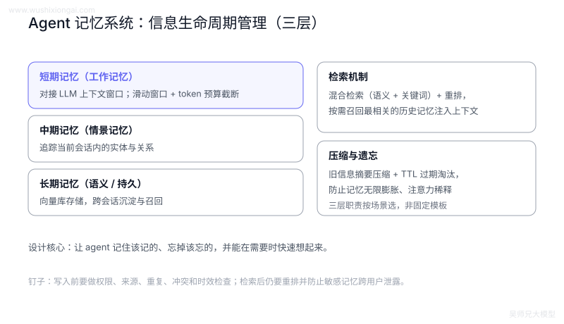

### 详解

**【原题速答】** 一句话浓缩：Agent 记忆按工作记忆、会话/情景记忆、长期知识三层职责管理，以"可追溯写入、受控检索、版本化冲突处理、级联删除"四个机制保证可靠。

**【考察意图】**
1. 是否建立了 MemGPT/Generative Agents 之后的分层心智模型——问的不是"记不记得住"，而是"记忆怎么被治理"；
2. 是否理解生产四要件（可追溯写入、受控检索、冲突版本化、级联删除）：这是把记忆论文转成工程的关键分水岭；
3. 是否了解 2025 年记忆系统三强（mem0/Letta/Zep）的路线差异（【调研报告】表四）。

**【深度解析】**
- **三层模型**：
  1. 工作记忆 = 上下文窗口内的内容（系统提示 + 核心事实 + scratchpad），快、易失、容量受窗口限制；MemGPT 类比为 RAM；
  2. 会话/情景记忆 = 对话历史与 episodic 事件，超窗即压缩为摘要，但保留指向原文的指针可回溯；
  3. 长期记忆 = 外部存储（向量库/知识图谱/文件），要求写入带 source、版本、时间戳。
- **学术源头两条线**：
  - Generative Agents（Park et al., 2023）：memory stream 逐条记录 + 检索打分 recency/importance/relevance（官方实现为三项归一后相加，recency=0.995^Δh，Δh 为距上次检索的小时数）+ 定期 reflection 把低层观察提炼成高层推断。教学算例（连乘化简便于理解）：事实 A（相关性 0.9、重要性 0.8，1 小时前）得分 0.9×0.8×0.995≈0.716；事实 B（相关性 0.95、重要性 0.5，30 天前）则有 0.995⁷²⁰=e^{720×ln0.995}=e^{720×(-0.005013)}=e^{-3.609}≈0.027，得分≈0.95×0.5×0.027≈0.013。结论：0.995/小时的指数衰减在月尺度几乎清零，工程上要么调小衰减系数、要么按天衰减、要么对核心事实免衰减（pinned）。
  - MemGPT/Letta（Packer et al., 2023）：把 LLM 当操作系统——主上下文（常驻：系统提示+core memory+近期消息）与外部上下文（recall storage/archival storage）分页管理；supervisor 模型可**自编辑核心记忆**（append/replace），休眠时也可被分页唤起；提供 .af（Agent File Format）序列化。
- **记忆写路径（mem0 口径）**：从对话抽取候选事实 → LLM 与相似既有记忆比对 → 四类操作 **ADD/UPDATE/DELETE/NOOP**（NOOP 防重复写入膨胀）→ 更新向量库（图记忆由托管平台提供）；OpenMemory MCP server 让任意 MCP 客户端共享统一"关于我"事实层。
- **冲突与时效（Zep/Graphiti）**：双时间线——每个事实同时带事件时间与系统摄取时间；修正后旧事实不物理删除而是打上 t_invalid 封存，审计上可回放"系统在何时相信过什么、何时改口"。
- 对比表（【调研报告】表四精选，许可已按 2025 年事实核查口径标注）：

| 系统 | 记忆定位 | 特点 | 不足 |
| --- | --- | --- | --- |
| mem0（Apache-2.0） | 短期/中期抽取式记忆 | 多租户精细、接入成本最低、OpenMemory MCP | 图记忆等高级能力依赖付费托管 |
| Letta（Apache-2.0） | 长期自主管理 | 分层记忆范式最完整、学术沉淀深 | 需采用其 runtime，文档偏研究向 |
| Zep/Graphiti（Graphiti Apache-2.0） | 关系与事实演变 | 双时间线可审计，适合合规场景 | 自托管依赖图数据库运维 |

**【追问链纵深】**（沿原文"摘要失真、用户纠正优先级、多 Agent 隔离"）
1. **摘要失真怎么减少？** 三招：摘要用结构化 schema（事实条目而非自由散文）；摘要永远保留原文指针（turn ids + archival 引用），可随时降级回原文重摘要；pinned 事实不参与压缩。校验用"事实保留率"抽出式评测（从原文抽事实、检验摘要覆盖）。
2. **用户纠正为什么最高优先级、怎么落地？** 纠正事件直接写入核心记忆层，同时给被纠正的旧事实打 t_invalid（双时间线封存而非物理删除）；检索侧"最近一次被用户确认的事实"必然胜出；同时向用户展示记忆来源，避免记忆黑箱。
3. **多 Agent 场景怎么隔离？** 按 user_id/agent_id/run_id 三层 namespace（mem0 原生支持）：用户级共享事实与 agent 私有 scratchpad 分库；共享写需审计；防止一个 agent 的临时草稿污染另一个 agent 的决策。
4. （延伸）**记忆投毒与注入**：被检索回来的记忆属于"不可信文本"，需来源标注、写入过滤与红队测试（【调研报告】§五）——这是 prompt injection 在记忆维度的变体，与第 04/07 题的注入防御同构。

**【串联与资料】**
- 关联：[agent.md](agent.md) 第 03 题（上下文组装消费记忆层）、第 04 题（模块协作中记忆是数据底座）；本仓库 `rag-foundations`（长期记忆的检索底座）、`knowledge-graph`（图式长期记忆与时序建模）、`document-processing`（事实抽取）、`evaluation-monitoring`（记忆质量评测）。
- 论文一句话核心：**Generative Agents（arXiv:2304.03442）**：记忆流+检索打分+反思机制支撑 25 个 agent 小镇涌现社会行为，是个性化 agent 的思想源头；**MemGPT（arXiv:2310.08560）**：把上下文当虚拟内存分页管理、让 LLM 自编辑记忆，长文档分析等任务显著受益。
- 【调研报告】补充（考点 7）：遗忘与冲突合并是隐藏考点；开源三强均可本地部署，但"跨系统记忆标准尚未统一（MCP 记忆规范仍在演进）"——答分层结构是基本分，答治理机制才是区分度。

---

### 03. 多轮对话上下文状态管理机制

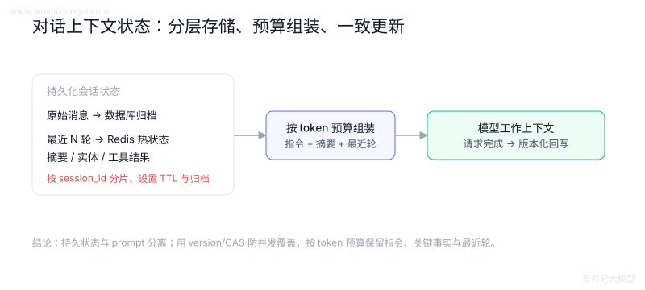

### 详解

**【原题速答】** 一句话浓缩：把"持久会话状态"与"模型工作上下文"分离——状态是外部存储的唯一事实源（SSOT），每次调用按 token 预算组装指令、摘要与最近轮，用版本控制、分片、TTL 保证一致性与生命周期；本详解补充 2025 年关键件：**prefix 稳定性与 KV/prompt 缓存、compaction**。

**【考察意图】**
1. 是否分得清 session state（外部、可审计、可纠错）与 model context（每次调用的有损视口）——混为一谈是新手标志；
2. 会不会算账：token 预算分配、摘要触发时机、缓存命中能省多少钱；
3. 是否跟上 2025 年话语转变：管理对象从单条 prompt 变成整个循环里"什么信息以什么形式进入有限窗口"，即 context engineering（【调研报告】考点 6）。

**【深度解析】**
- **双层模型**：state（SSOT）——每轮先被外部存储固化、带版本号与来源；context（viewport）——每次调用按预算拼装，其中截断与摘要是**刻意的信息丢弃**，丢弃策略必须可解释、可复核。
- **组装模板**（按 KV/prompt 缓存友好的顺序，稳定内容前置）：系统提示（恒定）→ 核心用户事实（低频变）→ 会话摘要（低频重算）→ 最近 K 轮原文（高频变）→ 当前消息 → 工具 schema（稳定）。
- **预算公式**：B_total = B_sys + B_facts + B_summary + B_recents + B_tools + B_reserve，B_reserve 为输出预留+安全边际。128K 窗口工程样例：8K（sys）+4K（facts）+8K（摘要）+40K（recents）+ 检索动态注入 +8K（输出预留）≈ 68K ≪ 128K，为工具结果留出 60K 级余量。
- **摘要触发算例**：平均每轮 600 token、history 预算 40K → 原文窗口只够约 66 轮（40K/600≈66.7）；超出即把最老 30 轮折叠成约 1.5K 结构化摘要，释放约 30×600-1500=16.5K。
- **缓存经济学（量化）**：前缀稳定部分可命中 KV/prompt 缓存。按【调研报告】表五口诀口径，DeepSeek-V3.2 输入未命中 $0.28/M、缓存命中 $0.028/M——**命中即 10 倍差**。例：30 步长会话共 0.9M 输入 token，全未命中≈\$0.25；若稳定前缀占 85% 且全部命中，成本≈0.9M×(0.85×0.028+0.15×0.28)/1M≈\$0.059——**约省 77%**。结论："稳定内容前置"不是代码洁癖，直接是钱。
- **版本/分片/TTL**：state 每次变更加版本号（可重放、可时间旅行调试）；超长会话按主题或时间段分片存储、检索跨片而组装限片内；TTL 按数据类别分级——会话原始轮 7–30 天，摘要更久，用户级核心事实在显式删除前常驻；删除请求一律级联生效到缓存与摘要。
- **勘误/口径更新**：原文速答（C 级教学整理）列举的"版本控制、分片、TTL"正确但不完备。2025-11 口径必须补两点：其一，**KV/prompt 缓存的前缀稳定性**已成为上下文组装的一等约束（Claude Code、Codex CLI 都靠稳定前缀降本）；其二，"窗口够大就随便放"是错的——窗口大只解决"放得下"，**context rot（上下文越长、模型利用效率越低）与成本**不随窗口消失；Gemini 3 Pro 的 1M 上下文是缓解溢出的选项，不是免压缩的理由。

**【追问链纵深】**（沿原文"哪些状态该长期保留、摘要与关键事实如何可追溯可纠错"）
1. **哪些状态该长期保留？** 判据双问：未来会话是否还会引用、是否用户级而非任务级。保留：稳定偏好、显式授权、用户确认事实；不保留：一次性中间计算、任务内 scratchpad（短 TTL 或任务结束即弃）。
2. **摘要和关键事实如何可追溯可纠错？** 每条摘要与事实带指向原文轮次的指针 + source + version；纠错时按编号升版本并触发重摘要；审计日志不含明文凭证、可完整回放"哪一步基于哪条信息"。
3. **分片与 TTL 粒度怎么定？** 会话→主题→轮三级分片；检索跨片、组装限片；TTL 与合规（用户删除权）联动，删除请求级联到向量库、缓存与摘要。
4. **大窗口与压缩是不是二选一？** 不是。窗口解决容量，压缩解决利用率与成本；生产稳态 = 大窗口 + 结构化状态 + prompt 缓存 + 必要时子代理隔离（各子任务独立视口）。

**【串联与资料】**
- 关联：[agent.md](agent.md) 第 02 题（记忆分层是状态的长期化）、第 06 题（组装与 token 成本）、第 07 题（ReAct 循环中的上下文增长）；本仓库 `inference-optimization`（KV 缓存与长上下文推理）、`rag-foundations`（检索注入层）、[prompt-engineering.md](prompt-engineering.md) 第 03 题（结构化输出JSON 的状态 schema）。
- 资料：本题原文为 C 级教学整理、无论文链接；工程依据可读 Anthropic《Effective context engineering for AI agents》（2025，【调研报告】学习路径指定阅读）——核心主张：把上下文当有限资源做"预算+结构+压缩"，对抗 context rot。【调研报告】佐证：考点 6 与 §三（Claude Code/Codex-Max 的 compaction 实践：Codex-Max 官方宣称靠压缩机制支持 30+ 小时连续自主任务）。

---

### 04. Agent模块协作机制与失败场景

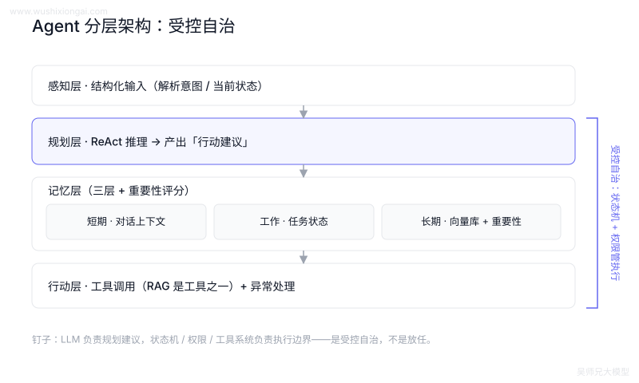

### 详解

**【原题速答】** 一句话浓缩：生产级 Agent 把感知、规划、分层记忆、工具执行模块化连接，由状态机限定转移、权限限定能力、反馈闭环修正错误，把自治限制在可控范围内。

**【考察意图】**
1. 系统分解能力：模块之间靠什么契约通信（结构化状态、事件、工具结果）；
2. 失败枚举的完备性：面试官想听的不是"会出错"，而是"哪几类错、各在哪一层被拦"；
3. 生产意识：权限分级、人审卡点、观测 trace 是否已是默认反射。

**【深度解析】**
- **参考架构与契约**：感知层（输入归一化+安全过滤）→ 规划层（策略与分解）→ 记忆层（上下文供给）→ 工具执行层（全系统唯一副作用边界）→ 反馈回路（观察回填后重规划）。模块间以**结构化状态机**连接：idle→planning→acting→waiting_approval→done/failed，每次转移带 guard（权限检查、预算检查、错误处理）。
- **权限三道闸**（直接落在状态机上，不是另外一层）：能力白名单（本任务允许哪些工具）→ 参数级 policy-as-code（路径白名单、金额上限、目标账号约束，如 target_account_id 不在白名单集合即 deny）→ 人审（不可逆外副作用前置拦截）。四档权限模式参考 Claude Code（【调研报告】表二：只读 / 自动编辑 / 全自动+白名单 / 人审全批）。
- **失败场景清单与拦截点**（模块归位）：
  - 规划幻觉工具/参数 → schema 校验+枚举白名单硬拦截（第 08 题工具层）；
  - 工具超时/部分失败 → 幂等+重试+熔断+降级链（第 06 题）；
  - 记忆污染/投毒 → 来源标注+双时间线封存+写入过滤（第 02 题）；
  - 记忆 vs RAG vs 实时工具结果冲突 → 来源可信度矩阵裁决（追问 1）；
  - 越权写 → 三道闸+最小权限+唯一处理权（第 05 题）；
  - 死循环 → max steps+重复调用哈希检测+无进展判停（第 06/07 题）；
  - 注入劫持（网页/工具输出携带恶意指令）→ 注入内容仅为"数据"不得成为"指令"，配合权限隔离与输出检查（第 07 题追问）。
- **可靠性算例**（为何处处要闸）：单步 95% 的 20 步自主链≈35.8%（推导见第 01 题）；生产可用一般要求 ≥95%——约 59 个百分点的差距只能由验证信号、检查点与人审卡点补齐。这正是【调研报告】"三层知识树中验证层最被低估"的量化注脚。

**【追问链纵深】**（沿原文"冲突裁决、写操作防越权误执行"）
1. **记忆、RAG、实时工具结果冲突怎么裁决？** 构建来源可信度矩阵：权威度（官方实时 API > 内部知识库 > 模型参数知识）× 新鲜度（时间戳）× 具体度（更具体的规则优先）；自动裁决不成立时，向用户澄清优于静默择一；关键决策记录 provenance（依据哪条证据、哪个版本）。
2. **写操作怎么防越权和误执行？** 最小权限+临时授权（per-task grant、任务结束回收）；不可逆动作一律人审；可逆写先落 worktree/草稿态再提交；全链审计日志脱敏可回放。
3. **中途部分失败怎么办？** checkpoint + 幂等重试 + 补偿（Saga 详见第 05 题）；对"已外部生效"的步骤如实报告而不是装作没发生。
4. **持续归因怎么做？** 每步 trace（thought/tool/args/result/token/cost/error）入 run 表；失败样本回放进回归集，评测挂 CI，改动带对比结论（【调研报告】§五测试评估节）。

**【串联与资料】**
- 关联：[agent.md](agent.md) 第 01/05/06/08 题（此题是它们的"系统级串联题"）、第 02 题（记忆冲突治理）；本仓库 `evaluation-monitoring`（观测与评估）、`rag-foundations`（冲突中的 RAG 侧）。
- 论文一句话核心：本题原文为 C 级教学整理、无论文链接；口径依据 Anthropic《Building effective agents》（2024）核心主张——先固化工作流确定性、再按需放开 agent 自主性，"编排确定性+模型智能"是设计共识（【调研报告】表六总结）。【调研报告】佐证：考点 10/13，§五安全机制与上线清单（三层注入防线、沙箱默认禁网、一键停机回滚）。

---

### 05. 多 Agent 协同如何分工?

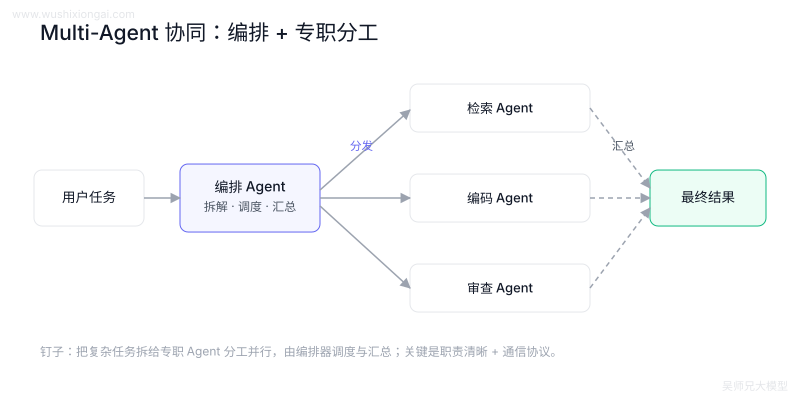

### 详解

**【原题速答】** 一句话浓缩：多智能体由编排器负责任务拆解、路由与结果汇总，专职 Agent 通过标准消息协议协作，并用超时、验证、唯一处理权和人工回退控制风险。

**【考察意图】**
1. 拓扑常识：orchestrator-worker、流水线、辩论评审、handoff swarm、图/状态机各自的适用场景；
2. 分布式系统直觉能否迁移：Saga、幂等、一致性级别要在 agent 场景会落；
3. 成本与风险意识：多 agent 成本与失败级联都是倍增的，不是"人多力量大"（【调研报告】表六不足栏）。

**【深度解析】**
- **何时升级多 agent**（【调研报告】考点 9）：并行探索（一次考察多个假设）；上下文隔离（每个子任务独立窗口，避免互相污染、避免每个 worker 重读全仓大文件）；异构特长分工（检索型+编码型）。默认姿势仍是"单 agent + 子代理"，有显著瓶颈再升级编排拓扑。
- **拓扑与框架对比**（【调研报告】表六精选）：

| 框架 | 心智模型 | 生产强项 | 不足 |
| --- | --- | --- | --- |
| LangGraph | 图/状态机+共享状态 | checkpoint 断点恢复、interrupt 人审一等公民 | 学习曲线陡、样板代码多（MIT） |
| AutoGen | Actor 事件驱动会话 | 研究范式覆盖最广 | 生产部署需补基建（MIT） |
| CrewAI | 角色化 Crew / Flow | 上手最快 | 深度控制流受限（MIT+企业版） |
| OpenAI Agents SDK | Swarm 正式化 | handoffs/guardrails/tracing 轻盈 | 绑定 OpenAI 生态 |

- **失败级联算例（完整推导）**：设两 worker 各自成功率 0.9、汇总步 0.95：全任务 P=0.9×0.9×0.95=**76.95%**。对比单 agent 跑等效 12 步长链：0.95¹²=0.95⁸×0.95⁴=0.6634×0.8145≈**54.1%**。可见正确拆分的多 agent（77%）优于傻长链单 agent（54%），**前提是上下文隔离后 worker 单步质量不降**。反例：worker 质量只有 0.8 时，0.8×0.8×0.95=60.8%，多 agent 反而劣化——**多 agent 是把各段成功率相乘：乘出"质量"还是"失败"，取决于 worker 单步质量与隔离效果**。
- **成本公式**：Cost_multi ≈ C_orch + ΣC_worker_i + C_aggregate。看似翻倍，但子代理上下文隔离可省（每个 worker 不必重复读大文件，【调研报告】考点 14"子代理避免重复读文件"）；长上下文场景隔离省额可抵消甚至超过编排开销。
- **工程控险四件套**（对应原文速答）：超时（worker 级 deadline+超时转移）、验证（对产物跑结构化校验/测试）、唯一处理权（同一资源单 writer，避免双写竞态）、人工回退（兜底通道直连人）。
- **消息协议契约**：task_id、artifact 引用、验证标准、补偿动作声明。handoff 时传"产物+决策要点"而非全量历史——信息丢失在 handoff 的摘要环节最常见，必须保留可回溯指针。

**【追问链纵深】**（沿原文"Saga 实现、补偿幂等、一致性级别与 UX"）
1. **Saga 怎么具体落地？** 把一次多步写任务建模为事务序列：执行前把补偿动作登记到持久日志，失败按逆序补偿；at-least-once 执行+每个动作幂等 key，防重复执行。
2. **补偿操作怎么保证幂等？** 补偿同样带 idempotency key，并且只对"已确认成功"的事务生效（先查执行登记再补偿），避免"补偿撤销了根本没发生的事"。
3. **一致性级别对 UX 的影响？** 强一致（串行、每步确认）→ 进度全可控但慢；最终一致（worker 异步）→ 快但界面必须显式展示进行中状态，不能装完成；生产折中是 checkpoint 后批量人审而非逐步人审（考点 18——interrupt-on-external-effect 分级审批）。
4. **多 agent 怎么评测？** 每级 worker 各自 eval + 汇总层端到端 eval；失败样本回放进回归集；基准参照 SWE-bench Verified/GAIA/τ-bench（τ-bench 是与 evaluation-monitoring 模块同口径的工具+策略遵循基准；【调研报告】§五）。

**【串联与资料】**
- 关联：[agent.md](agent.md) 第 01 题（任务分解/Plan）、第 04 题（模块契约与失败域）、第 08 题（工具侧安全是多 agent 写权限的基础）、第 06 题（trace）；本仓库 `evaluation-monitoring`（多级评测）。
- 论文一句话核心：本题原文为 C 级教学整理、无论文链接；以【调研报告】表六共识为准——多智能体把可靠性问题从"单循环"升级为"分布式系统"问题：收益来自隔离，代价来自级联；生产一致做法是"编排确定性+模型智能"。

---

### 06. Agent 系统实现流程与核心组件

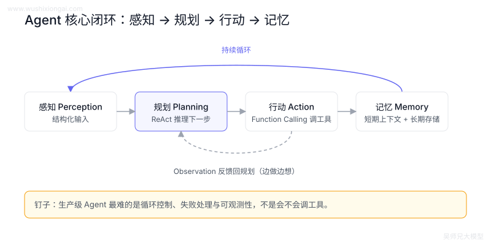

### 详解

**【原题速答】** 一句话浓缩：Agent 以感知、规划、工具执行和记忆组成反馈闭环，并通过停止条件、失败处理、权限与观测来控制循环。

**【考察意图】**
1. 能否手写出最小 agent loop（不依赖框架）——这是【调研报告】学习路径第一周的作业题，检验真功；
2. 组件抽象是否完整：感知/规划/执行/记忆之外，停止条件、失败处理、权限、观测常被漏掉，它们恰恰决定生产可用性；
3. 成本与死循环意识：会不会算多步循环的 token 账。

**【深度解析】**
- **最小循环（约 15 行伪代码）**：`while not done: ctx = assemble(state); out = llm(ctx, tools); state.append(out); if out.tool_call: obs = execute(out.tool_call) (受权限门控); state.append(obs); done = is_done(out) or budget_exhausted or step_limit; if out.tool_call failed → retry/fallback`。核心组件对应：感知=环境观测进入 state；规划=LLM 输出中的 thought/计划字段；执行=工具运行器+权限门控；记忆=state 存储；停止=三重条件（完成判据/预算/人工中断）。
- **停止条件三层**：语义完成（verifier 判定）、预算（步数/token/金钱三限位）、人工中断。缺失停止条件是最常见事故源——死循环烧钱且不可控。
- **token 成本算例（完整推导）**：上下文每步增量 Δ（工具结果+思考），n 步后上下文≈C₀+nΔ，n 步总输入≈Σ(C₀+iΔ)=nC₀+n(n+1)Δ/2，即 **~O(n²) 膨胀**。取 C₀=3K、Δ=1K、n=30：总输入≈30×3K+30×31×1K/2=90K+465K≈**0.56M token**。按 Opus 档 $5/M 输入≈\$2.8；若 KV/prompt 缓存命中 85%（命中价按缓存计费更优）与 DeepSeek-V3.2 口径（0.28/0.028）混合路由，可压到 \$0.1–0.2 级。结论：上限由步数预算与缓存策略共同决定，无预算上限的 agent loop 不应上线。
- **失败处理**：工具失败分类（可重试/不可重试/需要降级），失败信息结构化回灌而不是吞掉；重试带 idempotency key；连续失败 N 次熔断并交人工（参考第 04 题状态机 failed 转移）。
- **观测（trace）**：每步记录 thought/tool/args/result/latency/tokens/cost/error，入 run 表并支持回放；失败样本进回归集。
- **工具降级设计**：主工具失败→等价备选（如 web 检索 API 失败→另一 provider）→ 关键能力缺失时显式报告而非编造；降级决策写状态机而非散落在 prompt。

**【追问链纵深】**（沿原文"防 ReAct 死循环、Agent trace、工具降级"）
1. **怎么防 ReAct 死循环？** 四道保险：max_steps 硬限；重复动作检测（对 tool+args 哈希，重复超过阈值强制换策略或终止）；无进展检测（连续 k 步评分无提升即停）；预算限位（步数/token/钱）。
2. **Agent trace 怎么设计？** 每步一条结构化记录（含 prompt 内容引用而非全文），run 级聚合（总 token、总费用、每工具调用统计）；trace 同时服务调试、评测回放与成本分摊三个用途。
3. **工具降级怎么设计？** 每个关键工具声明 fallback 链与超时；降级标注进 observation 让模型知道"这是降级数据"；降级链的可用性本身纳入监控。
4. **怎么测这个 loop？** 先单步（工具 mock）→ 再多步场景（带自动验证信号的小任务集）→ 最后端到端（回归集+CI，失败回放）。

**【串联与资料】**
- 关联：[agent.md](agent.md) 第 07 题（ReAct 特化循环）、第 01 题（停止与检查点组合）、第 08 题（执行器的门控细节）、第 03 题（assemble 即上下文工程）；本仓库 `inference-optimization`（token 成本与缓存）、`evaluation-monitoring`（trace 与评测接入）。
- 论文一句话核心：本题原文为 C 级教学整理、无论文链接；工程范本为 Anthropic《Building effective agents》（2024）——从"可预测的组合件"搭建 agent，能 workflow 就不用自主循环，自主循环也要用"最小必要自主"。【调研报告】佐证：考点 2/10/14/19（agent loop、可靠性、成本优化、harness 天花板）。

---

### 07. ReAct 架构原理与失败场景

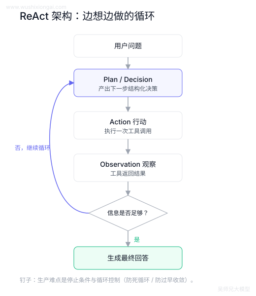

### 详解

**【原题速答】** 一句话浓缩：ReAct 把"当前思考、工具行动、环境观察"交替循环，让后续决策利用真实反馈，并在满足停止条件后输出答案。

**【考察意图】**
1. 论文功底：能否讲出 ReAct 为什么"交错"有效（而不只是"会调用工具"）；
2. 失败场景的工程化：死循环、终止判断、trace 三问都是生产题，不是概念题；
3. 对比意识：ReAct 与 plan-and-execute、Reflexion 的谱系差异。

**【深度解析】**
- **机制拆解**：一个 ReAct 步 = Thought（显式推理文本）+ Action（工具名+参数）→ 环境 → Observation（结构化结果回入上下文）。有效性的两条实证理由（对应原文【ReAct 论文】消融实验）：去掉 Thought（仅 Act）→ 盲目行动、成功率明显下降；去掉 Grounding（仅 Reason，不接观察）→ 幻觉率陡增。**ReAct 的本质收益 = 用环境真值替代参数记忆来锚定推理。**
- **与 CoT 的关系（量化口径）**：ReAct 是"带环境的 CoT"。注意 2025-11 口径的模型现状：新一代推理模型（o/Codex/Gemini 系）已在参数层内化大量推理与工具使用训练，裸 ReAct 少样本模板的绝对收益相对 2022 年持平甚至下降，但其**可控性**（每步可插权限点、可打断、可回放）仍是工程不可替代的价值——问题从"用不用 ReAct"变成"如何工程化 ReAct loop"。
- **失败场景清单**（工程映射）：
  1. **工具调用死循环**：模型重复同一调用（形成 "search→nothing→search" 环）→ 防：tool+args 哈希重复检测、max steps、无进展判停（第 06 题）；
  2. **观察污染上下文**：单个巨大观察占满窗口 → 防：结果截断+摘要在结构化字段中插入，观察只给"必要切片"；
  3. **Thought 幻觉绑定**：模型捏造未执行的观察 → 防：观察由 harness 注入而非由模型生成；结构化区分（tool 输出字段与 thought 字段物理隔离）；
  4. **任务完成判断难**：模型"我已完成"≠真完成 → 防：任务完成用外部 verifier（测试/断言/回放）判定，而不是信模型的自我声明；
  5. **注入劫持**：观察文本含恶意指令（网页检索结果、工具输出）→ 防：观察=数据不为指令、注入过滤、工具结果走权限门控（【调研报告】考点 12：agent 场景注入更危险的原因是"工具执行权+不可区分指令与数据"）。
- **structured trace 示例（ReAct 运行时记录什么）**：`{step, thought, action:{name,args}, observation:{source, content_truncated, ts}, per-step tokens/cost, guard_flags}`——既服务调试也服务评测与计费。
- **一个小算例**：ReAct 5 步搜索任务，第 i 步输入≈(3K+i·1K)：总输入=Σ_{i=1..5}(3K+i·1K)=15K+1K×(1+2+3+4+5)=**30K**；配 prompt 缓存后稳定前缀大量命中，第 5 步的边际成本远低于第 1 步头的线性预期——与第 06 题 O(n²) 膨胀对照看，缓存是 ReAct 成本的主杠杆。

**【追问链纵深】**（沿原文"判断任务完成、防死循环、结构化 trace"）
1. **如何判断任务完成？** 分两级优先：外部验证信号（单元测试/断言/回放比对）> LLM-as-judge（须人工校准阈值与偏差）> 模型自我声明（最不可信，只作提示不作判据）。
2. **如何防工具调用死循环？** 判停三件套（重复哈希检测、无进展判停、max steps）之外，还要在 prompt 中要求"同一步失败两次必须换策略"——让模型与 harness 双保险。
3. **如何记录结构化 ReAct trace？** 上述 JSON 结构 + run 级聚合（总 token/总费用/每工具统计），失败样本回放进回归集并挂 CI。
4. **ReAct 与 Reflexion 的谱系**：Reflexion 在 ReAct 之上加"失败后的语言化自我反思"——失败信号作为 episodic 记忆存下，下次作为上下文提示，不改权重。它改进的是"跨 trial 学习"，与 ReAct 的"trial 内纠错"互补（【调研报告】考点 16/17）。

**【串联与资料】**
- 关联：[agent.md](agent.md) 第 01 题（范式对比）、第 06 题（通用 loop 与停止条件）、第 03 题（观察->上下文预算）、第 04 题（注入防线）；本仓库 `prompt-engineering.md` 第 02 题（few-shot 机制——ReAct prompt 本质是格式化 few-shot）。
- 论文一句话核心：**ReAct（arXiv:2210.03629）**：交错推理与行动的轨迹使后续决策利用真实环境反馈，比单独推理或单独行动错误更少；Reflexion（Shinn et al., 2023）为延伸参考——失败反思的语言信号可替代梯度带来跨试次改进（原文未列）、此处按论文补判别。

---

### 08. Agent工具定义、注册与安全控制有哪些？

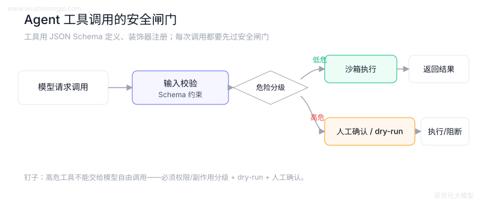

### 详解

**【原题速答】** 一句话浓缩：工具通过 Schema 注册与参数校验接入 Agent，执行前做权限检查与副作用分级，执行配套沙箱、限额与审计。

**【考察意图】**
1. 工具层工程细节：JSON Schema 定义、注册表、动态发现（MCP）各自的边际差异；
2. 安全工程反射：副作用分级是否本能出现在"写文件/发邮箱/删数据"这类任务里；
3. 是否理解 2024-11 之后工具生态的结构性变化：MCP 成为跨厂商工具连接标准（【调研报告】考点 5，2026 必考）。

**【深度解析】**
- **定义层（给模型看什么）**：JSON Schema（名/描述/参数及类型/枚举/required）。描述质量=召回率与正确调用率的第一驱动因素（工具描述质量 > 换模型，【调研报告】考点 19）。实践中描述要含"何时用/何时不用"两句话。
- **注册层（运行时管理）**：静态注册表 → 版本化与灰度（同一工具多实现路由）→ 动态发现（MCP：host/client/server 三层，以 tools/resources/prompts 三类原语分发）。**MCP 与 function calling 的关系一句话：MCP 是"工具分发/互操作协议"，function calling 是"模型侧的调用机制"——MCP 把"每 agent×每工具直连"的 M×N 适配问题降为 M+N。**（【调研报告】考点 5）
- **校验层（模型说错怎么办）**：JSON Schema 校验（类型/必填/枚举）→ 越界防御（超范围路径、超大参数、上下文外引用 ID 拒绝）→ 单位/量纲/时区等业务语义校验（LLM 常犯）。
- **权限与副作用分级**：
  - 只读类（read/search/query）：可全自动；
  - 可逆写（edit/创建草稿）：自动+checkpoint；
  - 不可逆外副作用（send/pay/delete/deploy）：人审门控+白名单+限额。【调研报告】§五原文："Agent 默认只读，写与网络按任务临时授予；代码执行放容器/worktree 并默认禁网。"
- **沙箱与限额**：执行代码必进容器/worktree 且默认禁网、按需开白名单出口；每工具可设速率 limit/日预算/单调用上限，预算超限即被状态机 guard 拦下并转入降级或审批分支。
- **审计**：所有 tool 调用（含 args 与 result hash）入 trace，日志脱敏不含明文凭证；凭证分权存放+可轮换（对【调研报告】§五）。
- **幂等与回滚（写操作）**：写操作需提供幂等 key 与 undo/补偿定义；三态结果（成功/失败/不确定）必须显式上报，"不确定"由运行时负对账——不能默认成功。

**【追问链纵深】**（沿原文"编排选 ReAct/状态机/DAG、写操作幂等回滚"）
1. **多工具编排：ReAct vs 状态机 vs DAG？** 规则：目标开放、步数不定 → ReAct（探索）；业务流程固定、需审计 → 状态机（可控重试与审批节点）；并行依赖明确 → DAG（如多数据源 fan-out）。同系统可混合：外层状态机、局部 ReAct 探索。
2. **写操作怎么保证幂等与可回滚？** 幂等 key+去重登记；回滚两路：可逆写（worktree+commit 回退）/ 不可逆（Saga 补偿）；"不确定"态由对账兜底。
3. **MCP server 写工具要注意什么？** server 侧保持无状态鉴权（scoped token）；schema 尽量细粒度（避免"万能工具"）；敏感动作不作为细粒度工具裸暴露，而是包进复合流程并在 host 侧统一审批门控。
4. **工具安全评测**：针对工具误用建立 eval 集（错误参数、错位引用、注入型 prompt 诱导），并用 AgentDojo 类基准对工具调用打分（【调研报告】§五注入与策略评测）。

**【串联与资料】**
- 关联：[agent.md](agent.md) 第 04 题（权限是状态机 guard）、第 06 题（执行器/降级/trace）、第 01 题（幂等是重试的前提）；本仓库 `rlhf-alignment`（模型行为约束的对齐源头）、`evaluation-monitoring`（工具级 eval）。
- 论文一句话核心：本题原文为 C 级教学整理、无论文链接；生态依据为 **MCP（Anthropic 2024-11 开源）**——统一 host/client 三层接口与 tools/resources/prompts 原语，一年内成为跨厂商事实标准，被称为 agent 生态的 USB-C（【调研报告】§四）；安全规范口径参考【调研报告】§五"凭据权限三级纵深"。

---

# Prompt 工程模块（3 题）

> 以下 3 题题号与 [prompt-engineering.md](prompt-engineering.md) 保持一致（01–03）：格式化输出 vs 思维链、Few-shot 推理、稳定 JSON 输出。

---

### 01. 格式化输出 vs 思维链，怎么选？

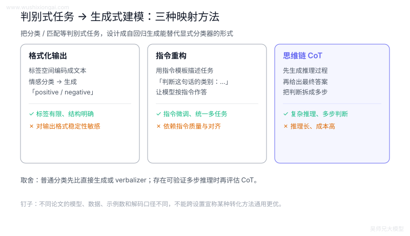

### 详解

**【原题速答】** 一句话浓缩：判别任务可通过标签文本、模板填空、结构化生成或"解释辅助"转成生成建模，但效果需按任务实证选择，不存在通用最优。

**【考察意图】**
1. 是否理解 prompt 层的"范式转换"本质：把判别问题重写为生成建模，这是 PET/T5 时代的核心思想；
2. 是否有框架认可的概念而非经验公式：何时输出要格式、何时输出要推理，且有实证意识；
3. 是否跟进 2025-11 变量：现代推理模型把 CoT 内化到参数层后，显式 CoT 的边际收益下降、结构化输出变成调用层问题。

**【深度解析】**
- **判别→生成的四种重构路径**（原文速答所列四条的展开）：
  1. 标签文本化：直接让模型输出标签词（binary sentiment → "positive"/"negative"）；
  2. 模板/完形填空（PET/Cloze，arXiv:2001.07676）：输入嵌入 "X。总体来说，它非常**掩码**。" 用掩码概率作判别分数；
  3. 结构化生成（T5 text-to-text，arXiv:1910.10683）：把所有任务统一成"输入前缀→输出序列"，任务只是前缀；
  4. 解释辅助（CoT，arXiv:2201.11903）：生成中间推理链再给答案。
- **选型决策**（三问）：输出结构是否需要给下游程序消费 → 是则优先结构化；任务是否含隐式多步推理 → 是则 CoT 优先，且两者可结合（结构化包裹 CoT：`{reason, label}`）；实时性预算 → CoT 费 token 与时延，判别低延迟场景可限长（标签仅 1-10 token）。
- **量化算例（性价比）**：分类任务直接判别约 5 token 输出；CoT 版（50 token 推理 + 5 token 标签）输出约 55 token，输出侧成本≈11 倍；收益方面：CoT 在 GSM8K 从 PaLM 540B standard prompting 17.9% 提升至 8-shot CoT 56.9%（arXiv:2201.11903 原文数字），说明"需要多步计算的任务 CoT 收益是质变"，简单分类则是负收益+高延迟。**结论：选型不是喜恶而是性价比 = 收益提升÷新增成本。**
- **PET 细节注意（考察"追问"里"模板偏差"）**：不同 template 结果方差大——PET 通过多模板 ensembling + 标签分布投影（distillation）缓解；若只用一套模板，往往是"模板中 ICL 偏差"非"模型能力"。
- **多模板集成与校准**：模板偏差主要来自 verbalizer 选择与模板措辞引起的条件分布差异；工程缓解是"多模板集成 + 概率校准"——多套模板各自打分再聚合，逼近任务真实分布（展开见追问链 1 与 4）。

**【追问链纵深】**（沿原文"模板偏差、标签 tokenization、概率校准、多模板集成"）
1. **模板偏差怎么处理？** 多模板集成（不同 verbalizer 排除"性能单点"）+ 交叉校验模板选择；极端时模板决定"这题能不能做对"。
2. **标签 tokenization 为什么影响结果？** "Yes" 是单 token 而 "yes." 是两 token，多分词路径对自回归概率有 bias；单 token verbalizer 更稳定（这也是早期 cloze 工作必提的设计点）。
3. **概率校准怎么做？** 不同标签的先验概率偏置（生成概率受表面频率影响），可用"无输入先验 probs 归一化"（PMI式：P(label|x)/P(label)）或独立校准集后处理。
4. **多模板集成为什么拥挤时有效？** 模板方差主要来自信息通道差异，集成近似"扩样本维"，方差约降 σ²/K（K 为模板数），是 prompt 层最朴素的 ensembling。
5. （2025-11 口径补充）**现代模型对格式的敏感性已下降，但选型仍在**：reasoning 模型（o 系列 / GPT-5.1 / Kimi K2 Thinking，【调研报告】表五）已把"思考"内化为独立通道，显式 CoT prompt 可由 reasoning token 预算替代；对非推理模型，"结构化包裹 CoT"仍是生产标配。

**勘误/口径注明**：Self-Consistency（Wang et al., 2022，arXiv:2203.11171）是"同一模板下采多条推理链再做多数投票"，与多模板集成（不同模板下聚合）不同；对算术/逻辑类任务收益最大，对简单判别意义不大，生产推理任务首选自我一致性（同一模板采样更便宜）。

**【串联与资料】**
- 关联：本仓库 `model-architecture` 模块（decoder-only 自回归与逐 token 生成机制）、`inference-optimization`（约束解码/JSON 输出的推理层实现）、`evaluation-monitoring`（按任务实测验证）、`fine-tuning`（prompt 与工具都解决不了时的最后选项——【调研报告】考点 15 默认顺序：先 prompt/context，再工具与 RAG，最后微调）；同模块第 02 题（few-shot 机制决定 CoT 少样本可行的原因）。
- 论文一句话核心：**PET/Cloze（arXiv:2001.07676）**：把分类重写为完形填空并多模板集成，小样本逼近全监督；**T5（arXiv:1910.10683）**：text-to-text 统一框架证明"把一切任务转成生成"可行且有效；**CoT（arXiv:2201.11903）**：中间步骤让大模型解决多步推理，且收益随规模涌现（足够大的模型才显著）；**Self-Consistency（arXiv:2203.11171）**：多链投票在算术/常识推理上持续降错，是最廉价的推理集成手段。

---

### 02. Few-shot 推理为何有效?

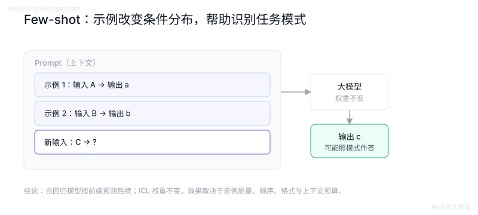

### 详解

**【原题速答】** 一句话浓缩：Few-shot 示例通过改变自回归模型的条件分布帮助其识别任务与格式，推理时权重不变，收益取决于示例质量、顺序与上下文预算。

**【考察意图】**
1. 机制理解：ICL（in-context learning）≠参数学习——能说清"示例到底改变了什么"（条件分布而非权重）；
2. 论文素养：掌握参考的 4 篇论文代表的两条解释路线（隐式贝叶斯 vs 隐式梯度）与一组关键对照实验（随机标签）；
3. 实践倒推：知道示例怎么排布、选多少条对收益有量级影响。

**【深度解析】**
- **形式化**：预训练模型学到联合分布 P(x,y)；few-shot 时模型条件变为 P(y|x, D_k)，D_k 为 k 条输入输出演示；**参数 θ 不变**，改变的是"以示例为证据的任务条件化"。一句话：ICL 是"用上下文临时指定任务"，不能神化为"不更新权重也在学习"。
- **两条解释线（参考的四篇论文正好各贡献其一）**：
  1. **隐式贝叶斯推断**（arXiv:2111.02080）：D_k 提供了对"任务概念 z"的似然，模型在后验 P(z|D_k) 上执行推理；这解释了为什么示例有噪声也能工作（后验仍可收敛）、也解释了对顺序与覆盖面的敏感性。
  2. **隐式梯度下降假说**（arXiv:2211.15661；Min et al. 2022 系列）：attention 前向传递可在函数级等价于一步梯度更新（GPT 在线性复杂度的玩具任务上可精确构造等价），这解释了"示例越像训练分布、收益越大"的表现。
- **关键对照实验（arXiv:2202.12837，Min et al.）**：把示例标签换成**随机标签**，分类性能下降有限（远小于预期）——这证明示例是"任务识别/格式 anchor"地位大于"知识注入"地位；但注意不要过度解读：**正确的标签仍然系统性更优**，该论文结论是"演示的作用主要在'抓住任务语义与格式'，其次才是'提供事实知识'"。
- **实操量化（上下文预算账）**：预算 B、单条示例 token 数 l → K_max≈(B−B_sys−B_query)/l。经验曲线：0→1 shot 收益常最大（从零样本到少样本存在"格式/任务定位"的跃迁），1→5 递减，>10 条后增益很小、还挤占 query 与检索注入空间。工程建议：示例块保持稳定并置于 context 前段以提升 prompt 缓存命中（呼应第 03 题"稳定前缀"策略）。
- **few-shot vs RAG 选型边界**：任务是"格式与视角对齐"→ few-shot 起效；任务是"事实缺失"→ few-shot 无法解决（参数里没有的知识，塞多少示例也变不出来）——外知识走 RAG（【调研报告】考点 15：外部知识优于参数化知识，可更新、可审计）。

**【追问链纵深】**（沿原文"任务识别、隐式梯度假说、随机标签对照"）
1. **任务识别具体识别什么？** 输出空间、格式、prompt 空间分布、语义方向（褒/贬）、粒度——都在"示例序列（文本流）中显式或隐式给出"；第一步最重要：label space 对齐。
2. **隐式梯度假说证据是什么、边界在哪？** 证据：线性回归任务上 attention 可精确实现一步 GD；局限：对真实大规模任务 nonlinear、多层等价复杂，"等价"只在设计过的玩具任务严格成立——不能说成"ICL 就是梯度下降"。
3. **随机标签对照实验的边界？** 收益降但仍存 → 说明有两条通道：format/task anchoring（随机标签仍保）+ label 语义通道（被打掉）；对竞争任务的实测以【Min et al. 2022】数值为准，不要只凭 test error 口头引用。
4. **示例质量怎么评测与选择？** 逐条影响度量（leave-one-out）；示例检索策略——从示例库按与输入的相似度取 demo，比固定手选平均更稳（这是超出原文四篇论文的常考扩展点）。

**【串联与资料】**
- 关联：[prompt-engineering.md](prompt-engineering.md) 第 01 题（CoT 有效性依赖 few-shot 形式与可求解规模）、第 03 题（示例即"输出格式锚"的稳妥实现）；[agent.md](agent.md) 第 07 题（ReAct 的少样本格式模板本身就是 ICL 的一次直接应用）；本仓库 `model-training`（预训练任务分布决定 ICL 能力上限）、`rag-foundations`（demo retrieval vs doc retrieval 的不同）。
- 论文一句话核心：**GPT-3（arXiv:2005.14165）**：不更新权重下规模+demo 即可跃升任务能力，确立 ICL；**ICL as implicit Bayesian inference（arXiv:2111.02080）**：demo 是对隐任务概念的后验证据；**Rethinking Demonstrations（arXiv:2202.12837）**：随机标签对性能冲击可见但有限——ICL 主要来自格式与任务遍历语义对齐而非知识复制；**What learning algorithm is ICL？（arXiv:2211.15661）**：玩具任务上 attention 前向可严格等价于一步梯度，给出"ICL 的隐式学习算法"实证化路线。

---

### 03. 怎么让模型稳定输出 JSON?

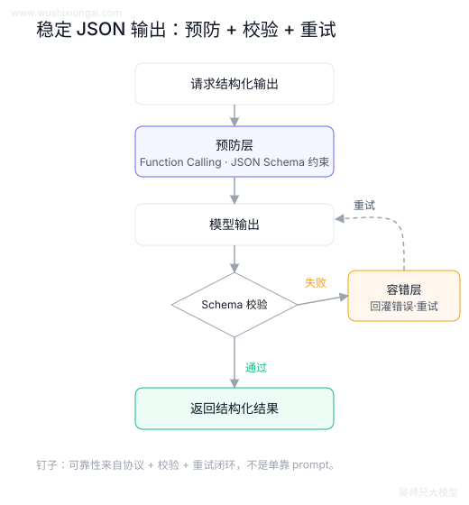

### 详解

**【原题速答】** 一句话浓缩：稳定结构化输出的优先级是"供应商级硬约束（严格 schema / 工具协议）→ 解析校验 → 错误回灌 → 有限重试 → 失败降级"的纵深链。

**【考察意图】**
1. 是否把"prompt 祈求"与"抽样层硬保证"区分开（这是本题最大的分水岭）；
2. 是否知道 function calling ≠ 契约完备：仍需要后端业务校验（对应原文追问"Function Calling 仍然需要哪些后端校验"）；
3. 失败兜底思维：重试预算、降级路径在评测与监控闭环中的位置。

**【深度解析】**
- **四个阶梯（从强到弱）**：
  1. **语法级强制（structured output / constrained decoding）**：供应商提供 JSON schema 受约束解码（如 OpenAI structured outputs，及自建 grammar-constrained decoding），在采样时逐 token 过滤不合法候选——**语法不可能错但语义仍可能错**（枚举外的取值被屏蔽了，但"字段内容错"仍是模型给的）。本地可用 llama.cpp grammars / Outlines / XGrammar 实现。
  2. **工具协议（function calling）**：声明工具签名+strict 模式，模型输出"工具调用"而非自由文本，返回结构（大部分厂商带 JSON schema 校验与自动重试一个回合）。
  3. **格式引导+容错解析**：prompt 明示字段与示例、response_format json_object；解析用容错 parser（剥离 markdown 代码围栏、去除外层杂语、常见 JSON 修复）。
  4. **校验-回灌-重试-降级**：pydantic/手写校验业务约束 → 失败时把"错误信息 + 原始输出"回灌让模型修复 → 有限次重试（预算内）→ 仍败则降级（人工兜底、放宽任务重试，或显式报错进队列）。
- **可靠率算例（口径以自家回归集实测为准）**：设裸输出"合法且满足业务 schema"的概率 90%：启用结构化输出后语法层≈100%，但语义层仍有残留（典型：required 数组填空对象、必填字段改 null、枚举值"擦边"）；再加后端校验+错误回灌修复回路，最终交付成功率可达 95–98%。**口径警告**：不要把各层名义 99% 相乘自欺（层间失败有相关性），最终成功率必须用回归集实测，分层指标只用于定位损失发生在哪一层。
- **成本视角（重试要算账）**：设单次尝试成本 C、每次尝试成功率 p=0.9、最多重试 2 次（共 3 次尝试）：最终成功率=1-(1-p)³=1-0.001=**99.9%**；期望成本=(0.9+2×0.09+3×0.009+3×0.001)C≈**1.11C**，计入回灌错误信息的增量上下文后≈1.15C。结论：有限重试能把成功率推到 99.9% 且成本增幅仅约 11–15%，但必须设上限——无上限重试在 p<1 时呈几何级数爆炸。
- **function calling 校验层不可省**（本节最关键提醒）：工具化解决了"格式"，没解决"业务正确"——模型仍会输出"类型正确、内容错误"的参数（id 串位、金额单位弄反元与分、时区错位、枚举大小写与后端不一致）。

**【追问链纵深】**（沿原文"function calling 后端校验、复杂 schema 失败重试降级"）
1. **Function calling 还需要哪些后端校验？** 四类：类型/枚举/正则（schema 重复校验一次，防止供应商未 strict）、业务不变式（金额>0、日期时区、ID 存在性）、权限资源一致性（目标 object 属于 caller，防越权 via 参数注入——此处联动 agent.md 第 08 题）、量值合理性（单位/量纲 sanity check）。
2. **复杂 schema 失败怎么重试与降级？** schema 拆分（深嵌套改多步、每步小 schema）；宽松-严格两遍（first pass 宽松获得主体、二 pass 只校难字段）；重试预算（≤2 次，带错误位置定位的 error message 而非全文回灌）；仍败走降级（宽松 parse + 人工判断队列 + 标记保守失败）。
3. **枚举/多字段矛盾的交互失败**：多个字段各自合法但组合非法（例如 discount>base_price），这类"字段间不变式"必须在后端跨 field 校验并回灌出明确错误说明。
4. **评测维度**：把"JSON valid 率、schema pass 率、语义 pass 率、修复回路成功率"四项分开度量（如【调研报告】评测分层），不要报笼统"成功率 99%"——分层指标才能定位哪层在丢。

**【串联与资料】**
- 关联：[agent.md](agent.md) 第 08 题（工具层校验与安全是同一问题）与第 04 题（校验后的失败处理与状态机）、第 03 题（schema 本身是上下文工程产物）；本仓库 `model-architecture`（约束解码的 token 层原理）。
- 论文一句话核心：本题原文为 C 级教学整理、无论文链接；结构化范式的源头可上溯 T5（arXiv:1910.10683 的 text-to-text 统一）；工程统一结论是"**语法可被约束解码保证，语义仍需校验与人审**"（供应商文档：OpenAI structured outputs / Anthropic tool use 的 strict 模式说明同口径）。

---

## 使用说明

- 本文件只增不删，未改动 `agent.md` 与 `prompt-engineering.md` 的任何内容与图片引用。
- 每题五个板块以【】标签定位，可直接用于面试复盘或讲义扩展。
- 数据口径：2025-11 官方发布（调研报告 v1.1 已做 4 处事实核查修正：Claude Code 时间线 2025-02、SWE-bench 原始集与 Verified 分开计、mem0 许可 Apache-2.0、DeepSeek-V3.2 价格 $0.28/$0.42）。
