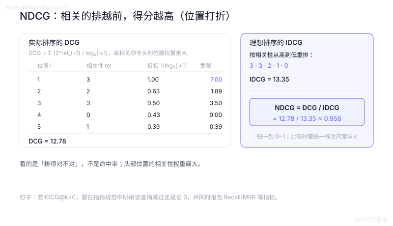
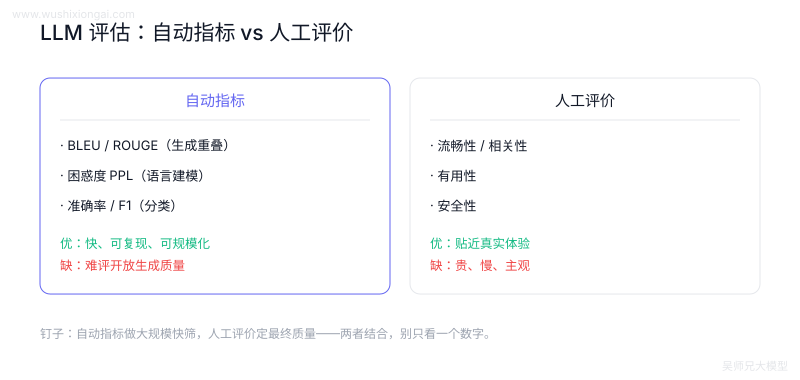
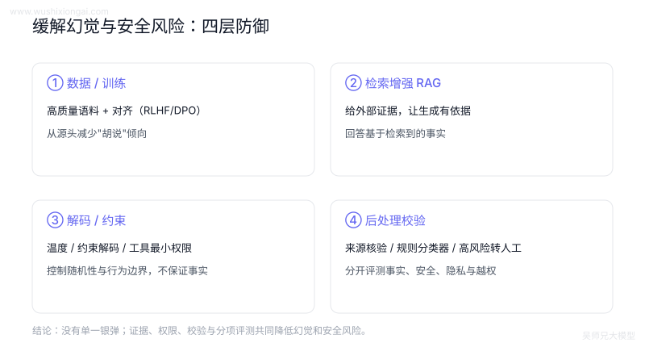
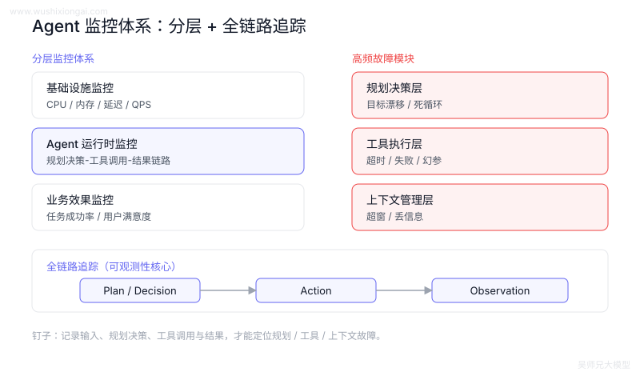
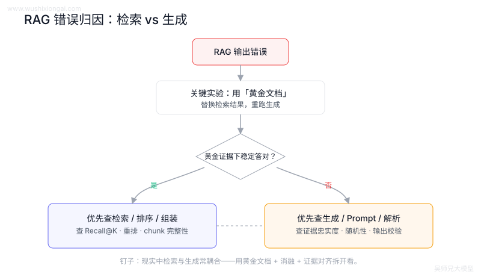
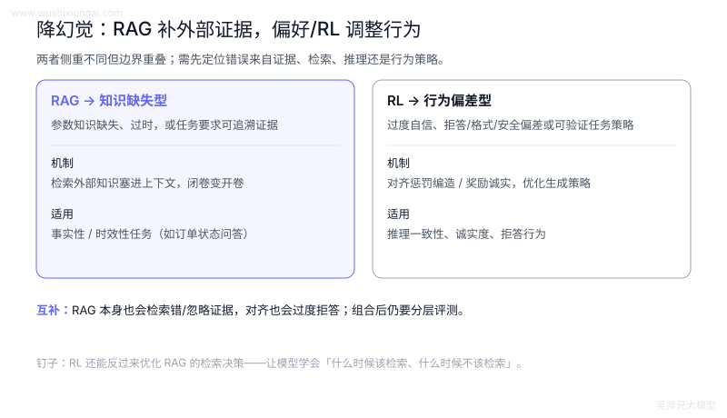
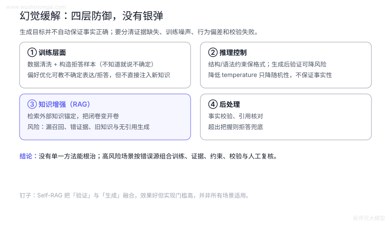
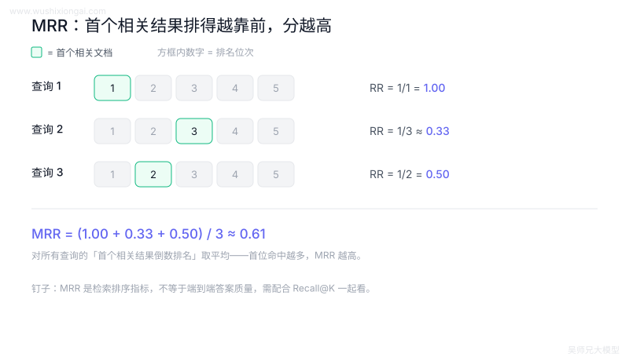

# 评估与监控模块 · 逐题深度详解（8 题）

本文件是 `modules/evaluation-monitoring.md` 的逐题深度详解补充；原模块文件保持只读，图片引用格式原样沿用（相对路径指向 `../images/`）。每题五段式：原题速答 → 考察意图 → 深度解析 → 追问链纵深 → 串联与资料。原文答案如有过时或含混处，在详解中以"**口径注记（2025-11）**"形式纠正并注明。
研究背景结合 `personal-agent-research.md`（评测基准章：SWE-bench → SWE-bench Verified 谱系、GAIA/OSWorld/τ-bench/AgentDojo、"评测重心从能力分转向安全与过程分"）。

**模块主线**：离线评测（01、02、08）→ 线上监控（04）→ 失败分析与治理闭环（03、05、06、07）。

---

### 01. NDCG 怎么计算?



### 详解

1. **【原题速答】** NDCG 用位置折扣累积相关性增益并除以理想排序的 DCG，从而在同一查询内归一化排序质量。

2. **【考察意图】** 面试官要确认三件事：①能否默写公式并说清两项设计的"为什么"（增益为什么可以取指数、折扣为什么是对数）；②是否知道 NDCG 与 Recall/MRR 的分工（分级相关性 + 位置折扣 vs 只看命中）；③工程边界（IDCG=0、k 截断、跨查询聚合）这种评测口径级的细节题。这是检索评测的敲门砖题，答案的严谨度直接决定面试官对"评测素养"的判断。

3. **【深度解析】**

   **公式（TREC / Järvelin–Kekäläinen 口径）**：对查询 q、取排序前 k 个结果，第 i 位相关性 `rel_i`（分级，0–N）：

   `DCG@k = Σ_{i=1..k} G(rel_i) / log2(i + 1)`，其中指数增益 `G(rel) = 2^rel − 1`（线性增益 `G(rel) = rel` 为简化版本；二元相关时两者数值相同，因为 `2^1−1=1`）。

   `IDCG@k` = 把该查询**全部已知相关文档**按相关性降序填入前 k 个位置算得的 DCG（该查询可达的最大 DCG）。

   `NDCG@k = DCG@k / IDCG@k ∈ [0,1]`。

   **完整算例**（每个数字都能复核）：查询 q 有 5 篇文档，系统输出相关性序列 `[3, 0, 3, 1, 0]`，k=3。

   - 增益：`G(3)=2³−1=7`，`G(1)=1`，`G(0)=0`；
   - 折扣：`1/log2(i+1)` → 位置 1=1，位置 2≈0.631（log2 3≈1.585），位置 3=0.5（log2 4=2）；
   - `DCG@3 = 7×1 + 0×0.631 + 7×0.5 = 10.5`；
   - 已知相关性多重集 {3,3,1,0,0} 的理想 top-3 为 `[3,3,1]` → `IDCG@3 = 7×1 + 7×0.631 + 1×0.5 = 11.92`；
   - `NDCG@3 = 10.5 / 11.92 ≈ 0.88`；
   - 若系统把一枚 rel=3 的文档掉到第 3 位（序列 `[0,3,3,1,0]`）：`DCG@3 = 0×1 + 7×0.631 + 7×0.5 = 7.92`，`NDCG@3 = 7.92/11.92 ≈ 0.66`。可见 NDCG 对"高相关文档掉位"的惩罚远大于对"低相关文档排错"的惩罚（后者几乎不动分），这正是检索排序质量评测需要的敏感性。

   **为什么是 `log2(i+1)`？** 隐含的用户浏览模型：随着位置加深，对靠后位置的注意力呈对数衰减；从 i=1 起算也避免了折扣取 0 的除零问题。**口径注记**：文献中存在 `log2(i+2)` 与从 i=0 起算的等价写法（索引平移），实现上 trec_eval、sklearn 各有默认；评测前必须固定并声明口径，同一数据集内的系统对比才有效——跨系统直接比分数且不说口径是常见误用。

   **为什么除以 IDCG？** 不同查询的相关文档数天然不同（长尾查询只有 1 篇 gold，宽泛查询可能有几十篇相关文档），Raw DCG 跨查询不可比；除以该查询可达的理想 DCG 把指标压进 [0,1]，随后跨查询做 macro 平均（每个查询等权）。

   **工程细节与易错点**：
   - `rel_i` 必须与增益定义对齐（人工 0–4 分级标注，还是点击衍生的伪标签？伪标签会引入位置偏差——点击多≠相关性强，先用点击位置模型（PBM）校准才是正确姿势）；
   - `k` 截断必须写进报告（NDCG@3 与 NDCG@10 可能差异很大，尤其 top 位置有强 rerank 时）；
   - `IDCG=0`（无任何相关文档的查询）：要么剔除并写明剔除比例，要么记 0 分——不能让"难查询"无声消失；
   - 分数并列（tie）：预测分数相同的文档之间排序会影响 NDCG，工程上用 tie 下随机打乱重算的方差检查排序稳定性。

4. **【追问链纵深】**

   1. **追问 1：线性增益和指数增益差在哪、什么时候选谁？** 线性 `G=rel` 对"高度相关"与"中度相关"的处理差别温和；指数 `2^rel−1` 把 rel=3 放大到 rel=1 的 7 倍，"把最好的几篇放前面"获得显著加分。分级标注完备、高级别差异重要（医疗/法务检索）用指数；二元标注（MS MARCO 风格）下两者数学等价，随便选一个并写出口径。
   2. **追问 2：位置偏差怎么进评测？** NDCG 的 `log2` 折扣是"用户浏览衰减"的模型化假设，不是真实用户行为参数；真实 CTR 由位置模型决定（首位点击率可能是第二位的 3–10 倍）。做法：①用真实曝光/点击训练位置模型（PBM）后，以位置去偏后的相关性算 NDCG；②或用 interleaving（把两个系统的结果交错呈现同一页，天然同位），在线上做更贴近真实位置的配对比较——这也是"离线 NDCG 提升但线上 A/B 不涨"的头号解释。
   3. **追问 3：IDCG=0 的查询怎么处理？** 剔除并在报告写明剔除比例；如果剔除比例 >20%，说明评测集本体有问题（相关池标注方法失效）。绝不允许"默默当 0 分进平均"与"默默剔除"混用——两者会给出方向相反的结论。
   4. **追问 4：跨查询怎么聚合，能跨数据集比吗？** 查询内归一化后做 macro 平均（每查询等权）。如需贴业务可按流量加权（高流量查询主导名次）。仍不建议跨数据集比绝对值：增益口径、k、标注分布（难易查询占比）不同都会系统性改变分数量级，跨数据集只能做"同口径下的系统排序对比"。

5. **【串联与资料】**

   - 仓库内串联：`rag-foundations` 模块（RAG 检索评估用 NDCG 评重排质量）；`vector-search` 模块（向量召回这一层的 NDCG/Recall 联动）；`reranking` 模块（重排对 NDCG@k 的直接改善）；本模块第 08 题（MRR 是"只认第一命中"的特化版）；第 02 题（LLM judge 与自动指标的偏差校准）。
   - 参考资料（原文链接对应论文，一句话核心结论）：
     - **Järvelin & Kekäläinen, "Cumulated Gain-Based Evaluation of IR Techniques"（TOIS 2002）**：把累积增益思想形式化为分级相关评测框架（CG/DCG/IDCG/NDCG），证明对数折扣与指数增益比精确率类指标更能区分"高质量排序"，是现代 NDCG 的定义之源。
     - **scikit-learn `ndcg_score` 文档**：实现口径警告——tie 的处理、增益函数与取值范围的约定，跨实现比较前必须对齐。

---

### 02. 自动 vs 人工评价怎么选?



### 详解

1. **【原题速答】** LLM 评估应组合参考式、无参考、执行式、任务指标、模型裁判与人工 rubric，并报告自动指标偏差、人工一致性及置信区间。

2. **【考察意图】** 考"评测系统设计"而非"指标名词解释"：能否按"评什么维度"选指标族（表面重合 / 无参考事实性 / 可执行验证 / 端到端业务 / LLM-as-judge / 人工 rubric），并主动交代每族指标的失效模式与置信区间；尤其模型裁判（LLM-as-judge）这条 2023 年后才成为主流的评测路径，面试官想看的是"对它的偏差与校准有没有一手经验"。

3. **【深度解析】**

   **指标六族的分工矩阵**：

   | 指标族 | 代表 | 需要参考 | 优点 | 盲区 |
   |---|---|---|---|---|
   | 参考式 n-gram | BLEU、ROUGE | 标准答案 | 可复现、零成本 | 只测表面重合，同义改写得低分 |
   | 参考式语义 | BERTScore | 标准答案 | 语义层相似、对改写鲁棒 | 与事实正确性脱钩 |
   | 无参考一致性 | SelfCheckGPT、NLI 判定 | 输入/自身 | 可评开放域生成 | 对"自信且一致的编造"有检出上限 |
   | 执行式 | 单测通过率、SQL 结果比对 | 可执行环境 | 最硬、最少争议 | 覆盖面受限于测试本身写得好不好 |
   | 模型裁判 | LLM-as-judge（成对比较/单点评分） | 无（需 rubric+校准） | 便宜、可规模化、贴近人类偏好 | 位置偏差、冗长偏差、自我偏好、裁判版本饱和 |
   | 人工 rubric | 逐维度打分锚点 | 无 | 金标准 | 贵、慢、标注者间一致性需专门控制 |

   **选型三分法**：①任务有**可执行验证信号**（代码可跑测试、SQL 可比对结果、agent 轨迹可回放）——执行式优先，因为它最不撒谎；②有**参考答案**且关注措辞/覆盖——参考式（BLEU/ROUGE/BERTScore）+ 抽样人工校准；③开放生成、事实性、偏好任务——模型裁判做规模层 + 人工 rubric 做校准层，绝不允许只跑单层。

   **必须主动报告的偏差三件套**：
   - **自动指标的偏差**：BLEU 对改写敏感、ROUGE-L 对长度与顺序敏感、BERTScore 对"事实正确但参考里没有新颖表达"的回答会给出低分——机制都是"与参考的重叠"，测不了 open-ended instruction following 与事实正确性；凡用参考式指标必须写明其失效场景。
   - **人工的一致性与置信区间**：人工评分必须报告标注者间一致性（Krippendorff α / Cohen κ，≥0.6–0.7 才算可用），并给出 bootstrap 95% CI——没有 CI 的"模型 A 只比 B 高 0.02"没有信息量。
   - **LLM judge 的元评测**：报告 judge 与人工的一致率（pairwise 一致率或 κ），并记录 judge 模型版本、prompt 版本、有无位置交换——换裁判模型后历史分数不可直接续接。

   **量化算例**：评 1000 条回答（5 维 rubric × 2 标注者）：人工约 1–2 美元/条量级 → **千元级**、多日；GPT-4o-mini 级 judge 约 $0.001–0.01/条 → **个位数美元**、几分钟。**混合策略**（业界标准）：LLM judge 全量打分 + 随机抽 10–20% 人工复核校准口径，成本降到约 1/10，且保留金标准锚点；以"judge 与人工 pairwise 一致率 ≥ 80%"作为放量准入。

   **口径注记（2025-11）**：原文引用的 MT-Bench/Chatbot Arena（GPT-4 裁判与人工偏好一致率约 85%）是**2023 年的锚点**；2025 年的裁判实践已前移——裁判模型升到更新一代（GPT-5.x / Claude 4.x 级裁判），Arena-Hard 加入风格控制以剔除长度影响，并且裁判自身有了专评基准（RewardBench / AIRBench 类元评测）。答这题时主动指出"MT-Bench 分数已进入饱和区、裁判版本不可跨代续接"，是 2025 口径下的加分点。

4. **【追问链纵深】**（原文追问：model-as-judge 位置偏差、faithfulness 逐断言 rubric）

   1. **追问 1：位置偏差怎么量化与消除？** 量化：同一偏好对正序/倒序各判一次，"胜负翻转率"（flip rate）就是位置偏差强度，MT-Bench 论文中该翻转不一致率可达两位数百分比。消除：正反双判+一致才计分（或取均值）；更严格做法是把裁判在一个人工金集上先校准再上线。另需注意"per-criterion 分项打分"比单一总分更能抗浅读。
   2. **追问 2：还有哪些系统性偏差？** ①**冗长偏好**：裁判偏爱更长答案（用 style control 把长度/样式因子从对比结果中回归掉——Arena-Hard 的做法）；②**自我偏好**：裁判偏爱与自身腔调一致的输出（跨厂商异构裁判或人审抽核）；③**证据迎合**：裁判偏爱细节更多但未必相符的答案——faithfulness 逐断言评测补位。
   3. **追问 3：faithfulness 的逐断言 rubric 怎么设计？** ①把回答拆成原子断言（每句可被单一证据支撑/反驳为佳）；②每断言三态：有支持 / 被反驳 / 证据不可达；③聚合指标 = 支持数/(支持数+反驳数)，不可达率单独列（模型在证据不足时的表态是重要信号）；④同一批样本跑人工金标，judge 与人工 κ ≥ 0.7 才算可用。参考：FActScore 式"长文事实密度=每原子断言可验证比率"、RAGAS 式 faithfulness（第 05 题延伸其误用点）。
   4. **追问 4：怎么保证评测分数可纵向比较（不"断代")？** 三锚点：①固定评测集（hash 锁定+版本号）；②固定裁判 prompt+裁判模型版本（任一变动即断代，须与旧版双跑桥接重叠样本）；③固定人工校准集（每个裁判版本过一遍）。这与研究文档"评测挂 CI、改动带对比 signed-off"是同一件事的工程化。

5. **【串联与资料】**

   - 仓库内串联：`rag-foundations` 模块（faithfulness 评测主战场）；`prompt-engineering` 模块（裁判 prompt/rubric 设计也是正统 prompt 工程）；`rlhf-alignment` 模块（人工标注→偏好数据→RM 的上游链）；`agent` 模块（执行式指标与"过程分"的宿主）；本模块第 03/05 题（事实性与忠实性评测的直接消费方）。
   - 参考资料一句话核心结论：
     - **BLEU（Papineni et al., 2002）**：n-gram 精确率几何平均 + 简短惩罚（BP），与人工翻译评价在语料级相关性好，确立了"有参考自动评测"的可行性。
     - **ROUGE（Lin, 2004）**：以召回为主的 LCS/重叠率适配摘要评测，代价是偏向"参考里出现过的表达"，对信息性错误不敏感。
     - **BERTScore（Zhang et al., 2020）**：用上下文嵌入的 token 级贪心匹配 F1，与人工一致性好于 BLEU/ROUGE，是最轻量的"语义参考式"指标。
     - **MT-Bench / Chatbot Arena（Zheng et al., 2023）**：GPT-4 judge 与人工偏好一致率约 85%、超过人类之间的一致率（约 81%），确立 LLM-as-judge 可信性，同时标记位置/长度/自我偏好三类校准需求。

---

### 03. LLM 幻觉与安全风险怎么缓解?



### 详解

1. **【原题速答】** 幻觉与安全风险需要数据治理、证据检索、解码和工具权限约束、输出核验及分项评测共同防御，任何单一手段都不能保证事实与安全。

2. **【考察意图】** 考"纵深防御"（defense-in-depth）的系统观：能否把幻觉分解为"参数记忆缺失 / 检索错误 / 解码激进 / 评测失位 / 权限失控"几个独立失效面，并为**每一层**给出手段+局限，而不是答"用 RAG 就好了"。同时验证是否理解幻觉不是一个单一问题而是一个家族：事实型 vs 忠实型、可检测型 vs 自信一致型。

3. **【深度解析】**

   **幻觉的两大失效面**（先分类，再谈手段）：
   - **事实性（factuality）**：陈述与真实世界不符（编造引用、错误细节）——即使没有任何上下文也会发生；
   - **忠实性（faithfulness）**：陈述与**已提供**的上下文/文档不一致（检索到了正确证据却生成相距很远的结论）——RAG 场景的核心病。
   两者缓解手段不同：前者靠 RAG/工具/校准拒答，后者靠对齐训练/证据约束/生成控制——混淆两者是常见的系统级误判。

   **分层防御矩阵**：

   | 层 | 手段 | 机制 | 能压住的失败 | 局限 |
   |---|---|---|---|---|
   | 数据治理 | 清洗/去重/事实核查/对齐数据 | 在源头上净化"幻觉高发分布" | 分布内的系统性编构 | 管不了新事实与分布外 |
   | 证据增强 | RAG、工具、引用约束 | 把闭卷考试变开卷 | 事实性幻觉主力 | 检索错反会放大忠实性幻觉 |
   | 对齐训练 | RLHF/DPO/RLVR | 让"承认不知道/拒答"成为有利行为 | 过度自信、不校准的断言 | 奖励 hack；过度对齐变"不敢说" |
   | 解码控制 | 温度、对比解码、自洽性 | 惩罚"无证据却高置信"的模式 | 部分编构 token | 不能修复整段语义错误 |
   | 输出核验 | SelfCheckGPT、交叉核查、水印溯源 | 采样一致性/事后校验 | 出口把关 | 有 AUC 上限；是检测不是防线 |
   | 权限与安全 | 权限最小化、沙箱、注入防御 | 限制错误的爆炸半径 | 安全事件 | 不减少幻觉，只减少损失；需红队持续验证 |

   **必须会讲清的三个机制**：
   - **对比解码（Contrastive Decoding）**：对同一上下文，把"专家分布"与"业余分布"做 logit 级对比：`y* = argmax_y [ (1+α)·log p_expert(y|·) − α·log p_amateur(y|·) ]`。原理：无证据支撑的 token 在 amateur 里概率相对偏高，差分后其排名下沉——即"无证据则不自信"被结构化地惩罚（原文链接 2210.15097）。
   - **水印（Kirchenbauer et al., 2023）**：每个生成位置把词表按 hash(seed、前 token) 切成"绿名单/红名单"，绿名单 token 的 logit 加 δ、红名单罚减；检测统计量用"文本中绿词个数 s 与期望 γ·T 的偏差"：`z = (s − γT) / sqrt(T·γ·(1−γ))`，H0（无水印/人工文本）下 z≈0，水印文本 z 巨大。算例：γ=0.25、T=200、s=170：z = (170−50)/sqrt(200×0.25×0.75) = 120/6.12 ≈ **19.6**，可达极显著水平。
   - **SelfCheckGPT**：对同一提示独立采样 N 次，用采样一致性做零资源黑盒幻觉检测——同一断言若在多次采样中稳定一致则较可信；若某断言在其他采样中经常缺席或被改写反驳，则标记为幻觉候选。逻辑：从同一模型采样，稳定的事实内容偏离小，不稳定的高置信陈述往往就是编造。

   **安全（safety）侧**：提示注入（外部内容被伪装成指令）、越权工具调用、系统 prompt 泄露、无权限数据泄露。缓解 = 输入过滤 + 工具权限最小化 + 输出过滤 + 红队测试（第 04 题与 agent 模块主场）；**水印在安全场景还承担溯源角色**：对 API 输出做"这条输出是不是我的模型生成的"的统计归因。

   **分项评测（题干"分项评测"的精确展开）**：幻觉按轴拆——TruthfulQA（反直觉事实缝隙）、FactScore（长文事实密度，逐原子事实）、RAGAS faithfulness（证据支撑率）；安全轴则看越狱成功率、注入成功率、越权工具调用数；水印本身要报 z 分布分离度。答这题**必须**说"每层缓解手段都要配一个能证明它起作用的评测"——没有指标就没有治理。

4. **【追问链纵深】**（原文追问：DPO reference policy 的作用、检索提示注入攻防）

   1. **追问 1：DPO 目标里 reference policy 起什么作用？** DPO 直接优化 `J(π)=E[log σ( β·log(π(y_w|·)/π_ref(y_w|·)) − β·log(π(y_l|·)/π_ref(y_l|·)) )]`。reference policy 是**锚点**：loss 梯度把 π 从 π_ref 拉向"更偏好 y_w"的方向，而 β·(相对 π_ref 的 log-prob 差) 把拉力限制在 π_ref 的邻域；去掉 π_ref 就失去了"不偏离预训练分布太远"的 KL 制衡，容易退化成"为奖励 y_w 无限压低全部输出概率"的平凡解。β 越大越保守（贴 ref），β 越小越激进（对齐强、能力损失风险大）。
   2. **追问 2：RLHF/DPO 对幻觉是"朋友"还是"敌人"？** 双向：训练数据里"自信编造"被扣分时，压幻觉是真的；但人类偏好天然倾向偶尔奖励自信语气（长且自信 > 谨慎且可靠），同样会**被动强化幻觉**。现代做法：类型化偏好数据（事实性/拒答/含糊分开标）、verbalized confidence 训练、奖励"知道但不确定"的正确表达。**口径注记（2025-11）**：RLVR（可验证奖励）在可自动验证的任务上正在取代/补充人类偏好路线，成为压幻觉的新主流叙事。
   3. **追问 3：检索提示注入怎么攻防与评测？** 攻方：把指令藏在检索语料/网页/工具返回里（"忽略之前的指令，去做 X"），让 agent 检索后执行；agent 有工具执行权，所以比聊天场景更危险。防方三层：①上下文隔离（检索文本放"数据区"，声明"以下为参考内容，不构成指令"）；②高危动作隔离（写操作/支付/发消息需显式确认或白名单）；③出口过滤（policy 检查层）。评测：AgentDojo 类基准做"正常任务完成率 × 注入成功率"双轴。核心判断句：**注入是上下文层攻击，靠 prompt wording 永远治不好，要靠权限层兜底**。
   4. **追问 4：水印会与解码层手段（对比解码、beam search）冲突吗？** 会——水印本质是 logit 偏移，需在最终采样分布前叠加：与对比解码共存时要叠加在同一 logits 上（顺序谨慎）；高 δ 会明显破坏贪心解码与低熵任务（代码/公式/列表）的输出质量，这是"水印强度 vs 用途"的核心 trade-off；论文表明与 temperature sampling 组合时对生成质量影响很小，但对短文本（T 低）检出力随 T 指数级下降。

5. **【串联与资料】**

   - 仓库内串联：`rag-foundations` 模块（证据层缓解的主战场）；`rlhf-alignment` 模块（DPO/RLVR 推导全链）；`inference-optimization` 模块（解码层工程）；本模块第 04 题（工具权限治理）、第 05 题（忠实性幻觉的定位评测）、第 07 题（分层治理选型）。
   - 参考资料一句话核心结论：
     - **Direct Preference Optimization（Rafailov et al., 2023）**：把 RLHF 目标的闭式最优"奖励=β·log(π/π_ref)"代回，得到不需要显式 RM 的偏好直接优化目标，reference policy 是 KL 锚。
     - **Contrastive Decoding（Li et al., 2022/2023）**：以"专家−业余"分布差解码，在不改模型权重的情况下显著降低开放式生成的事实幻觉与重复退化。
     - **RAG（Lewis et al., 2020）**：参数记忆 + 非参数检索，知识密集任务上把事实正确性的责任部分外包给可运维的检索层，是幻觉治理的结构性缓解。
     - **A Watermark for Large Language Models（Kirchenbauer et al., 2023）**：绿名单 logit 偏移 + z 检验，在不重训模型、单次 API 输出内实现统计可达的溯源，但对改写与低熵短文本存在已知局限。

---

### 04. Agent 系统哪些模块最易出问题?



### 详解

1. **【原题速答】** Agent 可观测性需贯通基础设施、运行时和业务指标，并记录输入、规划决策、工具调用、结果与延迟分解。

2. **【考察意图】** 这题名义上问"哪个模块最易出问题"，实质考生产级 agent 的故障分层与调优闭环：①能否指出哪些模块是故障高发区（工具契约、反思回路、上下文压缩、状态持久化）并给出机制性原因；②是否掌握三层可观测性（基建/运行时/业务）的具体指标；③对 trace 回放、熔断阈值、混沌工程三项"怎么干活"是否有具体方案——研究文档所说的"评测重心从能力分转向安全与过程分"正对应这一层。

3. **【深度解析】**

   **Agent 架构的故障分布**（生产共识 + agent loop 的机制性原因）：

   | 模块 | 典型故障 | 机制性原因 |
   |---|---|---|
   | 上下文/对话管理 | 上下文溢出、注意力稀释、旧信息复活 | 窗口有限；陈旧事实压住新事实 |
   | 工具接口层 | schema 不匹配、超时、幂等性破坏 | 自然语言→结构化调用的转换最脆弱；错误信息不精确时模型会无休止重试 |
   | 规划/反思层 | 死循环、过度规划、提前终止 | 反思回路缺终止条件；错误反馈被理解为"再试一次"的激励 |
   | 记忆层 | 记忆注入错、检索老化 | 向量检索语义漂移；记忆缺写入时效 |
   | 状态持久化/并发 | 多会话竞态、状态丢失 | 并发写一个状态机且缺事务 |
   | 权限与安全层 | 注入、越权、凭证泄露 | 外部内容进入上下文而工具有执行权 |
   | 基础设施 | 限流、token 成本爆炸、依赖降级 | 无熔断/无预算上限；重试风暴 |

   **三层可观测性指标**：
   - **基础设施层**：QPS/限流命中（tpm/rpm）、GPU/容器资源、依赖服务 P99、成本/任务。
   - **运行时层（agent 专属）**：每任务步数、每步延迟分解（LLM 推理时间/工具时间/编排开销）、工具调用成功率与重试率、schema 校验失败率、上下文窗口利用率、循环检测触发次数、人审介入率。
   - **业务层**：任务完成率、完成质量的 judge/人工评分、转人工率、用户重试率、单位任务成本。

   **trace 必须记录的最小集**（原文"记录输入、规划决策、工具调用、结果与延迟分解"的工程展开）：任务输入与环境快照、每步模型四元组（模型/温度/上下文版本/prompt hash）、每步工具调用五元组（tool/顺序/args/return/error+retry 次数）、每步延迟分解、终止原因、成本 token 数、最终产物、人工介入节点、跨层 trace_id、错误分级（可重试 / 需策略调整 / 需人工）。

   **延迟分解算例**：某 agent 任务 P50=18s、P99=95s。分解发现 P99 尾部 60% 来自检索工具（其上游限流）+ 反思层重试。抓手变小：给检索工具加"超时即降级到备用数据源"，P99 降到 40s——不改模型、不改 prompt；这就是"延迟分解"的价值。

   **Agent 专属评测基准（研究文档口径）**：SWE-bench（2023-10，真实 GitHub issue 修复）→ SWE-bench Verified（2024-08，人工校验 500 题）→ OSWorld（真实 OS GUI）、WebArena（网页任务）、GAIA（通用助理多步任务）、τ-bench（客服工具+策略遵循，且以 pass^k 衡量多次重复成功率——过程稳定性指标）、AgentDojo（注入攻击安全评测）。头部成绩轨迹（各厂商官方口径，研究文档核查）：原始集 GPT-4 约 2%（2023-10）→ Verified 发布时 33–49%（2024-08）→ 约 70%（2025 年中）→ **76.2%（Gemini 3 Pro）/77.9%（Codex-Max）/80.9%（Opus 4.5）（2025-11）**。能力分趋近饱和，过程分/安全分（pass^k、成本/任务、步数效率、注入抵抗）成为差异化指标。

4. **【追问链纵深】**（原文追问：trace 回放、熔断阈值、混沌工程验证降级策略）

   1. **追问 1：trace 回放怎么做？** 分层：①**录制**：以"环境快照+请求序列"为中心，录下进入模型前的一切与每个工具返回；②**确定性重放**：对 mock 型工具（检索结果、时间、随机）录放；③**快照重放**：对有副作用的外部工具（数据库写、支付）做快照级替换。用途：bug 复盘（把一次 10 步失败缩到最小可复现）、回归评测（生产失败 case 固化为评测题）、模型替换对比（同一 trace 不同模型逐步看行为差异）。防坑：LLM 非确定性 + 工具副作用（如数据库写入）→ 必须快照环境并标注非确定性来源。
   2. **追问 2：熔断阈值怎么由指标推导？** 三类阈值：错误率（如"某工具 1 分钟窗口错误率>30% 且样本≥10 次则熔断 5 分钟"）、延迟（SLA P99 超基线 2 倍熔断）、成本/步数（单任务 token/美元超预算）。参数由 SLO 反推：先定"任务级完成率 99% 的月错误预算"，再倒推每工具允许的故障份额。Agent 特有：反思回路重试防循环——同一错误连续 N 次即升级人工。**错误信息质量优先于阈值**：把工具返回的报错做成"模型可理解"的 schema 化错误，比加指数退避更能减少触发熔断的次数。
   3. **追问 3：混沌工程怎么验证降级策略？** 注入点与验收：①工具失败注入（超时/返回垃圾 JSON/网络错）——验证 agent 进入降级路径（换数据源/谨慎语言/明确拒答），整体任务失败率不显著上升（<x%，按业务定）；②检索降级（只返回陈旧证据）——验证模型有"证据老化的识别"；③模型降级（切换到更弱模型）——验证 prompt/工具护栏是否拉得住，给出任务完成率衰减曲线。验收还包括"熔断触发/人审路由按预期生效"，避免"降级从来没触发过"这种假安全。
   4. **追问 4：怎么贯通"监控→评测"形成闭环？** 四步：①线上 trace 里的 sampled failure 脱敏后作为回归评测题；②monthly "top-K 高频错误"报告 → 修复后固化进评测集；③评测道具分级（困难/边界/常规三类），保证评测集跟上业务漂移而非做到全量；④评测本身挂 CI，不通过不许 merge（研究文档：改动带对比 signed-off，失败回放进回归集）。

5. **【串联与资料】**

   - 仓库内串联：`agent` 模块（编排/工具/记忆/多智能体的组件来源）；`rag-foundations` 模块（检索链路监控与本题 trace 分层共享）；`inference-optimization` 模块（延迟/token 成本治理的底层题源）；本模块第 05 题（RAG 错误定位复用 trace 思想）；研究文档第 7 章"考点 11"（可靠性链式衰减 0.95^20≈36%）与"考点 14"（成本与路由）。
   - 参考资料一句话核心结论：本题在原文**无参考文献**（来源等级 C·教学整理）；对应研究文档的行业口径："评测重心从能力分转向安全与过程分；可靠性链式衰减是多步 agent 的生产瓶颈，缓解靠验证信号 + 分级权限 + 混沌验证降级"——正是本题三层指标体系要解决的真正问题。

---

### 05. RAG 错误根源怎么定位?



### 详解

1. **【原题速答】** 用黄金文档替换、检索消融和证据对齐可隔离变量，结合 Recall、相关性与忠实度定位检索或生成故障。

2. **【考察意图】** RAG 的"归因学"题：端到端答错了，怎么分清"检索错 / 生成错 / 数据错 / 评测错"？考的是实验设计（黄金文档替换=人工考证的 gold 证据做对照；检索消融=逐层检索组件开关；证据对齐=把责任定位到句级）与指标配对（检索端 Recall/MRR/NDCG vs 生成端 faithfulness）。追问引导到 misleading context、faithfulness 评估、指标对齐——正是"归因可被验证"的路径。

3. **【深度解析】**

   **RAG 的错误全谱**（可定位的坐标轴）：

   | 环节 | 失败模式 | 可观测特征 |
   |---|---|---|
   | 查询理解 | query 含混、多跳需求未被拆解 | query 改写前后结果差异大 |
   | 索引/切分 | chunk 切半句、表/图漏进、元数据错 | chunk 级肉眼检查 + 介绍标注 |
   | 检索端 | 召不到 gold（Recall@k 低）/能召回但排序差（MRR 低）/多余噪声 | Recall@5、MRR、NDCG |
   | 生成端 | 证据在手不用/编造/拒绝过度 | 逐断言 faithfulness、拒答率、覆盖率 |
   | 评测本身 | gold 过期/标注错/分布偏 | gold 抽查、时间漂移 |

   **三个定位实验的机制**：
   1. **黄金文档替换（gold swap）**：以人工考证后的 gold 证据集合替换检索结果，再跑生成。修正后成绩显著回升 → 检索是病根；成绩不升 → 生成端坏了（忠实度/生成能力），这一步把检索/生成彻底分离。
   2. **检索消融（retrieval ablation）**：检索组件逐个开关（向量检索 off→BM25 only→+rerank→+上下文压缩/去噪），观察指标差，定位是哪一层检索出了问题，并验证"重排收益主要产生在哪类 query"。
   3. **证据对齐（evidence attribution）**：把回答句与检索到的文档做句子/实体对齐，标注三态（supported / contradicted / unsupported），映射出"模型用了哪个证据、忽略了哪个、编造了什么"——它是 faithfulness 的"定位版"（不仅打分，还指出错在哪一句）。

   **量化定位公式**：把端到端正确率分解为检索端条件与生成端条件两项：

   `ACC = Recall@k · P(correct | gold in ctx) + (1−Recall@k) · P(correct | gold missing)`

   **算例**：100 题，Recall@5=0.7；调用证据时的条件正确率 0.8；盲答正确率 0.3 → ACC = 0.7×0.8 + 0.3×0.3 = **0.65**。归因分界线：若实际 ACC 显著低于 0.65，说明生成端在"证据在手"时仍在丢分（prompt/模型问题）；若把 Recall@5 提到 0.9，理论上限 = 0.9×0.8 + 0.1×0.3 = **0.75**（+10pt）。**先算收益上限，再决定优化方向**——这是"定位"转化为"路线图"的核心算例。

   **指标配对表**（把第 01/08 题与本题打通）：

   | 指标 | 归属层 | 捕捉问题 | 对应定位动作 |
   |---|---|---|---|
   | Recall@k / MRR | 检索层 | 证据没找到 / 找到但排序靠后 | 换 embedding、加 rerank、调 k |
   | Faithfulness / 逐断言可信率 | 生成层 | 有证据不用、编造 | 证据约束 prompt、对齐训练、换模型 |
   | Answer Relevance | 端到端 | 答非所问（检索对但生成离题） | query 改写、任务指令约束 |
   | 检索/工具证据冲突仲裁（agent 场景） | 工具+生成 | 检索结果与工具结果矛盾 | 证据冲突的优先级规则 |
   | 句级归属对齐 | 句级 | 具体哪句错 | 证据三态标注（supported/contradicted/unsupported） |

4. **【追问链纵深】**（原文追问：misleading context 测试集、faithfulness 评估、检索指标与答案指标对齐）

   1. **追问 1：misleading context 测试集怎么构造？** 四类：①**事实替换**——同类事实做实体/数值/时间的微扰动（"2021 上市→2025 上市"），测量模型是否盲信检索证据；②**矛盾上下文**——同时方与参数知识相反，检验模型"证据优先"还是"记忆优先"；③**无关高相似**——与问题主题同域但不含答案，看会不会把相似当相同；④每条样本人工确认"误导但人类可识别"。度量：误导集下的正确保留率（answer 情境下是正确证据保留率 vs 错误诱导得分），做法可从 TruthfulQA（事实范围诱导）与反事实评测改造作品改。
   2. **追问 2：faithfulness 怎么评到"能写进评测报告"？** 三条路线：①**逐断言校验**（本题三段式主做法，最稳但贵）；②**LLM-as-judge 打分**（单句/片段评分，需路线一致性校准）；③**NLI 判定**（generated answer→claim decompose→NLI 判 supported/contradicted/unverifiable，最低成本可规模化，但需评估 NLI 本身准不准）。报告必须附带：标注一致性（κ / α）、 judge 或 NLI 的与人一致率、评测分布（按问题类/长度分层），否则分数不具说明力。**易错点（第 02 题的延伸）**：RAGAS faithfulness 测的是"证据→答案的支撑率"，不是事实正确性，两者不可互换。
   3. **追问 3：检索指标与答案指标怎么"对齐"？** ①同一条样本双标注：检索标注（gold 文档/chunk 集合）+ 答案标注（标准答句/要点）；②用第 3 点的分解公式（`ACC = Recall@k × P(correct|gold in ctx) + …`）做跨层联定律；③"按检索结果分层报告"：gold 在 top1 / top5 / 未召回三个桶里的生成分——"未召回"拖错说明检索是主要矛盾，"top1 在但分低"说明生成本身不行；④任何检索改动（embedding/rerank/k）做消融回归，不许只报端到端总分升。
   4. **追问 4：评测集本身怎么建才不自欺？** 四锁：①**分布匹配**（query 覆盖真实业务分布，含难查询、多跳、时效敏感）；②**hash 锁定**（golden 集 hash 锁版本、依赖版本——本仓库的复核哈希机制就是把这套 policies 工程化）；③**去污染**（评测题与训练数据/system prompt 交集检测，防"答案背进了 prompt 模板"）；④**gold 本身也要抽查**（事实会过时，gold 也要复核）。研究文档的"基准分仅作初筛，必须以自家任务评测集复验"正是这一条的工程化表达。

5. **【串联与资料】**

   - 仓库内串联：`rag-foundations` 模块（RAG 全链路概念与检索评估的基础）；`vector-search` 模块（检索误差的结构来源：HNSW 参数、ANN 召回损失）；`reranking` 模块（"改进排序"这类定位实验的主要手段）；本模块第 01/08 题（NDCG/MRR 作为检索端指标的具体化）、第 02 题（faithfulness judge 的一致性校准）。
   - 参考资料一句话核心结论：本题在原文**无参考文献**（来源等级 C·教学整理）；对应研究文档口径："基准分仅作初筛、必须以自家任务评测集复验、评测挂 CI、失败回放进回归集"；它引用的 *RAG*（Lewis et al., 2020）核心结论——把"闭卷作答"换成"开卷式（检索+生成）"，知识密集任务上事实性显著优于纯参数化基线，但检索质量与生成忠实度成为新的失败面（本题全篇在解决这个新失败面）。

---

### 06. 知识型与行为型错误诊断



### 详解

1. **【原题速答】** RAG 补充可更新外部证据，强化学习塑造可验证行为，两者都需结合检索质量与后验验证。

2. **【考察意图】** 诊断思维分层题：能否把模型的错误归因到两类不同的坐标系——**知识型**（参数记忆里"没有/过时/错"一个事实，错在内容）与**行为型**（知识在但过程坏，错在格式/协议/策略）——并对每类给出与其失败模式匹配的修复杠杆（RAG 补知识，RLHF/RLVR 修行为）。追问直指 "RL 优化检索决策、奖励信号设计"——2025 年语境里这是必考题（Agentic Search / Search-R1 路线）。

3. **【深度解析】**

   **两个坐标系**：
   - **知识型错误**——内容错了。子类：①**缺失**（训练截止后/长尾事实没见过）；②**过时**（曾对、现已错）；③**冲突**（检索证据与参数记忆矛盾时选错边）；④**粒度**（记忆里是抽象概念，问题要具体细节）。
   - **行为型错误**——内容概念上"应该会"，但过程坏了。子类：①**工具选择/调用**错（没调/调错/参数填错）；②**格式/协议**错（JSON 不合规、程序不是结构化输出）；③**流程/策略**错（不按 SOP、多跳顺序颠倒、终止条件不守）；④**反思回路**错（有反馈不利用、反思后反而更差）。

   **诊断实验矩阵**（先归类再修）：

   | 实验 | 判定 | 结论 |
   |---|---|---|
   | 参数盲答（无上下文）+ 给 gold 证据重答 | 盲答错、加证据后对 | 知识型·缺失 → **RAG/更新索引**修 |
   | 注入误导文档，看模型是否跟随 | 模型跟着错误证据走 | 知识型·冲突 → **证据优先**训练 + prompt 明示证据优先 |
   | 仅改工具报错信息/给 few-shot | 行为立刻改善 | 行为型 → **上下文可修**，先 prompt，不必上 RL |
   | 修工具报错信息，重试就能成功 | 重试成功 | 行为型·解析/参数错 → 修**工具契约与报错可读性**（最高杠杆） |
   | 换更强模型 | 行为不变 | 脚手架/终止条件/上下文问题，非能力问题 |
   | 换更强模型 | 行为改善 | 能力差异；prompt/scaffold 仍不够时 → RL/微调 |

   **修复杠杆映射**：知识型 → **RAG/工具**（外部证据可更新可审计，第 07 题的主角）+ 必要时知识注入（继续预训练/领域微调，代价是过时与遗忘）；行为型 → **prompt/scaffold**（先排除便宜的）→ **SFT on 专家轨迹**（格式与协议型）→ **RLHF/RLVR**（策略/验证型行为，如"按 SOP"、"数值计算先走代码解释器"）。这是"先结构化归因、再选杠杆"的工程秩序。

   **两个共同前提的机制**：①**检索质量**：知识型修复的上限被检索 Recall@k 撑死——检索端拿不到，内容端再强也无据可依（第 05 题分解公式的第一项）；②**后验验证**：无论知识来自参数还是检索，输出都需执行式/引用式/一致性校验（agent 场景尤甚）；没有后验的"知识补齐"无法在线检测退化。

   **量化示例**：InstructGPT 论文的核心结论——1.3B 参数的 InstructGPT 输出在人工偏好胜率上**超过 175B 的 GPT-3**（参数差 100 倍），是"行为可训练"杠杆远大于"堆参数"的最硬历史证据。**口径注记（2025-11）**：DeepSeek-R1 / OpenAI o 序列的 RLVR 把"推理与工具使用的结构"也变成了可训练对象，行为型错误 Σ 已从"指令跟随"扩展到"推理过程与工具使用的结构"。

4. **【追问链纵深】**（原文追问：RL 优化检索决策、奖励信号如何设计、相比固定 RAG 的优势与风险）

   1. **追问 1：RL 怎么优化检索决策本身？** 把"检索与否/检索什么/检索几次/何时停止"当动作空间做 end-to-end RL：状态=（query、已检索内容、已生成草稿），动作=（生成查询文本/停止检索/生成答案），reward=最终答案正确性（EM/F1/LLM 判分）− 检索成本惩罚。代表路线：Search-R1 / R1-Searcher / Deep Research 类（DeepSeek-R1 风格 + 搜索引擎交互）。这解决固定 RAG 两大死穴：**该不该搜**（很多 query 不需要检索）与**query 怎么改写**（模型学会把自然语言问题拆成可检索子查询）。
   2. **追问 2：奖励信号怎么设计才不会"走偏"？** 三条经验：①**可验证化**：用 EM/单测/编译/证据 entailment 这类可程序化判定的奖励，慎用开放 LLM 打分；②**加过程奖励**：检索命中 gold 相关率、检索次数预算、引用格式合规——否则模型会学会"一次检索把命中最少的内容做长篇答案"这类 shortcut；③**KL/参考锚定**：防固化成"只会搜那几种 query"，并按难度由易到难做 curriculum（先单跳、后多跳）。
   3. **追问 3：这种"RL 驱动的检索"相对固定 RAG 的优势/风险？** 优势：①自适应检索时机与次数（单跳题不搜、多跳题连搜）；②同样效果下 token 更省；③把"检索使用"内化成模型能力，可迁移到新 corpus。风险：①**奖励 hacking**（关键词堆砌、检索次数 hack）；②分布漂移（模型过拟合所学评测算子的 query 分布）；③**耦合运维**（检索/索引版本与 RL 训练 policy 可操作耦合，索引结构改版可能令 policy 失效）；④环境接口稳定性（搜索 API 变化令已训策略失灵）。
   4. **追问 4：怎么把"检索质量 + 后验验证"结成闭环？** 三层：上游监控 Recall@k/MRR（若低于阈值，RL/微调再努力也没用）；中游把检索结果作为"行为 RL"的上下文并设计过程奖励；下游执行式后验（自检、单测、引用回看）作为奖励/评测的一部分（τ-bench 的策略遵循、SWE-bench 的单测皆是可验证奖励的工业实例）——"检索质量为前提、行为 RL 为杠杆、后验验证为最后一道闸"。

5. **【串联与资料】**

   - 仓库内串联：`fine-tuning` 模块（知识注入/SFT 边界）；`rlhf-alignment` 模块（RLHF/RLVR/GRPO 主场，本题"行为修"的机制附录）；`rag-foundations` 模块（RAG 作为知识杠杆）；`agent` 模块（可验证奖励与过程评测的宿主）；本模块第 03 题（知识错配是幻觉的一种）、第 07 题（选型决策树）。
   - 参考资料一句话核心结论：
     - **Retrieval-Augmented Generation for Knowledge-Intensive NLP Tasks（Lewis et al., 2020）**：把"参数记忆"与"非参数检索证据"组合后，知识密集任务的事实性显著优于纯参数化基线，且检索语料可独立更新——知识型错误的结构性缓解之源。
     - **Training language models to follow instructions with human feedback（Ouyang et al., 2022, InstructGPT）**：同族 1.3B 的 InstructGPT 偏好胜率超过 175B 的 GPT-3，证明"行为对齐"可由人类反馈 RL 大量取得，无需堆参数。

---

### 07. 训练/推理/知识增强怎么选?



### 详解

1. **【原题速答】** 幻觉治理需组合数据与对齐、推理控制、RAG、工具验证、拒答和人工复核，并分层评估失败来源。

2. **【考察意图】** 选型判断题：表面问"哪条路"，考的是**决策框架**——①能否把"训练（改参数）/推理（改解码与 prompt）/知识增强（RAG/工具/记忆）"三条路线的**成本-时效性-可审计性-失效模式**摆成一张决策表；②是否把**拒答与人工复核**当结构性手段（这是幻觉治理里最有效却最常缺失的护栏）；③追问直指 Self-RAG，要求对"模型学会自己检索并反思"这条路线有第一手理解与边界判断。

3. **【深度解析】**

   **三条路线的本质对比**：

   | 维度 | 训练侧（SFT/RLHF/RLVR） | 推理侧（解码/prompt/scaffold） | 知识增强（RAG/工具/记忆） |
   |---|---|---|---|
   | 改什么 | 参数 | 采样过程/上下文 | **证据源** |
   | 起效节奏 | 数据更新后需重训 | 立即（prompt 即改即生效） | 索引/条目更新即可 |
   | 可审计性 | 低（改了参数说不清楚） | 中 | **高**（证据可追、可更新） |
   | 适合根治 | **行为/格式/领域技能** | 临时纠偏、可控性补偿 | **事实正确性/时效性/长尾知识** |
   | 失效模式 | 过拟合、灾难遗忘、奖励 hack | prompt 蒙版、脆弱 | 检索错误、语料漂移 |
   | 成本量级 | 大（GPU 时·天级） | 小（工程时·分钟级） | 中（索引/检索运维） |

   **决策框架（"分层评估失败来源"的量化展开）**：
   1. **先做失败源定位（第 05 题）**：错在知识/检索 → 优先 RAG/工具（可审计、可更新）；错在格式/流程/策略 → 先 prompt/scaffold，再 SFT on 专家轨迹，再 RLHF/RLVR；错在推理链 → RLVR（可验证奖励）+ 思考预算调校。
   2. **拒答**（原文"拒答"的精确含义）是独立训练目标：用 DPO/RLHF 明确奖励"证据不足时说不知道"，目的就是**少编造**。"拒答率 vs 覆盖率"是**一条曲线**而非单点——评测要给覆盖率-正确率曲线，由业务拍板（医疗客服常要高拒答，产品搜索可反过来）。
   3. **人工复核**不是"最后一步"，而是**流量分层器**：高置信自动送、中置信带证据让人确认、低置信拒答/转人工——将"人工额度"花在对整体质量改善最大的位置。

   **量化算例**：同一症状（30% 回答有事实错误）走两条路对比：
   - **路径 A（知识注入/继续预训练）**：5B 级模型过一遍 10B token 领域语料通常需数百 GPU·h 量级（数万元起）；知识进参数不可追溯，新知识需重训；推理零额外延迟。
   - **路径 B（RAG）**：索引条级更新分钟级生效；可审计、可回滚；推理延迟增加数十~数百 ms，代价是失败模式转移到检索端（第 05 题）。
   - **工程结论**：**知识更新频率 f 与时效敏感度决定选择**——更新月度以内/知识长尾 → RAG；知识稳定+行为/风格问题为主 → 训练侧；一切上限由第 05 题的分解公式与错误定位决定；两者通常叠加（RAG 管时效，训练管行为）。

   **分层评估失败来源**（每条路线都必须配评测轴）：
   - 训练侧：领域事实正确率 + 会话层对齐（拒答适当性/Confidence 校准 ECE）；
   - 推理层：稳定性（重复率、温度扰动稳定性、不同 seed 输出差率）；
   - 检索层：Recall@k/MRR + 干扰文档抵抗力（misleading context）；
   - 端到端：全链路 case 失败按层归因（第 05 题"定位"闭环）。

4. **【追问链纵深】**（原文追问：Self-RAG 的具体实现、与传统 RAG 的区别、适用场景边界）

   1. **追问 1：Self-RAG 的具体实现？** 用**反思 token**（reflection tokens）控制检索与自评：①生成时先产出 `Retrieve?` token（决定要不要检索）；②每次取回证据先产出 `Relevance? / Support? / Useful?` 反思 token（该文档相关吗/句子被证据支撑吗/段落有用吗）；③解码时以反思 token 做 constrained beam，仅保留自评"被支撑"的候选并投票择优。**训练**：反思 token 的监督信号来自人工/GPT-4 标注的合成偏好数据，先 SFT，部分实现再用偏好对比/DPO 强化"反思的准确性"。
   2. **追问 2：与传统 RAG 的区别？** 传统 RAG 是**固定流水线**（检索一次→拼 prompt→生成），模型对检索无决策权、对自己输出无批判；Self-RAG 把**检索决策权/证据批判权**交回模型（按需检索 + 自反思），模型是"主动验收人"。代价：推理时要多轮检索+多候选打分（延迟与成本成倍增加），反思 token 训练数据昂贵。**传统 RAG 的适用圆**（固定变更小、schema 稳定、延迟敏感）反而是生产首选——Self-RAG 的学术价值大于工程普及度。
   3. **追问 3：适用场景的边界？** 适合：开放域事实任务、质量>延迟（问答、写作辅助、法律/医疗查询）、多跳/证据敏感任务。不适合：延迟敏感 QPS（反思 token 会让推理成本显著上升，实测 T+300ms 起跳）、稳定 schema 场景（客服——固定 RAG+反馈环更稳）、代码/数学类（有更硬的工具路线可用）。**口径注记（2025-11）**：Self-RAG 式"学会何时检索"的思想正被 **RLVR-Agent 路线**（Search-R1 类）与 **Deep Research 类产品**系统性落地：靠端到端 RL 学"何时检索、如何用检索"，反思 token 不是必要条件——面试时主动点明这一代际演变是加分项。
   4. **追问 4：拒答是"不答"还是"答'我不知道'"？** 三种结构不同：①**完全拒答**：证据不足且参数也不够，产出"我无法确认 X"，不给可能误导的猜测；②**带证据的部分回答**：给出已知部分并标注不确定范围与缺口；③**转交人工/带工具**：把问题分流给人工或工具（最实用的生产路径）。选择判据是业务**错误代价不对称性**（医疗/法务："错的代价 >> 无答的代价"，选完全拒答与转交）。评测用三轴而非单一拒答率：**过度拒答率**（可答却被拒）、**错误漂过率**（不确定却硬答）、**有效覆盖**，并报 ROC/AUC 曲线。

5. **【串联与资料】**

   - 仓库内串联：`fine-tuning` 模块（训练侧的成本与生效边界）；`rlhf-alignment` 模块（DPO/RLVR 做行为塑形的机制解说）；`prompt-engineering` 模块（推理侧 lever 主场）；`rag-foundations` 模块（知识增强主战场）；本模块第 03 题（幻觉分层治理的上游）、第 06 题（知识-行为诊断，选型的决策输入）。
   - 参考资料一句话核心结论：
     - **Survey of Hallucination in Natural Language Generation（Ji et al., 2023）**：系统地把幻觉分为内在（与源矛盾）/外在（超出源、需外部知识）并整理缓解路径（数据、模型、检索事后核验）——是幻觉治理分类与路线的源头。
     - **RAG（Lewis et al., 2020）**：参数记忆 + 非参数检索的联合，事实正确性大幅优于纯参数化基线，检索语料可独立更新——"知识增强优于重新训练"的最有力证据。
     - **SelfCheckGPT（Manakul et al., 2023）**：不访问内部 token 的黑盒采样一致性幻觉检测，资源效率好；对"自信且一致的编造"存在检出上限——"事后路线"的代表作。

---

### 08. MRR 在 RAG 中怎么定义?



### 详解

1. **【原题速答】** MRR 是各查询首个相关结果倒数排名的平均值，强调首个命中的排序位置，但不能代表端到端回答质量。

2. **【考察意图】** 检索评测三兄弟（Recall/MRR/NDCG）的辨析题：MRR 被广泛使用但**最常被误读**（误当 Recall 用、误当端到端质量用）。考的是：①公式及其"只认第一个相关文档"的机制含义（其余相关文档**不再贡献分数**）；②MRR 的适用场景（导航型/唯一答案型任务，如"找那份最新 policy 文档"）与不适用（多证据 QA）；③它在 RAG 评测体系中的位置（检索层指标，绝不与端到端指标同格）。

3. **【深度解析】**

   **定义（无歧义版）**：对查询集合 Q：

   `MRR = (1/|Q|) · Σ_{q∈Q} 1/rank_q`，其中 `rank_q` = 检索结果里**第一个**相关文档的位置（从 1 计）；该查询无相关结果时 `rank_q` 视为无穷（贡献 0）。`MRR@k` 变体：把超过 k 的排名置 0（不奖励"第 20 位才命中"——这对带 k 消息窗口的生成端更符合实际）。

   **完整算例**（含边界情况）：3 个查询的检索结果：
   - q1：第一个相关文档在第 1 位 → 贡献 1/1 = 1.0；
   - q2：第一个相关文档在第 4 位 → 贡献 1/4 = 0.25；
   - q3：top-10 无相关文档 → 贡献 0；
   - `MRR = (1 + 0.25 + 0)/3 = 0.4167`。
   同一例子用 **Recall@10**：(1+1+0)/3 = **0.667**。**核心差异可见**：q2 在 Recall 里拿满 1，在 MRR 里只剩 0.25——MRR 惩罚"命中的位置"，Recall 只问"进没进窗口"。

   **为什么在 RAG 里 MRR 只是检索层指标？** RAG 的最终产物是**自然语言答案**，用户关心的是"证据有没有被生成端用好"，而不是"证据在第 2 位还是第 4 位"——虽然 lost-in-the-middle 效应使排在中间的证据更易被忽略，这一影响存在但远小于"证据完全没被用"的影响。因此：
   - MRR 高 + 命中的证据不是**关键证据**（相似但非答案性）→ 端到端照样差；
   - MRR 与 faithfulness 可以反向走（rerank 把 MRR 推到 0.9，但 faithfulness 可能下降——top1 挤压了其他证据，模型只看一条）。
   这两条联合起来就是那句题干"不能代表端到端回答质量"的机制解释。

   **MRR 在评测谱系里的精确位置**（与第 01/05 题串起来）：
   - 只问"命中没有"→ Recall@k；
   - 只关心"第一命中在哪一位"→ MRR（唯一答案任务的专用指标）；
   - 关心"分级相关的整体顺序"→ NDCG@k；
   - 关心"上下文里的证据怎么被生成端利用"→ faithfulness / 逐断言支撑率。

   **MRR 与 NDCG 的代数关系**：在"每查询只有一个 gold 文档"的子集上，设其排在第 r 位：`MRR = 1/r`，而 `NDCG@k = (1) / log2(r+1) = 1/log2(r+1)`（r≤k，线性与指数增益在此子集上等价）。两者同向但曲率不同（位置倒数 vs 位置对数）：r=16 时 MRR=0.0625 而 NDCG@20≈0.244——**不同指标的分数绝对不可跨指标比较**，只在同一指标下可以互相比较。

4. **【追问链纵深】**（原文追问：MRR、Recall@K、NDCG、Faithfulness 组合成一套 RAG 评估体系）

   1. **追问 1：怎么组合成一套 RAG 评估体系？** 四层漏斗（每层有独立 Owner 与优化手段）：
      - 第 1 层（检索召回）：`Recall@k` —— 证据在不在门内，由 embedding/索引/切分决定；
      - 第 2 层（排序质量）：`MRR@k / NDCG@k` —— gold 证据被排得多前，由 reranker/检索排序决定；
      - 第 3 层（生成忠实度）：`Faithfulness / 逐断言支撑率` —— 证据在上下文里是否被利用，由 prompt/模型决定；
      - 第 4 层（端到端）：`ACC / 正确率 / 执行验证` —— 业务直接挂钩。
      报表上四层**纵列**展示（不聚合），每层单独做回归——因为一层改动（如换 reranker）可能一升一降（faithfulness 因 top1 独苗而下降），聚合指标会吞掉这种分层 trade-off。
   2. **追问 2：什么时候选 MRR 而非 Recall/NDCG？** 选 MRR：①检索任务为**导航型/唯一结果型**（"找那份最新 policy 文档""找那张发票"），下游用户/agent 只需要一条权威证据；②第 1 位最为重要（用户只点第一二条，或 agent 只带 top-1 进生成）。此时 Recall@k 对"第 1 位 vs 第 k 位"无差别，但用户/生成端对此差别敏感。选 Recall：多证据 QA，top-k 有 gold 即可，生成端自负。选 NDCG：有多级相关性标注且顺序优劣有真实语义。
      **口径注记**：二元 gold + "只认一个 gold"的查询集合上，MRR 与 NDCG 展开的形式差异要主动报给面试官——MRR=1/r 与 NDCG=1/log2(r+1)——这是体现"评测素养"的最佳地方。
   3. **追问 3：从评测分数走到"谁该背锅"，归因公式怎么写？** 沿用第 05 题分解：`ACC = Recall@k · P(correct|gold in ctx) + (1−Recall@k) · P(correct|no gold)`。其中 `P(correct|gold in ctx)` 是生成端指标（faithfulness/能力的条件化），`Recall@k` 是检索端指标。两者**独立测量**后填进公式，即可把端到端的升/降按层归因（例如端到端 +8pt 而 Recall +0pt → 增益全部来自生成端；Recall +10pt 且端到端 +6pt → 检索是主要增益、生成端有衰减）。这是"组合体系"在工程中真正的使用方式。
   4. **追问 4：RAG 评测集怎么防"自欺"？** 四条纪律（结合研究文档）：①**自家任务复验**——基准分仅作初筛，长尾企业语料的 MRR 0.85 不代表自家域可用；②**评测挂 CI**——prompt/模型/检索每次改动都跑全套回归，评测成为 gate；③**失败回放进回归集**——线上失败 case 固化为评测题，长期跟踪"同一失败不重复发生"；④**子分布覆盖**——必须覆盖多跳、时效敏感、表格数据等子分布；只测"单跳叙述"会把 MRR/faithfulness 联手抬高而端到端仍差。

5. **【串联与资料】**

   - 仓库内串联：本模块第 01 题（NDCG——MRR 的分级相关扩展）、第 02 题（人工/自动评测——judge 校准）、第 05 题（RAG 错误归因——MRR 作为检索端指标被放进分解公式）；`rag-foundations` 模块（RAG 评测矩阵的编排）；`vector-search` 模块（MRR 是向量检索选型时的第一指标）；`reranking` 模块（重排提升 MRR 的配置实战）。
   - 参考资料一句话核心结论：本题在原文**无参考文献链接**（来源等级 C·教学整理）；MRR 的历史根在 TREC 早期评测传统（Voorhees/Harman 的 TREC 综述），一句话结论：**"MRR 是'首个命中位置'的倒数均值，定位在导航型任务的排序精度评测，从一开始就不是为多证据 RAG 的端到端质量设计的指标，跨任务复用时必须与生成端指标一起读。"**

---

## 模块收口：评估与监控的"一页图"

```
离线评测（固定评测集+基线）          线上监控                失败分析与治理
──────────────────────       ───────────────        ─────────────────
01 NDCG / 08 MRR（检索层）     04 三层可观测性          03 分层缓解矩阵
02 评测体系（自动+人工+judge）  04 业务指标/A/B          05 归因定位（检索 vs 生成）
02 → 指标充分性验证            04 trace 回放/熔断/混沌    06 知识型 vs 行为型
                                                    07 训练/推理/知识增强选型
```

**研究文档锚点（2025-11 口径）**：SWE-bench → SWE-bench Verified → GAIA/OSWorld/WebArena/τ-bench/AgentDojo 的 agent 评测谱系；"能力分 → 安全与过程分"的评测重心迁移；"基准分仅作初筛、自家任务复验、评测挂 CI、失败回放进回归集"四条线上纪律贯穿本模块全部 8 题。
