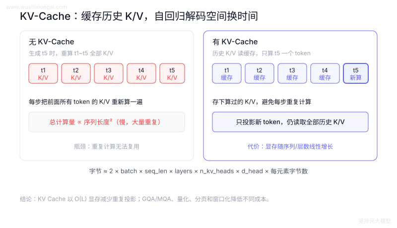
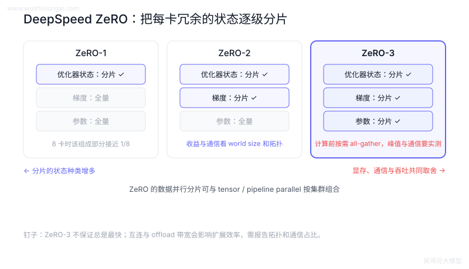
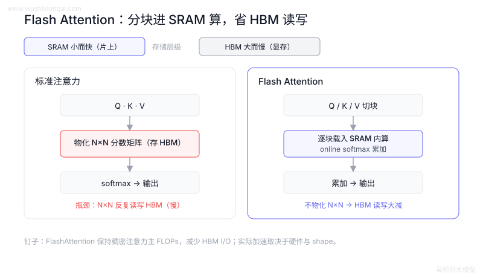
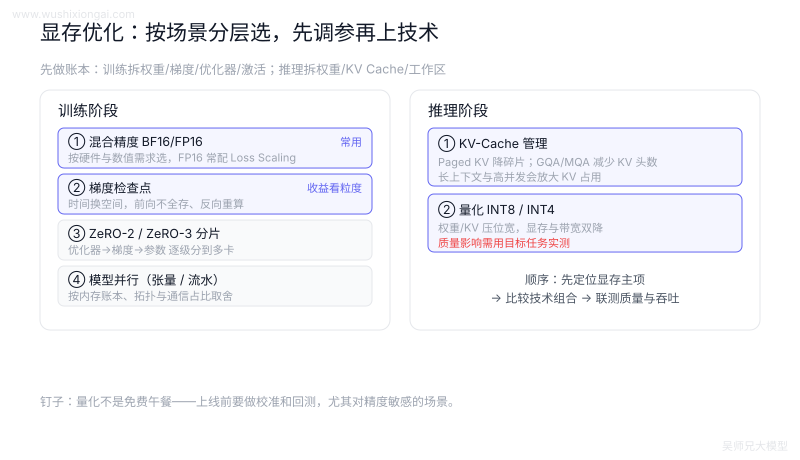
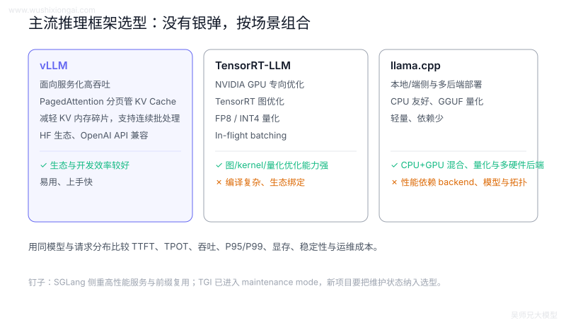
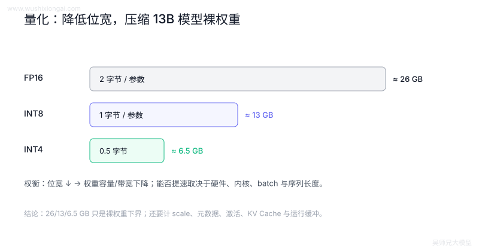
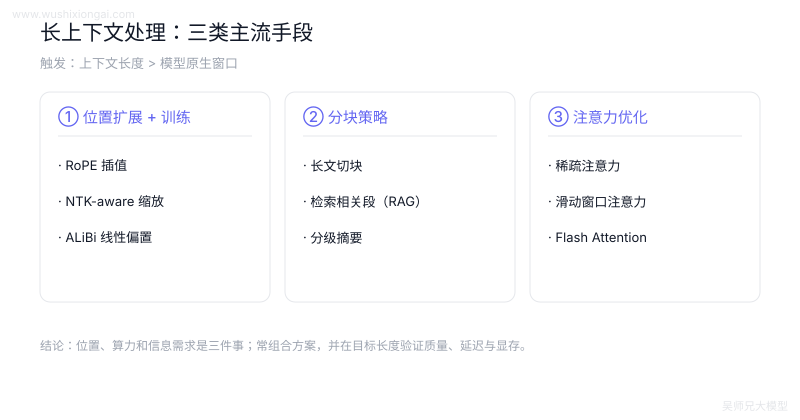

# 推理优化 · 逐题深度详解（7 题）

> 本文件是 [`inference-optimization.md`](inference-optimization.md) 的逐题深度详解。每题先**原样保留**原模块的题干、图解、30 秒回答与参考资料（原模块文件只读未改），随后追加五段式详解：**【原题速答】→【考察意图】→【深度解析】→【追问链纵深】→【串联与资料】**。
>
> 生成日期 2026-11-13。原文答案若有过时或含混处，在详解中以「⚠️ 纠正」或「📌 2025-11 口径补充」标注并给出修正口径，不改动原文。详解内不新增外链，论文以 arXiv 编号指代。

---

### 01. KV-Cache 空间复杂度怎么算?

> **30 秒回答：** KV Cache 保存各层历史 K/V，空间随批次、序列长度、层数和 KV 头数线性增长，可用 GQA/MQA、量化、分页或窗口化降低不同成本。
>
> **继续追问：** 可继续讨论连续批处理、前缀缓存和块大小对吞吐的影响。

**复核：** 2026-07-19 · **来源等级：** B · 附可核验资料

**参考资料：**
- [Llama 2: Open Foundation and Fine-Tuned Chat Models](<https://arxiv.org/abs/2307.09288>)
- [Efficient Memory Management for Large Language Model Serving with PagedAttention](<https://arxiv.org/abs/2309.06180>)

[在官网查看「KV-Cache 空间复杂度怎么算?」的完整答案、口语讲法与连续追问](https://www.wushixiongai.com/q/arch-kv-cache-space-complexity?utm_source=github&utm_medium=referral&utm_campaign=interview_100&utm_content=question-arch-kv-cache-q0051)

### 详解

**【原题速答】** KV Cache 逐层缓存历史 token 的 K/V，显存随「批次 × 序列长度 × 层数 × KV 头数 × 每头维度 × 字节宽」各因子线性增长；工程上用 GQA/MQA/MLA 压头数、量化压字节、分页压碎片浪费、窗口化压长度，按瓶颈选组合。

**【考察意图】**
- 公式层：能否写出单 token·单层、单序列、全批三个粒度的 KV 字节公式，并说清每个因子为什么不可省（而不是背一个模糊的 "2·L·S·h"）。
- 计算层：能否代入真实模型的层数/头数/d_head/dtype 逐层展开出 GB 级数字，并意识到"线性"在长上下文服务里的乘法效应。
- 工程层：能否区分三种瓶颈（显存总量 vs 解码读带宽 vs 碎片浪费）并映射到正确手段；对 PagedAttention 的分页/写时复制机制是否有机制级理解。
- 引申层：decode 为什么被"读一遍 KV"卡住——这决定了 continuous batching、KV 量化等优化的收益上限。

**【深度解析】**

1. **公式与逐层来源。** 因果模型每处理一个 token，每层各追加一份本层 K_t、V_t（形状 H_kv × d_head）；Q 不入库（当步用完即弃）。故：

$$ \text{KV}_{bytes} = \underbrace{2}_{K,V} \times B \times S \times L \times H_{kv} \times d_{head} \times n_{bytes} $$

因子来源逐项核对：2（K、V 各一份）；B（请求间不共享，除非前缀缓存）；S（因果模型不回看未来，每 token 只追加）；L（每层注意力表示独立）；H_kv（GQA/MQA 下远小于 Q 头数）；d_head；n_bytes（fp16=2、int8=1、2bit≈0.25+组开销）。

2. **逐模型代入（全部可复算）。**

| 模型 | L | H_kv | d_head | dtype | 每 token·每层 | 每 token·全层 | 4k 序列（B=1） |
|---|---|---|---|---|---|---|---|
| Llama-2-7B（MHA） | 32 | 32 | 128 | fp16 | 2×32×128×2 = 16 KB | 512 KB | 2 GiB |
| Llama-3-8B（GQA） | 32 | 8 | 128 | fp16 | 2×8×128×2 = 4 KB | 128 KB | 512 MiB |
| Llama-2-13B（MHA） | 40 | 40 | 128 | fp16 | 2×40×128×2 = 20 KB | 800 KB | ≈3.1 GiB |
| Llama-3-70B（GQA） | 80 | 8 | 128 | fp16 | 4 KB | 320 KB | 1.25 GiB |

- Llama-3-70B 若仍是 MHA（H=64）则每 token 2.5 MB、4k 序列 10 GiB——GQA 压掉整 8×；这是 Llama 2 论文 70B 起启用 GQA 的直接动因。
- 长上下文的乘法效应：Llama-3-8B 在 128k 上下文的单序列 KV = 128 KB × 128k ≈ 16 GiB，已与其 fp16 权重（16 GB）相当——07 题"装不下"由此而来。

3. **decode 带宽视角（KV 决定吞吐上限）。** decode 每步是 GEMV，须把全部权重与全部活跃 KV 各读一遍，步时下界：

$$ t_{step} \ge \frac{W_{read} + \sum_{i \in batch} KV_i}{BW_{HBM}} $$

算例：Llama-3-70B、TP8、H100-80（BW≈3.35 TB/s）：每卡读权重 140/8 = 17.5 GB；B=64、S=4k 时每卡 KV 切片 64 × (1.25 GiB/8) = 10 GiB；t_step ≥ 27.5 GB ÷ 3.35e3 GB/s ≈ 8.2 ms → 约 120 步/s，聚合 ≈ 64 × 120 ≈ 7700 tok/s（实测再乘 0.6–0.7 折扣）。权重读被批摊薄、KV 随批线性涨——这就是"批越大先加速、后撞 KV 带宽墙"的定量解释。

4. **减存手段的作用维度与代价。**

| 手段 | 压缩维度 | 收益 | 代价 |
|---|---|---|---|
| GQA / MQA | H_kv 头数 | H_q/H_kv 倍（GQA-8 → 8×；MQA → 数十×） | 需训练期架构改造（已有模型可蒸馏适配） |
| MLA（DeepSeek-V2/V3） | KV 压入低维 latent | 同规模 MHA 配置算术约 1/56（论文摘要口径：较 DeepSeek-67B MHA 基线减少 93.3%≈15×，两者基线不同） | 需专用训练与内核（latent 不可直接与标准注意力互换） |
| KV 量化（KIVI 2bit / FP8） | n_bytes | ÷4~÷8 | 需按通道处理离群值防精度塌方 |
| PagedAttention 分页 | 碎片/预留浪费 | 浪费 60–80% → <4% | 块表间接寻址的微小内核开销 |
| 滑窗/局部注意力 | S | KV 有界 | 牺牲远距依赖，需全局 token/分层补偿 |
| 前缀缓存 | 重复前缀的重复计算与存储 | TTFT 直降 | 常驻显存的容量税 |

5. **vLLM PagedAttention 机制（本模块最高频考点）。**
- 显存组织：按层分区的物理块池（默认块 16 token）；逻辑序列 = 块表（block table）串联，逻辑连续、物理不连续。
- 收益来源：旧系统须按 max_seq_len 预分配连续段（实测浪费 60–80%）；分页后只剩每序列末块空位（≤15/16 个 token）与块表开销 → 论文实测浪费 <4%。
- 共享与写时复制：并行采样/beam search/前缀缓存间的公共块以 ref_count 共享，append 触发分叉时复制新物理块。
- 调度联动：以"剩余可分配块数"决定准入与抢占（抢占回收块、必要时重算），与 continuous batching 天然契合；论文结论为吞吐较 FasterTransformer/Orca 提升 2–4×。

**【追问链纵深】**
- 追问 1（continuous batching 为什么必须配分页）：静态批等齐整批、按最大长度预留显存；continuous batching 以迭代为调度粒度、序列随时进出——若 KV 连续预分配，进出要 memmove 或产生外部碎片；分页把分配/释放降为 O(块表) 操作。
- 追问 2（前缀缓存怎么赚钱、怎么亏钱）：多轮对话/系统提示词命中前缀则免 prefill 且复用 KV，TTFT 与算力双省；但长前缀常驻挤占 decode 批容量，需按命中率做 LRU/LFU 淘汰，并能在抢占时精确回收共享块。
- 追问 3（块大小取舍）：块越小浪费率越低，但页表更深、内核访存越碎；块越大反之。16 token 是 vLLM 的工程折中；极端 block=1 浪费率最优、访存局部性最差——面试可顺势答出这条杠杆曲线。
- 追问 4（预算题）：8×A100-80 跑 Llama-3-70B fp16（TP8、4k 上下文）：每卡 17.5 GB 权重 + 约 10 GB 预留（workspace/激活/CUDA ctx）→ KV 预算 ≈52 GB；每序列每卡 KV 0.156 GiB → 显存上限 ≈330 并发；但 decode 带宽与 prefill 算力会把稳定并发压到约 100–200。结论：显存上限只是必要条件，SLO 命中率才是充分条件。

**【串联与资料】**
- 串联：本公式是 04 题（显存总账）、05 题（基准中的 KV 项）、06 题（KIVI）、07 题（长上下文 KV 预算与 Ring 分摊）的公共底座；GQA/MQA/MLA 的结构层归 model-architecture 模块；多轮会话的前缀缓存收益与 agent 模块相通。
- 论文一句话：Llama 2（arXiv:2307.09288）——70B 启用 GQA，在质量基本无损下大幅降低解码延迟与 KV 显存；PagedAttention/vLLM（arXiv:2309.06180）——把 KV 当"页"管理、写时复制支持共享、配合连续批处理，显存浪费从 60–80% 降到 <4%，吞吐提升 2–4×。

---

### 02. DeepSpeed 核心特性与架构怎么用?

> **30 秒回答：** DeepSpeed通过ZeRO、混合精度、检查点和多维并行扩展训练，收益取决于模型、集群和通信瓶颈。
>
> **继续追问：** ZeRO-3 all-gather 峰值、offload 瓶颈和分片 checkpoint 如何跨拓扑迁移。

**复核：** 2026-07-19 · **来源等级：** B · 附可核验资料

**参考资料：**
- [ZeRO: Memory Optimizations Toward Training Trillion Parameter Models](<https://arxiv.org/abs/1910.02054>)
- [DeepSpeed ZeRO official documentation](<https://deepspeed.readthedocs.io/en/latest/zero3.html>)
- [DeepSpeed Model Checkpointing official documentation](<https://deepspeed.readthedocs.io/en/latest/model-checkpointing.html>)

[在官网查看「DeepSpeed 核心特性与架构怎么用?」的完整答案、口语讲法与连续追问](https://www.wushixiongai.com/q/infra-deepspeed-framework?utm_source=github&utm_medium=referral&utm_campaign=interview_100&utm_content=question-sys-deepspeed-q0110)

### 详解

**【原题速答】** DeepSpeed 用 ZeRO（按阶段切分优化器状态/梯度/参数）、混合精度、激活检查点与多维并行（DP/TP/PP/EP）把训练从单卡扩展到百亿~千亿规模；收益取决于模型、集群与通信瓶颈；推理侧另有 DeepSpeed-Inference / ZeRO-Inference。

**【考察意图】**
- 能否把"混合精度训练每参数 16 字节"写全（参数/梯度/优化器状态各占多少）——这是一切显存讨论的原子单位。
- 能否给出 ZeRO-1/2/3 的每卡显存公式与通信量代价（1.5×/2× 的定量出处），而不是笼统说"省显存"。
- 是否理解 offload 真正的瓶颈在 PCIe/CPU 带宽，而非"显存不够就 offload"。
- （加分）主动指出本题虽在"推理优化"模块、DeepSpeed 主体是训练框架，推理是衍生能力——先澄清再作答是资深信号。

**【深度解析】**

1. **显存基线（AdamW + bf16 计算）**。每参数字节：bf16 参数 2 + bf16 梯度 2 + fp32 主参 4 + fp32 动量 m₁ 4 + fp32 二阶矩 m₂ 4 = **16 字节/参数**，即基线 16Ψ 字节；7B 模型仅状态就 112 GB，一张卡装不下。

2. **ZeRO 三级：每卡显存与通信（按 ZeRO 论文的"元素迁移量"口径）。** Ψ = 参数量，N = 数据并行卡数：

| 阶段 | 切分对象 | 每卡显存 | 每步通信（元素量） |
|---|---|---|---|
| DDP 基线 | 无 | 16Ψ | 2Ψ（梯度 all-reduce = reduce-scatter Ψ + all-gather Ψ） |
| ZeRO-1 | 优化器状态 | 4Ψ + 12Ψ/N | 2Ψ（reduce-scatter 梯度 Ψ + 广播更新后参数分片 Ψ） |
| ZeRO-2 | + 梯度 | 2Ψ + 14Ψ/N | 2Ψ（与基线相同） |
| ZeRO-3 | + 参数 | 16Ψ/N（+ 常数级缓冲） | 3Ψ = 基线的 1.5× |

ZeRO-3 的 1.5× 推导：前向逐层 all-gather 参数（Ψ）+ 反向重新 all-gather（Ψ，参数用后即弃）+ 梯度 reduce-scatter（Ψ）合计 3Ψ，基线只有 2Ψ。靠分层预取与计算重叠掩盖；ZeRO++ 再用量化/分层聚合压这部分开销。
（⚠️ 纠正：常见"Cheap 口径"说 ZeRO-3 通信 3×/6Ψ，是把字节与元素两套口径混用的重复计数；按 ZeRO 论文原口径是 1.5×。）

3. **多维并行通信量对比（重点）。**

| 并行 | 通信内容 | 每 step 频次 | 约束 |
|---|---|---|---|
| TP（Megatron 式切头） | 每层前向 2 次 all-reduce（attention 输出投影 + MLP 下投影），反向再 2 次；单次 ≈2·b·s·h 元素 | 4 次/层 | 与计算强耦合、难掩盖 → 限节点内 NVLink，通常 ≤8 |
| PP | 每微批在每个阶段边界收发激活（前向）与梯度（反向），2·b·s·h | 仅 P-1 个边界，量小 | 气泡率 (P−1)/(M+P−1)：P=8、M=32 → ≈18% |
| EP（MoE） | 每 MoE 层两次 all-to-all（dispatch/combine），载荷 ≈ top_k·h/token | 2 次/层 | 专家负载不均 + all-to-all 对互联带宽极敏感 |
| ZeRO（DP 维） | 见上表 | 1 轮 | 可被计算/预取掩盖 |

选型法则：节点内 TP≤8 → 跨节点以 PP/ZeRO-3 为主 → MoE 用 EP+TP/DP 混合；"跨节点加 TP 不如加 PP/数据并行"在 IB 互联上几乎总成立。

4. **端到端算例（7B，4×A100-40GB）。** 基线 16Ψ = 112 GB（单卡不可行）：
- ZeRO-2：2Ψ + 14Ψ/4 = 14 + 24.5 = 38.5 GB/卡；激活（b=2、s=2048、开 FlashAttention、不重算）≈ 34·b·s·h·L ≈ 18 GB → 合计 56.5 GB，超 40 GB 卡 → 仍需激活重算或减微批；
- ZeRO-3：16Ψ/4 = 28 GB/卡 + 全重算激活 ≈1 GB → ≈29 GB，可行。
- 结论链：优化器状态解决后第二个瓶颈是激活——自然引出重算/offload（04 题）。

5. **offload 的真实瓶颈。** ZeRO-Offload 把 fp32 状态留在 CPU、在 CPU 上执行 Adam：每步经 PCIe（Gen4 x16 理论 ~64 GB/s，实测 ~25–35 GB/s）搬运约 4–6 GB（fp16 梯度下行 + 更新所需往返），仅 PCIe 就贡献 ~0.3–0.6 s/step，叠加 CPU 侧 Adam 本身是 memory-bound 计算 → offload 是"能训"而非"训快"的手段；ZeRO-Infinity 把冷状态继续分级到 NVMe。

6. **📌 2025-11 口径补充。** DeepSpeed 仍是特性最全的开源训练引擎之一，但训练入口日趋多元：PyTorch 原生 FSDP（ZeRO-3 同路线）与 Megatron-LM 在新项目中选择率明显更高；DeepSpeed 的差异化在 offload 体系、1-bit/低秩压缩通信、sharded/universal checkpoint 与 RLHF 工程（DeepSpeedChat）。推理侧的 DeepSpeed-Inference（张量并行内核 + 权重 offload）热度已被 vLLM/SGLang/TRT-LLM 明显挤压——"什么场景仍选 DeepSpeed"是标准追问。

**【追问链纵深】**
- 追问 1（ZeRO-3 前向峰值由什么构成）：峰值 ≈ 16Ψ/N 的分片常驻 + 当前层 all-gather 后的完整层参数 + 通信缓冲 + 激活；可用 stage3 参数驻留阈值/预取窗口控制"多驻留换少通信"或反之。
- 追问 2（offload 后 CPU 成了瓶颈怎么办）：CPU Adam 本身 memory-bound（7B 每步 ~10Ψ 量级访存，双通道 DDR ~100 GB/s）→ 依赖融合内核与 SIMD；再往上走 ZeRO-Infinity（NVMe 分级）或直接加卡/开重算，而不是硬 offload。
- 追问 3（分片 checkpoint 怎么跨拓扑迁移）：universal checkpoint 存"分片 + 描述拓扑的元数据"，加载时按新的 (dp, tp, pp) 布局重切后续训；本质是把"分片 ↔ 全局张量"的映射与布局解耦——跨机房/换硬件续训的基础。
- 追问 4（ZeRO-3 与 TP 如何正确叠加）：同一层内先做 TP 的 all-reduce，再由 ZeRO-3 管理层参数分片，二者由同一 engine 编排；窗口/驻留阈值配错会出现双份通信或参数不一致——需能说出 all-gather 窗口与参数驻留阈值两个旋钮。

**【串联与资料】**
- 串联：ZeRO 显存表直接复用进 04 题（显存优化对比）；训练并行全景与 model-training 模块互为表里；QLoRA（fine-tuning 模块）是"冻结底座 + LoRA"对 ZeRO 的显存替代路线；RLHF（rlhf-alignment 模块）中 actor/critic/ref/reward 四模型共驻显存的工程前提正是 ZeRO 与检查点；推理落地方向衔接 05 题。
- 论文一句话：ZeRO（arXiv:1910.02054）——按 PoSD 依次切分优化器状态/梯度/参数，单卡显存近线性下降、通信最多 +50%（ZeRO-3），把训练可行规模推过 100B；DeepSpeed ZeRO-3 官方文档——层 all-gather/预取/分片 checkpoint 的工程细节；DeepSpeed checkpointing 官方文档——分片 + 元数据使训练状态可在不同并行拓扑间迁移。

---

### 03. Flash Attention 原理怎么理解?

> **30 秒回答：** FlashAttention 分块计算 Q、K、V 并用在线 softmax 累积，不物化完整注意力矩阵，从而减少 HBM I/O。
>
> **继续追问：** 怎样为不同 head dimension 和序列长度选择分块，并公平测量 prefill 与 decode 收益？

**复核：** 2026-07-19 · **来源等级：** B · 附可核验资料

**参考资料：**
- [FlashAttention: Fast and Memory-Efficient Exact Attention with IO-Awareness](<https://arxiv.org/abs/2205.14135>)
- [The I/O Complexity of Attention, or How Optimal is FlashAttention?](<https://arxiv.org/abs/2402.07443>)

[在官网查看「Flash Attention 原理怎么理解?」的完整答案、口语讲法与连续追问](https://www.wushixiongai.com/q/arch-flash-attention-io-optimization?utm_source=github&utm_medium=referral&utm_campaign=interview_100&utm_content=question-sys-flash-attn-q0002)

### 详解

**【原题速答】** FlashAttention 把 Q/K/V 分块装入 SRAM，用"运行最大值 m + 行和 l"的在线 softmax 流式累积输出，全程不向 HBM 物化 N×N 注意力矩阵——注意力严格精确（exact），HBM 访存从 O(N²) 降到 O(N²d²/M)（M 为 SRAM 大小）。

**【考察意图】**
- 分清"省的是 IO 不是 FLOPs"：计算量 O(N²d) 不变，快在显存往返减少。
- 在线 softmax 的数学等价：能否写出 m/l 的更新式，并证明分块结果与全局 softmax 完全一致。
- 会选块：给定 SRAM 大小与 head_dim，能估出块大小的解析上界再谈工程微调。
- 知道 FA2/FA3 的演进点，以及 prefill/decode 收益必须分开公平测量（原文追问方向）。

**【深度解析】**

1. **问题定位：标准注意力是 IO-bound。** 朴素实现把 S=QKᵀ 与 P=softmax(S) 两个 N×N 矩阵写入 HBM 再读回。以 N=1024、d=64 计：一次前向 S/P 的读写流量 ≈ 4N²×2B ≈ 8.4 MB，而计算 4N²d ≈ 2.7e8 FLOPs 在 A100 上 <1 µs——搬运时间约为计算的 4~5 倍；N=4096、d=128 时 S/P 流量 ≈134 MB vs 计算 8.6e9 FLOPs ≈ 27.5 µs，IO（≈66 µs）仍占大头。

2. **三层解法。**
- 分块：Q 按 B_r 行块、K/V 按 B_c 列块进入 SRAM；输出 O 与 softmax 统计量驻留寄存器/SRAM。
- 在线 softmax（等价性推导）：全行 softmax 需要 m* = rowmax、l* = Σexp(s−m*)、O* = Σexp(s−m*)v / l*。分块流式时逐块更新：

$$ m \leftarrow \max(m_{old},\ \text{blockmax}), \qquad l \leftarrow e^{m_{old}-m} l_{old} + \sum_{j \in block} e^{s_j - m} $$

$$ u \leftarrow e^{m_{old}-m} u_{old} + \sum_{j \in block} e^{s_j - m} v_j, \qquad O = u / l $$

正确性：缩放因子 e^{m_old−m} 保留旧累计值相对新最大值的比例，逐块展开即回到全局和（对两块归纳即可）；所有 exp 参数 ≤0，数值稳定。
- 数值对账（小例）：s=[1,2,3,4] 分 [1,2]｜[3,4] 两块：精确 m*=4、l* = e⁻³+e⁻²+e⁻¹+1 = 1.5530；分块 m₁=2、l₁ = e⁻¹+1 = 1.3679，合并 l = e^(2−4)·1.3679 + (e⁻¹+1) = 0.1851+1.3679 = 1.5530 逐位一致（u/O 的每个 head_dim 通道同理）。
- 复杂度：计算 O(N²d)（不减）；HBM 访存 O(N²d²/M + Nd)；显存 O(N) 而非 O(N²)。反向用保存的 m/l 重算局部 P，同样不存大矩阵；dropout 用 philox 计数器按块跳序生成确定性随机流。

3. **分块怎么选（原文追问预答）。** 约束：Q 块 + K 块 + O 块 + softmax 状态都要驻留 SRAM。论文给出解析上界 B_c ≈ ⌈M/4d⌉、B_r ≈ min(⌈M/4d⌉, d)。M = 192 KB（A100 SRAM）、d = 128 → 上界 ≈384；工程上还要权衡寄存器与 occupancy，通常取 64–256。d 变大则上界变小（d=256 时减半）；序列增长时块尺寸固定，IO 收益随 N² 近平方放大。

4. **FA2/FA3 演进（📌 2025-11 口径补充：原文只述 FA1）。** FA2（2023）：把并行度扩展到序列维（修掉"batch/头数少时打不满 SM"）、减少非 matmul FLOPs 占比、调整内核块序；FA3（2024）：Hopper 上用 WGMMA/TMA 异步流水、把 softmax 与 GEMM 重叠执行，官方报告内核较 FA2 快约 1.5–2×。decode（N_q=1）另有专用形态：FlashDecoding 沿 KV 序列维切分、并行计算部分 softmax 再合并。

5. **prefill 与 decode 收益的公平测量（原文追问预答）。**
- prefill（大 N）：FA 平方级 IO 收益完整兑现，TTFT 直接受益。
- decode（N_q=1）：注意力退化为"一查全"的薄 GEMV，瓶颈换成 KV 全量读带宽（01 题视角），FA 分块的收益有限——必须用 TPOT 单独衡量。
- 方法：内核级（同形状/同 dtype/同后端，报 TFLOPS 与 GB/s）+ 端到端（TTFT 与 TPOT 分开报）双轨；同时对齐框架调度差异（continuous batching、CUDA graph），否则收益归因是错的。

**【追问链纵深】**
- 追问 1（不存注意力矩阵，反向怎么办）：反向用保存的 m/l 重算 P，配合 dropout 的确定性随机流；精度与标准实现等价——"exact" 是核心卖点，不是近似方法。
- 追问 2（GQA 给内核带来的红利）：KV 头少 → K/V 块一次驻留可被多个 Q 头复用，KV 重复读更少；FA2 起原生支持 GQA packing。
- 追问 3（与长上下文的嵌套关系）：块内分块（SRAM 级）+ 序列分块（设备级，Ring Attention，见 07 题）是同一思想的两级嵌套；FlashAttention 首次让 16k 序列训练在单机上落地。
- 追问 4（为什么 decode 时 KV 量化比 FA 更"值"）：decode 的 IO 预算被"读 KV"独占，把 n_bytes 除以 4 是乘法级收益；FA 在该阶段只能省内核开销——解释了长上下文服务里"KIVI/FP8 KV 往往比 flash 微变体更关键"。

**【串联与资料】**
- 串联：04 题中"注意力激活从 O(N²) 降到 O(N)"的来源在这；05 题各框架默认内核都是 FA 系；07 题 Ring Attention 是其多卡延伸；model-architecture 模块的注意力变体（GQA/MLA、稀疏注意力）决定 FA 内核形态。
- 论文一句话：FlashAttention（arXiv:2205.14135）——IO 感知分块 + 在线 softmax 在严格等价前提下把 HBM 访存降到 O(N²d²/M)、显存降到 O(N)，实测 BERT-large 训练提速约 15%、GPT-2（1k 序列）3×、长序列场景 2.4×，并使 16k 序列训练成为可能；I/O 复杂度论文（arXiv:2402.07443）——证明 FlashAttention 的 Θ(N²d²/M) I/O 复杂度在同类精确注意力中最优：只要注意力得分平均 gap > log N，Ω(N²) 级读入不可避免。

---

### 04. 显存优化技术原理与对比

> **30 秒回答：** 大模型显存由参数、梯度、优化器状态、激活与临时缓冲共同构成，优化需按实测瓶颈选择。
>
> **继续追问：** 某一配置下参数、Adam 状态、激活或 KV Cache 的字节数如何估算。

**复核：** 2026-07-19 · **来源等级：** B · 附可核验资料

**参考资料：**
- [Training Deep Nets with Sublinear Memory Cost](<https://arxiv.org/abs/1604.06174>)
- [ZeRO: Memory Optimizations Toward Training Trillion Parameter Models](<https://arxiv.org/abs/1910.02054>)
- [FlashAttention: Fast and Memory-Efficient Exact Attention with IO-Awareness](<https://arxiv.org/abs/2205.14135>)
- [PyTorch Automatic Mixed Precision official documentation](<https://docs.pytorch.org/docs/stable/amp.html>)

[在官网查看「显存优化技术原理与对比」的完整答案、口语讲法与连续追问](https://www.wushixiongai.com/q/infra-gpu-memory-optimization?utm_source=github&utm_medium=referral&utm_campaign=interview_100&utm_content=question-sys-memory-opt-q0053)

### 详解

**【原题速答】** 训练显存 = 16Ψ（混合精度参数+梯度+Adam 状态）+ 激活 + 临时缓冲/碎片；推理显存 = 权重 + KV Cache + workspace。没有万能技术——先测出占比最大的分量，再选"切分（ZeRO）/重算（检查点）/外卸（offload）/量化（权重与 KV）/分页（碎片）"，各管一摊再组合。

**【考察意图】**
- 能否脱口而出各分量公式：训练基线 16Ψ、激活不重算 ≈34·b·s·h·L、全重算 ≈2·b·s·h·L、KV 公式（01 题）。
- 对一个具体"模型×卡"能否现场算字节数并给出可行组合（而不是报一句"上 QLoRA"）。
- 是否区分峰值显存 vs 驻留显存；是否知道每项技术作用的分量与代价——这是"名词罗列型"与"瓶颈驱动型"回答的分水岭。

**【深度解析】**

1. **训练侧解剖（AdamW + bf16，Ψ=参数量）。**

| 项 | 公式 | 7B 模型 |
|---|---|---|
| bf16 参数 | 2Ψ | 14 GB |
| bf16 梯度 | 2Ψ | 14 GB |
| fp32 主参 + Adam m,v | 12Ψ | 84 GB |
| 状态小计 | 16Ψ | 112 GB |
| 激活（不重算，开 FA） | ≈ 34·b·s·h·L | b=1、s=8k、h=4096、L=32 → ≈36.5 GB |
| 激活（全重算） | ≈ 2·b·s·h·L | ≈2.1 GB |

常用中间档：每 √L 层放一个检查点 → 激活显存降到 O(√L) 级、额外前向 ≈ +33%（Sublinear Memory 论文）。"34"这一系数是逐张量清点 LN/qkv/O/MLP/RoPE 缓冲后的工程近似，不必逐项背，但"每 token 每层 ≈34·h 字节"要能复述。

2. **推理侧解剖。** 权重 2Ψ / Ψ / 0.5Ψ（fp16/int8/int4，06 题展开）+ KV（01 题公式）+ workspace（框架临时缓冲，1–2 GB 级）+ CUDA context（~0.5–1 GB）。
- 分叉判断：短上下文小并发 → 权重主导 → 量化权重收益最大；长上下文大并发 → KV 主导 → GQA/MLA/分页/KV 量化收益最大。这是"按实测瓶颈选技术"最典型的两分法。

3. **技术—对象—收益—代价全景表。**

| 技术 | 作用分量 | 收益 | 代价 | 场景 |
|---|---|---|---|---|
| 混合精度（AMP/bf16） | 计算域（全部状态） | 16Ψ 基线成立的前提 | fp16 需动态 loss scale，bf16 近乎免 | 训练 |
| ZeRO-1/2/3 | 优化器/梯度/参数 | 02 题表 | ZeRO-3 通信 ×1.5 | 训练 |
| 激活检查点 | 激活 | O(L) → O(√L) | 额外前向 ≈ +33% | 训练 |
| CPU/NVMe offload | 一切状态 | GPU 显存释放接近归零 | PCIe/NVMe 带宽瓶颈（02 题） | 训练 |
| 权重量化（GPTQ/AWQ/FP8） | 权重 | ÷2~÷4 | 精度取决于路线；W4A16 不加速 prefill | 推理（QLoRA → 训练侧） |
| KV 量化（KIVI/FP8） | KV | ÷2~÷8 | 需按通道校准防 outlier | 推理 |
| PagedAttention | KV 碎片 | 浪费 60–80% → <4% | 页表开销微小 | 推理 |
| FlashAttention | 注意力激活 | O(N²) → O(N) | 内嵌重算 | 训练+推理 |
| GQA/MLA | KV 头数/形状 | 8× / 远超 8× | 架构改造 | 训练+推理 |

4. **预算算例（原文追问：字节数如何估）。** 配置"Llama-3-8B、A100-40、bf16+AdamW+ZeRO-2、b=1、s=4096、8 卡"：
- 单卡基线 16Ψ = 128 GB → 必须多卡；N=8 时 ZeRO-2 = 2Ψ+14Ψ/8 = 16+14 = 30 GB/卡；
- 激活不重算 = 34·b·s·h·L = 34×4096×4096×32 ≈ 18.3 GB，超出 40 GB 卡的剩余额度 → 开 √L 检查点后约 2–4 GB → 34 GB 勉强可行；
- 结论：这条配置的现实路径 = ZeRO-2/3 + √ 重算 + 梯度累积。注意梯度累积只压"激活峰值"、不压优化器状态——常见误区。

5. **推理侧隐藏大头（进阶显账）。** 全批全长 logits 若被物化：B×S×V×4B，取 B=64、S=4096、V=128256 → 64×4096×128256×4 ≈ 134.5 GB。成熟框架只保留最后位置或分块计算 lm_head——这类"被忽略的 ×V 张量"是推理显存审计最常漏的项。

**【追问链纵深】**
- 追问 1（能否干脆去掉 fp32 主参）：纯低精度更新有"累加误差/权重停在半路"的风险；主参保护的是更新精度。工程上宁可 ZeRO-3 切分也不删主参。
- 追问 2（显存碎片从哪来）：激活请求尺寸参差 + caching allocator 的块粒度 → "看着有空闲却 OOM"；缓解：expandable_segments、稳定 batch 形状、paged optimizer。
- 追问 3（检查点与分布式 hook 的配合）：重算区段要包住完整层块（含各自 norm 的 attn+MLP），在 all-reduce/自定义 hook 边界处切分会漏算或算重——工程惯例"整层一个检查点"。
- 追问 4（采样阶段 logits 的正确省法）：只算最后位置、限制 logprobs/top-k 返回、分块计算 lm_head；启用投机解码时还要预留 draft 侧 KV 的显存账——按"每步实际驻留"清点而不是按"理论权重+KV"清点。

**【串联与资料】**
- 串联：01（KV 公式）、02（ZeRO 全解）、05（推理选型的显存审计）、06（量化路线）分别是本表四行技术的展开；训练显存与并行在 model-training 模块更系统；QLoRA 细节在 fine-tuning 模块；RLHF 多模型共驻的显存放大见 rlhf-alignment 模块。
- 论文一句话：Sublinear Memory（arXiv:1604.06174）——√N 粒度的梯度检查点把激活显存降到 O(√N) 且计算只 +33%，是 activation checkpointing 的数学原型；ZeRO（arXiv:1910.02054）——依次切分优化器状态/梯度/参数，较基线最多省 8×，让 100B+ 训练成为可能；FlashAttention（arXiv:2205.14135）——注意力激活从 O(N²) 降到 O(N)；PyTorch AMP 文档——autocast + 动态 loss scaling 是混合精度的标准工程件。

---

### 05. LLM 推理框架综合选型

> **30 秒回答：** 推理框架应按模型兼容、硬件、吞吐、尾延迟、量化、并行和运维成熟度在目标负载上选择。
>
> **继续追问：** 可继续设计固定模型与请求分布的 TTFT、TPOT、吞吐、显存和稳定性基准。

**复核：** 2026-07-19 · **来源等级：** B · 附可核验资料

**参考资料：**
- [vLLM GPU Installation and Supported Hardware](<https://docs.vllm.ai/en/stable/getting_started/installation/gpu/>)
- [TensorRT-LLM Build Workflow](<https://nvidia.github.io/TensorRT-LLM/architecture/workflow.html>)
- [llama.cpp Official Repository](<https://github.com/ggml-org/llama.cpp>)
- [Text Generation Inference Documentation](<https://huggingface.co/docs/text-generation-inference/index>)

[在官网查看「LLM 推理框架综合选型」的完整答案、口语讲法与连续追问](https://www.wushixiongai.com/q/infra-inference-frameworks-overview?utm_source=github&utm_medium=referral&utm_campaign=interview_100&utm_content=question-sys-q0233)

### 详解

**【原题速答】** 选框架本质是给六维打分——模型结构兼容性 × 硬件支撑 × TTFT/TPOT 尾延迟 × 吞吐 × 量化与并行支持 × 运维成本；先用核心负载画像（短 prompt 长输出=decode 重，长输入=prefill 重）定序，再对候选做同口径基准。

**【考察意图】**
- 是否有一手压测经验：vLLM/SGLang/TRT-LLM/llama.cpp 的真实差异边界（而非纸面罗列）。
- 是否会用 TTFT/TPOT/goodput/SLO 这套服务语言描述需求，而不是只说 QPS。
- 能否解耦 prefill（算力瓶颈）与 decode（带宽瓶颈）给优化技术归类，并现场做吞吐估算。

**【深度解析】**

1. **两阶段瓶颈与优化映射（本模块主要分析工具）。**

| 阶段 | 计算形态 | 瓶颈 | 代表优化 |
|---|---|---|---|
| prefill | 大 GEMM（token 间并行） | 算力 | FlashAttention、chunked prefill（防长 prompt 阻塞/挤死 decode）、前缀缓存、W8A8/FP8/W4A8 |
| decode | GEMV（token 间依赖链） | HBM 读带宽（权重 + KV 每步各读一遍） | continuous batching、KV 分页+量化、CUDA graph、GQA/MLA、投机解码/MTP |
| 两者共同 | 显存总量 | 容量 | 权重/KV 量化、分页、长上下文稀疏与 Ring（07 题） |

2. **投机解码的分布一致性（超出原文 7 题字面但属于本模块高频追考，纳入详解）。** 目标分布 p、草稿分布 q；草稿模型自回归提出 γ 个候选，目标模型一次前向对 γ+1 个位置并行打分。对草稿 token x：q(x) < p(x) 必接受（贡献质量 q(x)）；q(x) ≥ p(x) 以 p(x)/q(x) 概率接受（贡献质量 p(x)）；拒绝时从残差分布 r ∝ (p−q)₊ 重采样。关键恒等式：Σ(p−q)₊ = 1 − Σ min(p,q)——残差总量恰好等于"未接受概率"，三个分支相加后每 token 边际分布精确等于 p → 无损。期望每步产出 E[k] = (1−α^(γ+1))/(1−α)（α 为单 token 接受率）：α=0.8、γ=4 → (1−0.8⁵)/0.2 ≈ 3.36 token/步，扣除验证开销后典型 2–3× 加速。严格性要点：逐 token 边际分布 = p（采样路径）；greedy 路径用确定性等价规则同样无损；EAGLE/MTP（多 token 预测头）沿用同一验证层，一致性论证不变。

3. **服务吞吐/QPS 估算算例（重点，量纲要完整）。** Llama-3-8B fp16 单卡 A100-80（BW≈2 TB/s、bf16 峰值 312 TFLOPS、MFU 取 0.5），输入 4096 + 输出 256，TPOT 目标 ≤50 ms：
- prefill（compute-bound）：每 token ≈ 2Ψ = 1.6e10 FLOPs；4096 token → 6.55e13 FLOPs；÷1.56e14 → TTFT ≈ 0.42 s ✓（同 MFU 下 prefill 聚合天花板 ≈ 9700 tok/s）。
- decode（memory-bound）：批 B 每步读权重 16 GB + ΣKV = B×0.52 GB（4224 token 近似 4k×128 KB）；B=64 → 16+33 = 49 GB → t ≥ 24 ms ✓ ≤50 ms；B=128 → 16+66.5 = 82.5 GB → 40 ms+内核开销，临界。
- 显存上限：KV 池 80−16−5 ≈ 59 GB → 满长并发 ≈113 条 → 与带宽/算力最优批交叉，工作点取 B≈64–100。
- 稳态吞吐：单请求驻留 ≈ 0.42 + 256×0.024 ≈ 6.6 s → QPS ≈ B/6.6；B=64 → ≈9.7 req/s（KV 容量上限折算约 15）；聚合 decode ≈ 64×41 ≈ 2600 tok/s。工程宣称值再打 0.6–0.7 折。总结账："8B/单 A100/4k 长输入 ≈ 10 req/s、2–3k tok/s"。

4. **框架格局对比（📌 2025-11 口径补充与纠正：原文只给官方文档入口，未标注格局变化——TGI 社区热度已明显让位，vLLM/SGLang 成为开源双主流）。**

| 框架 | 一句话定位 | 强项 | 相对短板 |
|---|---|---|---|
| vLLM | 开源事实标准 | PagedAttention、模型/硬件覆盖最广、迭代最快（V1 引擎） | 极致单核延迟略输 TRT-LLM |
| SGLang | 前缀复用 + 结构化生成 | RadixAttention 前缀树 KV 复用、近零开销调度器；多轮/JSON 约束负载占优 | 生态位略窄 |
| TensorRT-LLM | NVIDIA 官方引擎 | 内核极致、FP8/FP4、MTP/投机支持；按目标硬件编译 | 构建链重、可调试性差 |
| TGI | HF 生态 | 接入省事 | 2025 口径热度下降 |
| llama.cpp/Ollama | 端侧/CPU/消费卡 | GGUF 量化谱系完整（k-quants）、依赖极少 | 大规模集群吞吐弱 |
| LMDeploy | 量化/国产卡友好 | W4A16 内核强 | 社区规模较小 |

**【追问链纵深】**
- 追问 1（怎么设计一个服众的端到端基准）：固定模型/权重/精度/后端；固定数据集与到达过程（Poisson 速率扫描而非固定并发）；并发 1→256 画吞吐-延迟曲线；报 TTFT/TPOT 的 P50/P99 与 SLO goodput；前缀缓存开/关各测一轮（否则 SGLang 类会被高估或低估）；工具用 vllm bench serve / NVIDIA genai-perf。常见陷阱：不预热、并发上限不同、上下文 cap 不同、命中缓存的数据集差异。
- 追问 2（SLO 感知调度怎么拆双目标）：把 TTFT 型与 TPOT 型负载解耦——chunked prefill 把长输入切块插进 decode 流，避免一条 32k prompt 让全队 TPOT 抖动；调度按 goodput 函数决定准入/抢占/降级（优先保已开始的 decode 会话）。
- 追问 3（推理侧并行怎么摆）：单卡装得下 → TP2–4 换带宽；70B 级 → TP8 或 TP×PP；KV 与权重沿头同构切分；"少卡多实例 vs 多卡单实例"的取舍原则：延迟目标定聚合度、吞吐目标定实例数。
- 追问 4（贵重优化的开箱可用度）：投机解码/MTP、FP8 KV、前缀缓存、chunked prefill 在各框架的"成熟度等级"不同——选型表应加一列"高级优化是否 GA"，避免 PoC 好看、生产拉胯。

**【串联与资料】**
- 串联：01（PagedAttention/KV 公式）、03（FA 默认后端）、06（量化生态决定 W4A16/FP8 支持）、07（长上下文支持度是硬指标）；基准度量语言与 evaluation-monitoring 模块共用；多轮会话对前缀缓存的依赖衔接 agent 模块。
- 资料一句话：vLLM（arXiv:2309.06180 与官方安装/硬件文档）——KV 页化管理 + 连续批处理给出 <4% 浪费与 2–4× 吞吐，且是社区事实标准；TensorRT-LLM workflow 文档——"引擎 = 按目标硬件编译的静态优化产物"，解释其快与重的两面；llama.cpp 官方仓库——极简依赖 + GGUF/k-quant 的端侧路线；TGI 文档——continuous batching 与 HF 生态推理的参考实现。

---

### 06. 13B模型INT8/INT4量化后多大?

> **30 秒回答：** 13B 模型裸权重约为 FP16 26GB、INT8 13GB、INT4 6.5GB；实际显存与速度还取决于量化元数据、KV 缓存、内核和负载。
>
> **继续追问：** 可继续讨论KV缓存、激活峰值、量化元数据、内核和并发曲线。

**复核：** 2026-07-19 · **来源等级：** B · 附可核验资料

**参考资料：**
- [GPTQ: Accurate Post-Training Quantization for Generative Pre-trained Transformers](<https://arxiv.org/abs/2210.17323>)
- [AWQ: Activation-aware Weight Quantization for LLM Compression and Acceleration](<https://arxiv.org/abs/2306.00978>)
- [KIVI: A Tuning-Free Asymmetric 2bit Quantization for KV Cache](<https://arxiv.org/abs/2402.02750>)

[在官网查看「13B模型INT8/INT4量化后多大?」的完整答案、口语讲法与连续追问](https://www.wushixiongai.com/q/infra-quantization-storage-inference-impact?utm_source=github&utm_medium=referral&utm_campaign=interview_100&utm_content=question-sys-q0296)

### 详解

**【原题速答】** 13B 纯权重理论下限：FP16 ≈26 GB、INT8 ≈13 GB、INT4 ≈6.5 GB（13e9 × 位宽/8）；真实工件要加量化组元数据（组 128 的 4-bit ≈4.25–4.5 bit/参数 → 7 GB 上下）、KV 缓存（不随权重量化变小）、激活 workspace 与运行时开销——"权重减半"不等于"显存减半"。

**【考察意图】**
- 会不会做"参数量 × 位宽 / 8"的底线计算，并立刻知道它只是下限。
- 能否列出真实工件的超额来源（组 scale/零点、KV、workspace、CUDA ctx、GB/GiB 口径），并分清"文件大小"与"运行显存"。
- 借一个数字题展开量化路线选型（PTQ/QAT、GPTQ/AWQ/SmoothQuant、KV 量化）与速度-精度权衡——这是面试官真正想要的。

**【深度解析】**

1. **基础算术与"下限"意识。** bytes = Ψ×b/8；13e9 参数下 1 bit/参数 ≈ 1.625 GB。

| 精度 | 有效 bit/参数 | 理论值 | 常见实际工件 |
|---|---|---|---|
| FP16/BF16 | 16 | 26.0 GB | ≈26 GB（≈24.3 GiB） |
| INT8（对称 + per-channel scale） | 8 | 13.0 GB | ≈13.1–13.5 GB；GGUF Q8_0（8.5 bit 有效）≈13.8 GB |
| INT4（组 128） | 4.25（+组 scale/零点） | 6.5 GB 下限 | GPTQ/AWQ ≈7.2–7.5 GB；GGUF Q4_K_M（≈4.85 bit）≈7.9 GB |

⚠️ 纠正：原答"INT4 ≈ 6.5 GB"是不含任何元数据的纯权重理论下限；实际文件必然更大（组 scale/零点会再加约 +0.25~0.4 bit/参数）。
⚠️ 口径提示：GB 与 GiB 相差约 7%，"13B"实际参数量（如 Llama-2-13B 为 13.0e9 出头）会带来小数——报数字时应主动声明口径。

2. **量化基本公式与为什么需要"聪明"的 PTQ。** 对称：q = clip(round(W/s), −2^(b−1), 2^(b−1)−1)，s = max|W|/(2^(b−1)−1)；非对称再加零点 z。均匀量化噪声方差 ≈ s²/12，理论 SQNR ≈ 6.02b dB。但 LLM 存在少数大范数离群通道，且"大激活 × 权重"通道承载主要输出质量 → 朴素 RTN 在 4-bit 下 ppl 明显恶化——追踪激活统计是 GPTQ/AWQ/SmoothQuant 三条路线的共同公理起点。

3. **量化路线对比表（考点核心）。**

| 路线 | 类型 | 原理一句话 | 校准成本 | 边界 |
|---|---|---|---|---|
| RTN/minmax | PTQ | 逐组 absmax 直接取整 | 0 | 仅作基线，4-bit 精度差 |
| GPTQ | PTQ，W4A16 | 逐层以 Hessian（XᵀX）度量，OBQ 式逐列贪心量化并把误差回传未量化列 | 单 GPU 数小时/百级样本 | 对校准集/量化顺序敏感；3-bit 仍能打 |
| AWQ | PTQ，W4A16 | 识别"显著通道"（|W|·|x|² 大者），按通道缩放放大再量化（缩放等价搬到激活侧），让显著权重落入量化格中心 | 低，无需反向传播 | 对校准域鲁棒；部署生态最广（vLLM 原生） |
| SmoothQuant | PTQ，W8A8 | 把激活离群值"匀"给权重：X′=X/s_j、W′=W·s_j，s_j=(max|x_j|^α)/(max|w_j|^(1−α)) | 静态激活校准 | 双端 INT8 → prefill/计算也提速；基本止步 8-bit |
| QAT / QLoRA | 训练侧量化 | STE 前向模拟量化反向传；QLoRA = NF4 冻结底座 + LoRA 适配器 + 双重量化 | 训练成本 | 精度最好；QLoRA 让 65B 级微调进 48 GB 卡 |
| KIVI | KV 量化 | K 沿通道维（离群集中在通道）、V 沿 token 维的非对称 2-bit | 免调优 | 长上下文 KV 预算场景收益最大 |
| FP8/FP4（硬件原生） | W8A8/W4A8 | Hopper E4M3/E5M2；Blackwell MXFP4/NVFP4 块缩放；2025 gpt-oss 即按 MXFP4 发布 | 少量校准/训练 | 依赖新卡；趋势是训练-推理同格式 |

4. **W4A16 为什么不救 prefill（高频追问）。** prefill 是 compute-bound 的大 GEMM，权重仍需反量化为高精度参与计算（W4A16）→ 算力路径基本不变；decode 是 memory-bound，读权重字节数 ÷4 → TPOT 近线性改善（配 Marlin 类内核典型 1.5–2×）。要 prefill 也提速需要 W8A8/FP8/W4A8。结论一句话："weight-only 量化 = 显存与 decode 的优化；激活量化 = 计算优化"。

5. **显存总账算例（与 01 题衔接）。** Llama-2-13B（MHA，KV = 800 KB/token fp16）：AWQ 4-bit 权重 ≈7.2 GB；4k 上下文单序列 KV ≈3.1 GiB；A100-40 部署：7.2 + 3.1×并发 + workspace≈4 → 并发约 4–6 条；KV 转 INT8 → 每条 1.55 GiB → 并发约翻倍到 ≈10。定量结论："在这张卡上买并发，KV 量化和权重量化是两张不同的票"。

**【追问链纵深】**
- 追问 1（24 GB 消费卡怎么部署 13B）：AWQ 7.2 GB + 2k 上下文 KV 1.55 GiB/条(fp16) + workspace 2–3 GB → 单并发起步、KV 压 8-bit 后轻批可行；或 GGUF Q4_K_M + llama.cpp 按 --n-gpu-layers 分层 offload。
- 追问 2（量化精度到底损多少）：避免背小数，用趋势作答——4-bit 组量化（GPTQ/AWQ，g128）在 Llama 系上的 ppl 退化通常很小（常见报告 <0.2 量级），RTN 恶化显著更大；8-bit（尤其 FP8/SmoothQuant）基本无感；2-bit 权重须特殊处理仍掉点。
- 追问 3（GPTQ 与 AWQ 选谁）：同配置互有胜负；AWQ 对校准分布更稳健、工程生态最好；GPTQ 在更低比特更优但吃校准数据代表性——生产首问是"谁有成熟 kernel 与框架支持的落地"。
- 追问 4（KV 量化为什么 K、V 方案不同）：统计上离群值集中在 K 的通道维（head_dim 方向）→ K 沿通道分组量化保住离群；V 无此结构 → 沿 token 更细分组。"先看统计结构、再定分组轴"是量化方法论的核心句。

**【串联与资料】**
- 串联：04 题显存总账的"权重/KV"两行由本题展开；01 题 KV 公式给出量化收益的乘法底数；QLoRA 细节在 fine-tuning 模块；离群值与注意力结构讨论衔接 model-architecture 模块；部署验证回到 05 题框架基准。
- 论文一句话：GPTQ（arXiv:2210.17323）——逐层 Hessian 误差补偿使 175B 模型单 GPU 数小时完成近无损 4-bit 量化；AWQ（arXiv:2306.00978）——仅约 1% 显著权重决定量化质量，激活感知缩放让 4-bit 逼近 16-bit 表现且不依赖反向传播；KIVI（arXiv:2402.02750）——K 按通道、V 按 token 的非对称 2-bit 量化近无损且免调优，显著缓解长上下文 KV 显存压力。

---

### 07. 超长上下文怎么处理?

> **30 秒回答：** 长上下文方案需分别解决位置表示、注意力与 KV 成本及信息筛选，可组合位置扩展、分块检索、摘要和序列并行并做端到端验证。
>
> **继续追问：** 可继续讨论lost-in-the-middle探针、RoPE外推、Ring通信和KV预算。

**复核：** 2026-07-19 · **来源等级：** B · 附可核验资料

**参考资料：**
- [YaRN: Efficient Context Window Extension of Large Language Models](<https://arxiv.org/abs/2309.00071>)
- [Ring Attention with Blockwise Transformers for Near-Infinite Context](<https://arxiv.org/abs/2310.01889>)
- [Transformer-XL: Attentive Language Models Beyond a Fixed-Length Context](<https://arxiv.org/abs/1901.02860>)
- [KIVI: A Tuning-Free Asymmetric 2bit Quantization for KV Cache](<https://arxiv.org/abs/2402.02750>)

[在官网查看「超长上下文怎么处理?」的完整答案、口语讲法与连续追问](https://www.wushixiongai.com/q/infra-long-context-handling?utm_source=github&utm_medium=referral&utm_campaign=interview_100&utm_content=question-sys-q0364)

### 详解

**【原题速答】** 长上下文是三层子问题的叠加——位置表示（RoPE 族外推/插值）、注意力与 KV 成本（分块/稀疏/分布式/KV 量化）、信息筛选（lost-in-the-middle 与检索/摘要：装得下 ≠ 用得上）；手段可组合，且必须端到端验证。

**【考察意图】**
- 能否把"位置/成本/筛选"分层作答，而不是甩一个"RAG"万能词。
- 是否会用 KV 公式（01 题）× 长度算出"装不下"，并据此判断哪些手段是必需品而非可选件。
- 是否懂 RoPE 数学（PI/NTK/YaRN 差别）、Ring Attention 的通信模型、NIAH 探针的局限。

**【深度解析】**

1. **第一层·位置表示。** RoPE 第 i 维旋转频率 θ_i = base^(−2i/d)：高频维（i 小）承担相邻 token 的精细分辨，低频维承担远距相对位置。
- 直接外推：推理喂入训练未见过的大位置索引 → 相位分布出格、注意力分布发散 → 质量崩。
- 线性插值（PI）：位置 m → m/k：所有频率同比例压缩"世界尺寸"，低频维分辨率被一起压细，通常需要继续微调恢复。
- NTK-aware：改底数（base′ = base·k^(d/(d−2))）→ 高频维几乎不动（局部相对位置保真）、低频维被压缩——"分频段"思想的起点。
- YaRN：用 ramp 函数把各频率维在"外推/插值"两种策略间连续加权（NTK-by-parts），再加注意力温度（约 t = 0.1·ln k + 1）校准外推带来的注意力分布熵增；实证以远低于 PI 系方法的训练预算把 Llama-2 从 4k 有效扩到 128k。
- 📌 2025-11 口径：YaRN 类方法成为事实标准；Llama-3.x（128k）、Qwen 系（含 1M 级变体）等均基于 RoPE 拓展变体；"过 NIAH"成为发布长上下文的最低门槛（但并不充分，见第三层）。

2. **第二层·注意力与 KV 成本（复用 01 题公式的长度乘法）。**

| 模型（fp16 KV） | 每 token KV | 128k 单序列 | 1M 单序列 |
|---|---|---|---|
| Llama-3-8B（GQA8/32 层） | 128 KB | 16 GiB | 128 GiB |
| Llama-3-70B（GQA8/80 层） | 320 KB | 40 GiB | 320 GiB |

结论：百万上下文下 KV 以"百 GB/条"计，单卡无解，必须组合：

| 方案 | 思路 | 代价/边界 |
|---|---|---|
| FlashAttention | 激活/缓存 O(N) 化；prefill 计算 O(N²) 仍随长度平方涨 | 长 prompt 的 TTFT 依旧贵 |
| 滑窗/局部注意力（Mistral SWA 类） | KV 有界 | 压缩远距，需全局 token/分层补偿 |
| 稀疏注意力（BigBird/Longformer；2025 的 MoBA、NSA） | 只计算被选中的块 | 训练与内核需配套；MoBA/NSA 是硬件感知分块稀疏的代表 |
| Transformer-XL 式分段递归 | 段间循环携带记忆 | 属另一种架构，非 RoPE 可平移 |
| Mamba/SSM 混合（Nemotron-H、Jamba） | 状态为常数 O(1) 的替代算子 | 精确检索类任务退化，混合架构补偿 |
| Ring Attention | 每设备持子序列，K/V 块沿设备环 P2P 流动，分块注意力计算与通信重叠 | 编程复杂度；上下文随设备数近线性扩展 |
| KV 量化（KIVI 2bit/FP8） | n_bytes ÷4~÷8 | 70B@1M 从 320 GiB → 约 40 GiB，配合分页才可落地 |

- 并行分摊算例：70B、128k、TP8 → 每卡 KV = 40/8 = 5 GiB/条，十条级并发可行；1M 上下文 → 每卡 40 GiB，还必须加 Ring（序列维切到更多卡）或切稀疏/分页。
- TTFT 算力面：1M prefill 的 FLOPs 是 1k 的约 1000 倍——"能不能装下"之外还有"算不算得起"，这正是 chunked prefill/前缀缓存在长上下文服务中的位置。

3. **第三层·信息筛选（装得下 ≠ 用得上）。**
- lost-in-the-middle：召回能力对 needle 位置呈 U 形——头尾强、中间塌。工程对策：关键信息放开头/结尾；中段信息用检索/摘要补强。
- 探针方法：NIAH（needle in a haystack）；RULER 增加多针、聚合与多跳任务——"单针检索成功"不等于"能做长程聚合推理"，这是探针层最常见的假阳性。
- 组合策略：纯长上下文（一次塞入）vs RAG（检索塞入）的分界——单文档内多跳/全局推理 → 长上下文赢；海量文档库/成本敏感 → RAG 赢；生产常态是混动（长上下文内再做检索）。
- 端到端验证（原答"端到端验证"的展开清单）：位置扩展后跑 NIAH + 真实任务双轨；服务侧审计 KV 预算与吞吐曲线；agent 多轮场景叠加前缀缓存命中率——三项全过才算可上线。

**【追问链纵深】**
- 追问 1（lost-in-the-middle 探针怎样设计才严谨）：needle 深度 × 上下文长度二维网格采样；同任务无针版本作 null 对照；区分"检索成功（找到针）"与"使用成功（多针/多跳/聚合用上针，即 RULER 类任务）"；语言与格式多样化避免句式过拟合。
- 追问 2（PI/NTK/YaRN 的数学差别一句话）：PI 全维同压 → 相邻 token 相位差被压钝，高频失真；NTK 只改底数 → 高频保真、低频压程；YaRN 用 ramp 在两策略间 per-dim 插值，再加温度修正注意力熵——"远距用插值、近距保外推"两者兼得。
- 追问 3（Ring Attention 通信账）：每设备持 S/P token；每步收发一个 K/V 块（≈2·(S/P)·H_kv·d·n_bytes/层），P−1 步传完全环；通信总量 ≈ KV 全量 ×(P−1)/P，与计算重叠后对吞吐影响有限；每卡峰值 KV = 全量的 1/P + 激活块——回答时把"上下文随设备数 ×"与"每卡显存随设备数 ÷"两条曲线同时给出。
- 追问 4（1M 上下文服务方案）：70B fp16 KV = 320 GiB/条 → 组合 = TP8/Ring（容量分摊）+ KIVI 2bit（≈÷8）+ chunked prefill 与块稀疏（TTFT）+ 分页（碎片）；同时向产品方出示"1M prefill 计算是 1k 的 1000 倍"账单，反向确认是否真需要全量上下文——把技术题问回产品决策是高分项。

**【串联与资料】**
- 串联：01（KV 公式/分页是成本层地基）、03（Flash/blockwise 分块思想的两级嵌套）、05（各框架长上下文支持与 KV 预算）、06（KIVI）；"长上下文 vs RAG"取舍见 rag-foundations 模块；多轮记忆与摘要见 agent 模块；上下文排列敏感性衔接 prompt-engineering 模块；训练侧长上下文微调（如 LongLoRA 类）归 fine-tuning 模块。
- 论文一句话：YaRN（arXiv:2309.00071）——分频段插值 + 注意力温度，以远低于既有方法的训练预算把 4k 模型有效扩展到 128k；Ring Attention（arXiv:2310.01889）——K/V 块沿设备环流动、通信与分块注意力计算重叠，上下文长度可随设备数近线性扩展；Transformer-XL（arXiv:1901.02860）——段级递归 + 相对位置编码使推理长度突破训练长度并改善长程依赖；KIVI（arXiv:2402.02750）——非对称 2-bit KV 量化近无损，显著缓解长上下文 KV 预算。

---

> **收尾——本详解覆盖原始模块 7 题（01–07）**，编号、题名、图解引用与原文一致；原文 30 秒回答均已保留，过时/含混处（ZeRO-3 通信口径、INT4 工件实际大小、FA2/FA3 演进、2025 框架与长上下文格局）已单独标注纠正。
