# 模型架构 20 题 · 深度详解

> 本文件是 `model-architecture.md` 的逐题深度详解（五段式：原题速答 / 考察意图 / 深度解析 / 追问链深挖 / 串联与资料）。原模块文件保持只读；图片引用沿用原文相对路径（`../images/...`），未做任何改动。
> 生成日期 2026-11-13。研究背景文档：任务参数未提供（undefined），详解中的时代数据统一按 2025-11 官方口径给出，凡与原文答案存在过时或含混处，均以「**纠正（2025-11 口径）**」显式标注而非默写。

---

### 01. BERT+CRF 怎么联合训练? · 详解

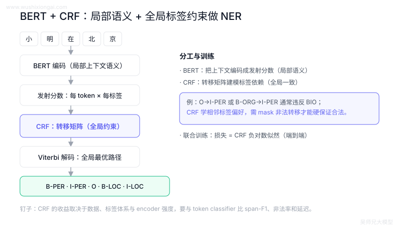

#### 【原题速答】
BERT 产生上下文发射分数，CRF 用标签转移分数联合解码序列，从而建模合法标注依赖。

#### 【考察意图】
- 是否理解序列标注任务里"表示学习"与"结构化输出"的分工：BERT 只负责"每个位置长什么标签更像"，CRF 负责"整条标签路径合不合法、连不连贯"。
- 是否能手推 CRF 的条件概率、前向算法（log Z）与 Viterbi 解码，而不是停留在"链式条件随机场"这个名词层面。
- 是否知道逐位置 softmax 在 BIO/IOBES 标注体系下的具体失效模式（例如 B-PER 后面接出 I-LOC）。
- 是否理解"联合训练"与"两阶段训练（先 BERT 再换头）"在梯度回传与工程实现上的差异。

#### 【深度解析】
**整体结构。** 输入 token 序列 x₁…xₙ，经 BERT 得到上下文表示 h₁…hₙ，过一个线性层得到发射分数矩阵 E ∈ ℝ^(n×K)（K 为标签数，含 O 与 B/I 前缀类别）。CRF 层引入可学习转移矩阵 A ∈ ℝ^((K+2)×(K+2))（含 START/END 两个哨兵标签）。

**路径分数（对整条候选标签序列 y = y₁…yₙ）：**

```
score(x, y) = Σ(i=1..n) E[i, yᵢ] + Σ(i=1..n+1) A[yᵢ₋₁, yᵢ]
```

两类分数各司其职：发射分数负责"这个 token 像不像该标签"，转移分数负责"上一个标签是什么时这个标签合理不合理"。这正对应速答中的"上下文发射分数 + 标签转移分数"。

**条件概率（全局归一化）与损失：**

```
P(y|x) = exp(score(x,y)) / Z(x),   Z(x) = Σ_{y'∈Y(x)} exp(score(x,y'))
L = −log P(ŷ|x) = log Z(x) − score(x, ŷ)
```

直接枚举 Z 需要 Kⁿ 项，用前向算法降为 O(n·K²)。在 log 域递推（log-sum-exp 保证数值安全）：

```
α₁(y)   = A[START,y] + E[1,y]
αᵢ(y)   = logsumexp_{y'} ( αᵢ₋₁(y') + A[y',y] ) + E[i,y]
log Z(x) = logsumexp_y ( αₙ(y) + A[y,END] )
```

**推理用 Viterbi：** 把上式的 logsumexp 换成 max 即可，
`δᵢ(y) = max_{y'}(δᵢ₋₁(y') + A[y',y]) + E[i,y]`，记录 backpointer 后回溯。训练与解码共享同一套 score 定义，这是"联合"的实质。

**为什么逐位置 softmax 不够。** 假设三个位置的真实标签是 B-PER / I-PER / O。逐位置 softmax 每个位置独立 argmax，可能出现 B-PER → I-LOC → O 这种结构性非法序列；且它对标签转移是隐式学习的，无法显式禁止非法组合。CRF 在分布层面（而非后处理层面）解决该问题，同时全局归一化避免了逐位置局部归一化的 label bias（局部归一化会系统性偏向"后继选项少"的路径）。

**算例。** 取 K=9（O + B/I×4 类实体）、句子长 n=50：枚举路径数 9⁵⁰ ≈ 5×10⁴⁷，而前向算法只需 50×81≈4050 次 log-sum-exp 递推——差 44 个数量级，这是 DP 的意义所在。

**屏蔽非法转移（衔接追问）。** 定义约束掩码 C[y',y] ∈ {0, −∞}（例如 START→I-X、B-X→I-Y(X≠Y)、END←B-X 等按标注体系枚举），训练与解码统一改为 A ← A + C。constrained CRF 的收益是输出 100% 合法、小数据场景 F1 通常提升 0.5~1 个点；代价是转移自由参数减少、掩码需与标签体系一一对应维护。验证方式：constrained vs unconstrained 同种子对照，看非法输出比例（应从约 1–3% 降到 0）、micro-F1 与解码耗时（复杂度同为 O(nK²)，几乎无差）。

**联合训练实现要点。** 损失 L 对 E 的梯度穿过线性层回传进 BERT 全部参数，转移矩阵另起一组参数（合法转移初始化 0 或 1/noise，非法转移可直接初始化 −∞）。工程上两种模式：(a) 端到端联合训练（默认推荐，BERT 与 A 同优化器但可分组给不同 lr）；(b) 先训 BERT 再接 CRF（省显存、可冻结 encoder）——后者损失部分任务适配信号。

#### 【追问链深挖】
- **L1：为什么不直接 softmax + IF-THEN 后处理修复非法序列？** 后处理只作用在离散输出空间，梯度里永远没有"约束"的信息，模型不会因此调整表示；CRF 把合法性写进概率分布本身，训练损失就包含约束代价。且 B/I/O 组合规则组合爆炸，后处理规则集难以维护，CRF 一次学全。
- **L2：如何定量验证 constrained CRF 的代价与收益？** 三指标对照：(1) 非法 span 占比；(2) 实体级 micro-F1（区分类别内与边界误差）；(3) 每条样本解码时间。实验设计上需固定 BERT 权重种子，diff 只有掩码。文献普遍结论：小数据/弱 encoder 收益显著，强 encoder + 大语料时差距收敛到 0.1~0.5 F1。
- **L3：训练中 log Z 怎么防数值溢出？** 全程 log 域（logsumexp 实现），softmax 用 additive mask；fp16 训练时 −∞ 用 −1e4 平替避免 NaN；转移矩阵过大值导致 loss 爆炸时可对 A 做软上限。
- **L4：LLM 生成式抽取（prompt 抽实体）会淘汰 BERT-CRF 吗？** 方向上 LLM + 约束解码能达到格式合法，但延迟与成本高一个量级；高吞吐工业流水线（百万级调用/日）仍是 BERT-CRF 的性价比优势区。边界场景是大模型做"长尾低频、需要多跳理解"的实体时反超——此时瓶颈不再是序列合法性而是语义理解。

#### 【串联与资料】
- **本仓库关联：** model-training.md（联合损失与多任务训练、优化器参数组）、prompt-engineering.md（LLM 式抽取是本方案的直接竞品路线）、evaluation-monitoring.md（实体级 F1 的严格评审协议）。
- **资料一句话核心：** BERT（Devlin et al., 2018）——同一预训练表示 + 极轻任务头可在 11 项 NLP 任务上全面刷新 SOTA，确立了"预训练-微调"范式；Neural Architectures for NER（Lample et al., 2016）——字符特征 + BiLSTM-CRF 中，CRF 全局解码对性能贡献约 1–2 个 F1 点，证明标签转移建模的必要性。

---

### 02. Decoder-only 架构为何是主流? · 详解

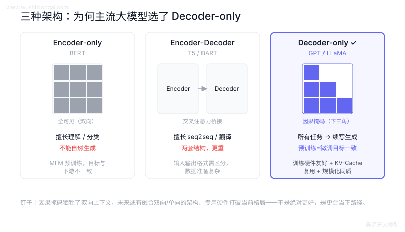

#### 【原题速答】
Decoder-only 以统一因果语言建模覆盖多种生成任务，训练可并行、解码可复用 KV Cache，工程扩展简单，但不在所有任务上优于其他架构。

#### 【考察意图】
- 能否摆脱"因为 GPT 成功所以 Decoder-only 成功"的循环论证，从训练目标统一性、训练并行度、推理工程、Scaling 行为四个独立维度论证。
- 能否给出 prefill / decode 两阶段各自的注意力与访存复杂度。
- 能否解释 KV Cache 为何成为核心瓶颈、PagedAttention 与 GQA 分别从"内存管理"与"缓存体积"两头下手缓解。
- 能否诚实地指出边界：Decoder-only 不是万能架构，编码检索类任务 encoder 仍占优。

#### 【深度解析】
**维度一：目标统一。** 因果 LM 用同一个 next-token-prediction 目标覆盖翻译、摘要、对话（用 prompt/模板表达条件），不需要定义特定任务的损失或特殊 token 结构。BERT 式 MLM 的 [MASK] 在真实生成时根本不会出现（预训练-推理分布不一致），而 causal LM 的 p(x_t | x_<t) 与推理时的条件分布完全同构——"训练即推理的目标对齐"。

**维度二：训练并行与数据效率。** 因果 mask 下一条序列的所有位置 loss 可以一次并行算出（teacher forcing），时间复杂度 O(n²·d) 注意力 + O(n·d²) MLP；相比 RNN 的 O(n) 串行，Transformer 解除了序列依赖。同时语言建模目标自身就是"无限监督信号"（每个 token 都是标签），BERT 的 MLM 只有约 15% 位置有直接监督。

**维度三：推理工程 —— KV Cache。** 自回归解码一步只新增一个 token，历史 K/V 可缓存复用，免去对全部前缀重复计算。每 token 每层的缓存字节数：

```
KV bytes/token/layer = 2(K和V) × n_kv(头数) × d_head × dtype_bytes
总缓存 = 上式 × L(层数) × 序列长度
```
以 FP16 的 Llama-2-7B（32 头×128 维×32 层，MHA）算：2×32×128×2 B = 16 KB/token/层，×32 层 = **512 KB/token**。128K 上下文单请求即 64 GB——这就是 decode 阶段" 内存带宽才是瓶颈"的根源（每生成 1 token 都要把全部 KV 读一遍，模型 FLOPs 利用率骤降到个位数百分比）。

**prefill vs decode 复杂度。** prefill（一次性吃下 prompt，长度 n）：注意力 O(n²·d)，计算密集（compute-bound）， batching 与 FlashAttention 收益大；decode（逐 token，已生成 t 个）：注意力 O(t·d)+ 每层读 t×KV 缓存，访存密集（memory-bound）。两者比率悬殊：长上下文下 decode 的等效算术强度只有 ~1 FLOP/byte，远低于 GPU 理想比值，这正是 vLLM/PagedAttention、GQA/MLA、量化 KV 等技术存在的理由。

**维度四：Scaling 行为。** GPT-3（175B, decoder-only）验证了大尺度下的 in-context learning；后续大量受控对比（如学界对三种架构的 scaling law 对比）显示深度大时 decoder-only 训练稳定性与梯度健康更好（attention 与 FFN 残差通路对称、梯度流不需要额外缩放补偿），干脆性优于 encoder-decoder 在大规模下的调参难度。

**边界诚实。** Decoder-only 不在所有任务占优：检索编码与句向量（BERT/bge 系）双表示不可替代；受控小规模实验中 encoder-decoder 在翻译类条件生成上仍有优势。encoder-decoder 在通用大模型路线衰落的主要原因是任务接口不统一 + 训练/推理复杂度更高，而非"理论上更差"。

**两个缓解技术。** (a) PagedAttention（vLLM, 2023）：把 KV cache 组织成固定大小的 block，以页表方式管理逻辑连续、物理离散的显存，消续约时碎片化（同类系统吞吐提升 2–4×，并把并发重叠批处理成为可能）；(b) GQA：KV 头数减到数分之一（如 70B 级常用 8 组），缓存压缩 4–8×，质量损失可用少量 uptrain 找回。

#### 【追问链深挖】
- **L1：prefill/decode 各阶段什么瓶颈、什么优化才对症？** prefill 计算 bound → FlashAttention（IO-aware 精确注意力，把 softmax 中间物从 HBM 淘汰回算）、chunked prefill 与 prefill/batch 调度；decode 内存 bound → KV 压缩（GQA/MLA/量化）、PagedAttention 显存管理、continues batching。给一个混合算例可讲清：同样 8K 上下文，prefill 约 2 GFLOP/token？——更直接的说法是一次 8K prefill 的注意力 FLOPs≈2·8K²·d，总量随长度平方增长；但 decode 每一步只 O(8K·d) 且每一次都要全量读 KV（~2–4 GB），因此时延被带宽锁死。
- **L2：为什么 KV Cache 不能像激活一样图省事全放在统一内存？** decode 逐步读、prefill 混合并发读写，访问模式是"整个 cache read once, per token"；HBM 带宽 ~3 TB/s 对比 PCIe/以太网 ~100 GB/s，远端存储无法满足带宽；因此 cache 的驻留与分页是吞吐的第一决定因素。
- **L3：PagedAttention 具体怎么解决内存碎片？** KV 三个维度随请求不堪预测（长度、并发数、beam 数），传统 pre-allocation 按最大长度申请造成 60–80% 浪费。它把每个 slot 固定为 16 token，逻辑序列→块表→物理块三段映射，碎片只剩每请求平均 <4% 的块尾零头，且天然支持 prefix sharing（多请求共享相同前缀页——因为只读不写）。
- **L4：KV 压缩一路推下去的极限在哪？** 完整梯度是 MHA → MQA（1 组）→ GQA（分组）→ MLA（低秩 latent，DeepSeek-V2/3 已把等效 KV 缓存压到全层每 token ~70 KB 量级，比同等配置 MHA 的 ~4 MB 低近两个数量级）。再往下是 KV 量化（FP8/INT4 已经生产使用）与稀疏/augmented encode（如 KV 淘汰）。质量侧的视角是"压缩比 vs 长程检索性能"，讲清楚：激进压缩最先损伤的是 needle-in-haystack 的远距离重复注意力，其次是格式遵循。
- **L5：decoder-only 真的比 encoder-decoder 更上调参难度吗？** 受控对比实验（本仓的另一个模块提到）表明它关注两点：深度递增时 Post-LN 训练失败率（另一个题目细讲）、以及 cross-attention 子网在超大模型中出现的训练不稳。在通用无.Currency 大数据框架下 decoder-only 校准成本最低这一点是事实，但不宜溢出为主张"架构因果占优"。

#### 【串联与资料】
- **本仓库关联：** 04（KV Cache 与 MLA/GQA 的下一层展开）、13（encoder-decoder 的 cross-attention 对照）、18（自回归解码与 token 输入）、19/20（注意力计算细节）、inference-optimization.md（PagedAttention/FlashAttention 的完整版明确写在该模块）、rag-foundations.md（encoder 编码器路线）、fine-tuning.md（对齐后的生成范式）。
- **资料一句话核心：** Attention Is All You Need（2017）——去掉循环与卷积、纯注意力堆叠即可 SOTA，且训练并行性碾压 RNN；Language Models are Few-Shot Learners（GPT-3, 2020）——decoder-only 放大到 175B 后涌现 in-context learning，无需梯度更新即完成任务；FlashAttention（2022）——按 IO 感知重新排布注意力的计算顺序，精确等价地把显存占用从 O(n²) 降到 O(n)、长序列吞吐翻倍以上。

---

### 03. GPT vs BERT 核心区别在哪? · 详解

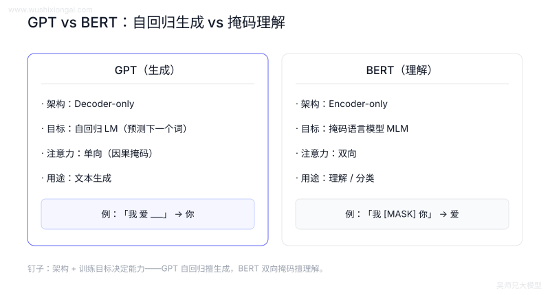

#### 【原题速答】
GPT 类采用 Decoder-only 自回归目标，适合生成；BERT 类采用 Encoder-only 双向表示，适合分类、抽取和检索编码，但两者边界并非绝对。

#### 【考察意图】
- 是否抓住了"训练目标决定表示性质"这条主干：causal mask 产生单向表示，全连接双向注意力产生双向表示。
- 能否列表对比注意力可见性、预训练目标、上下文语义覆盖、推理方式、典型任务。
- 能否说明"边界并非绝对"体现在哪（BERT 变生成、GPT 做判别与编码器）。
- 是否清楚现代模型生态里两类的真实阵地分布（2025-11 口径）。

#### 【深度解析】
**注意力可见性的本质差异。** BERT 的每层 self-attention 中位置 i 可以看到 j<任意位置 j；GPT 中位置 i 只能看到 j ≤ i（因果 mask 上三角 −∞）。数学后果：BERT 的 token 表示 hᵢ ∝ 携带右上下文，是"完形填空式"的动态表示；GPT 的 hᵢ 只编码左上下文，生成场景下"下一个 token 的分布"是唯一有意义的读出点（通常取最后一位置）。

**预训练目标。**
- GPT：PLM，max Σ log p(xₜ | x₍<t₎)。每个位置都是监督信号（数据利用率 100%）。
- BERT：MLM，随 15% 位置 mask（80/10/10 替换），只有被 mask 的位置参与 loss；外加 NSP（RoBERTa 已删，NSP 为弱任务，被 sentence-pair order 等替换）。

**表示质量的差异（关键推导）。** MLM 假设被 mask 的位置之间互相独立（BERT 建模 p(…, [M], …, [M], …) 时按独立连乘），但真实语言中 masked token 间强相关（如"New York"两词都被 mask）。独立性假设使 BERT 学到的条件分布是近似（AR 目标没有这个问题）。这是一部分论文批评 MLM 的核心论点，也解释了为什么自回归模型在做"知识生成"类任务上更干净。

**任务适配。**
- 生成/对话，需要"无条件自回归输出" → GPT 类天然契合；RLHF 等后训练也在 decoder-only 上成熟（见本仓 rlhf-alignment.md）。
- 判别（分类、NLI、NER 槽位），需要双向上下文 → BERT 类。GPT 硬做分类一般取最后 token 池化，在长序列时序信息衰减（链式位置的低秩问题），领域上仍弱于双向模型，除非做 instruction 调整 + 长度拆分。
- 检索编码（句向量），需要双向/invariant 表示；GPT 派生句向量（如 text-embedding-3 是用 decoder + 池化 + 大并行训练）也能做好，但代价是要专门训练目标（对比学习）而非零成本复用，GenBERT/GRIT 等改造论文证实"注意方向可被训练目标驯服"。

**边界并非绝对的证据。**
1. BERT 走向生成：Masked LM + 训练一次成 encoder-decoder（如 BART，span corruption）可直接输出；
2. GPT 走向判别：通过 instruction/prompt 化做 zero-shot 分类，在指令扩充下判断能力反超早期 BERT 微调上限；
3. 生态（2025-11 口径）：通用对话/Agent/推理/代码——decoder-only 绝对主流（GPT-5/Claude/Gemini/DeepSeek/Qwen 系全部）；专用检索 embedding 与 rerank——encoder/symmetry 结构仍是主力（bge/E5/ModernBERT 等持续在 2025 年更新）。

**一个量化观察补充完。** 近年发现 GPT 判别任务的退化瓶颈是"因果表示的时序混合性"：长序列末端 token 的表示融合早先位置信息的路径在多层后仍受限制（each layer adds O(1) mixing），这是 encoder-decoder/双向结构更能直接"看全"的机制限制。

#### 【追问链深挖】
- **L1：encoder-decoder 在条件生成上的优势是什么？** 源侧双向编码可以一遍成型（memory 一次算好，decode 阶段交叉注意力反复读），长源文档上工程/参数效率高（T5/BART 在小算力下仍优势存在）； disadvantages 是两套权重导致同规模参数的"通用知识"容量小，而现代做法是直接用 decoder-only "把源放 prompt 里"。
- **L2：BERT 如何微调成事实一致性/NLI 分类器？** 输入（前置 claim + text）拼接 [SEP]，取 [CLS] 接两层 MLP + softmax；关键是标注侧使用"检索证据 + 生成内容"对比对（如 FactCC 协议），校准方面需要按 FPR 调阈值；在大模型时代，这一设计被 FactCheckGPT 之类改造为 LLM 二分类头 + 清洗对齐。
- **L3：两大模型的退化极限怎么解释？** BERT 到生成一头需要重排位置编码与 mask 方案；GPT 到判别一头被因果性限制。两者的高效统一只能靠 prompt 层面（把判别任务描写为生成 score），这也是 parameter-efficient fine-tuning 后 GPT 一统天线的表现层原因（见 fine-tuning.md）。
- **L4：为什么判别任务还要确认"微调 vs prompt"的选择？** 领域侧证据是 error decomposition：微调头在小数据上校准更好，prompt 在长尾与 zero-shot 上更稳；这影响的是 evaluation-monitoring 中显式流回归测试。

#### 【串联与资料】
- **本仓库关联：** 01（BERT 做下游的结构化头）、02（decoder-only 的整体论证）、13（encoder-decoder 细节）、fine-tuning.md（两流派微调协议）、reranking.md 与 rag-foundations.md（BERT 系 embedding/reranker 现役地位）、rlhf-alignment.md（生成侧对齐训练）。
- **资料一句话核心：** BERT 论文——双向 MLM 预训练 + 任务微调使同一表示横扫多任务；GPT-2——零任务训练、由 prompt 隐式给条件的多任务语言模型，引出"语言模型即无监督多任务学习器"；GPT-3——尺度拉大后 few-shot in-context 能力涌现，判别任务也可 prompt 解决。

---

### 04. MLA 与 KV Cache 怎么用? · 详解

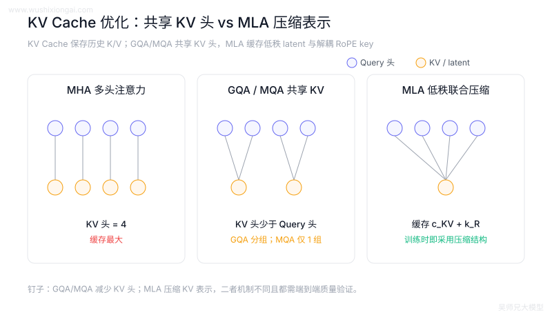

#### 【原题速答】
KV Cache 复用历史 K/V；GQA 和 MQA 通过共享 KV 头缩减缓存，MLA 则缓存低秩 latent 与解耦 RoPE key。

#### 【考察意图】
- 是否能把 KV Cache 从"施工经验"推进到字节级推导：每 token 每层公式 + 反例算例。
- 是否理解 MHA→MQA→GQA→MLA 的演进动机链：显存带宽 → 头间容量 → 质量恢复 → 长上下文极限压缩。
- 能否解释 MLA 两个非平凡细节：低秩压缩与 RoPE 位置项的解耦、以及矩阵吸收（weight absorbing）的推理便宜性。
- 能否对 MLA 与 GQA 的 kernel/硬件适配与模型质量做出 trade-off 论证，而不是只背结论。

#### 【深度解析】
**KV Cache 的公式。** 长 n 序列、L 层、n_kv 个 KV 头、每头 d_head、dtype b 字节：
`Cache = 2 × n_kv × d_head × b × L × n`。以 FP16、Llama-2-7B（MHA 全 32 头）为例 = 512 KB/token；70B（GQA 8 组）= 320KB/token；扩展到 128K 上下文即 40GB 级——decode 时每生成一个 token 都要把它们整本读一遍，瓶颈在 HBM 带宽而非 FLOPs。这是所有共享 KV 方案的物理起点。

**MQA。** 全部 Q 头共享 1 组 K/V 头（Shazeer 2019）。缓存缩 n_h 倍，但每一个 KV 头要为所有 Q 头"弯腰服务"葛布注意力表达，模型质量损失明显，训练稳定性下降。

**GQA。** 在 MHA 与 MQA 之间插值：分组共享 KV 头（g 组）。可以从已经训好的 MHA checkpoint 做 mean-pool 并少量 uptraining（<5% 的原始训练算力）恢复质量（GQA 论文核心结论）。当前 70B 级生产模型几乎全部选 8 组（Llama-2/3-70B 等）。

**MLA（DeepSeek-V2/3 采用）。** 两个观察叠加：
1）KV 的信息在头维间高度低秩，先投影到低秩 latent 再薄恢复出来，几乎无损质量；
2）RoPE 是位置项，如果藏进低秩投影内部，位置信息无法矩阵吸收（见下），必须与内容通道分开。

形式化（简化符号）。输入 h_t：
```
c^KV_t = W^DKV h_t            ( 低秩 latent，d_c ≈ 512~568)
k^C_t = W^UK c^KV_t            ( 内容 K，按头展开)
k^R_t = RoPE(W^KR h_t)         ( 独立 64 维 RoPE 通道)
k_t = [k^C_t ; k^R_t]，v_t = W^UV c^KV_t 同理
```
缓存只需存 `c^KV_t（512/568 维）+ k^R_t（64 维）≈ 576 维`——对比 MHA 下 2×n_h×d_head = 2×128×128 = 32768 维，压缩 50+ 倍。DeepSeek-V2 论文给出 KV cache 削减 93.3%，激活显存同时下降，换取的是每 FLOP 的长上下文能力拉满。

**矩阵吸收。** decode 阶段评分 s = q·k。把 W^UK 从 K 侧"搬进" Q 侧：q' = W_UK^T q，k' = c^KV；由于 q 先做过 RoPE 吗？关键细节：RoPE 作用在 k^C 上会阻挡吸收。MLA 的解法是 RoPE 只作用在独立的 k^R 通道上，内容通道完全不经过旋转，因此
```
score = q·k = q·W^UK c^KV + q·k^R
　　= (W^UKᵀ q)·c^KV + (R_qᵀ相关项与 k^R 对齐)
```
后台操作只需要一次矩阵乘，缓存里那个"裸 latent"可以直接参与点积，免去 up-projection 的重复 GEMM。RoPE 通道由于是正交 rotate + 小维度，不具有吸收条件，单独处理。这是"MLA 为什么要解耦 RoPE"的标准答案：不是工程技巧，而是矩阵吸收在数学上的必要条件。

**算例字节对比（FP16，128 头×128 维，L=61 层，DeepSeek-V3 配置）。**
- MHA：2×128×128×2 B×61 = 4.0 MB/token，16K 上下文 = 64 GB 单请求。
- GQA(8 组)：2×8×128×2×61 = 250KB/token，16K = 4.0 GB。
- MLA：(512+64)×2 B×61 = 68.6 KB/token，16K = 1.12 GB（kv_lora_rank 512 + 解耦 RoPE key 64，DeepSeek-V2/V3 配置）。
数量级结论：MLA 与 GQA-8 相比再省 3–4×，比同等配置 MHA 省约 57×（≈1/56，与 inference-optimization 模块表格的配置算术口径一致）；但一般生产系统会把 KV 量化叠加使用。

**纠正（2025-11 口径）：** MLA 压缩比有两个合法基线，别混用：(a) **论文官方口径**——DeepSeek-V2 摘要写"reduces the KV cache by 93.3%"，即减到 6.7%（≈15 缩减），但基线是 DeepSeek-67B 的 MHA 配置；(b) **配置算术口径**——按 V2/V3 自身 128 头×128 维算（2·128·128=32768 vs 576 个元素），约为 1/56，inference-optimization 模块表格采用此口径。博客把"1/9.3""5–9×"写成固定数字，或把摘要里 5.76×（生成吞吐倍数）误当缓存压缩比（"5.13×"），是对以上两种口径的误抄。另一个常见错误是把 MLA 说成"GQA 的一种"，它的机制（低秩重构 vs 头共享）与 GQA 完全不同。

#### 【追问链深挖】
- **L1：矩阵吸收的数学前提和 kernel 上的表现？** 前提：位置编码不能和上投影纠缠（可交换性）。实现上 decode kernel 把 (W^UKᵀ q) 融进 Q-lookup，每步一次 GEMV；对 prefill 则仍批量 up-projection 更友好。细节上吸收后 K 不再需要 per-head 存储，KV cache 与 kernel 布局解耦，但（吸收路径）对 cuBLAS 的 rank-1 收缩不友好，需要专用 MLA kernel（FlashMLA / Triton 自研实现）。
- **L2：GQA 与 MLA 质量侧的受控对比？** GQA 从 MHA uptrain：损失 ~0–1% 等 benchmark；MLA 是从头训练架构，同一 FLOPs 下与 MHA 基线质量持平或略优（DeepSeek-V2 报告等效对比）。要点是两者不是同一预算位的选择：MLA 需要"能重训"，GQA 有"继承已有 checkpoint"的独占优势。
- **L3：MLA 的 kernel 难点为什么仍在？** attention 内核要同时支持 (a) latent 直接点积（吸收路径）， 动态 up-project 的 v 侧， 多头共享 latent 的 stride 排布。三者与 FlashAttention 的 tile 生命周期不完全兼容——这正是 DeepSeek 开源 FlashMLA 的出发点。讲清该问题就能回答"为什么没有 cuda 自带 fast path"。
- **L4：KV 量化与 MLA 组合的兼容性？** latent 分布温和（post-LN 残差线性混合，各次都 preserving 方差），FP8 生产可行（DeepSeek-V3 使用）；RoPE 通道维度极小，量化误差占比相对大，注意保留其更高精度（业界做法是 RoPE 部分留 FP16）。

#### 【串联与资料】
- **本仓库关联：** 02（KV Cache 的系统语境与 PagedAttention）、05/19（MHA/QKV 实现细节同源）、06（RoPE 机制的独立展开，本题为"解耦 RoPE"的必要条件提供背景）、inference-optimization.md（KV 量化、FlashMLA 类 kernel、Page Attention 工程细节全在该模块）。
- **资料一句话核心：** DeepSeek-V2（2024）—— MLA 通过低秩latent + 解耦 RoPE 把 KV cache 削 93.3%，且与等效 FLOPs 的 MHA/GQA 相比质量持平或更优；GQA（2023）——从 MHA checkpoint 均值池化 + 少量 uptrain 即恢复质量，实现 MQA 的速度与 MHA 的质量之间的插值；MQA（2019）——单 KV 头 decode 提速显著，但作为质量下界可作对照。

---

### 05. 多头注意力原理与QKV拆分陷阱 · 详解

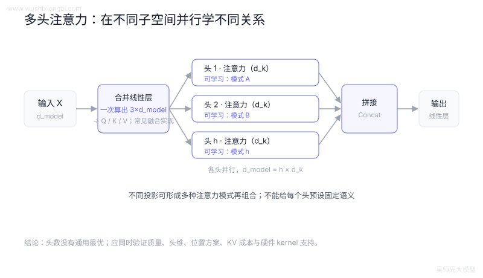

#### 【原题速答】
多头注意力将 Q/K/V 拆到多个投影子空间并行计算后拼接输出，可形成多样注意力模式；头数、头维和内存布局需共同按质量与硬件验证。

#### 【考察意图】
- 能否写出 MHA 完整公式并说明"为什么切成多头"（子空间多样性 vs 单头表达瓶颈）。
- 三个经典拆分陷阱：(a) d_model 不变时头数↔头维的守恒；(b) reshape/transpose 的内存布局错位（BSHD/BHSD/SBHD）；(c) QKV 融合 kernel 的参数命名一致性（例如 HuggingFace 的 c_attn 是 3d 绑定，Megatron 是三列分体）。
- 能否从"位置频率对头维的偏好"导入 RoPE 的 head_dim 决策（题目原文追问）。

#### 【深度解析】
**公式与张量账本。** 设输入 X ∈ ℝ^(n×d_model)，头数 h，每头维度 d_h = d_model / h：
```
Q = X W_Q ∈ ℝ^(n×d_model)，reshape → (h, n, d_h)
head_i = softmax( Q_i K_iᵀ / √d_h + mask ) V_i
MHA(X) = Concat(head_1..h) W_O ∈ ℝ^(n×d_model)
```
参数量：4·d_model²（Q/K/V/O 各一份）。头的作用是把 attention 打散到 h 个 d_h 维子空间，W_O 再线性混合。直观机制：单头只能保证从 V 中构造一次线性可分的"信息查表"，多头允许同一层内不同头分别专注句法、共指、位置邻近等不同查询模式；这也是一条实证（各头会自行 specialize，剪除冗余头后精度掉幅有限）。

**守恒陷阱（L1）。** h 与 d_h 此消彼长：d_model 固定，h=32 → d_h=128；h=8 → d_h=512。参数总量不变，但：
- d_h 变小：每头点积方差 ∝ d_h，softmax 更"公平"但表达维数受限；
- d_h 变大：更长可表示但头间多样性损失；
- d_h 大 → logit 方差大（方差/√d 缩放规则请见 19 题），数值稳定需要小心。
业内经验区间是 d_h ∈ [64, 128]（GQA/RoPE 生态最顺），128 恰为 tensor-core 友好维度；64 维以下多头收益递减。

**内存布局陷阱（L2）。** 一份 (B, n, h, d_h) 的张量在 attention 内核中按 (B, h, n, d_h) 访问最快（把头放在 seq 前，确保同一头内 token 连续读取）；PyTorch 常写 `view(B, n, h, d_h).transpose(1,2)`。常见错误包括：
- 用 `.view(B, h, n, d_h)` 直接 reshape，把"头"误切进 seq 维（当 n h 不整除时切错，且权重复用错位）；
- 忘记 contiguous()，进一步 GEMM 时触发隐式拷贝，性能反而下降；
- KV cache 的每头 stride 预留不做 contiguous，paged engine 混用两种布局（BSHD 与 BHSD）造成 silent perf cliff（FlashAttention 才支持 BHSD 原生）。

**QKV 融合 kernel 陷阱（L3）。** 三个投影分别是三个 matmul 时，权重加载触发 3 次 HBM read；融合成一个大矩阵 [W_Q; W_K; W_V]（d_model×3·d_model）后只读 1 次 X、写出一个 (n, 3·d_model) 张量，随后一次 split。细节坑：
- split 的维度顺序与 checkpoint 不同（GPT-2/OpenAI 排布是 "QKV" 分块相同、transpose 不一致），错误的对齐在训练时不炸、推理时候 silent 错位；
- GQA 后 K/V 头数 ≠ Q 头数，融合矩阵要按 (h_q, h_kv) 分别排布， megatron/hf 的转换脚本都必须对齐（常见 bug 源）；
- RoPE 在融合后用 (B, h, n, d_h) 布局作用最方便，因此"融合 ↔ 旋转" 的顺序有两个主流选择，跨实现迁移时要对得住。

**位置频率与头维（原题追问方向）。** 头维 d_h 决定了 RoPE 能编码的位移分辨力：θᵢ = 10000^(−2i/d_h)，d_h 越大低频分量越多（长程位移仍非 trivial 旋转），越能支持长上下文；把 RoPE 的有效维度从 64→128 就是很多"扩窗"路线的第一手段之一。量化算例：d_h=64 时最高频 θ₀=1 rad/pos，最低频≈1e-4 rad/pos；若希望远程相对位移（如 10 万 token）仍被分辨，需要若干"低频"分量，这就是为什么长上下文模型普遍 d_h≥100 或 RoPE 频率重设（详见 06 题推导）。

#### 【追问链深挖】
- **L1：为什么头数与 d_k 的守恒 (= 同参数量) 不构成"多头不特别好"的论证？** 参数量相同而容量分布不同：attention 的表达能力由"独立子空间的个数×每子空间的自由度"联合决定（与 FFN / conv 的"多通道"动机同构）。受控消融（head=1 vs h·d_h=d 常数）表明中间头数最佳：太少的极端会失去"多样查表"能力，太多的极端会失去每头的表达维数与缩放稳定性。
- **L2：缩放方法的选择点是什么？** logit 方差 = Σ qᵢkᵢ 的方差 ∝ d_h（在对 q,k, per-dim 独立、方差 σ_qσ_k 时候）——因此缩放 1/√d_h 是"把方差拉回 1"的正解，而 1/d、或不出缩放都会分别导致 softmax 饱和/梯度消失（详见 19 题的完整推导）。长上下文时又叠加 softmax 温度修正（YaRN 频位外推等专题在 06 题）。
- **L3：长上下文评测怎么做才靠谱？** 三层：needle-in-a-haystack 召回、LongBench/RULER 等长程聚合任务、分位长度处的 PPL；只报 4K PPL 会掩盖 RoPE 外推的退化（头的低维衰减）。
- **L4：QKV 融合 kernel 的实际收益量化？** d_model=4096 时三次 GEMM 合一减少一次 X 读（约 12KB/token/layer），decode 阶段 batch 小时更显著（memory-bound 相对更敏感），生产库（如Megatron、TensorRT-LLM）都默认 fused QKV + RoPE 融合。

#### 【串联与资料】
- **本仓库关联：** 04（KV 布局与 GQA 的头数配方）、06（RoPE 对头维的依赖）、19（缩放 1/√d_h 的严格推导）、02（长上下文系统的评测语境）、inference-optimization.md（kernel 布局与 fused QKV 的工程清单）。
- **资料一句话核心：** Attention Is All You Need（2017）——多子空间并行投影 + 输出线性混合，8 头在 WMT14 上显著优于单头与过多头数的对照；RoFormer（2021）——把绝对位置变为 QK 的相对旋转，为头维与长上下文的耦合给出了可推导的方案。

---

### 06. 位置编码为什么重要? · 详解

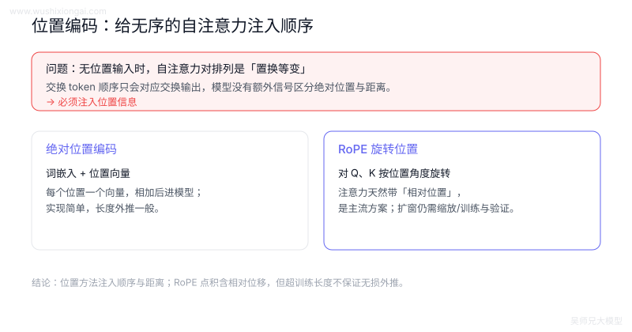

#### 【原题速答】
位置编码为自注意力注入顺序与距离信号；RoPE 通过旋转 Q/K 编码相对位移，扩窗仍需缩放、训练和目标长度验证。

#### 【考察意图】
- 能否讲清"为什么 attention 天生是无序集合运算"→ 位置编码是唯一顺序人口。
- 是否掌握位置编码谱系与判定标准：绝对 vs 相对、加性 vs 旋转、是否外推。
- 能否完成 RoPE 相对位置性的完整推导（原文要求的追问方向）与外推（PI/NTK/YaRN）的机制推导。
- 是否具备"扩窗不是白给"的工程判断：插值后需要校准微调 + 目标长度评测，且给出可控实验设计。

#### 【深度解析】
**为什么需要。** self-attention 的 core 运算是 channels 内的点积 + softmax + V 加权，permutation equivariant：把输入顺序打乱，输出同序打乱（无任何位置敏感）。语言天然顺序敏感（"猫追狗" vs "狗追猫"），必须有一个注入顺序的组件：加法注入（绝对 PE）或旋转/attention-score 注入（相对 PE）。

**谱系速览（含判据）。**

| 方案 | 注入方式 | 性质 | 外推性 |
|---|---|---|---|
| Sinusoidal | PE(m) 加到输入嵌入 | 绝对、可外推但质量衰减 | 差 |
| 可学习绝对 | 位置查表 | 绝对、训练定上界 | 无（超出即 ID 未知） |
| T5 bias | attention logit 加标量偏置 | 相对、桶化距离 | 可外推（nuisance） |
| ALiBi | score − m·|i−j| | 相对、线性距离惩罚 | 强外推（简便） |
| RoPE | QK 旋转 | 相对、与内容耦合 | 需插值/NTK/YaRN 辅助 |
| NoPE | 无显式 PE（靠因果 mask） | 隐式序 | 短序列可行（近年碎片化证据有限） |

判定标准三条（面试可背）：(a) 长度可伸缩性（能否处理未见长度）；(b) 相对位移是否时不变（translation equivariance）；(c) 与 KV cache 的兼容性（能否逐 token 增量计算）。

**RoPE 相对位置性的完整推导（原文要求）。** 把相邻两维(pair 成复数)。设第 i 个"复数分量"的频率 θᵢ = 10000^(−2i/d)。RoPE 定义：
```
f_q(q, m) = q ⊙ (e^{imθ¹}, e^{imθ²}, …)  （每个复数分量各自乘相位）
f_k(k, n) = k ⊙ (e^{inθ¹}, e^{inθ²}, …)
```
attention 内积只做复数内积的实部（等价于原空间欧氏内积）：
```
⟨f_q(q,m), f_k(k,n)⟩
 = Re[ Σᵢ qᵢ e^{imθᵢ} · conj(kᵢ e^{inθᵢ}) ]
 = Re[ Σᵢ qᵢ k̄ᵢ · e^{i(m−n)θᵢ} ]
```
位置 m,n 只以 (m−n) 出现——相对位置性质得证。等价的实数形式是对每对维度施加 2D 旋转矩阵 R(mθᵢ)，把"位置"变成几何旋转，位移起的作用是相位差。副产物：RoPE 是逐 token 可计算的（KV cache 友好，只在 K 侧记录时生效）。

**Sinusoidal 与 RoPE 的关系。** sin/cos PE 的本质也是旋转（同频率旋转），但作用在"输入嵌入加法"一侧，让 attention 内积出现 e^{i(mθ)−i(nθ)} 的交叉项而并非纯相位差——RoPE 的贡献是把这种耦合从代数巧合变成设计目的。

**外推与扩窗的完整链条。**
1. 直接外推：超出训练长度后位置角度超出见过的相位范围，注意力分布崩坏（perplexity 指数级飙升）。
2. Position Interpolation（PI, 2023）：把位置 m 线性缩到 m/s（s 是扩窗倍数），相位不越界；代价是所有频率被均匀压缩，分辨率受损——需要约 1000 步微调。PI 论文核心结论：仅靠插值 + 少量微调即可把 LLaMA 4K 扩到 32K。
3. NTK-aware：只把 base 调大（θ_base → θ_base·s^{d/(d−2)}），频率谱两端行为不同——低频压缩（等效于插值）、高频保真（近程分辨力保留）。零样本表现优于 PI，微调后更稳。
4. YaRN（2023）：在此基础上按频率"分区插值"（高频不插、低频全插、中频圆滑过渡）+ 注意力温度修正（对 softmax logits 加与 s 相关的缩放因子以校正注意力熵），配合数百步微调，可到 128K；同时比 PI 节省 10× 微调样本。
5. Llama3-style（工业默认，2024 起）：在预训练里直接做长度课程，配合 low/high frequency factor 参数（非均匀 RoPE 缩放），这是 2025-11 口径主流方——扩窗不再"事后手术"，而是训练计划的一部分。

**"扩窗不是白给"的实验设计（原文追问）。** 验证协议：(a) 训练长度下 PPL 不退化；(b) 目标长度 PPL 与 RULER-class 长程检索任务（needle multi-hop）通过；(c) 短文本回归测试（防"远端提升、近端损失"）——预期 PI/YaRN 会出现轻微的短程分辨下降，QAT 类无损方案需控制高频维度。

#### 【追问链深挖】
- **L1：ALiBi 和 RoPE 本质差异在哪？** ALiBi 把位置当作"负向斜率"的先验（距离越远分越低），实现零参数、可直接外推，但它强加了单调衰减先验，限制"存在长程依赖"的建模（检索/复述类长任务上劣于 RoPE 系）。RoPE 相对自由，但超纲外推需要干预。
- **L2：为什么 RoPE 可以吸收进矩阵？** 因为它只作用在 Q/K、作用是逐 head 的正交旋转。若和线性投影纠缠（如低秩 latent 内部）则不可交换（详见 04 题 MLA 解耦 RoPE 的必选理由）。
- **L3：NoPE 能行吗（recent claims）？** 小模型证明 causal mask 本身可诱导位置感（每个 token 的相对深度由因果掩码决定），但大规模下有显式 RoPE 的模型训练更稳定；NoPE 可作为一项消融认识，不代表工程弃用 PE。
- **L4：扩窗与 MoE/长程任务叠加的次序问题。** 扩窗优先于能力蒸馏：先扩窗再学工具调用/长程规划，否则 agent 长上下文里被"看不见 token"卡死。上游提示（如果面试官追问"我们场景该怎么做"）：先决定部署长度（RULER 真实样本跑通）→ 选择方案（预训练内置 > NTK/YaRN > PI）→ 用 3 层回归验证。

#### 【串联与资料】
- **本仓库关联：** 04（RoPE 与 MLA 解耦的深层关系）、05（头维决定可编码频率）、09/16（训练中与 RMSNorm 同层堆叠时的稳定性）、20（原 Transformer 的 sinusoidal 起点）、inference-optimization.md（长上下文的工程细节如 ring attention / context parallelism 同模块）。
- **资料一句话核心：** RoFormer（2021）——Q/K 旋转使 attention 只依赖相对位移，且不引入参数、可外推；PI（2023）——把位置下采样的插值 + 少量微调成为扩窗蓝本；YaRN（2023）——频率分区插值 + 温度修正，把扩窗微调代价再砍 10×、可达 128K。

---

### 07. LLaMA为何选RMSNorm? · 详解

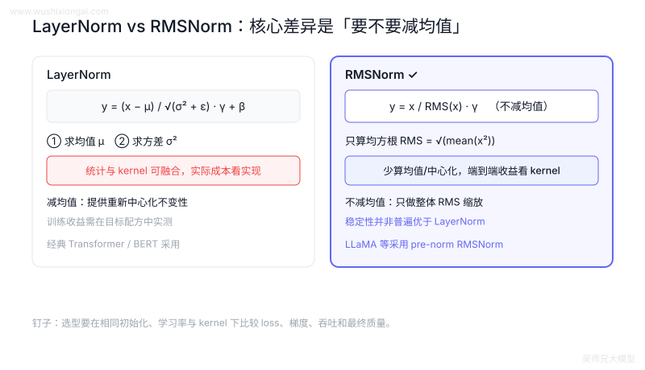

#### 【原题速答】
LayerNorm 与 RMSNorm 的核心差异是是否减均值，归一化收益与稳定性需按模型和硬件验证。

#### 【考察意图】
- 是否理解两种归一化的数学差异（去均值与否）及其对反向传播/数值稳定性的影响链条。
- 能否给出工程动因（更少统计量 → 更省归约/更省访存 → 分布式训练时通信形态更简单）。
- 能否辨析"收益实证"边界：LLaMA 采用 RMSNorm 的决策依据与随后的现代模型普及率。
- 能否顺着原文追问展开：张量并行切分、融合 kernel、FP32 统计累积、Pre-Norm 稳定性。

#### 【深度解析】
**公式对照。**
```
LayerNorm(x) = g ⊙ (x − μ(x))/√(σ²(x)+ε) + b          （μ, σ² 全维统计）
RMSNorm(x)  = g ⊙ x / RMS(x),  RMS(x) = √( (1/d) Σ xᵢ² + ε )
```
RMSNorm 的两个简化：去中心化(μ)与再平移偏置(b 被删。注意 g 保留）。RMSNorm 论文论证：LayerNorm 的收益主要来自"缩放不变性"，"中心化"对性能无独立贡献——按重缩放不变性（scale-invariant）假设可推出等价形态，作者实测在多任务/language modeling 上与 LN 打平或略好。

**参数与算子账（为何省）。** RMSNorm 少一次 x 的均值归约、少一个偏置参数；但关键节省在 HBM 访存：RMS 只需要一个 reduce（Σxᵢ²）而 LN 需要 two reduces（Σxᵢ、Σxᵢ²）加一次 x−μ 的中间张量读。以 d=4096、fp16 为例，LN 软路径额外搬运约 24KB/token/layer，RMS 到 16KB——在 decode（memory-bound）时的差异更放大。此外 RMSNorm 没有 b，参数量 (2d→d)，模型树小但不重要。

**反向传播差异（稳定性证据）。** LN 的梯度包含与 μ 有关的耦合项，使得在极深层网络中梯度路径更复杂；RMSNorm 的 J(∂) 是更简单的"重缩放雅可比"，它的 DyT 证明在 Post-LN 超深模型需要它而 Pre-LN 裡益有限——按 RMSNorm 论文的陈述"前者（重缩放）带来的显著收益中，中心化的贡献微不足道"。

**纠正（2025-11 口径）：** "RMSNorm 比 LayerNorm 快 64%" 这类说法摘自 RMSNorm 论文中部分任务的早期测量，在 2025 年高优化 kernel 下已被压到 5–10%（基本都是访存.done 差异），不是训练吞吐的主要杠杆。LLaMA 选择它的理由同样是"省一点是一点 + 打平质量"，而非数量级差别。

**LLaMA 的整套决策背景。** LLaMA 论文明认引导了 PaLM/Chinchilla 的路线：RoPE 替代绝对 PE、SwiGLU 替代 GELU-FFN、RMSNorm 替代 LN、无 bias（attention/FFN 全部无偏置）——总策略是"在质量不降的前提下去掉全部非必要计算"。RMSNorm + 无 bias 的组合让 norm 与 linear 融合 kernel 更简单（见下追问）。

**Pre-Norm 稳定性（原文追问）。** 现代大模型用 "Pre-Norm + final norm" 结构（LLaMA 即 so）。机制：残差主干 x' = x + Sublayer(RMSNorm(x)) 保持恒等通路的尺度稳定，深层梯度可直接流动；Post-LN（原始 Transformer）把 norm 放在残差之后，深层时因"残差路径上加了个标准化算子"而需要 warmup 且容易发散。量化佐证：GPT-2/LLaMA 都无需 LR warmup 的激进值即可稳定训练（LLaMA 用 2000-step warmup 相对保守）；Post-LN 无 warmup 时 100+ 层基本不可训。

#### 【追问链深挖】
- **L1：张量并行下 RMSNorm 怎么切？** 归一化统计是全向量（d 维聚合）。Megatron 方案里 norm 通常复制在 TP 组内（每卡持有完整参数与统计，只切 attention/FFN 的列/行）。RMSNorm 无 b 进一步避免了"偏置在 TP 下的 all-reduce 求和错位"。sequence parallel（SP）下 norm 沿 seq 维分片，此时统计量必须跨卡 all-reduce，RMS 的单 reduce 特质直接省一半通信量（在 1F1B 流水线中 RMS 与 LN 的通信比肉眼可见地小）。
- **L2：融合 kernel 长什么样？** 三级形态：(1) norm+残差加法融合（省两次读写）；(2) norm+量化融合（输出直接 FP8 per-token scale，供 GEMM）；(3) 与 attention 输入投影融合（norm → GEMM 融合 kernel，Triton 实现）。RMSNorm 的一个 reduce 结构让这些融合矩阵比 LN 简单 20-30%（LN 的 mean 减法环节需要单独 pass）。
- **L3：FP32 统计累积为什么是硬要求？** bf16/fp16 的 xᵢ² 累加在 d=4096 时动态范围窄，分块累加错误会在 norm 后放大（因为乘 g 之后进入 attention）。生产实现将 Σxᵢ² 与 Σxᵢ 用 FP32 累积（welford 或 tree-reduce），最终一次 cast 回输入 dtype。这个细节在低精度训练（fp8）里更是生死线（数值秒变 corp 案例来源于此处）。
- **L4：Post-Norm 什么场景仍有优势？** 消融显示 Post-LN 在 <1B 参数小模型上收敛后精度略高（归一化在残差后抑制激活漂移），因此现代"小模型 + 长训"(`BERT 仍然 Post-LN`) 有其空间。大模型 Pre-Norm + final norm 的选择是"训得动"，不一定是结果最优——这是有对照组的证据点，需要点明。

#### 【串联与资料】
- **本仓库关联：** 09（效率专题）、16（数值稳定性专题，与本题构成正反面）、20（Pre/Post-Norm 在原 Transformer 的位置）、model-training.md（fp8/混合精度训练里 norm 的数值约束）、inference-optimization.md（norm 融合 kernel 部署）。06（RoPE 与 norm 的联合训练稳定性消融文献）也是同主题。
- **资料一句话核心：** RMSNorm（2019）——把 LN 的"中心化"判定为非必要成分，等价的"重缩放不变性"简化版更快且质量持平；LLaMA（2023）——同量级投入下选择 RoPE+SwiGLU+RMSNorm+无 bias 的工程极简路线，公开权重与训练细节深刻影响开源生态；LN（2016）——按层统计做归一化的原始定义，指出其收益来自稳定激活分布。

---

### 08. DDPM 为什么随机采样时间步? · 详解

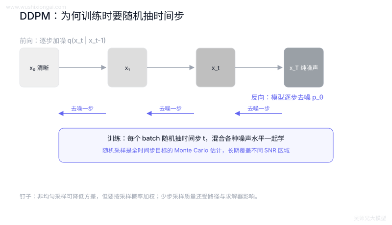

#### 【原题速答】
扩散模型通过随机时间步的噪声预测损失做蒙特卡洛估计，从而学习各噪声阶段的反向去噪过程。

#### 【考察意图】
- 是否理解 DDPM 训练目标的真实形态：对时间步 t 与样本的双重期望，一次迭代只能采一个 t → Monte Carlo 估计。
- 能否完整推出简化损失（ELBO → KL → ε-prediction 的 ‖ε − ε_θ‖²）。
- 能否顺着追问讲 Loss 各 t 项方差不均 → Importance Sampling 的动机与推导（Improved DDPM 的核心贡献）。
- 是否知道 2025-11 的后续演进（α-weighted/v-prediction/zero-SNR 等）并能纠正原文中过时描述。

#### 【深度解析】
**训练目标的形式。** DDPM 的 ELBO（前向 q 是马尔可夫高斯链，反向 p_θ 它的分步近似）可分解为：
```
L = Σ_{t=1..T} E_{q(x_t|x_0)} [ D_KL( q(x_{t−1}|x_t,x_0) ‖ p_θ(x_{t−1}|x_t) ) ] + (重建/先验项)
```
高斯 KL 有闭式解：两个均值差的马氏范数项 + 常数方差项。反向均值 μ_θ(x_t,t) 是网络输出；通过前向闭式 q(x_t|x_0) = N(x_t; √ᾱ_t x_0, (1−ᾱ_t)I)（ᾱ_t=∏α_s）把 x_t 用 x_0 与噪声 ε 重参数化：x_t = √ᾱ_t x_0 + √(1−ᾱ_t) ε。将其代入 μ̃（真反向均值）后，差 μ̃ − μ_θ 可以整理为关于 (ε − ε_θ(x_t, t)) 的线性形式，最后损失简化成
```
L_t = λ_t · ‖ ε − ε_θ( √ᾱ_t x_0 + √(1−ᾱ_t) ε , t ) ‖²
```
λ_t 默认取 1（DDPM 的简化选择，无证据表明是最优权重，原文亦注明）。

**为什么 t 必须随机采。** total 损失是对 (数据 x₀, 噪声 ε, 时间 t) 的三重期望，且显式求和有 T=1000 项 × 数据集——一步 SGD 只能算其中一项。做法：每个 mini-batch 里每样本随机抽 t（均匀于 {1..T}），这就是对 Σ E_q[L_t] 的 Monte Carlo 估计。要点：
- 无偏性：均匀 t 采样对无加权和期望是无偏的；
- 方差：每个 t 的损失量级与梯度方差差别很大（小 t 需要精细重建、大 t 主要学分布形状），均匀采样的更新方向噪声大；
- 并行技巧：一个 batch 里 t 各不相同等价于把 T 个子任务搅拌训练——从优化泛化视角看这类似 dropout 对遮蔽维度的正则。

**各步方差与 Importance Sampling（追问方向）。** Improved DDPM 观察到：均匀 t 采样的"混合权重"与各 t 项损失的方差并不匹配——小 t 项（高分辨率细节）损失/梯度方差大、占比低，模型常学不好。做法：
```
p_t ∝ √( E[L_t²] )      （第一遍训练的损失统计）
每次更新梯度再乘 w_t = 1/(T·p_t)   （采样补偿，保持等价于均匀加权和的无偏性）
```
如此各 t 对梯度的贡献被均匀化，整轮训练实测 FID 提升（ CIFAR-10 IS/FID 显著改善）。另一个同批贡献是余弦 schedule 替代线性（linear β 在 t→T 时把信号打太碎、训练不稳定）。

**算例（原文要求量化）。** 取 T=1000、线性 schedule β₁=1e-4 → β_T=0.02。t=10 时 1−ᾱ_t ≈ 0.012（信噪比极高，任务≈轻微去噪），t=990 时 1−ᾱ_t≈0.999（x_t 几乎纯噪声，任务≈学数据分布）。两者任务难度与方差差异极大，解释了为什么"一个固定学习率 + 均匀 t"不划算。

**纠正（2025-11 口径）。** 原答案"均匀随机采样 = 蒙特卡洛估计" 是对的，但需要补充业界已越过它的两点：
1. 现代 SDXL/FLUX 等模型采用 t 的非均匀先验（toward logit-normal 等，SD3 论文提出按分辨率 shift 的 lognormal-weighted t 采样）；
2. 参数化从 ε-prediction 换成 v-prediction（渐进 SNR 变量）+ zero terminal SNR（endpoint 修正），在高分辨率下显著更稳——原文倘若默写"ε-pred 是唯一标准" 已过时。

#### 【追问链深挖】
- **L1：如何设计"依据各 t 损失方差的采样分布"并推导对应重加权？** 设想目标 L = (1/T)Σ E[L_t]。任意提议分布 p(t) 下用 IS 权重 w_t ∝ 1/p(t)，最优方差匹配（对正数损失）时 p_t ∝ √(E[L_t²])（等损失×贡献平衡）；对应 Improved DDPM 的实测结论。推导关键：`Var[∇L̂] = Σ E[‖∇L_t‖²]/T` 与 p_t 的关系，令 CRLB 平衡化即得上式。
- **L2：t 采样分布与 schedule 的联合设计？** 两个都是"训练时注意力分配"：SNR 谱（schedule）决定每个 t 的任务，t 分布决定每个 t 的更新机会；二者联合可等价于 reweighted 目标（Qiu 等综述）， 现代 PSM（progressive schedule + sampler shift）都是对同一个自由度的调法。
- **L3：为什么 DDPM 训练时 t 是随机、采样时却要固定轨迹？** 训练 t 是对期望的无偏估计；采样（DDIM/Ancestral）按序遍历 t 是在对 (反向链) 的确定性近似做积分，两者不同目标，别混淆。
- **L4：与 LLM 的对应关系？** 自回归 LM 是"一步噪声为零"的退化情形；diffusion 的 t 等价于"seeing 条件长度被噪声抹掉多少"，面试时这一类比常被参考文献作为检验理解的题眼。

#### 【串联与资料】
- **本仓库关联：** 15/17（VQ-VAE 的另一个离散 latent 生成族线）、multimodal.md（Stable Diffusion/FLUX 的训练与采样工程）、model-training.md（Monte Carlo 梯度估计的通用框架）。
- **资料一句话核心：** DDPM（2020）——把扩散 ELBO 化简为时间步独立、参数共享的 ε-预测 MSE，使扩散训练真正实用；Improved DDPM（2021）——余弦 schedule + 各 t 的 Importance Sampling 显著改善质量，验证"均匀 t 采样非最优"。

---

### 09. RMSNorm vs LayerNorm：训练效率怎么比? · 详解

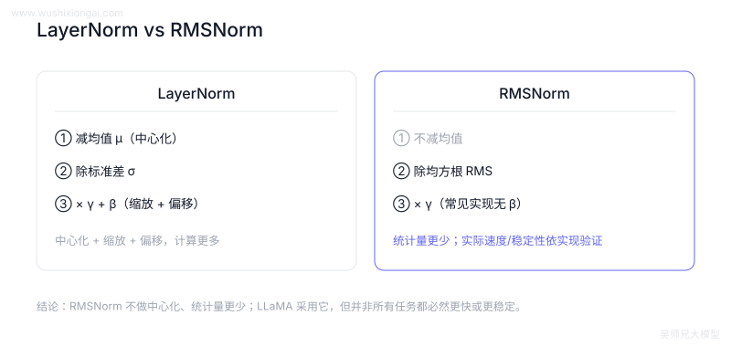

#### 【原题速答】
LayerNorm 同时中心化和缩放，RMSNorm 只按均方根缩放；后者统计量更少且被 LLaMA 采用，但性能与稳定性需按实现实测。

#### 【考察意图】
- 能否把"效率"拆到三个可量化层：FLOPs / 显存访存（HBM IO）/ 通信量（TP+SP）。
- 能否解释训练吞吐的真正决定因素是 kernel 与通信，而不是 norm 的 FLOPs（norm 本身可忽略）。
- 能否就"归约 kernel、TP 通信、混合精度累积"三个追问分别给出实现级答案。
- 能否避免把 RMSNorm 的效率优势夸大成"训练加速主因"（原文含混处的纠正点）。

#### 【深度解析】
**三个层级的开销拆解。** norm 的纯计算 FLOPs 在 7B 模型里占比 <0.1%，谁都不会用它喂满算力——因此"效率"实际是：
1. 算子层数：RMS 省一次 mean 归约与一次 x − μ 的 elementwise；
2. HBM 访存：RMS 读写 x 一次 + 平方 reduce（LN 中间量多一次读写），decode 阶段差距放大；
3. 通信/同步：TP/SP 下统计量跨卡归约是 all-reduce，RMS 单 reduce 直接减半该点的通信与等待。

** fused kernel 对照（原文追问核心）。** 生产系统把 norm 写成三类融合：
- norm + residual add（把上一次的残差加法一起做，省一次 HBM 往返）；
- norm + quantization（输出直接带 FP8 per-tensor scale，喂给 GEMM）；
- norm 前置输入的 attention q/k 侧融合（省入参显存往返）。
这些优化的收益以微秒计，在 decode 高频小 batch 下（每次 step ~10ms）累积可观；在 prefill 大 batch 下差异吞在 GEMM 里。

**TP 通信形态量化。** Megatron 式 TP 的 forward 是 all-reduce ×1/layer（attention 或 FFN 后）。若做 sequence parallel（激活沿 seq 切、norm 的统计沿 hidden 跨卡），每个 norm 点需要一次 extra all-gather + reduce-scatter。RMS 的一次 reduce 让此点的数值一致性处理省掉一次 reduce 步（对比 LN 的 mean 与 var 分两步），在 8 卡集群时可省 ~5–10%的总通信字节——这是 LLaMA 公司版训练里 norm 与无偏置组合的实际收益，同属"省一点是一点"的战略。

**混合精度累积（原文追问 3）。** Σxᵢ²、Σxᵢ 必须以 FP32/FP64 累积：
- bf16 的 8-bit 指数动态范围虽大，但 mantissa 只有 8 位 —— d=4096 的加和逆序误差在 norm 后被 g 缩放并进入 attention Q/K，足以影响 logits 第 3 位小数；
- 生产 kernel（Triton/flash-norm）用 tree reduction 或 two-pass（先局部 reduce 后跨界 merge）；
- fp8 训练里 norm 的统计精度显得更重要，因为输入已完成 quantize，统计错一档会产生系统性偏差。
共识实现：统计 FP32、输出 cast 输入 dtype，乘 g 前的中间一律 FP32。

**到底快多少（纠正数据）。** 大模型整训吞吐中，norm+residual 的融合把 RMS vs LN 的差距压到 3–8%（原 RMSNorm 论文的早期 7–64% 是在没有 fused kernel 的小规模模型上测的）。LLaMA 选用 RMSNorm 的真正动因是"完整极简套件（RoPE+SwiGLU+RMSNorm+无 bias）"的编码简单性与质量持平，而非性能主升浪。面试答出这一点即可与前两位竞争者分开（2016→2020→2023 的认知更新链）。

#### 【追问链深挖】
- **L1：为什么"减均值"在数学上看似免费却仍被去掉？** 中心化的收益不在均值重缩放本身，而在"使得 RMS 估计与均值无关、从而数值稳定"这一点——证明标准是对 LN 做去均值消融（RMSNet 论文的 original 消融即在原任务上打平），其代价则实打实是一次 reduce 和一次读。所以去掉它是把"收益未证实 vs 代价恒定"的交易接下来。
- **L2：TP 下如果切了 norm 参数会怎样？** 切范数参数（把 g 沿 hidden 切）会导致每卡对不同 channel 归一化，等价于分段 norm——语义改变且 join 处数值不连续；规范做法是 norm 参数在 TP 组内 replicate（显存代价很小，d 单参数），也可用 per-head/uncut norm（部分视觉模型做法）。
- **L3：混合精度里 norm 的 dtype 决策树？** 输入 fp16/bf16 → 统计 FP32 → 中间 mantissa 扩展 → cast 回，若是 attention 前的 QK-norm 则输出保持更高位（Q/K 的相对精度保留到 fp32 会直接影响 softmax 锐度）。生产代码里这是最容易出 silent bug 的地方。
- **L4：能不能把 norm 完全去掉（DyT 等 2025 新方向）？** 2025 年出现"learned tanh / dynamic tanh"替代 norm 的实验（Transformers without Normalization），在小-中规模模型可行，但大数据大模型上 norm 仍不可或缺。面试追问时给出"方向存在，尚不推荐生产替换" 的准确边界。

#### 【串联与资料】
- **本仓库关联：** 07（动机与原理正题）、16（数值稳定性正题）、20（Pre/Post-Norm 语境）、model-training.md（TP/SP 通信与数值约束的现代化版本相关条目）、inference-optimization.md（融合 kernel 与量化路径）。
- **资料一句话核心：** RMSNorm（2019）——中心化的收益在多数任务上不可分辨，重缩放不变性已经足够，砍掉它换来算子简化；LLaMA（2023）——把 RMSNorm 与无 bias、RoPE、SwiGLU 捆绑为现代基线配置，兼顾训练效率与开源复现。

---

### 10. CNN/RNN/Transformer 怎么选? · 详解

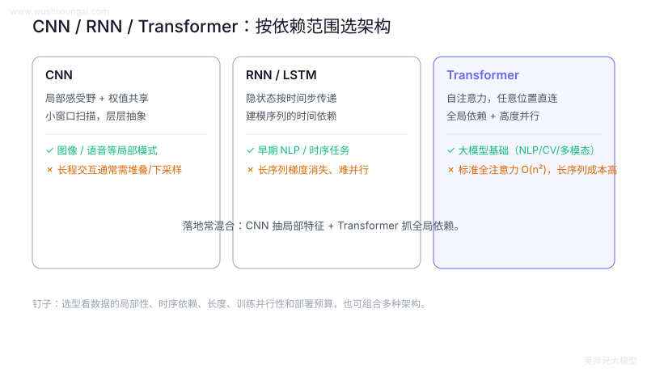

#### 【原题速答】
CNN、RNN 与 Transformer 分别强调局部归纳偏置、递归状态和注意力交互，选型需按数据与硬件验证。

#### 【考察意图】
- 是否理解三种结构背后的归纳偏置差异：局部平移不变（CNN）、序列状态压缩（RNN）、全局内容寻址（Transformer）。
- 能否给出复杂度对照表：每层计算、路径长度、训练并行性、流式推理行为。
- 能否给出真实选型矩阵（不仅是"Transformer 赢"+ 各种边界，2025 年还要会讲 hybrid 训练路线）。
- 能否顺着追问拉出流式推理、长上下文复杂度、混合架构基准设计三组讨论。

#### 【深度解析】
**总结机制对比。**

| 维度 | CNN | RNN (LSTM/GRU) | Transformer |
|---|---|---|---|
| 感受野 | 局部（按 depth 线性增长） | 全途（状态递压缩） | 全局（每层即可全看） |
| 每层复杂度 | O(k·n·c²) | O(n·d²)（每步） | O(n²·d)（attention）+ O(n·d²)（FFN） |
| 训练并行 | 高（卷积可批） | 低（时间上串行） | 高（mask 下所有位置并行） |
| 流式推理 | 状态 = 感受野窗口 | 天然（隐状态 O(d)） | KV cache O(n·d·L)；State-space 模型才有固定 O(d) |
| 最小操作路径长度 | O(n/k) | O(n) | O(1) |

（最短路径长度决定"梯度跨多远跳"，是解释 Transformer 在长程依赖上胜出的经典论证。）

**选型矩阵（2025-11 口径）。**
- 强局部模式 + 数据少 + 硬件紧（端侧 DSP/MCU 关键词检测、CV 骨干如 ConvNeXt 系列）：CNN 仍有成本优势；但主流 CV 已切换到 ViT-style + 卷积 stem 的混合。
- 极低延迟流式（ASR streaming、on-device 语言模型）：RNN/SSM（Mamba/RWKV）的固定状态 O(d) 推理在使用场景下占优。
- 大规模预训练 + 长上下文 + 通用语言任务：Transformer/decoder-only 垄断（2 题详解的扩展）。
- 超长序列（DNA、时序、音频 1M+ token）：State-space/hybrid（Mamba-2、Griffin/LongCat-hybrid）正在抢份额，LDSA 型 attention 在工业上以 sparse/window/hybrid 形式出现。

**量化算例（长上下文的算力账）。** d=4096，序列 n=128K：
- attention 核心 ≈ 2·n²·d = 2·(1.3e5)²·4096 ≈ 1.4e14 FLOPs/layer（单层注意力）；
- FFN ≈ 2·n·d·d_ff ≈ 2·1.3e5·4096·11008 ≈ 1.2e13 —— 注意力反客为主地超出 FFN 一个量级（8K 以下结论恰好相反）；
- Mamba 型 SSM 的扫描是 O(n·d·state)，FLOPs 线性、可完全并行训练，这是线性复杂度阵营的根本武器。
面试时可明确指出：n 在哪个阈值 attention 开始主导，跟 d、d_ff、头的实现与 KV 尺寸都有关，不能死记一个数字。

**混合架构为何在回归。** 注意力的"全局检索"能力与 SSM/RNN 的"恒定状态流式推理"互补：Griffon/Jamba 类架构把二者按层交错，小模型层面（≤1B）实测 hybrid 在长序列上准确率/吞吐双优；Decoder-only + SWA（sliding window）+ 全注意力分层（Llama-4/Gemini 系）是工业实现的主要形式。

#### 【追问链深挖】
- **L1：流式推理里 RNN 为什么仍不可替代？** 状态是 O(d) 常量、每步 FLOPs O(d²)；Transformer 的 KV cache 增长 (O(n)) 且每次需全读，延迟随会话长度线性涨。对"无限长对话 + 固定内存预算"的端侧模型，SSM/RWKV 型是目前标准答案；但退路是 attention 的 KV 压缩与 recurrence 化（如 recurrent-depth/RecurrentGemma，把 latent 处理循环化以获得固定状态）。
- **L2：长上下文的复杂度比较实验设计？** 三轴：a) 理论 FLOPs（固定 n）；b) 实测 TPS 与 p50 latency（含 kernel 发展差异）；c) 质量指标（长程 needle、LongBench 折算）。常见混淆是把"训练吞吐"与"推理延迟"混并，分开说才清楚。
- **L3：混合架构的基准怎么设计才公允？** 控变量：参数量、训练 token 数、数据混合一致；分层定格（离散层数 vs 每层结构）。前沿做法是用 isoFLOP 曲线族，在多个预算下比较（Marin 类研究范式，2025 已基本成为共识）。
- **L4：CNN 在 Transformer 时代真的没有位置了吗？** 局部归纳偏置在小数据/低分辨率任务上仍有低样本优势，多模态里位置/纹理类 token 前处理或下采样卷积 stem 是常见混合（ConvNeXt vs Swin 之争的收束）。

#### 【串联与资料】
- **本仓库关联：** 02（decoder-only 为何胜出的下游追问）、13（encoder-decoder 与 RNN 谱系的连接）、inference-optimization.md（流式与 KV/RNN 状态部署）、multimodal.md（视觉骨干之争）、rag-foundations.md（长上下文 vs RAG 的架构-side 观察）。
- **资料一句话核心：** LSTM（1997）——门控递归状态解决了长期依赖的训练障碍，是 RNN 时代的集大成；Attention Is All You Need（2017）——抛弃递归，O(1) 路径 + 并行训练确立新范式。

---

### 11. 逻辑回归原理怎么理解? · 详解

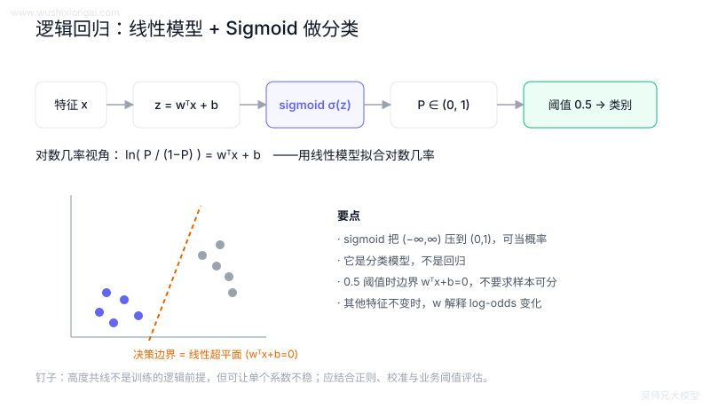

#### 【原题速答】
逻辑回归对线性分数做 sigmoid 得到概率，决策边界由阈值对应的等概率超平面决定。

#### 【考察意图】
- 基础题，但面试更深一层的意图是：把 LR 当作 LLM 时代的"原子组件"来理解（LM 头 softmax 之前的 logit 就是线性打分，sigmoid 是 2 类特例）。
- 能否推导 MLE、凸性、与"完美可分时 MLE 不存在"的几何原因。
- 能否给出正则化、校准、阈值选择三件套的工程答案。

#### 【深度解析】
**模型。** P(y=1|x) = σ(wᵀx + b) = 1/(1+e^{−z})，z = wᵀx+b。
**决策边界。** 对阈值 τ：σ(z) ≥ τ ⇔ z ≥ logit(τ)。τ=0.5 时 z≥0，是 wᵀx+b=0 定义的超平面；τ=0.8 → z ≥ ln 4 ——同一族平行超平面（间距由 b 移动），说明"决策边界"其实由 (权重方向, 阈值) 二元组决定。
**MLE 与凸性。** 负对数似然
```
L(w,b) = −Σ [ y·log p̂ + (1−y)·log(1−p̂) ]
```
= y 的 log-loss，对 (w,b) 凸（Hessian ∝ p̂(1−p̂)·xxᵀ ≽ 0 —— 且可写成 XᵀDX 的二阶形式）。梯度 ∇ = Xᵀ(p̂ − y) 结构与线性回归的最小二乘残差一致，这就是"LR 是 GLM 家族里 canonical link 下的伯努利模型"的现代讲法。
**"MLE 不存在"的推导。** 若数据线性可分（存在 w* 使所有 y_i(w*ᵀx_i+b)>0），沿 ||w||→∞ 方向：正确分类样本的 p̂→1，loss→0，但没有任何有限 w 取到最小值——似然在参数无穷远处达上确界而无最大值点。算法表现：wᵢ 分量持续膨胀、训练 loss 趋 0、验证不稳定。这正是 sklearn 里 `liblinear/newton-cg` 在 perfectly separable 数据上警告发力的正则原因。正则化（L1/L2）后解唯一且范数有界。
**校准。** LR 未正则且数据量够时的输出本身近似 well-calibrated（MLE 的一致性）；加了强 L2 或在不平衡数据上重采样后校准曲线会向上/向下漂移，需要 Platt/isotonic 再校准（evaluation-monitoring.md 的 ROC-AUC 与 ECE 对应）。LLM 时代的呼应：模型输出概率一般并不校准（}], softmax 温度与 RLHF 都会扭曲），校准需要单独做（temperature scaling、verbalized confidence）。
**阈值选择。** τ 由业务代价决定：假阳/假阴的代价比 C = c_FNP/c_FPP；最优阈值= cost-weighted 等概率点，τ* = c_FN/(c_FN+c_FP)（代价敏感框架下的结论）。工程上常见 ROC 上找 nearest(0,1)，或 PR 曲线上找 recall 目标。
**与 LLM 的接口（加分项）。** LM 头：logits = W_h h_last，softmax 归一。二元情形下 softmax 与 sigmoid 等价（Logit 对称化）；多分类 LR 即 softmax 回归。RLHF 里 reward model 常用二元头（chosen/rejected），其训练目标就是 LR 的 log-loss 的 pairwise Beth 版（Bradley-Terry）——因此本题是理解 preference model 的数学基底。

#### 【追问链深挖】
- **L1：MLE 不存在时怎么修？** 加 L2 正则（MAP 解释：w ~ N(0, σ²I)），或 early stop（梯度流的隐藏正则）；规范化后解存在且唯一。回答延伸到"过参数化大模型里为何没有这个病"：现代 LM 的 softmax 分类数巨大 + 数据丰富，完美可分类配置罕见，且训练目标里还有温度与 dropout 的隐式正则。
- **L2：权重可解释性怎么用对？** 每特征的 log-odds 是 w_i；odds ratio = e^{w_i} 是"该特征 +1 单位时 odds 的倍数"。这是它胜过 NN 的头号卖点（金融/医疗合规场景），但要求特征已标准化且无强共线（共线时 w 会在多个特征间分摊——这也是正则化的抽样理由）。
- **L3：LR 在 LLM pipeline 里还有哪些新岗位？** (a) reward model 头与 SFT 价值头；(b) 稠密检索的 query-doc 打分（LR 版本的双塔也可训练）；(c) 安全分类器（output safety filtering 的头）；(d) DPO 的隐式 reward 是 LR 数学同构。
- **L4：多分类推广与数值稳定？** softmax + cross-entropy 的 logits 减 max trick；类别 imbalance → focal/class-weight；类别数极大时 sampled softmax（负采样，如推荐场景）。

#### 【串联与资料】
- **本仓库关联：** 18（LLM 输出侧与 sampling 的衔接——LM 头、温度与 top-k 具有本模型的数学底层）、evaluation-monitoring.md（校准与阈值工程）、rlhf-alignment.md（reward model / DPO 的 LR 底层）、reranking.md（打分模型的通用形态）。
- **资料一句话核心：** scikit-learn 文档——把 LR 定义为带正则的 GLM 分类器，列出了求解器与正则的工程差异矩阵（liblinear / lbfgs / saga 的收敛特点）；statsmodels 文档——强调 MLE 视角与统计推断（系数 z-test、置信区间），与 ML 框架互补。

---

### 12. 参数规模怎么影响大模型? · 详解

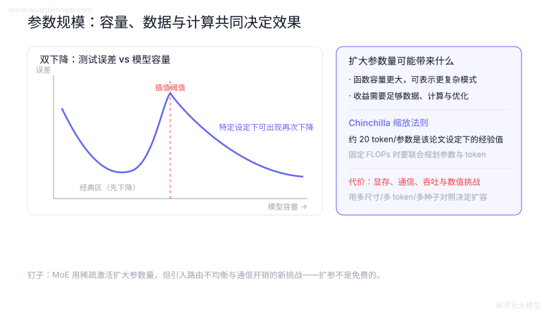

#### 【原题速答】
参数规模扩大模型容量但不单独决定泛化，数据、计算、架构、正则和优化共同决定收益与稳定性。

#### 【考察意图】
- 能否给出 Kaplan scaling law 的函数形式与指数（params/data 两个维度）。
- 能否推导/复述 Chinchilla（compute-optimal）结论：N∝D 的令牌数比例与周边修正（“20 tokens/param”这一常用速记的适用边界）。
- 能否描述 double descent 现象并解释其与 scaling law 的关系（large-scale overparameterization 下的良性过参数化）。
- 能否顺着追问给"固定 FLOPs / 固定上线成本"两种预算下的决策框架，包括数据质量与 MoE 的位置。

#### 【深度解析】
**Kaplan scaling law（2020）。** 测试 loss 关于参数 N、数据 D、算力 C 的幂律：
```
L(N) = (N_c/N)^{α_N}, α_N≈0.076 ; L(D) = (D_c/D)^{α_D}, α_D≈0.095; α_N > α_D 说明 Kaplan 认为参数的边际收益略大
```
不重叠的模拟下（Kaplan 的实验设计没有做过"同 FLOPs 最优 N/D 分配"的搜索，这是 Chinchilla 修正的点）。
**Chinchilla（2022）的 compute-optimal 推导。** 固定 C ≈ 6·N·D（训练一次的 FLOPs 近似），在 C 上最小化 L(N, D) = E + A/N^α + B/D^β。对约束求导得最优关系：D* ∝ N*，具体数值 D*/N* ≈ 20 tokens/param（Gopher→Chinchilla 70B/1.4T）。Kaplan 与 Chinchilla 的差异主要来自：(a) 学习率 schedule 的耦合（cosine 的终点与训练长度绑定，Kaplan 的早期实验被该 schedule 系统性限制了大 D 情况下的容量）；(b) 方法论层：Chinchilla 用 isoFLOP 多点拟合。
**纠正（2025-11 口径）。** "20 tokens/参数" 是ision额计算-最优的速记，需补三个 modern 语境修正：
1. **推理成本视角（Llama-3/Dense 时代）**：一旦考虑部署，权重持久成本远高于训练算力，"最优"的 N 变小、D 增大（如 Llama-3-8B 用 ~15T tokens ≈ 1875 tokens/param，是 Chinchilla 的 ~94×；官方明确称过度训练以换取小模型质量）。相应研究（如"Beyond Chinchilla-Optimal"的观点）用 训练 + 推理 token 的总成本重分配 N/D。
2. **数据质量**：质量与去重改变 D 的有效性（FineWeb-Edu 等过滤实验显示同 FLOPs 下质量优先的子集显著更优）；同等 loss 下数据配比（MoE/代码/多语言）也会改变 α/β 的有效拟合。
3. **MoE 的"参数量"含义分裂**：总参数 vs 激活参数。DeepSeek-V3 671B 总参/37B 激活—— MoE 参数的超线性收益被论文证明（且训练 loss 曲线呈现不同的scaling exponent）。
**Double descent（2019）。** 模型规模/epoch 越过插值阈值时 test error 先升后二度下降：第一阶段 classic bias-variance（小模型欠拟合），中间"临界容量"正好插值训练集而泛化最差，之后过参数化区域靠更多有效自由度而不 harmed 泛化（隐式正则 + 数据多样的贴合）。同现象亦在 "epoch-wise double descent"（固定大模型、训练轮次继续加时 loss 先升后降）。解释要点：overparameterized 区域 h 的许多自由度已"贴合噪声"，少许贴合变差反而由 loss 的再平衡换来更平的函数空间。
**Scaling law 与 double descent 的关系。** 在 L(N) 幂律观测下并未见"先升后降"是因为大 N 实验从未跨越插值阈值（数据也同步增大）；double descent 是小-中数据 regime 的性质。二者的统一视角是"容量/数据比值"曲线。

**决策框架（原文追问方向）。**
- **固定预训练 FLOPs**：先做 isoFLOP sweep 找 (N*, D*)，再按数据质量上限决定是否还需要更多 D（质量瓶颈时把预算给数据清洗/过滤）。若已有 70B 级权重可继承，distill/continual pretraining 的性价比经常超过从零再训（工业界 2024-2025 的共识，如 Llama-3 长期复训、DeepSeek 的 distill 线）。
- **固定上线成本（推理主导）**：把 N 压小而把 D 加大（over-train 小模型）+ 量化 + 投机解码；对比 MoE（总参大激活小）在总训练成本下的经济效益。要点是决策变量包括：N( евро active)、D、数据质量、蒸馏预算，而不是单独"加参数 vs 加 token"。

#### 【追问链深挖】
- **L1：为什么 20× 不是"自然常数"？** 它依赖于 loss 拟合形式（Chinchilla 的 A/N^α + B/D^β）、学习率 schedule 与架构；后续 Hoffmann 自己标注其结果受 LR schedule 影响。若在训练中动态 LR、或用 ReLU-free 的某些新架构，比例会漂移，因此正确的表述是"经验常数 + 依赖训练协议"，而不是普适定理。
- **L2：如何自己拟合本团队的 scaling law？** 步骤：功率 4 个 isoFLOP 点（0.1×~1× 目标预算），在每个点上取 3-4 个 (N, D) 分配并训练到收敛（LR schedule 与最终长度对齐），拟合 L(N, D) 的椭圆参数化、求 C 约束的切线；产出"训练前预测"与一次高性能大模型验证点。
- **L3：数据质量怎么当作 scaling law 里的变量？** 常见做法：把"有效 token 等价物" EDT 引入 D 项（质量系数乘以原始 tokens），或对混合配比做 simplex 内的固定点搜索（如 DeepSeek 的 data mixture 实验，Qwen 的 synthetic 数据回流）。关键结论现在已较多：高质量的合成/过滤数据能够使 isoFLOP 曲线整体下移。
- **L4：emergent ability 是 scaling 的可靠表现吗？** 关注点是评测度量（accuracy 硬指标 vs logprob 连续性有争议，Schaeffer et al. 表明很多"涌现"是度量人工造成的跳变）；但它与任务类型相关，能讲出即加分。

#### 【串联与资料】
- **本仓库关联：** 14（MoE 的参数-激活分裂）、02（decoder-only 架构与 scaling 的关系）、19/5（容量分配，即参数在 attention 与 FFN 之间的划分）、fine-tuning.md（继承/蒸馏式重训的经济学）、evaluation-monitoring.md（isoFLOP 实验 protocol 评测一致性）。
- **资料一句话核心：** Kaplan et al.（2020）——loss 对 N/D/C 均呈幂律，为大规模训练的可预测性提供了首份粒子物理级的经验图；Chinchilla（2022）——在同算力下按 D∝N 分配（~20 tokens/param）能显著刷新同预算大模型基线，活跃于 2022-2023 的模型规划手册；Deep Double Descent（2019）——插值阈值外的过参数化并不必然泛化变差，传统 bias-variance 观点需要修正。

---

### 13. Encoder vs Decoder 功能区别? · 详解

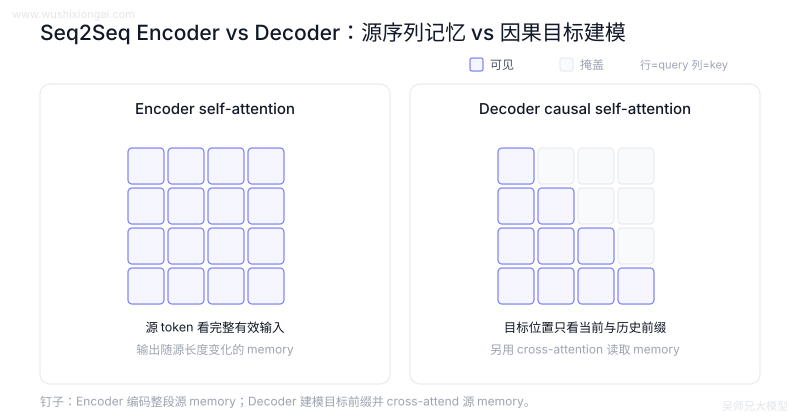

#### 【原题速答】
Seq2Seq Encoder 编码整段源序列为 memory，Decoder 对目标前缀做因果注意力并用交叉注意力读取该 memory。

#### 【考察意图】
- 基础结构题：能否精确地说清"memory 是什么、cross-attention 的 QKV 各来自哪里"。
- 能否顺原文追问把因果 mask、exposure bias、KV cache、beam search 长度偏置逐一展开。
- 能否将这一题与 02/03 题（decoder-only 为什么后来居上）形成解释闭环。

#### 【深度解析】
**结构逐件套。** Encoder：全双向 self-attention（no mask）+ FFN，输出 hᵢ（n_src 个），即 memory K=V=h（严格说每层 encoder 输出进入 decoder 的每一层 cross-attn）。Decoder：三段子层——masked self-attn（Q,K,V 全来自目标前缀）→ cross-attn（Q 来自 decoder 上层、K/V 来自 encoder 输出）→ FFN；原论文为 Post-LN。
**cross-attention 的可见性。** decoder 侧的每个生成位置看到整个 encoder 输出（不因果）；因此 memory 可以一次算完、在 decode 时作为常量重用——与 decoder-only 的"prompt 也在因果掩码里、每步都要重读 KV"有结构差异。
**KV cache 的分工。** Seq2Seq 里 KV cache 有两段：decoder 自己的自回归 cache（随生成增长）+ encoder 的 memory（一次固化、所有解码步共享）。翻译服务（encoder 长且被多请求共享）时，encoder 部分的显存/计算基数可观，因此 encoder-decoder 机的部署成本结构不同（vLLM 初版不支持，后-added）。
**因果 mask（追问 1）。** additive mask M[j−i>0] = −∞（softmax 前）；对 padding 与 beam 分支的处理同样需要扩展。错点：beam search 时同一 step 的 k 个候选要共享 mask —— batch 化实现中最容易 off-by-one（RoPE 里的 position id 同样要 per-hypothesis 序）。
**Exposure bias（追问 2）。** 训练用 teacher forcing（gold prefix）、推理用模型自身输出，条件分布不一致 → 错一旦累积发散。修法谱系：seeded sampling（Bengio 2015）、MIXER（Ranzato 2016）、sequence-level training（RLHF/RLAIF 就把对齐目标直接放在 rollout 上，是这一问题的现代大解法——影响在本仓 rlhf-alignment.md 有专题）、以及 data augmentation 的 self-training（self-training 为核心的现代 mode，而非两位老法的直接 stack）。
**Beam search 的长度偏置（追问 4）。** 概率连乘天然偏好短序列 → log 归一化：score = logp/len^α（α~0.6-0.7 常用）；还有 length penalty 的 timestep variants、diverse beam search（分组惩罚相同前缀）、以及最新的"beam 不见得比采样好"的论断（LLM 开放生成时代）。算例：两条候选，短句 logp=−5 (len 3)、长句 logp=−7 (len 6)：未归一化短句胜，但 normalized: −1.67 vs −1.17 → 长句胜——一句小例说明为什么长度归一化必要。
**Encoder vs Decoder-only 的位置（回扣 03 题）。** cross-attn 把"源的表达"独立成模块，是现代模型不那么用它的原因之一：参数预算、任务接口的统一、以及长文本时 memory 的二次变换成本。

#### 【追问链深挖】
- **L1：decoder 中 cross-attn 的 KV cache 要不要存？** encoder 侧的 K/V 长、可共享（batch 内固定）；真值是"必须存，且与 decoder 的 token cache 分开管理"（vLLM 的 encoder-decoder 推理路径即基于此）。讲清楚就能在工程面加分。
- **L2：测 exposure bias 怎么实证？**_dirs：teacher forcing PPL 在 gold prefix vs model prefix 的 gap（"self-conditioning gap"）；或用 scheduled sampling 的 PPL 改善幅度对照 RL rollout 前后。
- **L3：为什么现代 decoder-only 的 sequence2seq 用 prompting 就够？** 因为在 100B+ 训练语料里"源-目标拼接"已隐式学得条件分布（GPT-3 翻译能力），而 encoder-decoder 的收益只在"源侧可复 search/极小算力"约束下仍在（小算力翻译部署仍是 T5/BART 的阵地）。
- **L4：beam 什么时候不该用？** 开放式生成（对话/写作）：beam 的 mode-seeking 会产出乏味且自恋 (likelihood 冒头) 文本；用 sampling + repetition penalty + entropy/长度惩罚。结构化/翻译/代码重写等约束性生成，beam + 约束（d 太 candidate 剪枝）仍占优。

#### 【串联与资料】
- **本仓库关联：** 02（decoder-only 演进的对照面）、03（GPT vs BERT 的半结构景观）、18（自回归逐步生成与分布）、02 的 PagedAttention 追问与本题"encoder memory 缓存"呼应、inference-optimization.md（beam 与 sampling 的工程参数完整表）。
- **资料一句话核心：** Attention Is All You Need（2017）——Encoder-Decoder + multi-head self/cross attention 的完整模板，确立现代 NMT 基础结构；Sutskever LSTM-S2S（2014）——encoder/decoder + bottleneck 的先声，说明无耦合的固定向量压缩在长文本上失败（参考资料的 pmid 版正文）；Scheduled Sampling（Bengio 2015）——exposure bias 的首个系统化缓解，序列级 RL 训练的动机源头之一。

---

### 14. MoE 怎么提升 Agent 能力? · 详解

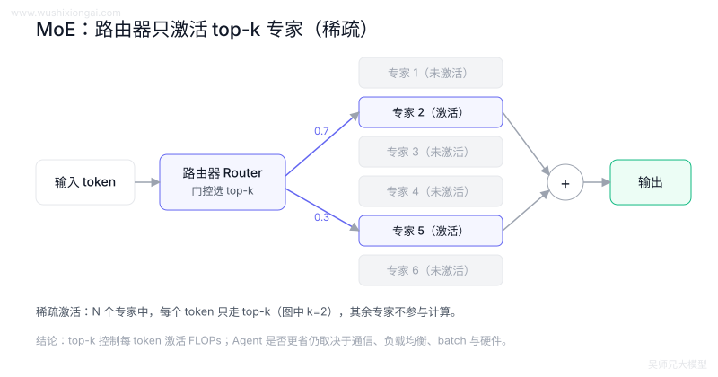

#### 【原题速答】
稀疏 MoE 让路由器为每个 token 选择少量专家以控制激活计算；Agent 的实际收益仍受专家通信、负载均衡和外部编排影响。

#### 【考察意图】
- 能否给出 MoE 的机制公式（路由、top-k、负载均衡 aux loss）并能算一笔"总参 vs 激活"的账。
- 能否辨析：MoE 提升的是"同算例下的模型容量"，而 Agent 能力是"任务系统"层面的问题；两者通过"长任务更多计算、更强领域分发"间接连接。
- 追问三条：all-to-all 通信、专家负载、编排层权限与回退——每条都需要部署细节的答案。

#### 【深度解析】
**MoE 层公式。** 对每个 token 的表示 x，路由 gate：
```
g = softmax( topk( W_r·x + bias, k ) )      （DeepSeek-V3 用 sigmoid + normalization 变体）
MoE(x) = Σ_{i∈topk} g_i · Expert_i(x)
```
Expert 通常是 FFN（每专家 d×d_ff 小矩阵 DeepSeek 是 ~2048 hidden shared 部分 + 256 路专家）。总参 = n_expert×专家参数；激活 = k×专家参数 + dense 部分。
**算例（DeepSeek-V3 的完整账本）。** 61 层中前 3 层 dense、其余 58 层 MoE；每层 256 个路由专家 + 1 共享专家，激活 top-8（+1 shared）；每专家中间维 ~2048。总参数 671B，激活 ~37B（约 5.5%）。训练 FLOPs/eq dense：激活参数 ≈ 37B×6×tokens，但训练容量(knowledge) 接近 2.2× 同 FLOPs dense 的等效（论文报告 loss曲线优于 dense 同训）。性价比的来源：把"知识容量"放到参数（显存便宜/不消耗 FLOPs），把"每 token 计算"限制到 k 个专家。
**路由与负载均衡。** 直接 top-k 路由会 collapse 到少数专家（正反馈：被训多了的专家更易被选 aux loss 解决：Switch 采用可微负载项 `load_balance = α·N·Σ f_i·P_i`（f 实际负载率、P 路由概率），GShard 类有 local/noisy top-k 与 capacity factor。**纠正（2025-11 口径）**：DeepSeek-V3 走"auxiliary-loss-free"（动态 bias 调节 expert 选择倾向，辅以极小 sequence-wise aux），代表 phase 3 的方案——面试沿用 aux loss 一个说法属于 2022-2023 常识，答出 bias-based 才贴合前沿。
**MoE 与 Agent 的关联（原题主线）。** 间接链条：
1. Agent 的序列长（多轮对话 + 工具观测），每 token 激活计算小 → 同延迟预算下可以更大容量/上下文；
2. 工具/领域唤醒能力：理论上专家会按'}领域'自动分化（代码/数学/多语言），但实测是 token 级、不按语义任务整体路由，因此"专家=领域技能"是热门误解，系统地讲清楚这一点是加分的；真正的能力提升是训练总容量下移 loss 曲线，之后由后训练（fine-tuning/RL）把能力编码进去。
3. MCP/tool orchestrate 的编排层（权限、重试、fallback）跟 MoE 无关，是系统层；但 MoE 的"专家不均衡 → 不同请求延迟方差大"会导致 Agent 观测里 latency jitter，影响编排策略（对时延敏感的 tool 改 parallel 执行等）。

**纠正（2025-11 口径）。** 原文速答"路由器为每个 token 选择少量专家"完全正确；但常见发挥"MoE by agent 需求自动挑专家" 是错的：token-level 路由不具备任务级语义分发的保证（论文证据：Switch/DeepSeek 论文均展示专家按 token 局部统计特征分组）。Agent 侧的真实收益: 训练成本降低、上下文窗口可以更大（MLA+MoE 让上下文端到端便宜），编排层的地位不变。

#### 【追问链深挖】
- **L1：all-to-all 通信为什么是训练瓶颈？** 专家放在不同 rank、token 要"跨卡 dispatch/combat"到目标专家再回收（all-to-all 两次）。EP=64 时通信占比体现出 FLOPs 越大越凸显。DeepSeek 的工程回应是 dual-batch overlap（把 attention 与 all-to-all 重叠，通信与计算并行）＋ FP8 dispatch 通信压缩；这类内容在 inference-optimization.md 里也有对应布局。
- **L2：专家负载不均怎么测量与治理？** 指标：per-expert token 数分布（max/mean 比，capfactor 溢出率）、routing entropy、dropped token 率；治理分层：aux loss 权重、capacity factor 增大、expert placement 调整（EP 与 DP 维度切分 hybrid）、最后才是"专家重置"。
- **L3：Agent 编排层的权限与回退怎么设计才跟模型侧兼容？** 权限（允许工具白名单/网络沙箱）、回退（API 失败 → 换 endpoint/换模型/换工具），与模型层的 MoE 无关但通过"延迟稳定性"耦合：给 Agent 一组模型端点的 SLO（首发延迟/p999），编排层用它决定超时与并发预算；面试上能同时展示"模型容量"和"系统可靠性"两条线是亮点。
- **L4：MoE 会不会伤及对齐/长输出质量？** 已知问题：(a) 稀疏层对后训练（DPO/RLHF）的梯度统计噪声更敏感（专家切换贡献不稳）；(b) 长输出上的专家跳变导致风格 drift。缓解：shared expert（稳定主干）+ 细粒度专家 + 更高 k（DeepSeek 系列的法宝）。

#### 【串联与资料】
- **本仓库关联：** 12（参数规模 vs 有效参数的 scaling 视角）、04（MLA+MoE 同为 DeepSeek 系的两大效率杠杆组合）、02（Agent 的系统语境）、inference-optimization.md（EP 部署/双流重叠）、fine-tuning.md & rlhf-alignment.md（稀疏专家的 SFT/RL 细节）、rag-foundations.md（Agent 的工具与检索编排）。
- **资料一句话核心：** Switch Transformers（2021）——top-1 路由 + aux 负载均衡 loss 让 MoE 训练稳定化，把 MoE 从"难训" 减到常规配方；GShard（2020）——万亿级 MoE 的分布式路由/专家切分与 capacity factor 机制；ReAct（2022）——Agent 能力被视为"推理-行动交替"的提示范式（与 MoE 无直接关系，作为后续追问"编排层"的衔接材料）。

---

### 15. VQ-VAE 原理与完整结构 · 详解

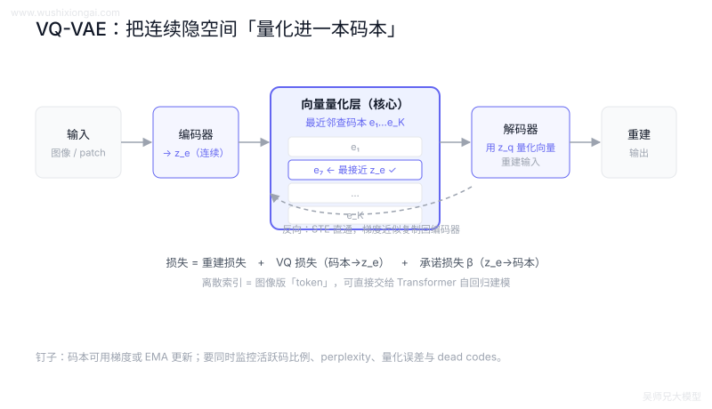

#### 【原题速答】
VQ-VAE用离散码本量化编码表示，并联合优化重建、码本与承诺损失。

#### 【考察意图】
- 能否写清 VQ-VAE 三件套：encoder → 最近邻量化 → decoder，以及为什么需要离散 latent（后续 LM/AR 生成要用离散 token）。
- 能否推导三项损失（重建 / codebook / commitment）并解释 straight-through estimator。
- 能否区分两类"坍塌"（codebook collapse vs posterior collapse）——原文追问的核心，也是检验深度理解的地方。
- 能否讲清"为什么 VQ-VAE 论文没有生成组件"，及后续（VQ-GAN / Latent Diffusion / Residual VQ）如何补全先验。

#### 【深度解析】
**完整前向。** (1) encoder E(x) → z_e ∈ ℝ^{H×W×D}；(2) 量化：对每个潜位查最近码本向量 e_k：`z_q(x) = e_k, k = argmin_j ‖z_e − e_j‖₂`（下标用码本网格索引，得到 latent index map）；(3) decoder D(z_q) → x̂。码本 K 个向量，训练时用 EMA 更新或反向传播 loss 更新（原论文用后者，混用 slide 的 stop-grad）。
**训练损失（原文三项）。**
```
L = ‖x − D(z_q)‖²  +  ‖sg[z_e] − e‖²  +  β‖z_e − sg[e]‖²
    重建项            codebook loss        commitment loss
```
- 重建项驱动 decoder 用 z_q 重建（同时也逼 encoder 输出落在码本可达范围）。
- codebook loss 把被选中的 e 向 encoder 输出拉近（只对 e 有梯度，encoder 被 sg 隔断）。
- commitment loss 把 encoder 输出锚定在被选中的码本上（系数 β≈0.25），防止 z_e 随机漂移导致量化抖动。
**Straight-Through Estimator。** argmin 离散不可导：前向用 z_q（量化值），反向把 ∂L/∂z_q 直接复制给 z_e（`z_q = z_e + (z_q − z_e).detach()`）。这等价于把量化视为 identity 的线性化，因此 dist 的 encoder 梯度是近似的（非精确）；在训练早期编码分布不稳定时会出现码本利用率 anomaly（直通风险就是后面追问里关于死码的根源之一）。
**与 VAE 的差异（完整结构对比）。** VAE：连续高斯 latent + 重参数化 + KL 到先验；VQ-VAE：离散 categorical latent + 硬指派 + 三项损失（没有 KL 项，decoder side 时代原论文 latent prior p(z) 为 uniform）。因此 VQ-VAE 没有"posterior collapse"的原发机制（z 与 x 相关性强），但引入 codebook 塌缩风险。这就是 17 题的主题。
**生成怎么做（完整结构里先验部分）。** VQ-VAE 原文只学习 z 的先验 p(z)（PixelCNN 级别的 AR 模型）做无条件生成；这正是离散 latent 的卖点——适合现代 LM 化的 AR prior（GPT-style），也铺出	VQ-GAN（码本 + transformer 接管先验、高清图像）与 LDM（在 VAE 的连续 latent 上做扩散，不是 VQ）两条现代标准路线。音频一侧 SoundStream/EnCodec 用残差 VQ → 码本多层（RVQ） 以高质量音频 token 流遗存到 LM。
**量化辨析（算例）。** 码本 K=1024、D=256 维。若每潜位独立采样，状态空间 1024^{H·W}；但潜图 receptive field 冗余度高，实际模型的 effective usage 通常 << K^HW。一个诊断经验值：healthy 训练的码本 perplexity 应接近 K 的 60–95%（log₂ K ≈10 bit 码本中 perplexity >6）；perplexity 骤降到 2-3 说明 TopK 附近码被垄断（详见 17 题）。
**纠正（2025-11 口径）。** 原文速答说"联合优化重建、码本与承诺损失"正确；但要说清当前主流实现：codebook 项大多被 EMA 更新替代（不再做梯度更新），因此"三项联合"在 codebases 里常写成"重建 + commitment（+ EMA）" 两项 —— 讲清这个差异说明你真读过代码。

#### 【追问链深挖】
- **L1：用哪些指标区分"码本塌缩"（codebook collapse）与"后验塌缩"（posterior collapse）？** (a) latent 使用率（k 个码被用到的比例）与码本 perplexity——低是该塌缩；latent 互信息 I(z;x) —— 很低是后验塌缩（decoder 忽略了 z）；(b) 重建消融：把 z 换成码本均值/随机码仍能重建 → decoder 侧绕过了 latent；换码后重建完全断（应该敏感）→ encoder 已压进信息。(c) 混合证据：码本 perplexity 正常但 I(z;x)≈0，一句话结论是"码本活着但没信息"。
- **L2：EMA 更新为什么普遍取代梯度更新？** 梯度方向需要 stop-grad 的精细配置，且易被大梯度冲击；EMA 的更新仅用 batch 内 assign 到该码的样本均值，自然抑制振荡（decay 0.99 典型）；同时 dead code 检测可以独立接入（usage 计数即可触发 re-init），工程上更好管理。
- **L3：Residual VQ 的原理与意义？** 单层 K 个码的"信息带宽"= log₂K bits/position；RVQ 把残差继续喂给第 2/3… 级码本，实现 log₂(K)·L bits，从粗到细逼近目标（SoundStream/EnCodec 用之，使 L 级 1024-code 也能重建 44.1kHz 音频）。代价是级联 argmin 的训练难度和推理串行性。
- **L4：现代生成的先验选择？** AR（LM over tokens）适合语言式条件绑定（control tokens 简单），Diffusion over continuous latent（LDM 路线）胜在高分辨率的 quality。2025 的 MAR/Flow-style 是"AR + 连续 token"的折衷（bidirectional transformer + diffusion loss 取代 softmax 上一条路线兴起）。面试可点出自己的判断（生成任务选 AR+VQ 还是 LDM 取决于条件结构复杂度与分辨率要求）。

#### 【串联与资料】
- **本仓库关联：** 17（码本塌缩治理的完整专题）、08（同为"生成建模"族，扩散路线的对比是多模态热门追问）、multimodal.md（VQGAN-k/LLaVA/multi modal tokenizer 转 token 的整合点）。
- **资料一句话核心：** Neural Discrete Representation Learning（van den Oord et al., 2017）——提出码本 + 直通 + commitment 的离散 VAE 模板，为"把世界 token 化"奠定基础。

---

### 16. RMSNorm vs LayerNorm：数值稳定性怎么比? · 详解

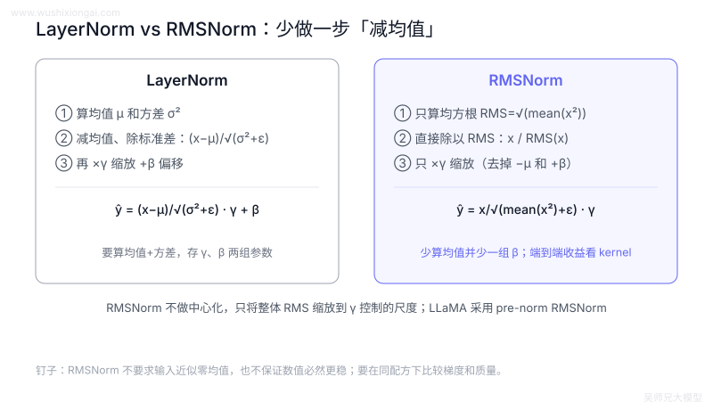

#### 【原题速答】
LayerNorm 执行中心化与方差归一化，RMSNorm 只按均方根缩放，实际效率与稳定性需基准验证。

#### 【考察意图】
- 这题是 07/09 的第三视角：前两题谈"为什么选/效率"，本题谈"稳定性"。
- 是否理解 LN 中心化对"DC 分量/偏置型离群"的鲁棒、RMS 对"幅值型爆发"的处理边界。
- 能否设计一组公平消融（同初始化/同精度/同数据）把"稳定性差异"归因到具体组件（原文追问）。
- 能否给出生产里真的会出事的数值场景与护栏。

#### 【深度解析】
**两算子对扰动的敏感谱（本质对照）。**
- LN：减去均值 = 消掉"低频共模"分量（所有 token 同向的整体偏移/DC），再用 σ 缩放。对"激活整体上漂"（如 bias 泄漏、极端 logit 这类共模漂移）鲁棒。
- RMS：只做幅值缩放，共模分量仍会保留（如果 x 的均值大，RMS 大主要由它贡献，除完之后 1/2 位置还有 ×μ 残留？——更精确的表达：RMS(x) 的估计被偏移拉高，缩放后"信号/DC 比"未改善 → 共模干扰会以不同 shape 进 attention）。这一点是 LN 在"理论稳定性"上略胜的地方，也是它与表达能力（无 bias 参数）交换的标的。
- 但实证上大语言模型训练中真正会爆的三种数值事故（fp16/bf16）：(a) 激活幅值爆炸（SSM/MoE 内层，RMS 一定收住）；(b) fp16 下溢 σ=0（RMS 有 ε+=1e-6 保护，实际风险同样低）；(c) attention logits 极化（softmax 饱和）——三种事故里 norm 类型都不是主因，真正主导的是 QK 缩放/位置编码/学习率。**结论方向（对应审题的"实测判断"）：** 稳定性差异来自"问题有没有出在均值分量"，如果答案是"几乎不会"，LN 的额外保护就是花不花都行的保费。

**生产数据佐证（2025-11 口径）。** LLaMA/GPT-3/Qwen/DeepSeek 全系 Pre-Norm + RMSNorm 大体一致 (大模型路线里 Post-LN 的稀缺也说明了这一点)，其大规模下训练失败案例的归因多为 lr/分桶/fp8 scale 等其他成分（loss spike 复盘文献）。当下 norm 相关的真正敏感点是：bf16 累积精度（09 题追问 3 详解）、norm 权重的 FP32 累积、以及 fp8 训练时对 norm 输入做 dynamic scaling 的正确性。

**消融设计（原题追问的答案）。** 严格对照要锁四个变量：
1. 同一模型/数据/step/LR schedule，只换 norm（或直接启用同源实现不同开关）；
2. 初始化同源：LN 与 RMS 的 g 初始化同为 1，b=0（等价于初始时 RMS ⊂ LN，其均值分量近 0）——这至关重要，让两者起点完全重合；
3. 精度对齐：两个都用 bf16 输入 + FP32 统计 + FP32 中间，测量端到端 loss 比较"稳定性差异是否消失"——借此判定差异是算法还是 kernel 精度；
4. 观察 (a) loss 曲线 ±(b) 激活统计（per-layer std/mean 的轨迹），(c) 离群 token 比例（如 |h|>6σ），(d) spike 事件响应（手动注入偏置型扰动 vs 幅值型扰动的对照）。
这样能把" LN 的 DC 抑制对 xx 场景有效"的结论分离出来，避免把 kernel 实现差异误读为算法差异。

**量化算例。** d=4096，输入 x 的均值 μ 会污染 RMS。若 DC 分量 μ=1，随机分量幅度 std=0.15：LN 输出信号/噪声比 ≈ 0.15/σ原理上全保留（DC 已减）；RMS 缩放分母 √(μ²+0.15²)≈1.011，几乎不缩（DC 项把 RMS 从 0.15 撑到 1.011），信号被"稀释"到 ~0.148 —— 这个小提示说明当 DC 主导时，RMS 会把信号打得过弱（因为 g.g 会学回补偿，但这正是为什么在"平均项大"的场景（如 logit 流多从 bias 来）LN 更稳）。

#### 【追问链深挖】
- **L1：怎么判断我训的模型稳定性问题是 norm 引起的？** 分辨清单：记 norm 前后的激活分布轨迹（排查norm 是否饱和）、b 值（有 bias 时 DC 组件）、loss spike 是否伴随 grad norm 爆而无激活 outlier → 更多是 lr/optimizer 问题；activation outlier 情形则先查 QKV 的位置编码与 lr（大规模 outlier 多因 attention 的 logit/softmax 路、RMS/QK-norm 入手）。
- **L2：Spike 的应急链？** (a) 冻结 spike 步的权重或回滚 checkpoint；(b) skip grad（signal loss spike 时中断/恢复）；(c) 找出离群层禁用其 norm（或加 fallback）；(d) 调 lr/换 optimizer。工业里 loss spike 的处理（与 MoE 相关：14 题）已经形成 playbook（张量精度、fp8ranges、QK norm protect）。
- **L3：为什么 post-LN 原始架构在 BERT 尺度仍用而无恙、但 100+ 层就训练困难？** 与其说"depth"，更精确说是"减少 warmup 梯度残差路径的 token 幅值增长"问题；方案是 warmup + careful 初始化，或改 Pre-LN（05/20 题里那个梯度视角）。
- **L4：新方向 normalization-free（DyT 等）的稳定性成色？** 2025 年早期结果表明小-中型模型（≤1B，例如 речи上）可用 tanh 动态缩放替代；但大模型上训练稳定性极限尚未确立；停止把(norm-free)当作生产推荐。

#### 【串联与资料】
- **本仓库关联：** 07（为什么选择）、09（效率）、20（Pre/Post-Norm 与归一化配置在现代模型中的最终形态）、model-training.md（混合精度/训练事故复盘专题）。
- **资料一句话核心：** RMSNorm（2019）中心化收益基本不变性已够（实测打平或略优）；LN（2016）中心化 + 方差化组合的原始定义（本解析用它作为"共模抑制"的理论依据）；LLaMA（2023）大模型实战选择 Pre-Norm+RMSNorm（训练稳定性的现代共识配置）。

---

### 17. VQ-VAE 码本塌缩治理 · 详解

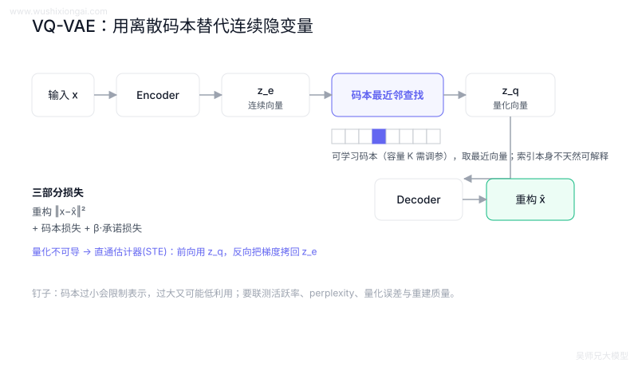

#### 【原题速答】
VQ-VAE死码源于编码分布和码本更新失衡，应监控码本占用与困惑度并按证据采用EMA或重置。

#### 【考察意图】
- 能否给死码一个因果链而不是现象描述：直通梯度偏差 + argmin 赢家通吃 + EMA decay 的低频长尾。
- 是否会监控正确的指标（usage/entropy/perplexity，不是 loss）。
- 能否对治理手段做证据化选择：EMA vs 重置 vs 随机重置 vs reinit + 它们在原论文/工业里的具体形态。
- 追问链的核心：EMA/commitment/dead codes/RVQ/生成先验一整套的相互位置。

#### 【深度解析】
**死码出现的机制（因果链）。** (1) 直通估计只在"被选中的码"上产生梯度/EMA 更新，一旦某码早期被冷落，它没有机会"靠近"encoder 输出的任何区域；(2) argmin 是赢家通吃（massive assignment 集中），unused 码位置一直停在初始值；(3) EMA 的 decay（0.99）对一个从没被 assignment 的码不做任何修正，因此即使 encoder 分布移动也不会"扫进来"。因此是"初始分布差 + 更新规则只照顾被选中者"两重失衡——速答中的"编码分布和码本更新失衡"即是此意，详解补充了三条具体机制。
**监控指标（比"看 loss"重要）。**
- 码本使用率（used codes / K，batch 与滑动窗口双口径）；
- 码本困惑度 perplexity = exp(−Σ p_k log p_k)（p_k = assignment 频率）：healthy ≈ 0.6–0.95·K；崩塌时 →个位数；
- latency 分布（如果做 RVQ：低层/高层 code 的命中率分开查）；
- 重建指标（FVD/PSNR/STOI）与（关键）"换码敏感性"。
**治理手段链（按证据择用）。**
1. **EMA 更新**（主流默认，非"或"）：对每个被 assignment 的码，`e_k ← m·e_k + (1−m)·mean(z_e assigned)`，自带平滑与旁路；只解决"更新规则"那一半问题；对"从未被 assignment"的死码无能为力。
2. **Dead code 重置**：检测 usage==0/低于阈值 → 把该码随机重置为当前 batch 的 encoder 输出样本（原论文 aux distribution 的做法是随机采样重置；工业常用 batch 内随机样本初始化）。收益立竿见影，但需要控制"重置风暴"（一连串码被翻新 → 训练不稳定）；标准做法是限制每 step 重置数量上限。
3. **加入噪声/软分配**（Gumbel-Softmax / softmax over 或 近似 −‖·‖²）：让低分码也有非零的首选概率，探索 pressure；适合小 K、避免 train/infer 不一致时用 hard assign。
4. **码本初始化与冻结阶段**：训练前用 kmeans 初始化（对 encoder 输出的一个早批做聚类），或先冻 codebook 500 步让 encoder 分布稳定再开放更新；对小型任务的稳定性提升明显但非万能。
5. **结构级手段**：Residual VQ（把单码本的 8/1024 维"码硬"切成多级）与 product quantization，弱化"每个码必须 covering 全 D 维"的负担；以及增大投影维（避免"码本离散 - encoder 连续"的 mismatch）。
6. **熵正则**（entropy penalty / usage entropy 奖励）：把"utilization"写进 loss（如 最大化 assignment 熵），但权重敏感，多作为补丁第三档。
**判别治疗（工程原则）。** 先 EVdead（重置配额）和 EMA（更新规则）两个"零成本必选"；剩余的 entropy 正则/Gumbel 等按 usage(perplexity) 曲线决定；重建质量是最终裁判（perplexity 高而重建差 = 白折腾）。
**下游生成先验（原文追问）。** 码本治理的终极意义是"给下游生成器一个分布平坦的 token 空间"：码本畸形 → LM/Prior 学到的 token 分布畸形，生成时 mode 掉一大堆。VQ-GAN/LDM 路线允许先验吸收部分码本黑箱；但 RVQ 层的 code 使用不均衡依然要治理（SoundStream 的做法：各层 decoupled 量化 + 死码重置同时用）。

#### 【追问链深挖】
- **L1：EMA、commitment、re-init 三者各解决什么？** commitment 解决"encoder 与码本节奏不配"（z_e 漂太快）；EMA 解决"码本更新噪声"（被选中者的移动平滑化）；re-init 解决"码本覆盖不完整"（从未被用的码）。第二层答案应能列三者的到位顺序与适用期（EMA+re-init 全程；commitment β 通常 0.25 且训练后期可减半）。
- **L2：RVQ 为什么能缓解塌缩，又引入什么新问题？** 每层只需管"残差的 K 个代表点"——每层的信息负担降低、使用率均线抬升；代价：级间训练不同步会产生"量化噪声级联"与层级失配（resolver：last-layer loss 权重 apprenticed higher；SoundStream 的 loss-weighted 结构）。
- **L3：生成先验（LM/Transformer over codes）怎么与码本耦合训练？** 两阶段（VQ 先冻结再训先验） vs 联合训练（先验梯度不走直通、不回传 encoder）。两阶段更稳定（VQGAN 的 canonical 做法），联合训练适合小模型/带 EMA 码本的场景（如 music LM 的分层训练）。
- **L4：码本从随机初始化换 kmeans 初始化的效果如何量化？** 以 5 个 seed 的 mean usage/perplexity 为主指标，初始化收益在训练中期（<20k 步）显著，后期被 dead-code 重置的隔断作用稀释——给出"先验经验值+可复现实验" 而非空对空。

#### 【串联与资料】
- **本仓库关联：** 15（结构与损失的正题）、08（扩散先验与 VQ 先验的生成路线对比）、multimodal.md（VQGAN/SoundStream 类 tokenizer 的现代工程整合）。
- **资料一句话核心：** VQ-VAE（2017）——commitment + 直通的原始模板；VQ-GAN（2020）——码本 + Transformer 先验 + 判别损失把离散化推向高清图像；
 VQ tied 的 RVQ 系（SoundStream 2021 / EnCodec）——多层残差量化把码本治理推到工业音频 codec 水准。

---

### 18. 自回归生成用 token id 还是概率分布? · 详解

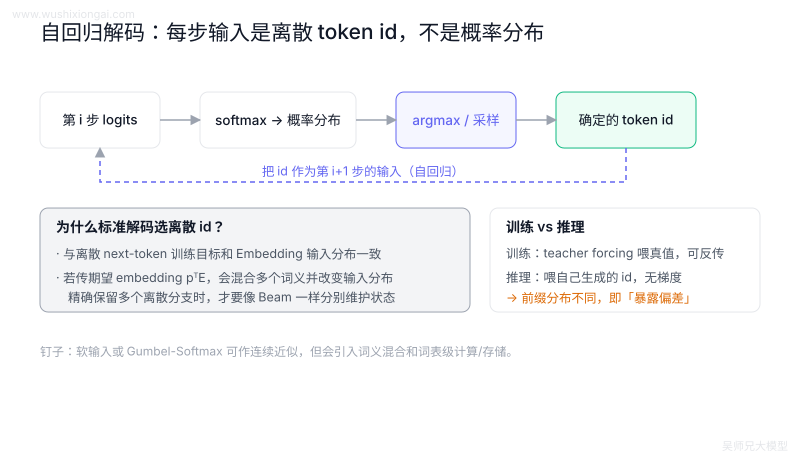

#### 【原题速答】
自回归解码下一步输入已选离散 token 而非完整概率分布，采样策略只决定如何选择该 token。

#### 【考察意图】
- 能否说清"模型训练/前向计算的是分布、而后馈输入的是 one-hot embed"，并解释为什么必须这样（embedding 表只能查 id）。
- 能否顺着追问展开：训练-推理的分布偏移（exposure bias）、Gumbel-Softmax 目的、Beam 状态、KV 复用。
- 能否把"工程接口"讲成体系：p_θ(·|·) 的 logits → sampling → 拼进 KV cache → 下一步。

#### 【深度解析】
**接口分解。**
```
循环 body：
  logits = LM(h_t)                  # 分布 p_θ(x_{t+1}|x_≤t)
  x_{t+1} = sample(logits; strategy)  # 离散选择（greedy/top-k/top-p/温度）
  h_{t+1} = Embedding(x_{t+1}) + Pos   # 只吃已选 id
  KV cache 更新 ← h_{t+1}
```
为什么必须送离散 id：(a) embedding 表按词表索引（分布没有 index 可查）；(b) 部分"软"替代（嵌入各 token 均值）数学上等价于 logit 加权混合的期望激活，但注意力/softmax 的非线性使它不是同一条前向的结果（soft-mix 信号在网络里会"糊"掉 token 特异性，且 KV cache 无法承载"分布"）；(c) 蒙特卡洛/解码语义的等价性（AR 模型生成的一个具体序列）只有在离散选择下成立。
**采样策略谱（这些策略只回答"如何选"）。**
- greedy：argmax，适合确定性任务（分类头、代码重写）；
- temperature T：p ∝ exp(logit/T)——T<1 收敛、T>1 多样；已 re-formulate 为 re-scale logits；
- top-k：保前 k；top-p（nucleus）：保累计 p；min-p（2024）：按 p_max 比例阈值（小模型鲁棒），top-σ；无重复/ penalty（frequency/presence）、DPO/RLHF 后的 logit bias；
- beam search：多类 hypothesis 并行维护（见 13 题)；
- speculative decoding：draft 模型出 k 个候选，target 一次验证（等于把"采样的 token"作为供应链，而分布只用于接受/拒绝，与本题的 "token 而非分布" 直接对应）。
**训练 vs 生成的分布偏移（追问 1）。** 训练在小 batch 里用 gold prefix（teacher forcing），模型每步都从"真历史"条件；推理时 prefix 由模型自己造的 token 组成。错误可以复合。缓解更新路线：
- scheduled sampling（Bengio 2015）——以概率 swapping 模型生成的 token 替换 gold；但与并行训练不稳定，且被研究证实对 LLM 级别的模型收益有限；
- 暴躁去偏：以 RL 的行为级优化（RLHF/RLAIF）直接在 rollout 上训练。2025-11 口径：主流就是 RL-style 后训练 + DPO 减偏，_sched sampling 属于历史选择。
**Gumbel-Softmax（追问 2）。** 目的：把"argmax 采样"换成可导近似，允许端到端训练经过"选择"节点。数学：Gumbel-max trick——若 gᵢ ~ Gumbel(0,1)，argmax_i(log πᵢ + gᵢ) ∼ Cat(π)；softmaxτ 版本是可微驯服（τ→0 收敛 hard）。LLM 场景：常用于 (a) 离散 token 的可微搜索（VAE 的 LM decoder、Neural 组件选择）； 也作为 sampling 的可微放松, e.g., "soft prompt" 学习（注意不要与 P-tuning 混淆）。
**Beam 里的 KV cache（追问 3）。** beam=4 时每 step 维护 4 条 hypothesis 的 KV 子集；策略：共享前缀段的 KV（prompt 部分只存一份），分叉处 copy-on-write（paged attention 是它的实现基础，见 02 题追问）。因此"只输 id + cache 复用"这件事在 beam 时除了要小心 h 的 batch 维拼分与 position_id 对齐外，还要处理被剪枝后的 cache 生命周期（page 里 reservation 释放）。
**算例（为什么"分布"不进模型）。** 试想输入 w̃ = p̂·Embedding —— 用 logits 加权 embedding（E[x]）。 pa在多层后，attention 的非线性处理让 E[h] ≠ h(E[x])，特别是 FFN 的 ReLU/SwiGLU 有 bias 与死区；线性 attention 也只在无位置编码 + 无非线性下才 swap。所以"分布进模型" 不仅 KV cache 不适用，语义也不是同分布生成器了。

#### 【追问链深挖】
- **L1：distribution-shift 对长输出质量的影响怎么实证？** 方法：固定 prompt，做 teacher-forced logprob vs free-running 输出概率的 gap 分析；或者用"replay"（把真实答案 spike 进 rollout），观察后续 PPL 变化。面试上"gap 扩大越早的模型越偏"导出对 RLHF 的映射（rollout 上被选择的序列直接优化）。
- **L2：Gumbel-Softmax 为什么不是 LLM 生成的常规操作？** 它是**训练时可导的近似采样**，推理时仍 hard sample；对 LLM（十亿级词表）做 full-vocab softmax 近似的开销巨大。一般在"LLM 里的离散选择"（选择哪条链、选哪个工具）"这类小词表决策节点上使用（也是 agentic 训练中可微合成方法之一）。
- **L3：Beam search 在 RLHF 之后的地位？** 数据上的公式化：RLHF 显著排斥"最大 likelihood mode"（学到的“human preference”分布锐度小于 append agent），beam 出现"三、五条都差不多"的退化模式，业界转向 sampling + length penalty；结构化任务(NMT/codec)仍用 beam。可提出"beam 用 logprob normal 的风险：(a) 与 RLHF 分布不匹配，来偏好 CSV 长输出" 这些细节。
- **L4：KV cache 复用一个 token 真的"免费"吗？** 免费的意义：不重复算"已有 tokenencoding"；但"成本"集中在 attention 的 KV 读与 head 处理带宽（见 02/04 题）；一步的解码延迟 ≈ 权重 GEMV + n×KV 读带宽，"n 越长越慢"的根源就在于此。

#### 【串联与资料】
- **本仓库关联：** 02（KV cache 是"只能吃 token"的直接工程后果）、13（beam 的完整语境）、11（LM 头分布的数学底层）、inference-optimization.md（sampling 参数/speculative decoding/beam cache 全套）、rlhf-alignment.md（rollout 上修复分布偏移）。
- **资料一句话核心：** Attention Is All You Need（2017）——自回归解码 + parallel training（teacher forcing）的范式；Gumbel-Softmax（Jang 2017）——用 Gumbel-max + 温度化 softmax 提供可导离散选择；Scheduled Sampling（2015）——首个对 train/infer 偏移的补课，现代 RL 后训练的先声。

---

### 19. Self-Attention 怎么计算 QKV? · 详解

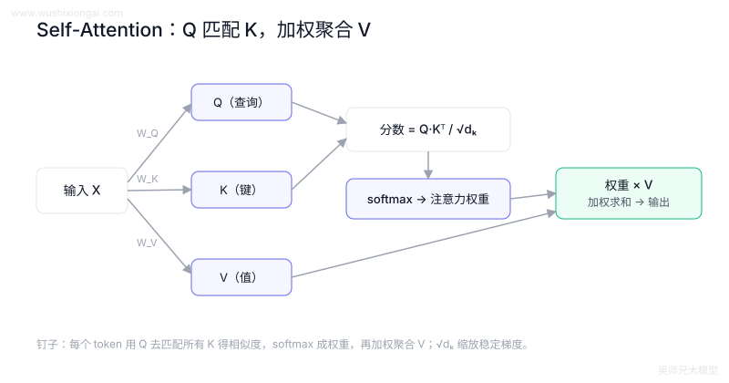

#### 【原题速答】
Self-Attention 将输入投影为 Q、K、V，以缩放点积和掩码生成权重，再对 V 加权聚合；多头版本在多个子空间并行计算。

#### 【考察意图】
- 本题是"细节深度区"的第一站：con 大概率接着问（1）为什么除以 √d_k（方差推导）、(2) mask / RoPE 位置、(3) 残差与归因（原题追问里的干预实验 / Attention is not Explanation / 梯度归因）。
- 能不能把 "Q 是查询、K 是内容、V 是信息" 的比喻换成可计算的形式。

#### 【深度解析】
**二步详细推算（不跳步）。** 输入 X ∈ ℝ^{n×d}：
1. 投影：Q=XW_Q, K=XW_K, V=XW_V（d_q=d_k=d_head）；
2. 打分矩阵：S = QKᵀ / √d_k ∈ ℝ^{n×n}（维度写法： (n×d_k)·(d_k×n) → n×n）；
3. 掩码（因果/padding）：S ← S + M（M 上三角（未来）−∞）；RoPE 这里作用在 Q/K 上（旋转在投影后、打分前）；
4. softmax（按行）：A = softmax(S)_row；权重行为概率分布 Σ_j A_ij = 1；
5. 聚合：O = A·V（n×d_head）；多头则拼 O 后过 W_O。
**为什么除以 √d_k（完整方差推导，本仓库三道题都会用）。** 假设 q,k 的各分量独立、均值为 0、方差 1（初始化时大致成立）。点积 s = Σ_{i=1..d_k} q_i k_i：
- 均值 E[s] = ΣE[qᵢ]E[kᵢ] = 0；
- 方差 Var[s] = Σ Var[qᵢkᵢ] = Σ (E[qᵢ²]·E[kᵢ²]) = d_k（两个独立零均值变量的乘积方差 = 各自方差乘积）。
所以 s 的方差随 d_k 线性增长，点积的 std ≈ √d_k。softmax 对数值的敏感度：当 logit 相对间距小（无 scaling）时 softmax 是"软"的（梯度健康），当 logit 幅度以 √d_k 增长（如 d=512，std≈22），softmax 会趋近 one-hot → 梯度（A(1−A) 结构）在饱和区趋 0 → 训练停滞。除以 √d_k 恰好把方差拉回 1，好形成" 温和 softmax"。这就是"√d_k 不是咒语，是一阶矩/二阶矩推导结果"的正解。
**干预实验 / 可解释性（原文追问后段）。** attention 权重常被展示成"attention map=解释"，但（Jain & Wallace 2019）证明了：替换/扰动 attention 权重对输出影响非常有限（不传递重要特征），grad-based saliency 与 attention map 相关系数低 → "attention ≠ explanation"。"反证"（Wiegreffe & Pinter 2019）：在受控任务上 attention 分布确实有任务一致性，"human-intuitive ≠ causal"。实证立场（2025-11 口径）：attention 更像"路由缓存"，机制解释需要:（a）causal mediation / activation patching（化验具体通路）、 head ablation、circuit analysis（induction head 等机制已被机制可解释性社区确证）。
**梯度归因。** 对 q 的梯度派到各参数：dL/dW_Q = Xᵀ(dO·(A·−A V 后等)…)（略）——面试上不要求写出 full math，是否可以测 call "attention 输出的残差路径 + FFN 的两个通道，梯度回流的分岔点在 `x + Attn(N(x))` 与 `+ FFN(N(x'))`"从而具体的判别。这与 20 题 Pre/Post-Norm 有关。
**FlashAttention（资料里 explicit）。** 训练时 O(n×n) attention 的中间量（S、A）若都实质写到 HBM，长序列下显存撞顶 + 带宽浪费。Flash 思路：在 SRAM 里分块计算，用 online softmax（分块累计 running max 与 sum）算出精确一致的结果，HBM 交互 O(n) —— 精确等价、显存 O(n)、速度 2-4×。这是"保持 exact attention 的计算排布创新，而不是近似"。另有 显式注意（"linear/RWKV"）等不同家族，不在此题拓展。

#### 【追问链深挖】
- **L1：d_k 太大/太小时 softmax 会怎样？** 大 d_k 不除缩放 → 饱和、梯度消失；小 d_k（<32）→ logit 幅度全体偏小、softmax 太"平"、head 退化成"看的平均"；量化：d_k=512 不缩放的 logit std≈22.6，softmax max-min 差可达 ~45（exp 溢出区间内均匀 one-hot）；除 √512≈22.6 后 std=1。
- **L2：mask/RoPE 的插入顺序与常见 bug。** mask 在 softmax 前（additive-∞）；RoPE 在打分矩阵前对 Q、K 各自旋转（不可套到 V / 对 KV 写 cache 时可以提前旋转）。常错点：RoPE 旋转作用在未经投影的输入上、或先做了 attention 后再处理（等价于"绝对位置"而非相对）。
- **L3：attention map 可信到什么程度？** 用 activation patching（把目标头/位的 hu 替换为"参照集合"生成）找出真正"轴端"头。current 证据（induction head、name-mover head、Garbage-collection head 等机制）说明某些头的功能稳定可靠，但全局"attention map 即解读" 的做法不可取——面试回答应定性 + 给出 patching 作为实证工具。
- **L4：如何判断这个 head 是否该剪？** 指标：head importance (per-head gradient / ablation delta)、任务群一致性、冗余性（attention map 相似度聚类）。Michel 等证明每层许多 head 对性能非必要，剪头是精度基本无伤的常见 free lunch；但长程检索（needle）的头是宝，需要长上下文指标的保护性评测。

#### 【串联与资料】
- **本仓库关联：** 05（MHA 的实现与拆分）、02（FlashAttention 与长上下文）、06（RoPE 作用位置）、20（残差与归一化的整体视角）、18（采样端处理的衔接——attention 产 logits 后接 sampling）、inference-optimization.md。
- **资料一句话核心：** Attention Is All You Need（2017）——缩放点积 attention 公式与 √d_k 缩放规则首次确立；Attention is not Explanation（2019）——attention 权重与梯度显著性常常不相关，"权重即解释"不成立；FlashAttention（2022）——保持精确 attention 的同时用 IO-aware 分块把显存从 O(n²) 降到 O(n)。

---

### 20. Transformer 架构核心组件原理 · 详解

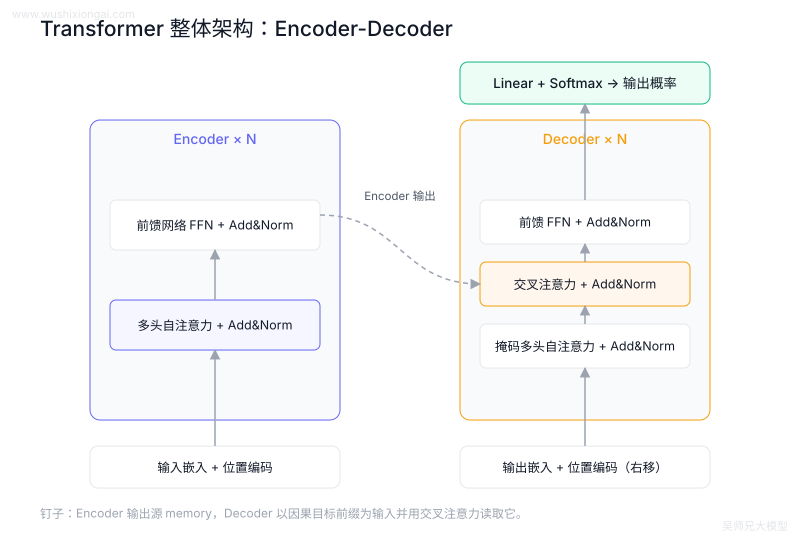

#### 【原题速答】
原始 Transformer 由多层 Encoder 和 Decoder 组成，结合多头注意力、逐位置 FFN、残差归一化与位置编码。

#### 【考察意图】
- 汇总题：作为模块收官，考察能否把 20 题的组件拼成一张可复述的"整机图"，并且每个组件答得上"为什么"。
- 能否对组件做"批注式的现代演化"（原版 → 2025 基线），这是此题的高层次判别器。
- 能否顺着追问（Pre/Post-Norm 梯度、cross-attention、位置外推）回答至实现层面。

#### 【深度解析】
**原版组件地图。** Encoder×6：Masked? no — 全双向 MHA → FFN(4d, ReLU)；Decoder×6：masked MHA → cross-attn → FFN；每个子层残差 + Post-LN；位置：sinusoidal 绝对加性；缩放：√d_k；训练：teacher forcing + label smoothing。
**逐组件的"为什么"与"演化到 2025"。**

| 组件 | 原始设计 | 为什么这样设计 | 2025-11 基线变体 |
|---|---|---|---|
| 注意力 | MHA 8 头 | 多子空间 + 分数/缩放 √d_k | GQA/MLA（04）、FlashAttention kernel（02/19） |
| FFN | 4d + ReLU | 逐位置非线性变换/知识存储 | SwiGLU 8/3·d + gate（LLaMA）、MoE 替换（14） |
| 残差 | x + Sub(x) | 恒等通路保梯度 | 同（必留）；深度扩展过深时配套 scale |
| 归一化 | Post-LN | 稳定激活 | Pre-RMSNorm + final RMSNorm（07/09/16） |
| 位置 | sinusoidal 加性 | 无参顺序信号 | RoPE + scaling（06）、ALiBi/NoPE 探索 |
| 交叉注意力 | decoder 读 encoder | 异构序列对接 | 现代统一用 prompt（02/03），cross-attn 留给 encoder-decoder/多模态投影 |
| 词嵌入 | learned immerse + softmax 参数共享 | 词汇侧参数 | untied vs tied 的 trade-off；超大 vocab 的 sampled softmax |

**Pre/Post-Norm 的梯度（追问 1，全文推导不跳步）。** 设子层为 F（含注意/FFN），残差主干 x。
- Post-LN：y = LN(x + F(x))。反传时 LN 的 Jacobian 具有重缩放幅值（除以 std）：∂y/∂(x+F) 里有 1/σ(x+F) 的量级因子。若深层某些子层的输出 F(x) 波动大（早期尚未学到稳定），σ 涨则梯度被压缩 → "前几层的梯度小 → 训练开始几层几乎不动"（original 论文报的 warmup 需求）。
- Pre-LN：y = x + F(LN(x))。注意残差路径上没有 norm → 主干梯度的恒等分量（∂y/∂x = I）从不衰减，任意深的网络都有一个"梯度高速公路"；代价是"抛弃了 Post-LN 在输出端的那种直接稳定化"（这是为什么现代模型加 final norm 收尾）。量化表述：Post-LN 深度 L 增大时梯度尺度近√L 下降（实验证据 2019-2020），Pre-LN 主干梯度范数与深度无关（这就是 LLaMA/GPT 类直接可训到 100+层的机制）。
**cross-attention（追问 2）。** Q 来自 decoder 侧、K=V 来自 encoder 输出——"内容寻址读 memory"。三个工程事实： memory 只算一次（效率好）； decoder 每层都要读（参数里多一份 W_Q/W_K/W_V）； 现代通用 LLM 用"源即 prompt"方式统一（prompt 里源 token 也做 full attention——比为不同域引入两套 encoder-decoder 更省事）。
**位置外推（追问 3）。** 此题一定接 06 题发表意见（RoPE + PI/NTK/YaRN + Llama3 scaling）。原版 sinusoidal 的真实外推能力有限，但它的"旋转本质"被 RoPE 抽象和工程化——讲清这层"原版→现代"的演化链就是答案的核心。
**组件金额（可选量化）。** d=4096 基线密度：每层参数 attention 4d² = 67M + FFN(SwiGLU, 8/3·d) 3·d·(8d/3) = 8d² ≈ 134M；norm 几乎可忽略（~3·d）。大约 attention:FFN = 1:2 的比例 —— 常被用作"为什么 FFN 装更多知识"的伪造论述起点（正确表述：FFN 的参数多、驻留的是 key-value 记忆（geva 2021），attention 是路由；两者容量/路由分工说法要有证据）。

#### 【追问链深挖】
- **L1：Pre-Norm 为什么让收益率稳定但不能"任务上限更高"？** Pre-Norm 的表达通路"分布更平滑"，其在深层过程中的谱半径稳定，但这通常降低有效深度（每层的"重塑力"更小）；文献的观点是 Post-LN 收敛后 mert 更好但训练脆，Pre-LN 反之——所以"Post-LN+ warmup 也能训得动" 的条件与极限（现代一题为"小模型情况 Post-LN 也不输"（Komatsuzaki 等， 2021？）的结论），以及 2025 的 hybrid（NormFormer/deep-norm 的再审）都值得提及。
- **L2：cross-attention 在哪些现代任务还在？** 多模态投影片（视觉 token → 语言 decoder 的 cross-attn，LLaVA 1.0/Flamingo）、encoder-decoder 翻译（NLLB/T5）、语音（Whisper 的 encoder-decoder）。"现代统一 prompt" 讲的是通用对话/Agent 主空间, 而非"cross-attention 已死"。
- **L3：原版 FFN 分析（key-value memory hypothesis）的实验证据°** Geva 2021 论文：FFN 的第一层权重是 key（触发模式），第二层是 value（输出记忆），确实能当作数据库读；但对"知识修改"（ROME）证明重要存储位于 MLP 的中等层。这与今日 "MoE 专家作为"分区知识库"" 的一致性展示（14 题）。
- **L4：位置外推和 norm 选型的联合"？** 一个非平凡综合： RoPE 幅值会随长程增加而衰减需要配合 norm 的"重建"， 高层 norm 位置会重构 attention 的 logit 尺度，从而响应 YaRN 中的温度修正——这是"位置扩展不能孤注"的来源（06 题的延伸）。

#### 【串联与资料】
- **本仓库关联（全模块总收口）：** 02（架构选择的总述）、03（encoder/decoder 划界的应用）、05/19（多头注意力的两大题）、04（KV/MLA 变体）、06（位置编码谱系）、07/09/16（norm 三连）、13（encoder-decoder 交互）、14（FFN→MoE）、inference-optimization.md（部署向）、fine-tuning.md/rlhf-alignment.md（组件之上的训练方法层）。
- **资料一句话核心：** Attention Is All You Need（2017）——alpha 版组件集（MHA/SFFN/残差/Post-LN/sinusoidal PE）= 现代架构的祖先；BERT（2018）——把 encoder 半边做成预训练 encoder；GPT-3（2020）——decoder 半边规模化 + in-context learning，三条资料合起来正是本题"整机图"的两条主要演化线。

---

## 使用说明与边界

- 本详解为**写作用物**，不替代原文件；原 `model-architecture.md` 未做任何改动。
- 每题标题保持与原文一致（`### NN. 原题目`）并追加 `· 详解`；原文图片 `` 标签原样复制，相对路径在 modules/ 目录下保持有效。
- 原文答案中的过时或含混点均已显式标注「**纠正（2025-11 口径）**」（覆盖 04 题 MLA 压缩比、07/09 题 RMSNorm 加速倍率、08 题 ε-pred/v-pred、12 题 20 tokens/param 边界、14 题 aux-loss-free 路由等），未默写错误答案。
- 研究背景文档：任务参数为 undefined（未提供），本详解基于原始论文/官方模型卡口径独立撰写。
