# 模型训练 × 模型微调 · 逐题深度详解（15 题）

> 源文件：`modules/model-training.md`（11 题）与 `modules/fine-tuning.md`（4 题）。原模块文件只读，本文件为逐题深度详解。
> 每题五段式：【原题速答】（原文 30 秒答案的浓缩，不改变含义）→【考察意图】→【深度解析】（机制/公式完整推导/对比表/量化算例）→【追问链加深】（沿原文"继续追问"展开 2–4 层，附各层答案要害）→【串联与资料】（与本仓库其他模块关联 + 原文参考资料每篇的一句话核心结论）。
> 补充与勘误：以"补充（2026-11）"标注新口径，以"勘误/澄清"标注原文过时或易混之处；图片引用沿用原文格式与路径。

---

# 第一部分 · 模型训练（modules/model-training.md，11 题）

### 01. KL散度本质与非对称性怎么用?

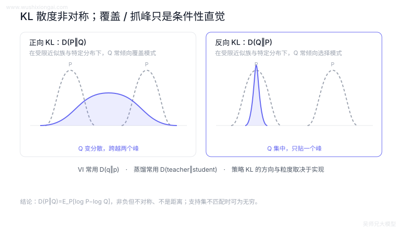

### 01 详解

**【原题速答】** KL 散度是以一个分布加权的对数概率差，非负但不对称且不是距离；变分推断、蒸馏和策略约束采用的方向取决于目标与实现。

**【考察意图】**

1. 能否把 KL 还原为数学对象：期望加权的对数比，用 Jensen 不等式证非负，而不是背"两个分布的差"；
2. 是否理解"不对称"是功能而非缺陷：前向/反向 KL 对应 mode-covering / mode-seeking，方向选错会直接改变训练语义；
3. 三个表格场景是否真正会算：蒸馏（与前向 CE 等价）、VAE（高斯对高斯闭式解）、RLHF（逐 token 蒙特卡洛估计 k1/k2/k3）。

**【深度解析】**

定义（离散情形，连续换成积分）：

$$D_{KL}(P\|Q)=\sum_x P(x)\log\frac{P(x)}{Q(x)}=\mathbb{E}_{x\sim P}\Big[\log P(x)-\log Q(x)\Big]$$

"以哪个分布加权"由期望下标决定——这就是一切"方向"问题的根源。

**非负性（完整推导，无跳步）**。利用 $\log$ 为凹函数的 Jensen 不等式：

$$-\,D_{KL}(P\|Q)=\mathbb{E}_{P}\Big[\log\frac{Q}{P}\Big]\ \le\ \log\,\mathbb{E}_{P}\Big[\frac{Q}{P}\Big]=\log\sum_x P(x)\cdot\frac{Q(x)}{P(x)}=\log\sum_x Q(x)=\log 1=0$$

故 $D_{KL}(P\|Q)\ge 0$；取等当且仅当 $Q/P$ 在 $P$ 支撑上是常数，即 $P=Q$。推导前提是 $P\ll Q$（$P>0$ 处 $Q>0$），否则直接为 $+\infty$。

**不对称性的数值算例。** 取 $P=(0.5,0.5,0)$、$Q=(0.4,0.4,0.2)$：
- $D_{KL}(P\|Q)=0.5\log\frac{0.5}{0.4}+0.5\log\frac{0.5}{0.4}+0=\log 1.25\approx 0.223$ nats；
- $D_{KL}(Q\|P)=0.4\log\frac{0.4}{0.5}+0.4\log\frac{0.4}{0.5}+0.2\log\frac{0.2}{0}=+\infty$。

第二个方向的 $\infty$ 来自 $P$ 支撑缺失：$Q$ 把质量放在了 $P$ 认为不可能的地方。工程含义：蒸馏/RLHF 中参考分布必须有支撑与平滑（温度软化、logit clip），否则惩罚瞬间爆炸。

**方向的语义（考点核心）。** 设目标分布 $p$、模型分布 $q_\theta$：
- 前向 $D_{KL}(p\|q_\theta)$：权重来自 $p$。$p$ 的高概率区域必须被 $q$ 覆盖（mode-covering，"宁可摊开也不遗漏"）；多峰 $p$ 配单峰 $q$ 时，最优 $q$ 是两峰之间的谷底点（两边各占一半惩罚最小化 $p\log(1/q)$）。
- 反向 $D_{KL}(q_\theta\|p)$：权重来自 $q$。$q$ 可以把质量全部钉在 $p$ 的一个峰上（mode-seeking，"宁可错过也不乱猜"）。
- 三大用法对应：蒸馏与前向 KL 等价；VAE 与反向 KL 对应（有闭式解）；RLHF 逐 token 用反向 KL 的近似估计。

**与交叉熵的关系（蒸馏为什么直接用 CE）。** $\mathrm{CE}(p,q)=H(p)+D_{KL}(p\|q)$。教师软目标 $p_T=\mathrm{softmax}(z/T)$ 是常量，最小化 CE 与最小化 KL 的梯度完全一致；$T>1$ 展平 logits 使"类间相对相似度"（暗知识）进入软目标，这是 KL 蒸馏有效性的机制层解释。

**VAE 闭式 KL（逐项推导）。** $q(z|x)=\mathcal N(z;\mu,\sigma^2)$（对角协方差），$p(z)=\mathcal N(0,1)$：

$$\mathbb E_q[\log q]=-$$\tfrac12\log(2\pi\sigma^2)$$-$$\tfrac12\ \ \text{（ } \mathbb E_q[(z-\mu)^2]=\sigma^2 \text{）}$$
$$\mathbb E_q[\log p]=-\tfrac12\log 2\pi-\tfrac12\,\mathbb E_q[z^2]=-\tfrac12\log 2\pi-\tfrac12(\sigma^2+\mu^2)\ \ \text{（ } \mathbb E_q[z^2]=\mathrm{Var}+\mu^2 \text{）}$$

相减，$\log(2\pi)$ 与 $-1/2$ 对消：

$$D_{KL}\big(\mathcal N(\mu,\sigma^2)\big\|\mathcal N(0,1)\big)=\tfrac12\big(\sigma^2+\mu^2-\log\sigma^2-1\big)$$

**ELBO 完整推导。** 对任意 $q(z|x)$：

$$\log p(x)=\log\int p(x,z)\,dz=\log\,\mathbb E_{q(z|x)}\Big[\frac{p(x,z)}{q(z|x)}\Big]\ \overset{\text{Jensen}}{\ge}\ \mathbb E_q[\log p(x,z)-\log q(z|x)]$$

即 $\mathrm{ELBO}=\mathbb E_q[\log p(x|z)]-D_{KL}(q(z|x)\|p(z))$：重构期望减 KL 正则，训练即最大化 ELBO。

**RLHF 逐 token KL 的估计（Schulman 2020 口径）。** 同一上下文 $s$ 下取 $r=\log p/q$，其中 $p=\pi_\phi(a|s)$（当前策略）、$q=\pi_{\rm ref}(a|s)$（参考策略）：
- $k_1=r$：无偏（期望恰为目标 $D_{KL}(p\|q)$），但单样本可为负、方差较大；
- $k_2=\tfrac12 r^2$：逐样本非负，但期望偏离目标二阶级 $O(D^2)$（大 KL 时不准）；
- $k_3=e^{-r}-1+r\big(=\tfrac{q}{p}-1-\log\tfrac{q}{p}\big)$：由 $x-1-\log x\ge 0$ 保证逐点非负、方差小，期望 $\approx D_{KL}-O(D^2)$ 轻微低估——实践中最常用的逐 token KL 估计，直接把 $-\beta\,k_3$ 加进逐 token reward。

**【追问链加深】**

1. **第 1 层（原文）：VAE 为何采用"从 q 到先验"的方向，即 $D_{KL}(q(z|x)\|p(z))$？** 要害：反向方向对 $q$ 求导有高斯对高斯的闭式解且能进 autograd；前向方向需要对 $p(z)$ 逐点求期望积分，一般无解析式。代价是反向 KL 的 mode-seeking 会加剧后验塌缩，需 KL annealing 缓解。
2. **第 2 层：后验塌缩（posterior collapse）机理与治理？** 要害：decoder 太强时 $q(z|x)\to p(z)$（KL→0、latent 无信息）仍是重构最优；治理有 KL annealing（KL 权重从 0 缓升）、free bits（低于阈值的维度豁免惩罚）、弱化 decoder、β-VAE 扫权重；诊断看 latent 激活维度与互信息。
3. **第 3 层：RLHF 里 KL 项为什么必要、以什么形式进损失？** 要害：约束策略与 $\pi_{\rm ref}$ 的漂移、防止过拟合 reward model 的外推区、保留追踪 reward 缩放的锚点；实现上按 token 加 $-\beta k_3$ 进 reward 或在 PPO 目标里做显式 ratio 约束。$\beta$ 过大停滞、过小则 reward hacking。
4. **第 4 层：DPO 与 KL 的联系？** 要害：KL 约束的 reward 最大化的闭式最优策略 $\pi^*(y|x)\propto\pi_{\rm ref}(y|x)\exp(r(y|x)/\beta)$，DPO 把它反解成 Bradley-Terry 偏好分类损失，显式 KL 预算退化为超参 $\beta$（详见 `rlhf-alignment` 02/03 详解）。

**【串联与资料】**

- 仓库内：`rlhf-alignment` 01/02/03（On-policy 与 DPO 选型、PPO/GRPO/DPO、DPO vs PPO——KL 全部以不同形式出现）、`rlhf-alignment` 06（SFT/偏好/RL 衔接）、`model-architecture` 18（自回归生成用 token id 还是概率分布——KL 与温度决定采样质量）、本模块 08（CE=H+KL）、10（校准中的温度 $T$ 优化同样作用于 logits 尺度）。
- 原文参考资料一句话核心结论：
  - *Auto-Encoding Variational Bayes*（Kingma & Welling 2013）：把 ELBO 拆为解析 KL + 可用重参数化单样本估计的重构期望，使 VAE 纯用 SGD 端到端训练。
  - *Distilling the Knowledge in a Neural Network*（Hinton et al. 2015）：温度软化的教师 logits 携带类间关系"暗知识"，对软目标做 CE/KL 蒸馏优于 one-hot。
  - *Proximal Policy Optimization Algorithms*（Schulman et al. 2017）：用截断的比率目标近似信任域约束，得到简单、稳定、单模型的策略提升算法。

---

### 02. Flow Matching 原理是什么?

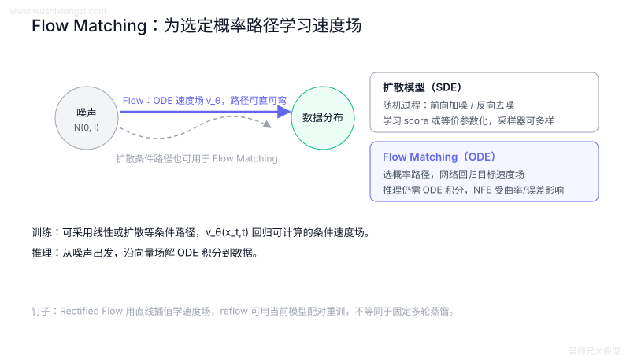

### 02 详解

**【原题速答】** Flow Matching 直接回归概率路径的条件速度场，并用常微分方程把基分布传输到数据分布。

**【考察意图】**

1. 是否掌握"模拟无关（simulation-free）训练连续归一化流"的核心思想：不解 ODE 也能学速度场；
2. 是否会证条件目标与边缘目标的梯度等价（这是把不可训练的目标变成可训练目标的全部机关）；
3. 能否把线性路径/修正流（rectified flow）的"目标就是 $x_1-\varepsilon$"拆到写代码级别；
4. 是否理解路径曲率与采样步数（NFE）的定量联系。

**【深度解析】**

**问题设定。** 连续归一化流（CNF）由 ODE 定义：$\frac{d x_t}{dt}=v_t(x_t)$，$x_0\sim p_0$（一般取 $\mathcal N(0,I)$），要求 $t=1$ 时分布 $p_1=p_{\rm data}$。理想目标是对每个 $t$ 回归"概率路径的速度场" $u_t$，但 $u_t$ 与中间分布 $p_t$ 都未知，且直接目标需要模拟 ODE——Flow Matching 的贡献是给出不用模拟的可训练替代。

**条件目标（可训练）。** 对每个样本对（基样本 $x_0$，数据点 $x_1$）定义插值路径与条件下速度，线性/OT 路径为：

$$x_t=(1-t)\,x_0+t\,x_1,\qquad u_t(x_t\mid x_0,x_1)=x_1-x_0$$

（一般高斯路径 $x_t=\alpha_t x_1+\sigma_t x_0$ 时，联立 $x_1=\frac{x_t-\sigma_t x_0}{\alpha_t}$ 得 $u_t=\dot\alpha_t x_1+\dot\sigma_t x_0=\frac{\dot\alpha_t}{\alpha_t}x_t+\big(\dot\sigma_t-\frac{\dot\alpha_t\sigma_t}{\alpha_t}\big)x_0$，全部信息可由 $(x_t,t)$ 还原。）训练目标：

$$L_{\rm CFM}(\theta)=\mathbb E_{t,\,x_0,\,x_1}\Big[\big\|v_\theta(t,x_t)-u_t(x_t\mid x_0,x_1)\big\|^2\Big]$$

**核心定理：条件目标与（不可训练的）边缘目标梯度相同。** 记边缘场 $u_t(x)=\mathbb E\,[\,u_t(x_t\mid x_0,x_1)\,\big|\,x_t=x\,]$，边缘目标 $L_{\rm FM}=\mathbb E_{x\sim p_t}\|v_\theta-u_t\|^2$。把条件损失展开成三项：

$$\|v-u_{\rm cond}\|^2=\|v\|^2-2\langle v,u_{\rm cond}\rangle+\|u_{\rm cond}\|^2$$

对 $(x_0,x_1)$ 取条件期望：交叉项里 $\mathbb E[u_{\rm cond}\mid x_t]=u_t(x_t)$（依塔式规则换序），故 $\mathbb E\langle v,u_{\rm cond}\rangle=\mathbb E_{x\sim p_t}\langle v,u_t\rangle$，与 $L_{\rm FM}$ 的交叉项完全一致；第一项 $\|v_\theta\|^2$ 两边相同；差项 $\mathbb E[\|u_{\rm cond}\|^2]-\mathbb E_{x\sim p_t}\|u_t\|^2$ 不含 $\theta$。三项对齐 ⇒ $\nabla_\theta L_{\rm CFM}=\nabla_\theta L_{\rm FM}$。这就是"条件化技巧（conditioning trick）"：用随机样本就能训练真正的边缘速度场。

**落地训练式（线性路径 + 高斯基）。** 单条公式即为全部实现：

$$L(\theta)=\mathbb E_{t\sim U[0,1],\ \varepsilon=x_0\sim\mathcal N(0,I),\ x_1\sim p_{\rm data}}\Big[\big\|v_\theta\big(t,\ t\,x_1+(1-t)\,\varepsilon\big)-(x_1-\varepsilon)\big\|^2\Big]$$

采样时解 ODE $\dot x=v_\theta(t,x)$（Euler/RK 数值积分）。直线路径下，如果速度场"恰好"是分段常数 $x_1-\varepsilon$，一步即可跨到终点——这是修正流（Rectified Flow）通过迭代拉直路径、追求少步采样的原理。

**时间步采样。** 在高分辨率与文本到图像场景，均匀采 $t$ 不是最优：SD3 的消融显示 logit-normal 分布（权重集中在曲率大的中段）显著更优，属"路径曲率 × 采样密度"的联合设计。

**【追问链加深】**

1. **第 1 层（原文）：为什么 Conditional Flow Matching 与边缘目标同梯度？** 要害：平方损失下的关键恒等式 $\mathbb E[u_{\rm cond}\mid x_t]=u_t(x_t)$，加上不含 $\theta$ 的常差项；任何满足"条件目标分解出唯一场"的路径族都成立，与网络结构无关。
2. **第 2 层：路径曲率如何影响采样 NFE？** 要害：Euler 单步误差 $\approx\frac{h^2}{2}\|v''\|$（沿轨迹二阶导）；路径越直、$v$ 沿轨迹越接近常数，误差越小、步数越少。修正流把弯路径"拉直"（一次 reflow 后逼近 curl-free 直线段），可把 NFE 从几十压到个位；蒸馏（如一致性蒸馏）可进一步到 1–4 步。
3. **第 3 层：FM 与扩散的 ε-prediction 是什么关系？** 要害：在扩散式路径（VP 形式的 $\alpha_t,\sigma_t$）下，速度目标与 ε 目标互为线性变换（见本模块 03 的等价表），差别只在时间加权 $w_t$ 与数值条件数——两者是同一损失的再参数化，不是两个学派。
4. **第 4 层：为什么 FM 里 $t$ 的采样分布本身是设计空间？** 要害：损失是 $t$ 上平均，信息量集中在曲率大的时段（生成中段的"关键拐点"）；logit-normal 集中采样等价于给难时段加权，是不改网络的免费收益，与扩散的 SNR 加权问题（`multimodal` 02）互为对偶。

**【串联与资料】**

- 仓库内：本模块 03（DDPM vs FM 的参数化等价表）、11（重参数化把"采样"变成"可微函数"是 FM 整套梯度成立的前提之一）、`model-architecture` 08（DDPM 为什么随机采样时间步——FM 的 $t$ 采样同理）、`model-architecture` 17（VQ-VAE：离散码本路径与连续流的镜像对比）、`multimodal` 02（扩散 SNR 加权）。
- 原文参考资料一句话核心结论：
  - *Flow Matching for Generative Modeling*（Lipman et al. 2022）：给出在任意概率路径上回归向量场、且与目标 CNF 训练梯度一致的模拟无关（simulation-free）损失。
  - *Flow Straight and Fast*（Liu et al. 2022，Rectified Flow）：以直线插值路径训练 + 迭代 reflow 拉直轨迹，使少步/单步 ODE 采样以及用同一框架做图像翻译成为可能。
  - *Scaling Rectified Flow Transformers for High-Resolution Image Synthesis*（Esser et al. 2024，SD3）：系统对比噪声-数据路径与时间加权后，确认修正流 + logit-normal 时间采样在高分辨率 T2I 的 scaling 中最优。

---

### 03. DDPM vs Flow Matching: 采样效率与优缺点?

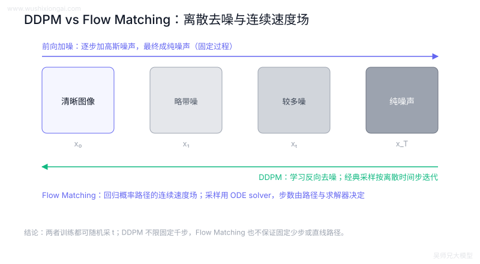

### 03 详解

**【原题速答】** DDPM 学习离散反向去噪过程，Flow Matching 回归连续概率路径的速度场；两者训练都可随机采样时间，采样效率取决于路径与求解器。

**【考察意图】**

1. 是否能同时站在两个视角看同一个生成问题：离散马尔可夫链 vs 连续 ODE；
2. 是否掌握四种目标的参数化等价（ε / $x_0$ / score / velocity）与转换代数；
3. 能否区分"训练目标等价"与"采样过程不等价"——效率差异来自采样，不是来自训练；
4. 有没有 2024–2025 的更新口径（少步采样、蒸馏、修正流主流化）。

**【深度解析】**

**DDPM 一侧。** 前向加噪：$q(x_t|x_{t-1})=\mathcal N(\sqrt{1-\beta_t}\,x_{t-1},\beta_t I)$，闭式 $x_t=\sqrt{\bar\alpha_t}\,x_0+\sqrt{1-\bar\alpha_t}\,\varepsilon$（$\bar\alpha_t=\prod_{s\le t}(1-\beta_s)$）。训练用随机 $t$ 的 ε-预测损失 $L=\mathbb E\| \varepsilon-\varepsilon_\theta(x_t,t)\|^2$（Ho 2020 的"简化目标"，等效于一种权重化的变分下界），采样用 $T=1000$ 步祖先采样。与 score matching 的关系（一行推导）：在 $x_t=\alpha_t x_0+\sigma_t\varepsilon$ 下 $\nabla_{x_t}\log p_t(x_t)=-\mathbb E[\varepsilon|x_t]/\sigma_t$，故 $\varepsilon$-预测与 score-预测只差 $-\sigma_t$ 倍缩放。

**FM 一侧。** 速度场 + ODE；在扩散式路径（VP 形式的 $\alpha_t,\sigma_t$）下，条件速度按 02 题公式为 $u_t=\frac{\dot\alpha_t}{\alpha_t}x_t+\big(\dot\sigma_t-\frac{\dot\alpha_t\sigma_t}{\alpha_t}\big)\varepsilon$。

**四参数化等价表（面试高频）。** 设 $x_t=\alpha_t x_0+\sigma_t\varepsilon$（$x_0$ 数据、$\varepsilon$ 噪声，α/σ 由 t 的调度给出）：

| 参数化 | 回归目标 | 由 $(x_t,t)$ 反算 |
| --- | --- | --- |
| ε | $\varepsilon$ | — |
| $x_0$（数据） | $x_{\rm data}$ | $x_0=\frac{x_t-\sigma_t\varepsilon}{\alpha_t}$ |
| score | $-\varepsilon/\sigma_t$ | $s=-\varepsilon/\sigma_t$ |
| v（Salimans & Ho） | $v=\alpha_t\varepsilon-\sigma_t x_0$ | $v=\alpha_t\varepsilon-\sigma_t x_0$ |
| velocity（ODE/FM） | $u=\dot\alpha_t x_0+\dot\sigma_t\varepsilon$ | $u=\frac{\dot\alpha_t}{\alpha_t}x_t+\big(\dot\sigma_t-\frac{\dot\alpha_t\sigma_t}{\alpha_t}\big)\varepsilon$ |

同一回归子族，互相单射可换；真正不同的是每步的损失权重 $w_t$（如 min-SNR-$\gamma$ 截断）与数值条件。**结论：训练无本质差距，差距在采样。**

**采样效率对比（含勘误/更新）。**

- DDPM（2020 口径）：$T=1000$ 步祖先采样。**澄清：**"DDPM 采样慢"只对 2020 年的实现成立；DDIM（2020）把更新改写为对同一概率流 ODE 的确定性高阶化，50 步足矣；2024–2025 工业口径是 20–50 步 + 蒸馏到 1–4 步（progressive distillation / consistency / 修正流再拉直）。原 30 秒答案未提蒸馏路径，详解中补齐。
- FM/修正流：直线路径天生逼近"分段常速度"，10–25 步 Euler 已近饱和，且天然兼容任意阶 ODE solver。

**优缺点表。**

| 维度 | DDPM | Flow Matching |
| --- | --- | --- |
| 训练 | 离散 $t$、ε 目标，生态成熟 | 连续 $t$、速度目标，框架统一 |
| 采样 | 马尔可夫链（祖先/DDIM） | ODE（任意 solver、确定性） |
| 少步能力 | 需依赖蒸馏/改进调度 | 直线路径天然更利于少步 |
| 概念统一性 | MDP 式叙事 | 扩散=其特定的概率路径（参数化等价） |
| 调试 | 步数/调度敏感性高 | 时间加权与对象选择更直接 |

**【追问链加深】**

1. **第 1 层（原文）：diffusion path 下 FM 与 score/noise prediction 的参数化联系？** 要害：见上表，$u,\ \varepsilon,\ x_0,\ s$（score）相互线性可换；FM 论文证明了用扩散路径时 $L_{\rm FM}$ 与 weighted score-matching 差一个 $t$ 权重，因此"DDPM vs FM"本质是"权重与采样器的差别"。
2. **第 2 层：DDPM 的简化损失与完整 ELBO 差在哪，谁更优？** 要害：简化损失 = 单位权重 ELBO；完整 ELBO 按信噪比自动加权；后续工作（min-SNR-γ、P2 等）证明手工权重能进一步提升，且与 `multimodal` 02 的 SNR 加权是同一套语言。
3. **第 3 层：为什么"少步采样"上 FM 更顺？** 要害：ODE 轨迹的累计位移与弯曲度决定离散误差；直线路径下轨迹几乎直线，一个步长就到位；而扩散的祖先链把"加噪—去噪"循环离散化，天然冗余。
4. **第 4 层：把 DDPM 迁到文本（discrete diffusion）和把 FM 迁到潜空间各有什么取舍？** 要害：离散扩散需要转移矩阵/离散得分理论更繁琐，token 级生成仍以 AR 为主流；潜空间（LDM/SD3）用 VAE 压缩后才负担得起 FM 的 transformer 计算，两者均已完成工程整合。

**【串联与资料】**

- 仓库内：`model-architecture` 08（DDPM 为什么随机采样时间步——与本模块 02 的 $t$ 采样设计呼应）、`multimodal` 02（扩散 SNR 与加权）、02 题（FM 原理与梯度等价推导）、11 题（重参数化：$\sqrt{\bar\alpha}x_0+\sqrt{1-\bar\alpha}\varepsilon$ 即是重参数化实例）、`inference-optimization`（采样步数与部署算力的换算）。
- 原文参考资料一句话核心结论：
  - *Denoising Diffusion Probabilistic Models*（Ho et al. 2020）：ε-预测 + 随机时间步的简化目标让扩散模型首次在图像上超越 GAN，奠定了两阶段训练范式。
  - *Flow Matching for Generative Modeling*（Lipman et al. 2022）：连续 ODE 视角给出与 score-based 扩散参数化等价、但更适合少步采样的梯度一致训练目标。
  - *Denoising Diffusion Implicit Models*（Song et al. 2020，DDIM）：把采样改成非马尔可夫确定性过程，同一训练好的模型可 10–50 步高质量采样。

---

### 04. PyTorch 动态图怎么自动微分?

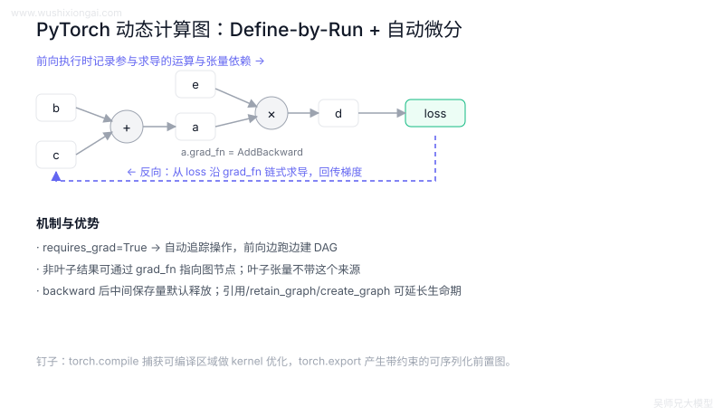

### 04 详解

**【原题速答】** PyTorch 在前向执行时动态记录自动微分图，反向按链式法则累积梯度并在下一轮重新建图。

**【考察意图】**

1. 能否精确说清"图"里存了什么：节点是 `grad_fn`（Function 实例），边是张量依赖，节点内保存的反向闭包（saved tensors）；
2. retain_graph / create_graph 的语义区别和真实用例——这是高分/低分回答的分水岭；
3. 动态与静态的边界：torch.compile 的 graph break 和 torch.export 的取图路径；
4. 反向与激活显存的关系（本仓库后续 LoRA/显存题的铺垫）。

**【深度解析】**

**前向建图。** 每个输出需要梯度的张量操作都生成一个 `Function` 节点，记录：
- `next_functions`：输入侧的节点引用（构成 DAG）；
- 反向所需的闭包（shape、非叶张量等 `saved tensors`）；
- 需要梯度的叶张量在节点 `AccumulateGrad` 里累积：`.grad += 新梯度`。

**反向。** 从损失（root）出发，按拓扑逆序逐节点执行 `node.apply(∂L/∂out)` 得到各输入的 $\partial L/\partial\,\text{in}$，写入叶节点。整体是"雅可比-向量积"（VJP）：反向一次即可得全梯度，成本 ≈ 2× 前向。

**retain_graph vs create_graph（原文追问核心）。**
- `retain_graph=True`：反向执行后仍保留缓存（saved tensors），允许**对同一前向图再次 backward**。用例：多任务共享 trunk（主损失 + 辅助损失分两次 backward）；调试时对同一 batch 反复观察梯度。
- `create_graph=True`：反向计算本身**再次建图**，使得再对梯度求导可行（二阶导、Hessian-向量积）。用例：WGAN-GP 的梯度惩罚（对 $\|\nabla_x D(x)\|$ 求导）、MAML 二阶元更新、部分谱方法。代价：图翻倍、显存与时间大增。
- 关系：`create_graph=True` 时反向建出的新图默认需要保留——因此常常与 retain 配合；单用 retain 只解决"复用旧图"，不产生新图。

**叶/非叶与重算。** `.requires_grad=True` 且由用户创建的是叶；中间张量默认 backward 后释放，除非设置 `retain_graph` 或显式 `retain_grad()`。重算范式：**梯度检查点（gradient checkpointing）** 只保存每层输入，backward 时重新执行前向——算力 +1 次前向（约 +33% 总 FLOPs），显存从 $O(\text{每层中间量})$ 降到 $O(\text{层数}\times \text{层输入})$，是 LoRA/大模型训练的标配（与 fine-tuning 01 详解呼应）。

**torch.compile 的 graph break 与重编译。** Dynamo 逐帧追踪字节码：遇到张量数据依赖分支（`if x.sum()>0`）、`.item()`、未注册的 custom op、numpy 互操作等，会中断追踪——替换为"已编译子图 + eager 段"拼接。后果：融合机会减少（子图边界妨碍 kernel 级融合）+ 段间回退开支；若 shape 变化超出 dynamic 缓存，会再次 recompile。`fullgraph=True` 会把 break 变成 Error 而不是回退。torch.export 则要求提前"冻结"控制流（支持导出静态图），面向部署不面向调试。

**量化算例（自动化与显存的联系）。** 一个线性层 $y=Wx$（$W\in\mathbb R^{d\times k}$，token 序列 $b\times s$）backward 需要：为 wgrad 保存 $x$（$2\,bsk$ 字节 bf16）、为 dgrad 持有 $\partial L/\partial y$；注意若去掉 checkpointing，激活量常为权重自身的数倍——这正是 7B 全参需要多卡 80 GB（ZeRO-3 分摊）、而 QLoRA 可在 24 GB 单卡完成的结构性原因之一（详见 fine-tuning 01/02 详解）。

**【追问链加深】**

1. **第 1 层（原文）：retain_graph 与 create_graph 区别是什么？** 要害：retain = 复用旧图（缓存不释放）；create_graph = 反向产生新图（支持高阶导）；干系上 retain 是"节约重建"，create_graph 是"升维重构"。误用成本：漏 retain 会报 "backward through the graph a second time"，乱用 create 白白显存翻倍。
2. **第 2 层（原文）：分析一次 graph break 和重新编译。** 要害：触发点（数据依赖 control flow / 未支持 op / shape 变化）→ 分段编译与 eager 回退 → 融合与并行受限 → dynamic=True 时以符号 shape 缓存 kernel，仍超限则 recompile；手段：`fullgraph=True` 逼写可追踪代码、拆热点段、避免 tensor 布尔条件。
3. **第 3 层：多卡训练与动态图的互相作用？** 要害：DDP 在 backward 中按 bucket 的就绪顺序 all-reduce 梯度（`register_post_accumulate_grad_hook`/`prepare_for_backward`）；ZeRO-3 在前向/反向分发参数时靠 hooks 按需 all-gather/release（而非常驻显存）；激活检查点与 SavedTensorHooks 让"重算"与"分布式调度"协同。
4. **第 4 层：动态图/二阶导对 LoRA 类训练意味着什么？** 要害：LoRA 只训小矩阵，可以用更高阶优化器或在 RL 中多次重放；但一般训练用一次反向即可，二阶导的真实刚需都在元学习/对抗训练类应用。

**【串联与资料】**

- 仓库内：`inference-optimization` 02（DeepSpeed 与 ZeRO 的实现基础就是这些 hook）、03（FlashAttention 的"反向重算"与 checkpointing 同思想流派）、04（显存优化全景：本文的激活算例是其前提）、fine-tuning 01（checkpointing 与 LoRA 单步成本）、本模块 11（重参数化与"建图"之辨）。
- 原文参考资料一句话核心结论：
  - *PyTorch Autograd Mechanics*：动态图以反向闭包记录依赖，backward 一次释放缓存，retain/create_graph 决定复用与二阶导。
  - *torch.autograd.backward 文档*：可带 grad_tensors/inputs 限定求导范围，warnings 提示 retain 缺失的二次 backward 报错。
  - *torch.compile 文档*：Dynamo 追踪 + Inductor 生成代码，graph break 与 dynamic shape 触发 recompile。
  - *torch.export 文档*：导出面向部署的静态图，要求显式处理控制流与动态 shape。

---

### 05. Focal Loss 公式与作用机制

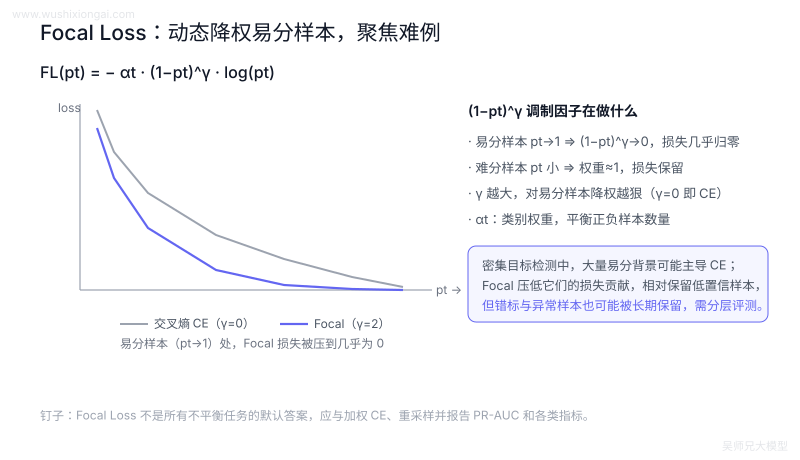

### 05 详解

**【原题速答】** Focal Loss 用调制因子降低易样本权重并聚焦难样本，类别权重和聚焦参数需按噪声与校准验证。

**【考察意图】**

1. 能否写出公式并**现场求导**——它是最常被要求"白板推导"的损失之一；
2. 是否理解"类别不平衡"在深度检测里的真实杀手形态：**负样本主导了 loss 总量**，而不是简单的正负数量比；
3. α 与 γ 的作用机理与联动（原文追问）；以及 γ 把"难"与"噪声"混为一谈的风险（原文追问第二问）；
4. 在 LLM/推荐场景迁移预判（什么时候不该用）。

**【深度解析】**

**公式。** 二分类记样本 $y\in\{\pm 1\}$，$p_t=\begin{cases}p &: y=1\\ 1-p &: y=-1\end{cases}$ 为"样本属于真实类的概率"：

$$\mathrm{FL}(p_t)=-\alpha_t\,(1-p_t)^{\gamma}\,\log(p_t)$$

CE 是 $\gamma=0$（不调制）的特例；$\alpha_t$ 是常规类别权重，$(1-p_t)^{\gamma}$ 是新增的调制因子。

**梯度完整推导。** 记 $z$ 为 logit，$p=\sigma(z)$，$\frac{dp}{dz}=p(1-p)$。对 $L=-(1-p_t)^\gamma\log p_t$：

$$\frac{dL}{dp_t}=-(1-p_t)^\gamma\cdot\frac1{p_t}+\gamma\,(1-p_t)^{\gamma-1}\log p_t$$

链式相乘：

$$\frac{dL}{dz}=p_t(1-p_t)\cdot\frac{dL}{dp_t}=-(1-p_t)^{\gamma}(1-p_t)+\gamma\,p_t(1-p_t)^{\gamma}\log p_t=-\,(1-p_t)^{\gamma}\big[(1-p_t)-\gamma\,p_t\log p_t\big]$$

即（Lin et al. 2017 的形式）：

$$\frac{d\mathrm{FL}}{dz}=\alpha_t\,(1-p_t)^{\gamma}\,\big(\gamma\,p_t\log p_t+p_t-1\big)$$

读法：梯度主干是 CE 的梯度 $(p_t-1)$，再乘 $(1-p_t)^\gamma$ ——这就是"难样本才被保留"的代数本质；$\gamma p_t\log p_t$ 是额外的"错得离谱时仍保留少量梯度"的修正项。

**量化体感（必背算例）。** 取 $\gamma=2$：

| $p_t$（样本难度） | 调制因子 $(1-p_t)^\gamma$ | 相对 CE 的权重 |
| --- | --- | --- |
| 0.1（极难） | $0.9^2=0.81$ | 81% |
| 0.5（中等） | $0.25$ | 25% |
| 0.9（极易） | $0.01$ | 1% |

易样本降 99%、难样本降不到 20%——**梯度预算自动向难样本集中**，一阶段检测器（RetinaNet）凭此追平两阶段方案。

**γ–α 联动（原文追问一）。** γ 调大的同时，总梯度变小，α 需要重新平衡：实践中先固定 γ（常用 1、2、5 扫描），再把 α 从 $\mathrm{pos}/\mathrm{neg}$ 比例的反数附近调；γ 越大 有效权重越"窄"，α 应相对调小。注意规则："α 修数量不平衡，γ 修难度不平衡"——两者不能互相替代。

**标签噪声风险（原文追问二）。** 噪声标签在特征空间呈现"不可学习" ⇒ 长期高 loss ⇒ 在 focal 机制下被认为是"难样本"而被**上调权重**，使噪声对梯度的相对贡献变大——这正是"标签噪声可能取得更高相对贡献"的机制。对策：清洗、小 γ、GCE/截断类损失（给极端 loss 设上限）、损失上限剪裁与噪声感知重加权。

**【追问链加深】**

1. **第 1 层（原文）：alpha 与 gamma 怎么联合调参？** 要害：γ 扫 $\{1,2,5\}$，α 以"负样本占比的倒数"为起点小幅搜索；γ ↑ 则 α ↓ 部分；观察指标是 loss 中正样本的占比而非总 loss。
2. **第 2 层（原文）：为什么标签噪声会取得更高相对贡献？** 要害：机制 = 难 ⇒ 升权；后续要接"难 ≠ 有信息"，噪声样本不具备可学习的梯度方向，靠清洗/限幅对冲。
3. **第 3 层：focal 的概率校准效应？** 要害：γ 会把输出的 $p_t$ 分布向 0/1 拉开（训练后置信度更极端），下游若需要真实概率，必须做温度/校准后评估（衔接本模块 10 的校准框架）。
4. **第 4 层：什么时候不用 focal？** 要害：OHEM（hard example mining）是"挑选"而非"加权"，样本少时更直接；严重噪声场景 GCE 更稳；LLM 训练的类别不平衡一般是词表/类别预测问题，用 CE + ignore_index/focal variant 少见，滥用反伤校准。

**【串联与资料】**

- 仓库内：本模块 08（CE 家族的梯度推导与校准语义，focal 即 CE 的加权变形）、10（γ 对校准的破坏与温度修补）、01（"加权"的本质是换一个 f-散度的生成元，KL/CE/focal 同族）、`multimodal` 02（扩散 loss 的 SNR 加权是同一"按难度重赋权"思想）。
- 原文参考资料一句话核心结论：
  - *Focal Loss for Dense Object Detection*（Lin et al. 2017）：调制因子 $(1-p_t)^\gamma$ 压制易样本对梯度的支配，使一阶段检测器（RetinaNet）在 COCO 上追平两阶段检测器。

---

### 06. 训练曲线异常怎么排查？

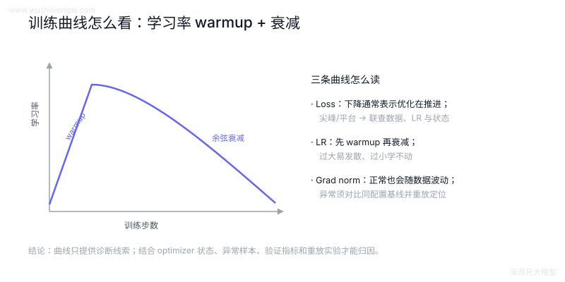

### 06 详解

**【原题速答】** loss、学习率和梯度范数只是训练诊断线索，异常需要结合优化器状态、数据样本、历史基线、验证指标和可重放实验才能归因。

**【考察意图】**

1. 能否建立异常分类学：把曲线形态映射到"数据/数值/系统/超参"四象限；
2. 重点考察 **loss 突刺（spike）的成灾链与恢复 SOP**——大模型预训练最高频的事故类型；
3. 是否熟悉稳定化的标准件：梯度裁剪、warmup/decay 调度、z-loss、QK-norm、fp16 动态 loss scaling；
4. 可重放与可归因的方法论（记录、回滚、隔离变量）。

**【深度解析】**

**异常形态 → 假设 → 检验 → 干预（核心排查表）。**

| 曲线症状 | 常见原因 | 检验手段 | 干预手段 |
| --- | --- | --- | --- |
| loss 阶跃突刺后回落 | 异常 batch（重复/超长/乱码/代码段），数据流切换 | 记录 spike step，拉样本回放；对照 grad-norm | 跳过该批 + 回滚数步（flush 动量后重放） |
| loss 持续抬升/不下 | LR 过大、warmup 不足、FP 溢出 | 降 LR 小步实验对照；看 loss-scale 日志 | 重设 warmup；bf16 或动态 loss scaling |
| 单点 NaN/Inf | 0 除、log(0)、logits 溢出 | fp32 重跑 suspect batch 定位算子 | 数值稳定实现 + z-loss + QK-norm |
| plateau 且 val 也平 | 数据重复度过高/学习率动力不足 | 查去重与 epoch 数；看 update-norm | 扩数据/换调度（cycle→decay） |
| train ↓ val ↑ | 过拟合、泄漏 | train-val gap、泄漏检测（n-gram/MinHash） | 早停/正则/修数据切分 |

**loss spike 的"成灾链"（重点展开）。** 一次大 spike 不仅是"看似瞬时的升高"：
1. **直接破坏**：spike 伴随 grad-norm 爆表，被 clip 后权重虽位移有限，但 Adam 动量/二阶状态被污染，继续训练可能隐性 divergence；
2. **恢复失败风险**：极少数 spike 由硬件/数值错误（静默位翻转、TP/PP 同步 bug）导致，会永久破坏权重，表现为"恢复后 loss 不再回到基线"；
3. **常规事故源**：数据混入异常 token 密度、代码/长重复文本；注意力 logits 无界增长（无 QK-norm 时 softmax 饱和）；fp16 的 loss scaling 在溢出边缘震荡。大模型规模上这些都从"小抖动"放大为"训练事故"，因为没办法回头一步步试。

**恢复 SOP（主流实践：PaLM/Gopher 等论文报告的做法）。** spike 发生时：(a) 跳过当前 batch（不累加梯度），(b) 回滚到 spike 前 checkpoint，(c) 丢弃其后若干 batch 再恢复，或临时降低若干步 LR "蠕动式"回升；记录 spike 步号以便回放归因。

**稳定化的标准件（配方表）。**

| 部件 | 典型配置 | 作用机理 |
| --- | --- | --- |
| 梯度裁剪 | `clip_grad_norm_`，max_norm=1.0（GPT-3/LLaMA 口径） | 全局 L2 范数统一缩放，防单步位移破坏；返回值（裁剪前范数）是异常最早信号 |
| warmup | 0.2%–2% 总步数（LLaMA 固定 2000 步） | 初期梯度统计未稳定，防止第一步大更新 |
| 调度 | cosine → 10% 峰值（LLaMA 口径） | 末段小步长降噪，loss 平台自然走低 |
| z-loss | $c\big(\log\sum_j e^{z_j}\big)^2$，$c\approx 10^{-4}$（PaLM 口径） | 惩罚 logit 的 log-sum-exp 无界增长，防 softmax 饱和与数值上溢 |
| QK-norm | Gemma-2/Chameleon 类做法 | 直接限幅注意力 logits，属"事前稳定" |
| 混合精度 scale | 动态 loss scaling：init $2^{16}$，溢出减半，稳定期加倍 | fp16 防下溢；bf16 指数位充裕通常不需要 |

**诊断优先级。** 顺序：grad-norm（clip 前）→ loss-scale/溢出日志 → spike 步数据回放 → 优化器状态与 checkpoint 校验和 → 并行的低 LR 对照实验缩小变量。单靠 loss 曲线本身定位不了任何问题。

**【追问链加深】**

1. **第 1 层（原文）：更新范数如何帮助归因？** 要害：观 $\|\Delta\theta\|/\|\theta\|$（AdamW 下典型在 $10^{-3}$ 量级；spike 时一阶动量方向突变会放大该比值）；配合 clip 前/后梯度范数差值，可区分"数据冲击"（前范数大、方向错）与"数值溢出"（范数 NaN）。
2. **第 2 层（原文）：loss scaling 在架构灾难中怎么用？** 要害：fp16 下溢出 → scale 减半 + 跳过本步；连续稳定 2000 步再增；可疑点是"scale 下跌频繁 ≠ 数据问题"，可能是某算子长期接近溢出（用 z-loss/QK-norm 根治）。bf16 场景 scale 需求弱，但动态校验（finite check）依然保留。
3. **第 3 层（原文）：scheduler 恢复怎么做才是对的？** 要害：回滚时同时恢复优化器状态与数据游标（不只是权重）；若 spike 源未排除，重放等价于重复踩雷，最好同时压 LR 或置空 spike 样本后再放行。
4. **第 4 层：异常 batch 回放该存什么？** 要害：存 batch 内容哈希 + step 号 + token 计数 + 优化器状态 checksum，落盘比存原始数据更省；配合确定性恢复（seed 固定 + dataloader 游标记录）实现"重放 = 复现"。

**【串联与资料】**

- 仓库内：本模块 09（收敛判断：异常与"正常变慢"的判定边界）、07（SFT vs 预训练：数据工程视角找突刺源头）、04（autograd 与浮点/重算：检查点引起的不稳定）、`inference-optimization` 02（DeepSpeed/ZeRO 的分片协程是"系统性 spike"的高发点）、`model-architecture` 16（RMSNorm vs LayerNorm 数值稳定——QK-norm 的底层选型）、fine-tuning 01（fp16 下的 QLoRA 需分页优化器防 spike）。
- 原文参考资料一句话核心结论：
  - *clip_grad_norm_ 文档*：全局范数裁剪接口，返回裁剪前范数供监控告警。
  - *Hugging Face Trainer 文档*：把日志/调度/回调/checkpoint 标准化，`max_grad_norm`、`gradient_checkpointing`、hub 上报皆可配。

---

### 07. SFT vs 预训练:核心区别在哪?

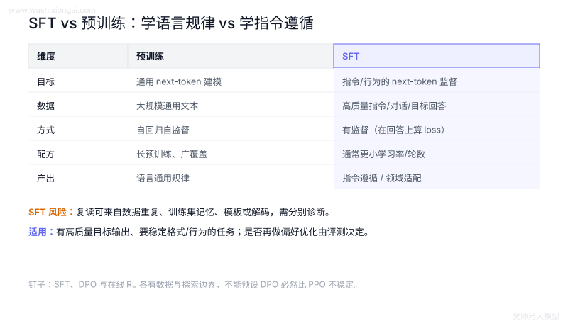

### 07 详解

**【原题速答】** 预训练与 SFT 常共享下一 token 损失，差异主要在数据与监督范围，复读需从数据和解码共同治理。

**【考察意图】**

1. 能否一句话戳破 misconception："两阶段是不同的损失函数"是错的——同为下一 token 预测，差异在**数据分布与监督范围**；
2. scaling law 的量化掌握（这是"预训练目标"这半题的定量核心，须完整给出 Chinchilla 推导）；
3. 数据工程三件套（配比/去重/清洗）对最终质量的因果解释；
4. assistant-only loss、灾难性遗忘、复读治理三条工程追问的深入.

**【深度解析】**

**损失函数相同，分布与掩码不同。** 两者都最小化 $-\frac1{|T|}\sum_{t}\mathbb E_{x_t}\log p_\theta(x_t\mid x_{<t})$。差异表：

| 维度 | 预训练 | SFT |
| --- | --- | --- |
| 数据 | 亿-万亿级通用语料 | $10^3$–$10^5$ 级指令/对话样本 |
| 监督范围 | 全 token | 通常 assistant-only（prompt 段 mask，防止模型学会"生成用户话"） |
| 每样本 token | 长/多样 | 短/成对结构 |
| 学习率 | $10^{-4}$–$3\times10^{-4}$ | $10^{-5}$–$2\times10^{-5}$（防止灾难性遗忘） |
| 步数 | 数十万步、多 epoch 谨慎 | 1–3 epoch 即收敛 |
| 目标 | 知识与语言统计 | 行为、格式、角色一致性 |

**Scaling law（必须会算的一部分）。** Chinchilla 拟合（Hoffmann et al. 2022；$\alpha\approx0.34,\ \beta\approx0.28$，$A\approx406.4,\ B\approx410.7$）：

$$L(N,D)=E+\frac{A}{N^{\alpha}}+\frac{B}{D^{\beta}},\qquad \text{训练 FLOPs}\approx C\approx 6ND\ \ (前向 2N + 反向 4N/每 token，忽略注意力项)$$

**最优分配的完整推导（Lagrange）。** 约束 $C=6ND$ 下最小化 $L$：
$$\frac{\partial}{\partial N}:\ -\alpha A N^{-\alpha-1}+6\lambda D=0 \quad(1)\qquad \frac{\partial}{\partial D}:\ -\beta B D^{-\beta-1}+6\lambda N=0 \quad(2)$$
(1)/(2) 消去 $\lambda$：
$$\frac{\alpha A\,N^{-\alpha-1}}{\beta B\,D^{-\beta-1}}=\frac{D}{N}$$
两边同乘 $N\cdot D^{\beta+1}$：
$$\frac{\alpha A}{\beta B}\,N^{-\alpha}\,D^{\beta}=1\;\Rightarrow\;D^{\beta}=\frac{\beta B}{\alpha A}\,N^{\alpha}\;\Rightarrow\;D=\Big(\frac{\beta B}{\alpha A}\Big)^{1/\beta}N^{\alpha/\beta}$$

代入约束 $C=6ND$ 反解：$N^*\propto\big(C/6\big)^{\frac{1}{1+\alpha/\beta}}$，$D^*\propto\big(C/6\big)^{\frac{\alpha/\beta}{1+\alpha/\beta}}$。因为 $\alpha/\beta\approx0.34/0.28\approx1.21>1$，**最优 $D^*/N^*$ 随预算缓慢增长**，在 Chinchilla 拟合区间内约 **20 tokens/参数**：7B → 约 140B tokens。

**勘误/补充（2026-11 口径）：** "20 tok/参数"是 2022 年的 compute-optimal 结论，**并非现在的训练准则**。官方实践已大幅 over-train：Llama 3 的 8B 用了 **15T tokens**（约 1875 tok/参数，官方博客说明基准测试外 loss 仍在下降），DeepSeek-V3（671B/激活 37B）14.8T。动机是推理成本按**参数量**摊销：训练是一次性支出，推理按 token 计量近乎无限次，因此用"多花训练、少花部署"换取单位成本最优化；同时 data-constrained 场景（Muennighoff et al. 2023）表明数据最多重用约 4 个 epoch 仍近无损收益。面试中给出这个时间线是加分项。

**数据工程对质量的影响（配比/去重/清洗）。**
- **去重**：MinHash+LSH（对 5-gram 做 MinHash 签名、分桶 LSH 找近重）+ 精确子串去重；FineWeb 系列消融显示激进去重显著提升下游表现并降低复读倾向。过长重复段落剔除与文档级过滤是便宜且高收益的核心步骤。
- **质量打分**：分类器/大模型打分过滤（FineWeb-Edu 用 Llama-3 类评委出 0–5 教育分，保留 ≥3 分得 ~1.3T tokens，仅占原语料小份额但下游显著更好）。
- **配比**：预训练用 domain 组间优化（DoReMi/RegMix 用小模型学出最优 mixture），SFT 更强调**任务多样性 > 单任务量**（FLAN 系：扩任务类别收益远大于重复样例）。

**量级算例。** 7B 模型 SFT 5 万条对话×平均 800 tokens ≈ 40M tokens：与 Llama-3-8B 的 15T 预训练 tokens 相比约为 **1 : 375,000**——说明"SFT 基本不改知识，只改行为分布"（LIMA 通过 GPT-4 相似评测支撑该结论）。

**复读需从数据和解码共同治理（原答案保留并展开）。** 数据侧：去重、多参考回复、鼓励多样 target；解码侧：repetition penalty / frequency-presence penalty、min-p 采样；训练侧：assistant-only loss 防止学会"生成用户话"。

**【追问链加深】**

1. **第 1 层（原文）：assistant-only loss 具体怎么做？** 要害：prompt/user 段 mask 掉标签，只对 assistant token 算损失；防止模型内化"用户腔"，同时让有效计算集中在行为监督上。代价是每样本有效 tokens 变少、batch 结构复杂（padded/mask）。
2. **第 2 层：灾难性遗忘怎么诊断与预防？** 要害：诊断用预训练期基准回测（MMLU/GSM8K/通用对话胜率）对比 SFT 前后；预防四件套——低 LR（$10^{-5}$ 量级）+ 注入 10–20% 通用数据 co-train + PEFT（LoRA 天然限幅）+ 短 epoch（≤3）。
3. **第 3 层：SFT 能填补知识空白吗？** 要害：基本不能（40M vs 15T 的 token 比），知识靠预训练+RAG；SFT 强行"填知识"将同时加重幻觉——用 `evaluation-monitoring` 03（幻觉缓解）与 07（训练/推理/知识增强选型）框架。
4. **第 4 层：SFT 与 RL/DPO 的接续怎么设计消融？** 要害：SFT→偏好优化是"格式获取→质量重排序"接力；消融必须同数据同评估，考察是 SFT 训练幅度（epoch/LR）还是偏好优化的错（`rlhf-alignment` 06/07 是接续主战场）。

**【串联与资料】**

- 仓库内：`rlhf-alignment` 06（三阶段衔接）、`prompt-engineering` 01/02（few-shot 与 CoT 是"不改参数的 SFT 替代"）、`evaluation-monitoring` 07（知识注入该走训练还是检索）、`rag-foundations`（外部知识通道）、fine-tuning 04（工程选型三段面）与本模块 06/09（曲线异常、收敛判定的"预训练预期基线"）。
- 原文参考资料一句话核心结论：
  - *InstructGPT*（Ouyang et al. 2022）：先 SFT 后 RLHF 的三阶段配方，小数据 SFT（万级）即可把对齐行为显著改变，而 RLHF 带来额外真实用户偏好收益。
  - *LIMA*（Zhou et al. 2023，"Less Is More for Alignment"）：仅 1,000 条精选样本微调 65B 模型，GPT-4/人工评测中接近或超过 RLHF 模型——**对齐更是行为分布的即时刻画而非知识注入**（注意此结论对质量要求极高，存在可复现性争议，但不翻转主趋势）。
  - *DPO*（Rafailov et al. 2023）：把带 KL 约束的 RL 目标闭式重参数化为对参照策略比值的分类损失，无需显式 reward model 与 RL 循环。

---

### 08. MSE vs 交叉熵损失怎么选?

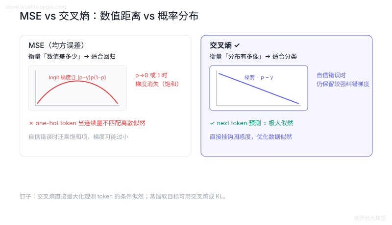

### 08 详解

**【原题速答】** 均方误差适合连续回归，交叉熵对应分类似然并提供更合适梯度，因此语言建模通常采用交叉熵。

**【考察意图】**

1. 白板现场推导 sigmoid+BCE 的梯度（原文追问），看是否记到"梯度恒等于误差"这一层；
2. softmax 数值稳定实现（log-sum-exp），这是工程必考点；
3. 能否从极大似然的角度贯通：回归↔高斯 NLL↔MSE，分类↔分类别分布 NLL↔CE；
4. 混用风险（分类用 MSE 为何"学习缓慢"）必须能定量解释。

**【深度解析】**

**sigmoid + BCE 梯度（完整推导）。** 单样本 $z\in\mathbb R$，$p=\sigma(z)$，$y\in\{0,1\}$：

$$L=-\big[y\log p+(1-y)\log(1-p)\big],\qquad \frac{dp}{dz}=p(1-p)$$

$$\frac{dL}{dp}=-\frac{y}{p}+\frac{1-y}{1-p}=\frac{-y(1-p)+(1-y)p}{p(1-p)}=\frac{p-y}{p(1-p)}$$

链式：

$$\frac{dL}{dz}=\frac{p-y}{p(1-p)}\cdot p(1-p)=\boxed{\,p-y\,}$$

梯度是**不带饱和抑制的误差**：$p$ 远离 $y$（方向错得离谱）时梯度反而大——这正是 CE 优于 MSE 的全部秘密。

**MSE 作对照。** $L=(p-y)^2$，$\frac{dL}{dz}=2(p-y)\,p(1-p)$：误差大但 $p$ 饱和（$p\to0/1$）时多乘 $\sigma'=p(1-p)\to0$，梯度消失、学习缓慢。**量化体感：** $p=0.01$、$y=1$（大错）：MSE 梯度因子 $2\times0.99\times0.01\times0.99\approx0.0196$，而 CE 梯度因子 $1$——相差约 **50 倍**。

**softmax + CE 梯度（多分类，完整推导）。** $p_j=e^{z_j}/\sum_k e^{z_k}$，$L=-\log p_y$：

$$\frac{\partial L}{\partial z_j}=\frac{\partial}{\partial z_j}\Big[\log\sum_k e^{z_k}-z_y\Big]=p_j-\mathbb 1[j=y]$$

同样"logits 梯度 = 概率 − one-hot"的线性形状，不发生额外饱和缩水（饱和项被商规则恰好化解）。

**似然视角贯通（选型的第一性原理）。** 高斯似然假设下 NLL $=\frac{\|y-\hat y\|^2}{2\sigma^2}+\text{const}$ ⇒ **MSE 就是回归的 NLL**；分类别似然假设 ⇒ CE。所以"连续回归用 MSE、离散分类用 CE"不是口味，而是模型假设匹配似然。

**数值稳定实现（原文追问。必背）。**

- softmax：减最大值 $m=\max z$，$p_j=\frac{e^{z_j-m}}{\sum e^{z_k-m}}$（防上溢；减常数不改概率）；
- CE：$\mathrm{LSE}(z)=m+\log\sum e^{z_k-m}$，$L=\mathrm{LSE}(z)-z_y$（`F.cross_entropy` 内核即此，避免先 softmax 再 log 的两次舍入叠加）；
- 多标签：BCE-with-logits 合并 sigmoid+BCE 的推导（数值上用 log 恒等式合并展开）；`ignore_index` 用以配合 assistant-only loss masking（07 题）。
- label smoothing（衔接 10 题）：$y\to(1-\epsilon)\,\mathrm{onehot}+\epsilon/K$，直接以 CE 的软目标形式实现。

**【追问链加深】**

1. **第 1 层（原文）：现场推导 sigmoid+BCE。** 要害：上面 $\frac{dL}{dz}=p-y$ 的每一步，特别注意商规则会**恰好抵消饱和项**这一生死细节。
2. **第 2 层（原文）：softmax 数值稳定怎么做？** 要害：max-shift + log-sum-exp；float32 聚合、logits 路径而非 softmax 概率路径；检查 nn.LogSoftmax 联合 NLLLoss 是同一 trick 的库实现。
3. **第 3 层：CE 为什么还"顺便"给了概率校准？** 要害：CE 在 log-odds 尺度上对错误线性问责（$p\approx1$ 且错时惩罚近无上界），训练后置信度分布与准确率匹配良好；MSE 只对已过 sigmoid 的 $p$ 回归，梯度因子 $p(1-p)$ 会把深错样本的学习信号一并压掉，校准语义不如 CE（衔接 10 题的校准框架）。
4. **第 4 层：什么时候 MSE 用于 LLM 相关管线是正确选择？** 要害：value head/奖励回归、奖励模型连续目标、蒸馏的中间表示回归（hidden-state MSE）；这些都不是"概率"而是"量"，用 MSE + 似然解释都对得上。

**【串联与资料】**

- 仓库内：`model-architecture` 11（逻辑回归 = sigmoid+BCE 同构）、19（Self-Attention 计算 QKV——主干到 logits 再接 CE 的路径）、本模块 01（CE=H+KL 的联系）、05（focal 是 CE 的难度重加权）、10（label smoothing 与校准）、`rlhf-alignment` 08（reward model 的成对目标同样是 CE 变形）。
- 原文参考资料一句话核心结论：
  - *PyTorch MSELoss 文档*：连续目标回归的标准均方损失，支持 mean/sum 归约与加权。
  - *PyTorch CrossEntropyLoss 文档*：logits+类标签一体的 log-sum-exp 实现，含 ignore_index 与 label_smoothing 支持。
  - *A Fast Learning Algorithm for Deep Belief Nets*（Hinton et al. 2006）：逐层无监督 + 微调（历史语境）证明深网可行，选用 CE/似然派的经典起点。

---

### 09. 模型收敛怎么判断?

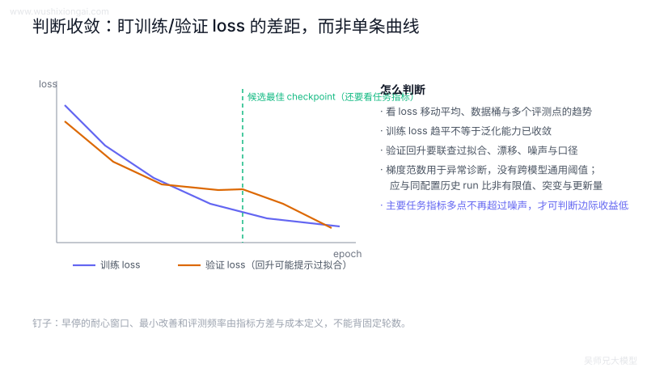

### 09 详解

**【原题速答】** 收敛需结合训练损失、梯度统计、独立验证指标和多次评测判断，单一曲线趋平不能证明泛化。

**【考察意图】**

1. 能否把"收敛"从单指标迷信拆成多信号体系（loss、梯度统计、独立验证、重复评测）；
2. 清楚"loss 平台 ≠ 收敛"的各种陷阱：schedule 末段还会降、验证指标有自己的噪声、emergent metric 争议；
3. 量化能力：给出评测噪声估计、update/param 比值、scaling law 外推残差；
4. 实用性：对追问链各层（更新范数、评测噪声、早停 patience、学习率阶段）逐层给出答案要害。

**【深度解析】**

**四层信号体系（先建框架）。**

1. **训练 loss**：平滑窗口看趋势 + log-log 拟合（power-law 期望值）；看是否受 schedule 影响（cosine 末段 loss 还会明显下降，因此**训练中途不断言"收敛"**）；
2. **梯度统计**：`clip 前 ‖g‖`（p95/p99 趋势与 spike 历史）、`clip 后`、**更新/权重范数比** $\|\Delta\theta\|/\|\theta\|$ 经验在 $10^{-3}$ 量级（AdamW：过大说明 LR 相对权重尺度过强，过小说明动力不足/已平台）；
3. **独立验证**：与训练完全隔离的数据划分 + 足够样本量；用 HF `Trainer` 的 eval 周期与选择器管理抽查节奏；
4. **任务指标×多次评测**：同一 checkpoint 多 seed/多 prompt/固定解码（温度 0、同 sample strategy）看方差。

**评测噪声必须量化（原文追问）。** 设指标为成功率 $p$、评测集 $n$ 条，标准误 $\mathrm{SE}=\sqrt{p(1-p)/n}$。**算例：** $n=500$，$p=0.8$ ⇒ SE$=\sqrt{0.16/500}=\sqrt{0.00032}\approx1.8\%$。结论：**小于 ±1.8 个百分点的评测差异是噪声，不是进步。**这直接决定"多次评测"而非"单次评测曲线"的必要性，也否定只看单曲线做决策的习惯。

**早停与 checkpoint 体系。** patience 的可执行定义：连续若干个 eval 间隔内的提升都小于 2–3 倍评测噪声即触发；两种 checkpoint 都要保留：按最小 val loss 与按任务指标（后者可能非单调）。

**附加维度（2026 口径，明显加分）。** 预训练可用 **scaling law 外推**：把训练步数的 $L(N,D)$ 拟合外推，实测残差（离期望值的偏差）作为"是否走偏"的定量警报——把 06 题的"异常"与"正常变慢"在数字上区分开。评估指标本身也会制造伪信号："emergent metric" 争议（Schaeffer et al. 2023：所谓"能力突现"很大程度是指标不连续带来的伪影——选连续指标/软指标可减少假象，与 evaluation-monitoring 02 呼应）。

**【追问链加深】**

1. **第 1 层（原文）：更新范数在收敛判读里怎么用？** 要害：`‖Δθ‖/‖θ‖≈10^{-3}`（AdamW 经验），并扣除 scheduler 阶段的影响再解读；epochs 未收尾时衰减导致变小，是"接近停机"而非"无效训练"。
2. **第 2 层（原文）：评测噪声有多重要？** 要害：先算 SE，再谈趋势；几个百分点的差在 $n\le1k$ 时是噪声，避免抓着"1 个点变劣"而回滚或暂停训练。
3. **第 3 层（原文）：早停 patience 怎么定？** 要害：以"评测噪声标准差的 2–3 倍、连续 N 个 eval 间隔无显著提升"为触发条件，且 patience 与 eval 频率绑定（不是纯步数）；双追踪 val loss 与任务指标对比，避免 false-negative。
4. **第 4 层（原文）：学习率的阶段对判读有何影响？** 要害：warmup 段（不稳）、平稳段（主线解读窗口）、decay 段（loss 再降、平台假象消失）。**判"收敛"要避开高 LR 平台期、等 decay 末段解读**——cosine 末段 loss 还有一段"免费下降"。

**【串联与资料】**

- 仓库内：本模块 06（异常判别 vs 正常变慢）、07（预训练 scaling law 作期望基线）、10（"置信度变平"不是性能退化——不同信号间的边界校验）、`evaluation-monitoring` 01/02（NDCG/自动 vs 人工：独立验证在评测语义层的对应物）、`rlhf-alignment` 07（RLHF 场景的收敛与评测）。
- 原文参考资料一句话核心结论：
  - *clip_grad_norm_ 文档*：返回裁剪前范数，是梯度统计监控的官方入口。
  - *Hugging Face Trainer 文档*：eval/回调/调度/早停（`metric_for_best_model`、`load_best_model_at_end`）的标准配置面。

---

### 10. SFT 后置信度下降原因

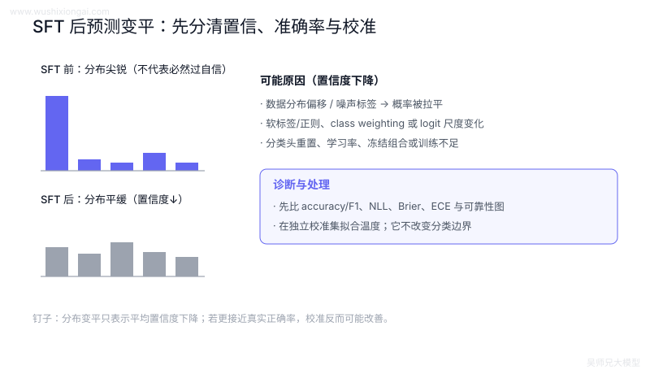

### 10 详解

**【原题速答】** SFT 后置信度变平不等于性能下降，应联合准确率、NLL、Brier、ECE 和分桶漂移诊断原因。

**【考察意图】**

1. 是否牢记"置信度 vs 准确率"解耦是校准问题的基本公理——下降不等于变差，也可能是"更诚实的美德"（原数据多参考目标所致）；
2. 会算 ECE/Brier（原文追问），包括多分类版与 bin 边界细节；
3. 会做 temperature fitting（Guo 2017 标准），并对比 SFT 前后各自拟合的 $T$；
4. 会用 logit margin 定位原因（原文追问第二问），区分"尺度变化"还是"排序变化"。

**【深度解析】**

**现象成因三路。**
- **数据侧**：SFT 目标多半带多参考答案（hallucination-averse prompt）或 label smoothing——训练目标本身不再是"提高对应样本 confidence"的 one-hot，输出分布自然"扁平化"。
- **训练侧**：目标分布"软"（多参考/smoothing）+ 步数有限，模型收敛不到 sharp 解，最大 logit 被压平——置信度整体"变矮"。
- **评测偏差**：评测集相对 SFT 后输出分布的偏移、解码参数不同（temperature/top-p）也会制造表观置信度差异。

**首要澄清（原文结论的展开）。** "置信度变平"**不等于性能下降**：若 top-1 不变而后几位概率上升，这只是"分布变宽（更多样/更诚实）"；若 top-1 下降且 argmax 变，才是真退化——判别的唯一办法是下文的联合信号面板。

**校准工具（原文追问A，带完整算例）。**

- **ECE（期望校准误差）**：把预测置信度分 $M$ 个 bin（宽度 1/M），每桶统计平均置信度 $\bar p_m$ 与实际准确率 $\mathrm{acc}_m$，加权绝对差求和：$\mathrm{ECE}=\sum_m \frac{n_m}{n}\,|\mathrm{acc}_m-\bar p_m|$。
- **Brier**：$\frac1n\sum_i\sum_c(p_{ic}-y_{ic})^2$（多分类对 one-hot 全类求和）；二分类简化为 $\mathrm{mean}(p_i-y_i)^2$。
- **算例**：总数 $n=1000$，四桶：$[0.6,0.7)$ 置信 0.65/准确 0.55/100 样本 → 贡献 $0.1\times0.10=0.010$；$[0.7,0.8)$ 0.75/0.79/200 → $0.2\times0.04=0.008$；$[0.8,0.9)$ 0.83/0.88/300 → $0.3\times0.05=0.015$；$[0.9,1.0)$ 0.95/0.86/400 → $0.4\times0.09=0.036$；**ECE≈0.069**；总准确率 0.821、总平均置信度 0.844，读法"过度自信，且高置信桶准确率反而不足"——SFT 后若该分布变平且 ECE 下降，说明"失一点锋利换校准"，若 ECE 升高且 argmax 变，才是真退化。
- **NLL** 的对比作用：log 损失无上界，可被"高置信做错"单独打爆（$p=0.999$ 但错 ⇒ NLL≈6.9）——作为最严格的一项与 ECE/Brier 并用。

**Temperature fitting（原文追问B）。** 在验证集上标量搜索 $T^*=\arg\min_T\mathrm{NLL}(\mathrm{softmax}(z/T),y)$（目标对 $\log T$ 近似凸，几步黄金分割即可）。推理时 logits 除以 $T$（只缩放不改 argmax）。$T^*>1$ 方向的偏移标定 SFT 的"压平"影响。

**Logit margin 定位（原文追问C）。** $m=z_{\rm max}-z_{2{\rm nd}}$ 的分布前后对比：若 $m$ 分布整体不变只是 $|z|$ 尺度缩小（RMSNorm 增幅、融合标签影响）→ 主要是"校准滞后"；若 $m$ 分布整体左移且 argmax 改变率上升 → 真退化（训练 LR/epoch 出问题）。

**Label smoothing 的开放性问题（原文引用文献 + 澄清）。** "When Does Label Smoothing Help?"（Müller et al. 2019）指出：**label smoothing 提升准确率但未必改善校准**（部分分布漂移下 calibration 反而变差），且可能损害蒸馏——所以"上了 smoothing 就更校准"不成立，必须实测。

**【追问链加深】**

1. **第 1 层（原文）：ECE/Brier 各自怎么算、差在哪？** 要害：ECE 是 bin 加权的 L1（对 bin 数敏感、可被大 bin 平均掉）；Brier 是无 bin 全局平方（可微、稳定）；两者联合用于诊断"分布外校准漂移"。
2. **第 2 层（原文）：temperature 拟合要点？** 要害：拟合在**验证集**上做 NLL 最小化（不是 ECE，因 ECE 不可微且分段常）；必须检查容量外推（不同子分布上各自 $T^*$）。
3. **第 3 层（原文）：logit margin 怎么定位原因？** 要害：排名不变仅主 logits 压缩 => 校准问题；排名变动 => 准确率/学习问题；这组区分直接决定要不要重训。
4. **第 4 层：RLHF/DPO 后的置信度走向？** 要害：与 SFT 反常同的问题谱：偏好优化往往**加锐**（chosen 档 logit 上升），反而过自信——校准评估时用同一面板；别把"RLHF 后更笃定"误判成"更强"。

**【串联与资料】**

- 仓库内：本模块 08（CE 与 label smoothing 的机理）、09（评测噪声与多次评测同样适用于置信指标）、01（KL 与蒸馏温度的联系）、`evaluation-monitoring` 02（自动 vs 人工评价的置信口径）、`rlhf-alignment` 07（对齐后的过度自信与评测化对齐）。
- 原文参考资料一句话核心结论：
  - *On Calibration of Modern Neural Networks*（Guo et al. 2017）：现代网络易过自信，验证集单参 temperature scaling 是最简单有效的校准法。
  - *Rethinking the Inception Architecture*（Szegedy et al. 2016）：提出 label smoothing（混合均匀分布软化目标）以抑制过度自信、提升泛化。
  - *When Does Label Smoothing Help?*（Müller et al. 2019）：label smoothing 促进类内收紧但仍不一定带来更高的校准分数，并可能伤害蒸馏表现——"搭上 smoothing ≠ 更好校准"要有实证过程。

---

### 11. 重参数化技巧怎么解决梯度问题?

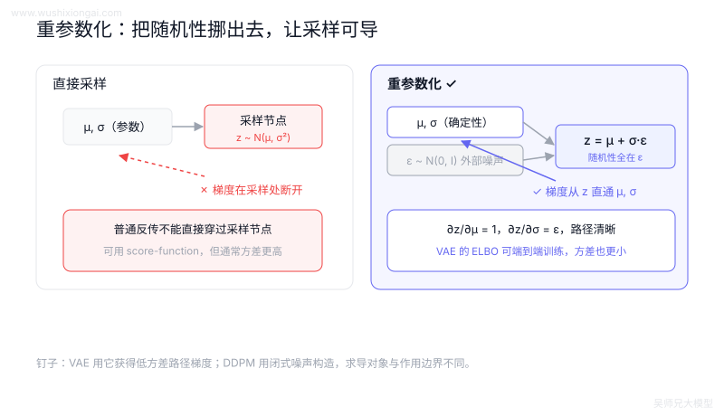

### 11 详解

**【原题速答】** 重参数化把随机变量写成参数与独立噪声的可微函数，使路径梯度能够通过采样计算。

**【考察意图】**

1. 两派估计器的对比不是死记名词：**score-function（REINFORCE，梯度打在有 log-prob 上）** vs **pathwise（重参数化，梯度打在路径上）**，要会算两者的方差差；
2. 直通估计（STE）与 Gumbel-Softmax（原文追问）各自的偏差/方差处境；
3. VAE 单样本的运用：为什么 KL 可解析、重构项用单样本估计即可；
4. 把"重参数化"从工具升格为视角：DDPM 的 $x_t=\sqrt{\bar\alpha}x_0+\sqrt{1-\bar\alpha}\varepsilon$ 也是同构重述。

**【深度解析】**

**问题。** $f\sim p_\theta$ 的期望 $\mathbb E_{f\sim p_\theta}[F(f)]$ 对 $\theta$ 求导；对 $f$ 直接采样的"硬"操作不可微。

**两派估计器（完整对比推导）。**
- **score-function（REINFORCE）**：$\nabla_\theta\mathbb E[F]=\mathbb E_{f\sim p_\theta}[F(f)\,\nabla_\theta\log p_\theta(f)]$（由 $\nabla_\theta p=p\,\nabla_\theta\log p$ 与不含 $\theta$ 的 $F$ 得 $\nabla_\theta\mathbb E[F]=\int F\,\nabla_\theta p\,\mathrm{d}f=\mathbb E[F\,\nabla_\theta\log p]$）。**无偏、高方差**。
- **pathwise（重参数化）**：把采样改写为 $f=g_\theta(\varepsilon)$ 且 $\varepsilon\sim p(\varepsilon)$ 与 $\theta$ 无关（比如 $z=\mu+\sigma\odot\varepsilon$），于是 $\nabla_\theta\mathbb E[F]=\mathbb E_\varepsilon[\nabla_z F(z)\cdot\nabla_\theta z]$。**无偏、低方差**（梯度走 $g_\theta$ 这条可微路径，不经过 log-prob）。

**方差差的闭式算例（原文要求"能算"）。** 设 $z\sim\mathcal N(\theta,1)$，目标 $\nabla_\theta\mathbb E[z^2]=2\theta$。
- score 估计器单样本：$z^2(z-\theta)$。均值：$z=\theta+U$（$U\sim\mathcal N(0,1)$），$\mathbb E[z^2(z-\theta)]=\mathbb E[(\theta+U)^2U]=2\theta+0=2\theta$ ✓ 无偏；取 $\theta=1$ 得均值 $2$。方差：$\mathbb E[(U+1)^4U^2]$，展开 $U^6+4U^5+6U^4+4U^3+U^2$，标准正态偶矩 $\mathbb EU^2=1,\mathbb EU^4=3,\mathbb EU^6=15$ → $15+0+18+0+1=34$；$\mathrm{Var}=34-2^2=30$。
- pathwise 估计器单样本：$2z=2(\theta+U)$：均值 $2\theta$ ✓；$\mathrm{Var}=4\,\mathrm{Var}(z)=4$。
- **结论：这个玩具场景 score 估计方差大 ~7.5 倍**（复杂函数/深网络下更显著），加上 score 估计可进 baseline 技巧降方差但仍劣——重参数化的价值就在此。

**VAE 实战（推导打通）。** ELBO $=\underbrace{\mathbb E_q[\log p(x|z)]}_{\text{重参数化单样本MC估计}}-\underbrace{D_{KL}(q\|p)}_{\text{高斯闭式解析}}$。KL 无需估计（闭式解析），重构项即使单样本估计也够方差预算——这正是 Kingma & Welling 的工程飞跃。注意 $\frac{\partial z}{\partial\mu}=1$、$\frac{\partial z}{\partial\sigma}=\varepsilon$：噪声变成了"梯度的载体"（这就是"pathwise"的字面意）。

**Gumbel-Softmax（原文追问，完整推导要点）。** 类别变量采样不可微。Gumbel-max 技巧证明：$g_k=-\log(-\log u_k)$（标准 Gumbel），则 $\arg\max_k(\log\pi_k+g_k)\sim\mathrm{Cat}(\pi)$ 严格成立（Gumbel 的最大稳定族性质）。软化：$y_k=\mathrm{softmax}\big((\log\pi_k^{\theta}+g_k)/\tau\big)$，$\tau\to0$ 收敛到 one-hot；$y$ 对 $\theta$ 可微。**偏差就来自 $\tau$ 有限**；$\tau\downarrow$ 偏差↓方差↑。直通（ST）版本：前向用 argmax（hard），反向走 soft 路径——梯度偏差换低方差。解读：反向传播在"未选中的路径"上梯度被硬性置零，STE 用 soft 前向补回这份梯度信息，代价是估计有偏。

**与 DDPM 的联系（加分点）。** DDPM 的 $x_t=\sqrt{\bar\alpha_t}x_0+\sqrt{1-\bar\alpha_t}\varepsilon$ 本身是重参数化视角：给定 $x_0$ 时 $x_t$ 是"参数 $\sqrt{\bar\alpha_t}x_0$ + 独立噪声 $\sqrt{1-\bar\alpha_t}\varepsilon$"的可微函数，从而 ε-预测目标可闭式改写（衔接本模块 02/03 的速度-噪声关系表）。

**【追问链加深】**

1. **第 1 层（原文）：直通估计、Gumbel-Softmax、score-function 怎么取舍？** 要害：离散结构（token/检索硬选择）→ ST-Gumbel（偏差换方差，工程上最常用）；连续 latent → pathwise 重参数化首选；只有不可逆采样（RL 轨迹、离散结构完全黑盒）才被迫 score-function + baseline。
2. **第 2 层：为什么 VAE 只需要单样本重构估计？** 要害：切换视角后每样本的梯度带在路径上，单样本估计方差可控；加上 KL 解析闭式，两段合计方差足够小。
3. **第 3 层：score-function 的 baseline/control variates 怎么调？** 要害：$\nabla\mathbb E[F]=\mathbb E[(F-b)\nabla\log p]$，$b$ 不改期望；按组（GRPO 式）中心化（`rlhf-alignment` 02：群内 reward 归一）正是结构化 baseline；还有方差优化的 moving-average baseline。
4. **第 4 层：什么时候 path 估计器不存在？** 要害：支撑为离散/输出会"跨界"的结构（如取 top-k、泊松整数）需要近似或放松；不可微的离散机制（离散 diffusion、VQ-VAE 码本查询）只能退回 STE 类做法——`model-architecture` 17 的 VQ 码本塌缩治理正是这类限制的直接案例。

**【串联与资料】**

- 仓库内：本模块 01（VAE ELBO/KL 闭式推导）、02/03（$\alpha_t x_0+\sigma_t\varepsilon$ 的重参数化形式）、08（$\sigma'(z)$ 梯度死亡的另一种"梯度断裂"案例）、`model-architecture` 15/17（VQ-VAE 与 STE/码本塌缩：重参数化受限的对立面）、`rlhf-alignment` 02（score-function 估计在 GRPO 中的组内 baseline 实例）。
- 原文参考资料一句话核心结论：
  - *Auto-Encoding Variational Bayes*（Kingma & Welling 2013）：重参数化使 VAE 的单样本低方差梯度估计成为可能，端到端 SGD 训练推断网络。
  - *Denoising Diffusion Probabilistic Models*（Ho et al. 2020）：扩散前向以"信号+噪声"的参数化写出，把采样重构与 ε-预测融为同一可微推断目标。

---

# 第二部分 · 模型微调（modules/fine-tuning.md，4 题）

### 01. LoRA 微调比全量微调更慢吗？

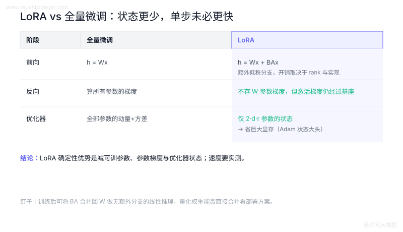

### 01 详解

**【原题速答】** LoRA 减少可训练参数、参数梯度和优化器状态，但仍经过冻结主干计算，单步训练不保证更快。

**【考察意图】**

1. 一句话戳破直觉误区："参数少了 100 倍 ⇒ 快 100 倍"是错的——**前向与反向主干 FLOPs 都要**，LoRA 主要是显存/优化器节约；
2. 是否会做 FLOPs 逐层分解（这本账是拿 offer 的关键层）；
3. 是否理解 QLoRA 的三件套（NF4/双重量化、分页优化器）与其代价；
4. 服务/合并侧的知识（merge 后零延迟、多 adapter 共享基座）。

**【深度解析】**

**零基线 FLOPs 分解（只看一个线性层）。** $y=W_0x+s\cdot B(Ax)$，$W_0\in\mathbb R^{d\times k}$，rank $r\ll k,d$；乘加记 2 FLOPs。

| 计算 | FLOPs | 说明 |
| --- | --- | --- |
| 前向主干 $W_0x$ | $2dk$ | LoRA 与全参**完全相同** |
| 前向 adapter $BAx$ | $2r(k+d)$ | 相对主干 $\approx\dfrac{2r(d+k)}{2dk}\approx\dfrac{2r}{d}=0.8\%$（$r=16,d=4096$） |
| 反向 dgrad（对 $x$） | $2dk$ | **LoRA 也要算**（多层链式 backwards 需要） |
| 反向 wgrad（对 $W_0$） | $2dk$ | **全参才需要，LoRA 省掉** |
| 反向 adapter（对 $A,B$） | $4r(k+d)$ | 可忽略 |

- 全参每层 ≈ $6dk$；LoRA 每层 ≈ $4dk+O(r)$，**理论省 1/3 的层内 FLOPs**。
- 实测（重要澄清）：单步时间常与全参**相仿甚至略慢**（0–20% 抖动，看实现）：kernel 融合与启动开销、LoRA 模块前后向的额外分支、FSDP/ZeRO 中 adapter 的 all-gather、dropout 等小环节都能吃掉理论收益；LoRA 原论文也承认训练延迟与全参相当。结论：**LoRA 的低成本红利在显存与总成本，不在单步时延**。

**显存账（量化算例 7B·bf16·AdamW·r=16 all-linear）。** 混合精度 AdamW 每参数约 16 字节（bf16 权重 2 + bf16 梯度 2 + fp32 主权重 4 + m 4 + v 4）。

| 项目 | 全参 SFT | LoRA | QLoRA(NF4) |
| --- | --- | --- | --- |
| 基座权重 | 14 GB | 14 GB | **~3.5 GB**（4bit） |
| 可训练参数 | 6.7e9（100%） | ~4e7（~0.6%，见 03 详解） | 同 LoRA |
| 参数梯度 | 14 GB | ~80 MB | ~80 MB |
| Adam m(+v)(+master) | ~84 GB（m+v+主权重 fp32） | ~0.5 GB | ~0.5 GB（**分页**防 spike） |
| 合计（不含激活） | **~112 GB** | **~14.5 GB** | **~3.9 GB** |

加上激活（batch×seq 生产大头，需要梯度检查点）后，7B 全参在单卡 80 GB 不可行（只能 ZeRO-3 多卡分摊），而 QLoRA 在 **24 GB 消费卡**上训 7B 是现状——这就是"单步不更快、总成本却低一个量级"的完整表述。

**QLoRA 的三件套（原文追问四的浓缩）。**（细节见 02/03 详解）

1. **NF4 4-bit 量化基座**：四位分位数量化保持零均值高斯假设的最优性，反量化时 upcast 到 bf16 计算以保精度；
2. **双重量化**：量化常数（块尺度）本身再量化一次，常数开销 0.5→约 0.13 bit/参数，65B 约省 3 GB（QLoRA 论文口径）；

3. **分页优化器**：优化器状态在 GPU 内存峰值时页出到 CPU，配合 spike（衔接本模块 06）避免 OOM。

**通信（原文追问三分支）。** ZeRO-3 下，主干参数 all-gather **省不掉**（前/后向都要用），LoRA 真正省的是**梯度 all-reduce/reduce-scatter 的体量**（从 100% 参数降到 ~0.5%）与优化器状态分片——大规模下梯度 all-reduce 常是通信 bottleneck，因此多卡吞吐仍受益。

**服务侧。** 训练完成后 `W' = W_0 + s\,BA` 合并，推理**零额外延迟**；多租户场景共享 $W_0$ + 换 adapter（S-LoRA 式 paged KV + adapter 批处理），这是 LoRA 相对全参在"多任务经济性"上的独有优势。

**【追问链加深】**

1. **第 1 层（原文）：线性层的输入梯度为什么 LoRA 省不了？** 要害：链式法则要求每层向下游传递 $\partial L/\partial x$（决定下一层的可用信息），冻结主干只是"不再更新 $W_0$"，不是"不再算 dgrad"；只有当该层是**网络末端**（无下游）时 dgrad 才省得掉。
2. **第 2 层（原文）：与梯度检查点的相互作用？** 要害：LoRA 训练激活量与全参几乎相同（主干仍要 backward），显存收益主要来自参数/优化器；必要时梯度检查点与 FlashAttention 仍是标配；只对 adapter 做检查点等优化可进一步省激活。
3. **第 3 层（原文）：通信侧省在哪？** 要害：ZeRO-3 的"前向 all-gather"是必须（主干参与计算），省的是梯度 reduce-scatter（0.5%）与优化器状态；另注意 adapter 权重本身也会在 FSDP 的 all-gather 流程中多一份小通信。
4. **第 4 层（原文）：QLoRA 与 LoRA 的完整区别？** 要害：QLoRA = LoRA + 基座 NF4 量化 + 双重量化 + 分页优化器；训练目标一致（base 冻结，只训 adapter），代价是反量化带来的步时延（经验 20–30%）、收益是权重显存 4 倍缩减（14→3.5 GB）。

**【串联与资料】**

- 仓库内：fine-tuning 02/03（PEFT 全景与 LoRA 数学）、`inference-optimization` 02（ZeRO 分片：本文通信分析的前提）、04（显存优化全景：16 B/参数表就是其口径）、06（INT8/INT4 量化后多大——与本文 NF4 算例互为验证）、本模块 06（spike 与分页优化器动机）、04（autograd 与保存中间量的分解逻辑）。
- 原文参考资料一句话核心结论：
  - *LoRA*（Hu et al. 2021）：把增量约束为低秩可训练对 $B,A$，在下游任务上与全参微调匹敌，可训练参数降达 10,000 倍。
  - *QLoRA*（Dettmers et al. 2023）：NF4 + 双重量化 + 分页优化器让 65B 模型可在单卡 48GB 上微调，且微调质量可追平 16-bit。

---

### 02. 全参数 vs 参数高效微调怎么选?

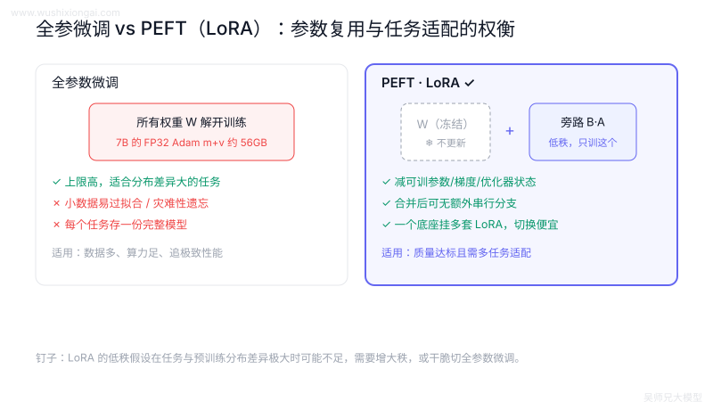

### 02 详解

**【原题速答】** PEFT 只训练少量新增或选定参数，可降低权重与优化器状态开销，但主干计算和激活仍然存在。

**【考察意图】**

1. 是否懂得 PEFT 的**省钱红利在优化器状态与存储，不在计算**（与 LoRA "不更快"同源）；
2. 能否写出方法谱系定位点（bitfit→prompt/prefix→adapter→LoRA 系），各自显存/延迟/表达力交换；
3. 量化能力：ZeRO 分片与 PEFT 的显存算式（原文追问）；
4. target modules 的场景化选择（原文追问），以及"冻结基座+量化"组合的工程陷阱。

**【深度解析】**

**方法谱系（按注入位置分类）。**

| 方法族 | 注入位置 | 参数量级 | 延迟代价 | 备注 |
| --- | --- | --- | --- | --- |
| bitfit | 仅 bias | ~0.1% | 0 | 极小、表达力低 |
| Prompt-tuning | 输入开头 soft token | ~0.01% | 0（但占上下文窗口） | 深层信息有限，模型大时才有效 |
| Prefix-tuning / P-tuning v2 | 每层 KV 前缀 | ~0.1–1% | 每层 + 前缀 GEMM | 相对更接近全参，对话强 |
| Adapter（Bottleneck） | 层间串行瓶颈 | ~0.1–1% | **串行 + 延迟** | 经典 PEFT，不能与主干合并（有串行小延迟） |
| LoRA 系 | 线性层旁路 | ~0.1–1% | **合并后 0** | 主流；rank/α/目标层可调 |

**"计算没省"的量化说明（原文追问一）。** PEFT 省的是：优化器状态（12 B/param×可训参数）、参数梯度、checkpoint 存储。**不省的是**：基座前/后向 FLOPs 与**激活显存**（反向链路不变）。激活量的量级：$\approx b\times s\times h\times L\times c$（bf16、$c\approx$14–34 量级视层实现）——7B、seq=2048、per-GPU batch=4：**激活可达数十 GB**，跟基座显存同量级。结论：**LoRA/adapter 单卡可跑的前提是 gradient checkpointing + FlashAttention**；否则激活比省下的优化器状态还大。

**ZeRO 分片（原文追问四）量化。** 每 param 混精 AdamW ≈ 16 B：ZeRO-2 分片梯度+优化器（14 B），每卡 ≈ $2\psi+14\psi/D$；ZeRO-3 连权重一起分片，每卡 ≈ $16\psi/D$（暂不计激活与缓存）。7B、$D=8$：ZeRO-2 ≈ 26 GB/卡（不含激活），ZeRO-3 ≈ 14 GB/卡（不含激活）。LoRA 组合下优化器/梯度小到不值得分片，用**ZeRO-3 或 FSDP 只做权重分片 + LoRA on top** 是 2025 主流配方之一；`use_orig_params` 与 FSDP 的交互在 HF Trainer/DeepSpeed 中须显式配置。

**target modules 的场景化选择（原文追问）。** QLoRA 论文的核心消融结论：**指令对齐/对话类任务仅对 attention（q,k,v,o）加 LoRA 已够**；**代码、数学、多语/复杂泛化任务需要 all-linear（含 gate/up/down MLP）**，qkv-only 在 HumanEval 这类任务上明显掉分。粗规则：行为/风格微调 → attention-only 即可；能力型（代码/逻辑/新语言）→ all-linear + 高 rank。

**选型矩阵（面试里最后背出来的一张表）。**

| 场景 | 推荐 | 理由 |
| --- | --- | --- |
| 少样本对话/风格/格式 | LoRA r=8–16, attention-only | 质量足够、显存小、可合并 |
| 能力型（代码/数学/新语言） | LoRA 高 r（32–64）all-linear 或全参 | 需要更大更新秩与字节自由度 |
| 单数据海量（≥1e5 双标注） | 全参 SFT（ZeRO-3）上限更稳 | PEFT 在极限数据下可能欠拟合 |
| 多租户/多任务服务 | LoRA + adapter 热交换 | 训练/部署经济性 |
| 更新安全性要求高（遗忘敏感） | PEFT | 限秩限幅即是正则 |

**【追问链加深】**

1. **第 1 层（原文）：激活不省是怎么回事、怎么对冲？** 要害：前/后向照常过主干，激活取决于 batch/seq/hidden，与训不训练权重无关；对冲 = gradient checkpointing（+33% FLOPs 换显存线性反降）+ FlashAttention（attention 激活从 $O(s^2)$ 降为 $O(s)$）+ 较小 per-GPU batch + 梯度累积。
2. **第 2 层（原文）：基座量化（QLoRA）与 ZeRO 怎么协同？** 要害：base 4-bit 常驻卡内（不再 ZeRO-3 分摊也放得下），adapter 常以 bf16 保存；ZeRO/FSDP 在该情形主要用于**梯度与优化器的分片**（adapter 本身很小，收益有限）与通信调度。
3. **第 3 层（原文）：target modules 有没有更细的规则？** 要害：能力型任务损失集中在 MLP（query→key→value 之外）；count the layer：每层 attention 4 个矩阵 + LLaMA 结构 MLP 3 个矩阵（gate/up/down），7B r=16 all-linear 可训参 ≈ 0.6%（见 03 详解）。
4. **第 4 层：冻结基座有什么隐藏花招？** 要害：RMSNorm/输出层等权重是否随 adapter 一起训练会影响分布对齐（通常 PEFT 不动它们）；fp16 基座在长训练下小更新会被有限精度吸收（基座用 bf16 或量化 + 高精度 adapter 缓解）；另一个隐藏点是**部分层训练 vs 全层旁路**（偏前层低秩适配常不够）。

**【串联与资料】**

- 仓库内：fine-tuning 01/03（单步成本与 LoRA 数学上下文）、04（工程选型收口）、`inference-optimization` 02/04（ZeRO 的公式化与显存全景题）、本模块 07（灾难性遗忘④PEFT 选项）、06（spike 与显存崩溃的关联）。
- 原文参考资料一句话核心结论：
  - *LoRA*（Hu et al. 2021）：低秩旁路在多数下游任务与全参表现相当，可训参数压缩万位。
  - *QLoRA*（Dettmers et al. 2023）：4-bit 载体 + 高精度 adapter 使单卡能微调 65B，并给出 attention-only vs all-linear 的关键消融结论。
  - *ZeRO*（Rajbhandari et al. 2020，1/2 两段）：优化器状态/梯度/参数三级分片，将数据并行的显存跌到近线性比例，通信增长可控。

---

### 03. LoRA 低秩分解 vs 全量微调怎么选?

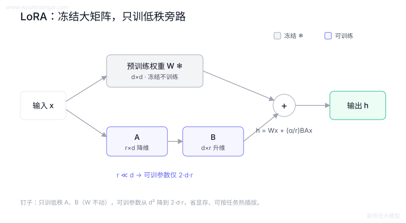

### 03 详解

**【原题速答】** LoRA 冻结原权重，将增量写成缩放后的低秩乘积 BA，只训练 A、B，从而显著降低可训练参数和优化器状态。

**【考察意图】**

1. 公式与维度极精确（$W' = W_0 + \frac{\alpha}{r}BA$），初始化方向**写反会被扣分**；
2. 梯度公式能手写（$\partial L/\partial A,\ \partial L/\partial B$ 各自形状与组织）；
3. rank/α 与 target modules 三旋钮的**关系**（α/r 是有效学习率的缩放）；
4. 合并/多适配器服务与"何时 LoRA 不够用"。

**【深度解析】**

**结构与形状。** 基座 $W_0\in\mathbb R^{d\times k}$（输出 $d$、输入 $k$），$A\in\mathbb R^{r\times k}$、$B\in\mathbb R^{d\times r}$：

$$h=W_0x+\frac{\alpha}{r}\,B\,(Ax),\qquad \Delta W=\frac{\alpha}{r}BA$$

- 参数量：全 $dk$ vs $r(d+k)$；**7B·r=16·all-linear**: 每层 attention q/k/v/o 共 $4\times16(4096+4096)=52$ 万，gate/up/down 共 $3\times16(4096+11008)=72.5$ 万，合计 ≈ **125 万/层 × 32 层 ≈ 4,000 万 ≈ 0.6%**。
- 初始化：$A$ 高斯/正态、$B=0$ ⇒ 起步 $\Delta W=0$，**与基座等价开场**。**为何不是"$A=0$、$B$ 随机"？** 数学上也成立（$\partial L/\partial B=s\,\delta A^{\top}=0$ 但 $\partial L/\partial A=sB^{\top}\delta\ne0$，A 可以先走起来），但没有"零初始增量"的干净性质，标准 practice 是随机 A、零 B。

**梯度公式。** 令 $\delta=\partial L/\partial h$（下游回传进来的）：
$$\frac{\partial L}{\partial B}=\frac{\alpha}{r}\,\delta\,x^{\top\!}A^{\top}=\frac{\alpha}{r}\,\delta\,(Ax)^{\top},\qquad \frac{\partial L}{\partial A}=\frac{\alpha}{r}\,B^{\top}\delta\,x^{\top}$$
读法："$\delta$ 像油一样灌进 $A$ 和 $B$ 的对位"，$B$ 零初始化 ⇒ 首步只有 $A$ 动、随后 $B$ 逐步跟上——由此读出"先 A 后 B"的更新次序。

**rank / alpha 的要害（原文追问二、三）。**

- **rank**：LoRA 论文用矩阵子空间相似度对照（随机高斯基线的 Jaccard 上限）显示多数适配任务的 ΔW 在 $r\approx4\text{–}8$ 已接近"内在秩"，但代码/多语言/泛化任务需要 32–64；经验起点 **r=16**。
- **α**：$\alpha/r$ 是 ΔW 的有效学习率缩放；**常用 α=2r（缩放 2）或 α=r（缩放 1）**；换 rank 时保持 α/r 不变即保持"等效训练动力学"。**rsLoRA**（2023）指出 $\alpha/\sqrt r$ 在大秩下更稳（$1/r$ 的缩放随 r 增大会让大秩欠拟合）。
- **学习率**：LoRA LR（$10^{-4}$–$2\times10^{-4}$）通常比全参（$10^{-5}$）高一个数量级——低秩小参数需要更大步长，这是**实践常错点**。

**合并与多适配器服务（原文追问四）。** 合并：`W' = W_0 + sBA`（建议 fp32 累加再回 bf16，避免低位精度叠加损失）→ 推理**零延迟差**；多任务：共享 $W_0$、按请求切换 adapter（S-LoRA/LoRAX 的 paged KV + 跨 adapter 批处理 kernel）。

**LoRA 与全参的胜负手（回答最终问题的口径）。** LoRA 的 $\Delta W$ 秩 ≤ r，可表达自由度受限：当任务要求**大规模表示重排**（新语言、大规模代码迁移、extreme domain shift）或训练数据海量（$10^5$+ 样本级）时，全参的上限更高；任务属风格/格式/指令适应时，LoRA 与全参的差距统计上在噪声区间内（QLoRA 论文对 MMLU/指令对齐的消融支撑这一点）。

**【追问链加深】**

1. **第 1 层（原文）：target modules 怎么选？** 要害：行为/指令 → attention-only 已够；能力型 → **all-linear（含 MLP）**；进一步消融可以看 per-layer 训练与否——深层/表征抽取层优先。
2. **第 2 层（原文）：rank/alpha 的确定法则？** 要害：r 与任务"内在秩"匹配（8–64 覆盖绝大多数），α/r 保持一致（或 rsLoRA 的 α/√r 进行大秩稳定）；小任务 r 大会过拟合 & 训练时间翻涨。
3. **第 3 层（原文）：合并与多适配器？** 要害：合并后零延迟、精度注意事项；多 adapter 服务在 /serving 侧是 LoRA 独有优势（全参无此选项）。
4. **第 4 层：LoRA 什么时候注定不够？** 要害：三条件——任务需要全秩更新（新领域/新语言）、数据太海量（$10^5$+）、RLHF 类连续大步更新；此时用全参（ZeRO-3）或"高 rank / DoRA、MoSLoRA 类增强"。

**【串联与资料】**

- 仓库内：fine-tuning 01（单步时延与显存账）、02（全谱系选型）、04（工程做法收口）、`model-architecture` 12（"参数规模影响"视图下"可训参数 ≤ 实参"的所指）、本模块 11（pathwise 梯度视角同样适用于 LoRA 的低秩参数）、`rlhf-alignment` 06（SFT 之后的 LoRA 训练出口也是常见做法）。
- 原文参考资料一句话核心结论：
  - *LoRA*（Hu et al. 2021）：低秩增量 $BA$ + 冻结主干，以 0.1%–1% 可训参数达到近似全参的下游表现。
  - *LLaMA*（Touvron et al. 2023）：开源基座（7–65B）与长亲 token-to-param 过训练，为 PEFT 实验提供了高质量公共承载基座。
  - *Hugging Face PEFT LoRA 文档*：`get_peft_model` + `LoraConfig(r, lora_alpha, target_modules, lora_dropout)` 的标准接口，以及合并/存储 adapter 的官方路径。

---

### 04. 大模型微调方法怎么选?

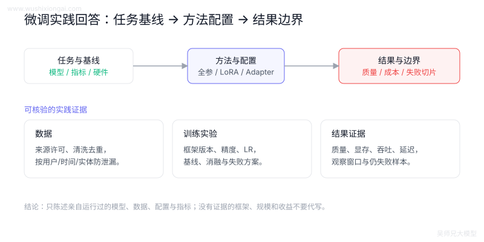

### 04 详解

**【原题速答】** 微调实践应用真实运行证据说明任务基线、数据许可与切分、方法配置、消融实验、质量成本和失败切片，未实际执行的信息不应代写。

**【考察意图】**

1. 面试官问的不是"你选过"，而是"你**如何**选"：要求可验证的基线意识、数据处置意识、消融链收口，以及本题最看重的**诚实性**（不代写未做之事）；
2. 能否给出一条可复制的"工程判释链"：基线 → 数据 → 方法 → 消融 → 质量/成本 → 失败切片；
3. 数据泄漏与灾难性遗忘的**排查套路**（原文追问）要具体到检测手段；
4. LoRA 目标层/rank 决策（原文追问）能否落到经验配置表。

**【深度解析】**

**决策前置（最容易被跳过、最加分的一步）。** 先建立**免训基线**：zero-shot/few-shot prompt、RAG、更小模型回填，看它们在中长期评估的差距（`evaluation-monitoring` 07 的"训练/推理/知识增强怎么选"框架）。只有当 (a) 格式/风格要求严格，(b) 检索无法补知识（无外部资料可挂），(c) 推理时延迟/成本需要固化能力，才有微调必要。

**数据五道关（原文追问二的支撑）。**
1. **许可与合规**：许可、个人信息、敏感性评估——这是"没做不能代写"的第一道红线；
2. **标注质量**：双人标注一致率（Cohen's κ 参考 > 0.65–0.7 为良好），或评分器一致性；
3. **切分防泄漏**：训练/验证/测试**时间切分**优先（业务数据有时间漂移），禁止随机切分之后同一客户/同一文档跨集合；
4. **n-gram / MinHash 重叠检查**：8-gram 精确重叠 + Jaccard>0.8 的近似重叠自动剔除；
5. **canary**：在训练集插入独特随机 token 序列，看测试时复现概率（量化"记忆"）。

**方法配置起点（原文追问一）。** 社区与论文催化的保守起跑线：

| 任务 | LoRA 目标层 | rank/α | LR | epochs |
| --- | --- | --- | --- | --- |
| 指令/对话/风格 | attention q,k,v,o | r=16, α=32 | 1e-4 | 1–3 |
| 能力型（代码/数学/新语言） | all-linear（含 MLP） | r=32–64 | 1e-4 | 2–4 |
| 全参 SFT | 全部权重 | — | 1e-5~2e-5 | 1–3 |

（训练成本算例延续此处：7B、5 万条×800 tokens×3 epochs ≈ 120M tokens，FLOPs $6ND\approx 5\times10^{18}$（0.4 MFU bf16 的 8×A100 ≈ $10^{15}$ FLOPs/s）→ **小时级可完成**）。（对应"质量成本"维度：LoRA 省显存、省总成本，但单步时间并不省，落点是"总成本与可得性"。）

**消融必须不少于四处。** (i) 方法消融：LoRA r=16 vs 全参（资源允许时）；(ii) 目标层：attention-only vs all-linear；(iii) 数据量：10%/25%/50%/100% 的效果曲线（决定是否值得继续采数据）；(iv) 混入 vs 未混入通用数据的比较（遗忘防线预审）。每处保留 checkpoint 与评估曲线，作为"真实运行证据"——这正是原 30 秒答案"未实际执行的信息不应代写"的落点。

**质量与成本双轴。** 质量：任务指标（自动 + 人工抽检）+ 通用基准回归（防遗忘）；成本：训练时长/显存/更换基座的重训代价——LoRA 式 PEFT 在基座升级时只需重训 adapter，是"演化友好"的独特优势。

**失败切片分析（原文的核心词）。** 按长度/类别/输入语言/任务类型分桶，找"最差切片"（worst slice），单点修复后再全量回归——泛化差距几乎总在切片级而非总量级。

**数据泄漏与灾难性遗忘排查（原文追问二细化）。**
- **泄漏**：canary 复现率、训练/测试 n-gram 重叠率、时间切分后指标差；若测试分数虚高且 canary 复现率异常 → 清洗并重划。
- **遗忘**：SFT 后通用基准（MMLU/GSM8K/多语能力）回测、通用语料 PPL 对比；对策四件套（低 LR、通用数据 co-train 10–20%、PEFT、短 epoch）衔接模型训练模块 07 详解。

**【追问链加深】**

1. **第 1 层（原文）：LoRA 目标层和 rank 如何选？** 要害：任务类型决策树（行为→attention-only；能力→all-linear）+ r=16 起跑 + α/r 恒定；数据显示能力型任务 MLP 层不能省。
2. **第 2 层（原文）：数据泄漏怎么排查？** 要害：canary + 统计重叠 + 时间切分的三角验证；最可疑的是"评测分数高、生产分数低"的剪刀差——此时优先怀疑评测集被"污染"或标签过拟合，而不是模型真的变强。
3. **第 3 层（原文）：灾难性遗忘怎么排查与治理？** 要害：通用基准回测 + 通用样本 PPL 前后对比；治理 = 低 LR + 混合 replay + PEFT + 短 epoch；对 report 的取舍：单点任务收益 vs 全局能力损失的 trade-off 曲线。
4. **第 4 层：如何表达"真实运行证据"才不算代写？** 要害：答到数量级与失败模式（数据条数/显存/卡型/时长/遇到的坑），并给出一个已知的例外或降级方案（如预算不够时 LoRA + 小 batch + 梯度累积起跑）；背诵论文显存数字（如 16 B/param）却说不出自己一卡实测，是本题最明显的减分项。

**【串联与资料】**

- 仓库内：fine-tuning 01/02/03（三道 LoRA/PEFT 方法题的直接承接）、模型训练 07（灾难性遗忘机理）、模型训练 06/09（异常与收敛判定——基线缺失导致的伪改进最易在这里翻车）、`evaluation-monitoring` 01/02/03/05/07（自动 vs 人工、幻觉缓解、RAG 错误定位、训练/推理/知识增强选型——"微调不是万能"的支撑题）、`rag-foundations`（先 RAG 后微调的判定依据）、`rlhf-alignment` 06（SFT→偏好→RL 的接续路线）。
- 原文参考资料一句话核心结论：
  - *LoRA*（Hu et al. 2021）：以极低可训参数覆盖大量下游任务适配，是本链选型的默认起点。
  - *Parameter-Efficient Transfer Learning for NLP*（Houlsby et al. 2019）：层间瓶颈 adapter 用 ~1% 参数达到近全参迁移效果（adapter 谱系的鼻祖）。
  - *Hugging Face PEFT 文档*：方法面（LoRA/prompt/prefix/adapters 等）与训练接口的一站式配置表，覆盖 prompt tuning 至 LoRA 家族的全谱系入口。

---

## 覆盖校验

- 模型训练 11 题（01 KL / 02 Flow Matching / 03 DDPM vs FM / 04 动态图 / 05 Focal / 06 曲线异常 / 07 SFT vs 预训练 / 08 MSE vs CE / 09 收敛 / 10 置信度 / 11 重参数化）——全部五段式详解。
- 模型微调 4 题（01 LoRA vs 全参速度 / 02 全参 vs PEFT / 03 LoRA 数学 / 04 方法选型实策）——全部五段式详解。
- 图片引用格式、题号与题名均沿用原模块文件。
