# RAG基础 · 文档处理 · 重排优化 —— 逐题深度详解（12 题）

> 本文为以下三个模块的逐题深度详解，原模块文件只读未改动：
> - `modules/rag-foundations.md`（6 题）
> - `modules/document-processing.md`（1 题）
> - `modules/reranking.md`（5 题）
>
> 每题固定五段：**【原题速答】**（浓缩原文 30 秒回答，不改变原意）→ **【考察意图】** → **【深度解析】**（机制/推导/算例）→ **【追问链纵深】**（沿原文"继续追问"展开 2–4 层）→ **【串联与资料】**（关联本仓库其他模块题 + 原文资料一句话结论）。
> 原文如有含混或过时处，以【纠偏】标注并给出 2025-11 口径；原文图片引用格式原样保留。

---

## 一、RAG基础（modules/rag-foundations.md · 6 题）

### 01. 增量式向量索引怎么更新?

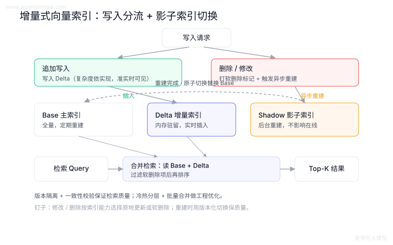

#### 详解

**【原题速答】**
增量索引以 Base（存量段）和 Delta（增量段）合并服务查询，删除更新按引擎能力处理（墓碑/段压实），并用版本化影子索引校验后原子切换。

**【考察意图】**
这不是"会不会用 Milvus"的题，而是考在线索引工程的演进思维：能否把 LSM-Tree、段级合并、蓝绿/影子切换这些基础设施思想迁移到向量索引上；能否量化"什么时候才值得重建 HNSW"，而不是拍脑袋每天全量重建；以及删除这种"向量检索天然弱项"如何兜底。面试官真正想听到的是**合并门槛的量化依据**和**切换期间的召回/延迟保障手段**。

**【深度解析】**

*1. 架构：Base + Delta 分段（Segment）服务查询*

- **Base 段**：全量（或上次合并后）构建的不可变索引（HNSW/IVF-PQ）。写入一次、永不改写，因此可以充分优化（量化、预取、锁free 只读）。
- **Delta 段**：新写入向量先进 Delta（小规模可暴力精确检索或小图索引），查询时**双段并行检索**，结果按分数归并取 Top-K。
- 查询代价近似为两者之和：`T_query ≈ T_ann(base) + T_ann(delta)`（不同段独立扫，最后归并），所以 Delta 成立时间越长、查询越慢、召回结构越差——这就是必须设"合并门槛"的根因。

*2. 删除的三种处理方式与代价*

| 方式 | 机制 | 代价 |
| --- | --- | --- |
| 墓碑过滤 | 点位仍留在图/簇里，查询时按删除标记丢弃 | 召回链路仍走"死点"，浪费算力与内存；但查询可用 |
| 标记删除（如 hnswlib `unmark_deleted`） | HNSW 支持标记/恢复，物理重建受限于 max_elements | 连续删除超过 `allow_replace_deleted` 配额后需扩容重建 |
| 段压实（compaction，Milvus/Lucene 式） | 合并段时物理剔除死向量，等价新 GC | 需要重建该段图结构，有 IO 与 CPU 尖峰 |

【纠偏】很多教程笼统说"HNSW 不支持删除"，这不准确：hnswlib 早已提供 mark/unmark deleted；正确的说法是——**HNSW 的删除是逻辑标记，物理回收必须靠重建/压实**，且大量死点会退化导航路径（死点断路后趋近最近邻的路径变长，跳变增加）。

*3. 合并门槛怎么定量设置（工程算例）*

设 Base 规模 `|B| = 1 亿`向量，日增 `δ = 50 万`。

- **规模门槛 θ_N**：`|Δ|/|B| ≥ 5%`（即 5 天攒出 500 万）触发合并。经验上小于该阈值时 Delta 能扛住暴力/精确检索（500 万 × 768 维 fp32 ≈ 1.5 GB，BN 商暴力扫单 q < 10ms），合并收益不足以抵掉一次重建抖动。
- **删除门槛 θ_D**：墓碑比例 `D / (N_alive + D) ≥ 20%` 触发压实。内存账：死向量白占 `D × d × 4B`；更隐蔽的是**召回退化**——图的入口/邻居关系仍在死点上，实测 30% 墓碑时 Recall@10 可掉 3–8 个百分点，比内存损失早得多。
- **召回/延迟门槛 θ_Q**：哪怕不到前两个门槛，若周评测发现 `Recall@K@Delta` 相对全量基线掉 > 0.5% 或 p99 涨 > 5%，也要触发——这是"以效果为准绳"的兜底条件。
- **合并成本账**：1 亿向量重建 HNSW（M=32、efConstruction=200）在单机约需数十 CPU·小时，故合并必须**影子构建 + 双缓冲**，而不是原地重建停写。

*4. 版本化影子索引与原子切换（标准 SOP）*

```
V_n serving ──┐
              ├─ 查询双读（可选，灰度比对）
V_{n+1} shadow（离线构建、只读）──┴─ 校验通过 ──→ 原子切换 metadata 指针（发号器/配置中心版本号）
```

- **Query 回放**：从线上日志抽样前 1 万条真实 query（按热度分层采样 + 保留长尾分层），在影子索引上跑同一检索栈，逐条对比 `Recall@K` 与排序；量化门槛：人均 Recall@10 相对生产 < 0.5% 且 p99 延迟涨幅 < 5% 才晋升。
- **原子切换**：切换的本质是把"哪个索引版本对外"这一个指针做原子替换（配置中心版本号 / 服务注册表），旧版本保留 N 小时供回滚——与常规蓝绿发布同构。
- 【纠偏】原文一句话未展开"回放怎么抽才不偏"：**必须按 query 热度分层**（头部 query 占量 0.1% 却贡献 60% 流量，只随机抽会全被头部淹掉），且要保留按天/按业务线的分切片对比，防止"总量达标、某片崩了"。

**【追问链纵深】**

1. **追问：为什么 Delta 不能直接写进 Base 的 HNSW？** → HNSW 是层次图，插入需重算邻居并可能级联改边，在线写放大与读延迟抖动都不可控；且批量导入比逐条插入快一个数量级（批量建图可并行、减少重访问）。这正是索引"读写分离成段"的根本原因。
2. **追问：双段检索的合并分数不一样怎么处理？** → 不同段可能用了不同量化/副本，分数不可直接比；工程上一是统一分数空间（同模型同量化参数），二是段内先各自取 Top-K 再统一归并、或干脆对进 Top-K 池子的候选重算一次精确距离（两段方案在 10ms 级预算内可承受）。
3. **追问：增量下 PQ/量化码本不一致怎么办？** → PQ 是对训练集聚类的，新数据分布漂移后旧码本失真；方案有：Delta 用 fp16/更大查表码、周期性重训码本随合并一起换（影子索引正好是零风险换码本时机）、或用 RAFT/近似重训监控重构误差 MSE 告警。
4. **追问：如何做 query 回放以避免污染线上？** → 回放只读影子环境；对线上灰度切 1%–5% 流量时用相同的请求签名与限流，对比指标（Recall、p99、hit rate）以取 min(线上指标， 回放指标) 为准。

**【串联与资料】**
- 关联：`vector-search.md`（HNSW / IVF-PQ / 量化选型是本题的底层），`inference-optimization.md`（服务性能与双缓冲），`evaluation-monitoring.md`（线上评测与回放方法论同构）。
- 资料：本题为"教学整理"级，无附论；可对照 Milvus / Lucene 官方文档的 segment compaction 机制一句话结论：**不可变段 + 定期压实 + 墓碑过滤**是所有向量库增量更新的公共骨架。

---

### 02. 时间窗口对话管理机制

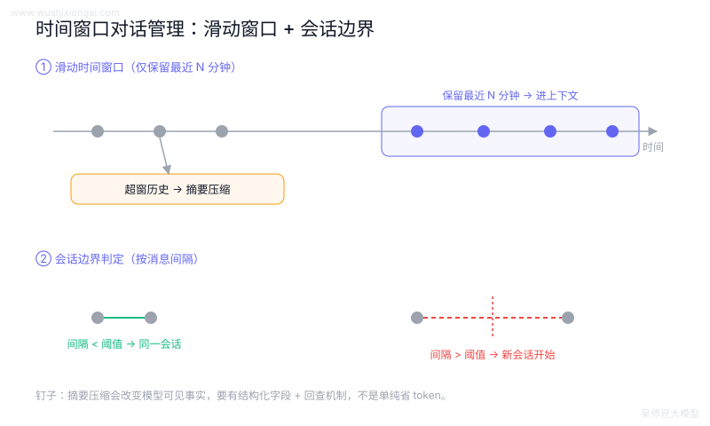

#### 详解

**【原题速答】**
时间窗口会淘汰或压缩过期消息，会话边界还应结合消息间隔、轮数与业务事件，并保留可回查历史。

**【考察意图】**
考的是"窗口只是表象，本质是**上下文预算与信息保真**的分配策略"：能否说清为什么淘汰、保什么、丢什么、丢了去哪找；能否把窗口、摘要、TTL、归档四个机制串成一个有状态的存储设计；这是典型的"会背概念 vs 设计过会话系统"的分水岭题。

**【深度解析】**

*1. 有效上下文的三层结构（窗口只是最上面那层）*

```
[effective context] = pinned (用户画像/关键槽位) + summary (滚动摘要) + recent (最近 T 分钟/最近 N 轮原文)
```

- `recent`：原始消息， fidelity 最高、token 最贵。
- `summary`：对窗口外的消息做压缩，fidelity 降级、成本一次付清。
- `pinned`：人工或规则提取的永不过期事实（姓名/订单号/偏好），通常直接注入 system prompt。

淘汰规则：`recent` 满足 `tokens(recent) ≤ B_recent` 且 `age(msg) ≤ T_window`；超出的进入摘要管线：`summary ← LLM(summary_prev, msgs_out)`，是**增量式合并摘要**而非每次全量重摘（保 slot 连续性、省 token）。

*2. 会话边界三信号（为什么单一时间不完备）*

| 信号 | 判据 | 例子 |
| --- | --- | --- |
| 消息间隔 | `Δt > T_idle`（如 30 分钟）视为换话题 | 客服场景闲聊 40 分钟后回来，旧上下文不必再带 |
| 轮数/长度 | `turns > N_max` 或 `tokens > Φ` | 50 轮长会话，即使没超时应主动切段 + 归档 |
| 业务事件 | 下单完成、工单关闭、支付成功 | 事件是**强边界**：比任何统计信号都权威 |

【纠偏】原文只点了三信号枚举，深度上要补 **优先级**：业务事件 > 轮数硬上限（防上下文爆炸）> 时间间隔；时间信号应做成"软边界"（可带摘要延续），业务事件是"硬边界"（强制新会话）。

*3. Redis TTL 与数据库归档 pairing 设计*

- **写路径**：会话 hash 代表"活跃会话"`HSET session:{sid} msgs/summary/pinned`，每次交互 `EXPIRE session:{sid} 7200`（滑动续期）；同时写一条 append-only 消息到 Kafka / 消息中心。
- **归档路径**：消费侧按 sid 聚合落库（全量历史 + 摘要版本），TTL 到期只代表"活跃会话驱逐"，**不是删除**——归档表才是事实源。
- **恢复路径**：用户隔天回来且命中会话意图时，从归档表拉最近摘要 + pinned 字段重建会话（`SLOT = (uid, business)` 而非纯 sid，防止 sid 变化丢上下文）。
- 容量算例：1000 万日活 × 5% 会话活跃 × 每会话 50 轮 × 平均 200 token ≈ 50 GB 原始文本/日；Redis 只放 2h 滑动窗口的活跃子集（< 200 MB 量级），归档走对象存储 + 压缩，天然分层。

*4. 摘要质量怎么评估（三道卡尺）*

- **信息保真（事实级）**：构造"槽位清单"（用户名、诉求、约束、承诺），标注后测摘要的**事实召回率** `recall_facts = 命中槽位数 / 应含槽位数` 与**幻觉率**（摘要中出现但历史中没有的事实占比）。
- **下游任务级**：同一对话历史下，"全文 vs 摘要"两组跑 A/B，对答案正确率/任务完成率做显著性检验——这是唯一金标准。
- **时效级**：摘要必须带时间戳原文引用，防止把两周前的偏好误当当前意图。

**【追问链纵深】**

1. **追问：窗口多大合适？** → 先看模型 KV/预算价格曲线：窗口过小导致多轮指代失效（"它"指不上），过大成本线性涨且易触发 "lost in the middle"。经验起点：recent 保最近 4–8 轮 + 预算 2k–4k token，剩余全走摘要；按评测调。
2. **追问：摘要丢关键约束怎么办？** → pinned 槽位机制兜底：用 NER/规则在每轮后抽取关键实体写进 pinned；摘要管线对 pinned 字段永不合并改写。
3. **追问：并发写同一会话怎么处理？** → TTL 续期 + Lua 脚本原子 read-modify-write；多副本部署时用乐观锁版本号 ``summary_version``，冲突时 discard并在下一轮合并。
4. **追问：隐式会话（无明确 sid）怎么办？** → 以 `(uid, business, 最近业务事件)` 做隐式会话键，覆盖率高于显式 session id；需要回查历史时按事件区间检索。

**【串联与资料】**
- 关联：`prompt-engineering.md`（上下文组装策略），`inference-optimization.md`（窗口大小→预填充成本），`agent.md`（Agent 的短期记忆就是本题机制的加强版）。
- 资料：本题无附论；思想可对照 "Lost in the Middle"（Liu et al., TACL 2023, arXiv:2307.03172）一句话结论：**长上下文里信息放在中间召回最差，轮次与位置的分配比堆料重要**。

---

### 03. RAG 系统核心组件怎么搭?

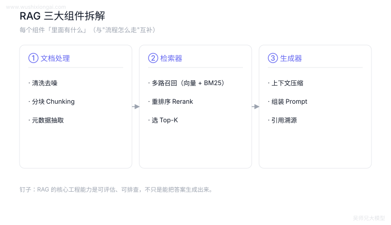

#### 详解

**【原题速答】**
完整 RAG 由文档清洗分块与元数据、混合召回和重排、上下文组装与引用生成三类组件构成。

**【考察意图】**
考系统分层与故障归因能力：能否把 RAG 拆成"离线文档管线 / 在线检索层 / 生成层"三层并说清每层边界与接口；能否自止血——设计评测集并能把"答错"定位到文档、召回、重排还是生成。这是 RAG 岗位面试的**第一道主菜**，通常后续追问全部从这张图延展。

**【深度解析】**

*1. 三层组件与接口契约*

| 层 | 组件 | 输入 → 输出 | 关键工程点 |
| --- | --- | --- | --- |
| 离线·文档层 | 连接器 → 解析 → 清洗 → 分块 → 嵌入 → 索引（含元数据/ACL/去重/版本） | 原始文档 → chunk + metadata | 表格/PDF 结构保留、SimHash 去重、增量管道（见本模块 01 题） |
| 在线·检索层 | 意图路由 → 查询改写 →（混合）召回 → 融合 → 重排 → 过滤/去重 | query → top-k chunks | 双路互补、RRF 融合、cross-encoder 小池精排（见 reranking 模块） |
| 在线·生成层 | 上下文组装 → 引用映射 → 生成 → 忠实度/引用校验 | top-k chunks + query → 答案 + 引用 | token 预算、lost-in-the-middle 顺序策略、引用可回查 |

每层的**接口契约**应可替换：文档层输出 `(chunk_id, text, metadata, vector)`；检索层输入只吃 `(query, k, filters)`——这是能在面试中拿分的架构纪律。

*2. 逐层典型失败 → 对应组件*

| 现象 | 病灶层 | 判别实验 |
| --- | --- | --- |
| 该答的没答、召回结果全不相干 | 召回 | 检查 `Recall@k< golden`；把 query 换成 golden chunk 原文词组能否命中 |
| 该召回的召回了但排到第 30 名 | 重排 | 看 `pre-rank Recall` vs `post-rank nDCG`，重排提升不足则说明精细打分烂 |
| 召回+重排都对但答案错 | 生成 | 把 golden chunk 手工注入上下文再测——仍错即生成层（含提示词/模型能力）问题 |
| 原文本身没有答案或答案过时 | 文档 | 连接器和知识版本治理；golden QA 里没有覆盖该问题 |
| 引用张冠李戴 | 生成 | 引用 id 与 chunk id 对账脚本抽检 |

*3. RAG 评测集怎么设计（原文追问一）*

- 结构：`{query, golden_chunk_ids, golden_answer, query_variant, 业务标签}`。`golden_chunk_ids` 是归因（attribution）的钥匙——Question type 要分层：事实型 / 多跃 / 摘要 / 拒答（negative 样本，Question 应回答"资料里没有"）。
- 规模：每个业务域 100–300 条起步，覆盖全部高频意图与边界（拼写、同義、指代）。
- 指标四件套：`Recall@k（golden chunk 命中率）/ MRR / nDCG`（检索），`Faithfulness = 有据答复 claim 数 / 总 claim 数`（生成，RAGAS 定义），加上端到端正确率。
- 数据来源：生产日志抽 query + 人工补标注；**负样本（无法回答）必须含的一部分**，占比 10%–20%，否则测不出"乱答"。

*4. 定位错误的四步流程（原文追问二）*

```
Step1: no-retrieval 消融 → 模型裸答对吗?（参数内知识基线）
Step2: golden 注入 → 只给 golden chunk 答对吗?（生成分线）
Step3: Recall@k 计算 → 召回有没有把 golden 拉进 top-k?（召回分线）
Step4: 排名分析 → golden 在 top-k 内但排名靠后 => 重排修理; top-k 内靠前但答案错 => 组装/生成
```

四个测量点把"答错"这个模糊现象约束到唯一层。配一个量化例子：1000 条评测中端到端错 120 条，no-retrieval 错 250 → 检索带来 130 净收益；其中 Recall 阶段漏 golden 80 条、rank 后段 40 条 → 优先修召回，其次重排。

*5. 时延与 token 预算（典型在线链路）*

| 阶段 | 预算 | 依据 |
| --- | --- | --- |
| 意图路由+改写 | ≤ 150 ms | 小模型/规则 |
| 混合召回（BM25+ANN） | 20–50 ms | ANN 检索单路 5–10 ms |
| 融合 + 重排（CE top-50） | 80–250 ms | 批量打分 |
| 上下文组装 | < 5 ms | 纯 CPU |
| 生成 TTFT | 400–800 ms | 单调 LLM 首字 |

**【追问链纵深】**

1. **追问：文档层每次都要重跑全量吗？** → 用内容指纹（SimHash/MinHash）增量；只有 chunk 边界策略或嵌入模型变更时才需要全量重建（且必须影子索引 + 回放，见 rag Q01）。
2. **追问：检索层 top-k 怎么定？** → 不是越多越好：`k` 大召回率升但噪声和 lost-in-middle 概率同时升；以评测集上 `k ∈ {4, 8, 12}` 网格 + 汇总到 token 预算（4k–8k）为锚。
3. **追问：权限怎么设计？** → ACL 过滤要在**索引层**（按 doc ACL 位图 pre-filter，而不是生成层裁剪——后者泄密），且 RAG 的权限语义与权限过滤语义不同（见 rag Q04）。
4. **追问：引用怎么强制可核验？** → 生成时要求每句带 `chunk_id` 引用，后验校验器检查 claim→chunk 的关系（或二次抽取 claim 与 chunk 做 NLI），不合规则重生成。

**【串联与资料】**
- 关联：`document-processing.md`（文档层细节），`reranking.md`（检索层细节），`evaluation-monitoring.md`（RAG 错误根源定位是本题 Step1–4 的系统化）。
- 资料：Lewis et al., RAG（arXiv:2005.11401）一句话结论：**把参数化记忆（generator）与非参数化记忆（Wikipedia 式可检索文档库）用边缘似然联合训练，开放域问答可拼出参数化模型的硬性收益**。

---

### 04. RAG意图识别原理与检索协同

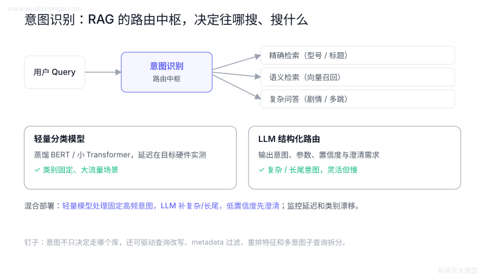

#### 详解

**【原题速答】**
意图识别是可选的检索路由层，低置信样本需澄清或兜底，授权仍必须由检索服务执行。

**【考察意图】**
三个考点的叠加：① 你能否把"何时检索"当**决策问题**而非 always-retrieve；② 小分类器（BERT 系）与大模型路由的取舍；③ **安全意识**——能不能一眼看出"意图路由 ≠ 权限控制"这个高危误区（这是企业 RAG 的红线）。

**【深度解析】**

*1. 意图识别为什么是"路由"而非"分类就算了"*

意图识别输出发**结构化路由决策**：`{route: retrieve | chitchat | tool_call | clarify, 约束: filters, 预算: top-k, 检索域: collections[]}`。它解决三件事：

- 省（闲聊/寒暄不检索，省时延和噪声）；
- 快（明确 goto 单域检索，避免全库梭哈）；
- 稳（agentic 场景下决定"检索 or 直接回答 or 调工具"）。

**决策函数**构建两条路线：

- **小模型分类器**（BERT 系）：快（< 10 ms）、可离线评测、概率可得；缺点是意图体系变更要重训。原文引用 BERT 论文的呼应点即在此——BERT 的双向预训练 QQ 领域适应强，是意图分类器的默认底座。
- **小 LLM few-shot 路由**：易扩展新意图、解释性好；慢、贵、输出需 JSON schema 约束。2025 年实践（【纠偏】以 2025-11 官方口径）已大量转向 **小 LLM / 结构化输出路由**，原答案若暗示"BERT 是唯一做法"应做此更新，但两者取舍仍按 QPS/成本分场景。

*2. 置信校准：为什么 raw softmax 不可信*

神经网络过参数化后 softmax 往往**过度自信**（误分类时也给出 0.99）。校准三式：

- **Temperature Scaling**：`p_i(T) = exp(z_i/T) / Σ_j exp(z_j/T)`，在验证集上以最小化 NLL 优化唯一参数 `T`（不改变 argmax，只改置信度）。
- **Platt Scaling**（二分类等价）：`p' = σ(a·f(x)+b)`，两参数仿射。
- 评估指标：**ECE**（Expected Calibration Error）`= Σ_bin |acc(bin) - conf(bin)| × weight(bin)`，工程上要求 ECE < 5%。

低置信策略分层：`conf < τ_low`（如 0.5）→ 反问澄清（clarify）；`τ_low ≤ conf < τ_high` → 兜底默认路由（如全库检索 top-k=5 保召回）；`≥ τ_high` → 直接路由。**兜底必须廉价**，不要把兜底做成重型检索。

*3. 意图识别与检索的协同接口（含权限红线）*

```
query → router(意图, 置信, filters建议) → 检索服务(执行过滤+打分) → [权限在检索层裁决] → 生成
```

- **授权必须在检索服务执行**：router 只能建议 filters，绝不让意图层决定"可见集"。原因：意图分类器是低可信组件，一旦被注入/误判，路由结果若直接当作过滤器，就是水平越权。检索层用 ACL 位图 pre-filter + 结果作后验对账（用户可见集与检索命中差集告警）。
- **层级意图**：粗类（问产品 / 问流程 / 问闲聊）→ 子类（具体产品/具体流程），每层独立卡置信阈值；上层低置信直接进兜底，不要硬开武断分支。
- **提示注入防护**：路由模型只吃 **query 文本**，不吃未清洗内容；被检索文档内容始终以数据身份（定界符/标注 as-data）进入生成层，禁止它们进入下一轮路由的指令通道（防 prompt steganographic injection）。

*4. 原文引文在语境中的定位*

- RAG 论文一句话结论对应：模型参数记忆"知识陈旧/幻觉"，检索注入后按文档边缘似然生成——这就是"是否检索"这条**决策边**的理论起点。
- BERT 论文一句话结论：双向预训练 + 微调范式让小模型分类器全面崛起——这就是意图分层分类器的工程理由。

**【追问链纵深】**

1. **追问：什么时候根本不需要意图识别？** → 纯知识库问答（every query 都该检索）可省去路由省时延；一旦业务里混有闲聊/工具型（价格计算、查订单），就值得加路由。判据：检索的"空转率"（检索后答案未引用任何 chunk 的比例）> 30% 时上路由。
2. **追问：路由错了怎么治？** → 双保险：兜底配置 + 结果级校验器（答案引用了检索文档但村民回答域不匹配 → 降级重跑）；数据回流：路由错配样本进训练集闭环。
3. **追问：层级意图怎么训练？** → 每层独立分类头（multi-task）或两阶段（先粗后细）；评测分层指标 **层次准确率**（每层独立 acc）与**路径准确率**（全路径正确）。
4. **追问：意图和 Agent 的 tool-call 选择什么关系？** → 同构：意图路由是 Agent 的 tool 选择器特例；agent.md 的"工具选择与权限"题就是它的母题，安全性结论一模一样——**选择器只建议，执行器才授权**。

**【串联与资料】**
- 关联：`agent.md`（工具选择=路由的同构问题），`prompt-engineering.md`（澄清式追问的提示设计），`knowledge-graph.md`（多意愿路由到图检索）。
- 资料（原文引用，一句话核心结论）：
  - *BERT*（arXiv:1810.04805）：**双向 Masked LM 预训练带来的双向深度表示在小样本微调后大规模刷新 NLP 纪录**，是意图分类器的经典底座。
  - *RAG*（arXiv:2005.11401）：**参数记忆 + 可检索非参数记忆，用边缘似然联合训练**，为"是否检索/检索什么"的决策边提供了理论框架。

---

### 05. RAG 三阶段原理与失败场景

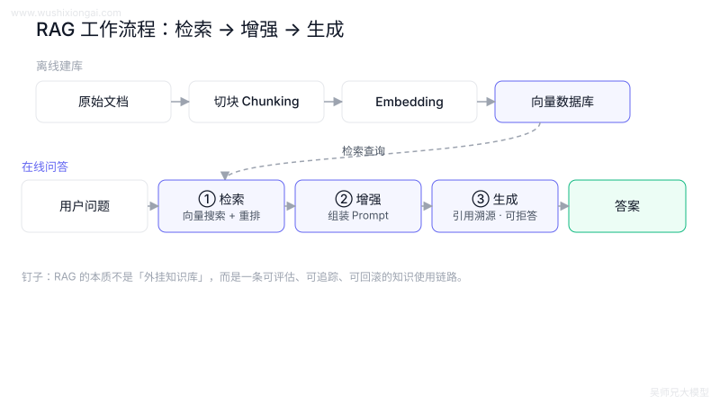

#### 详解

**【原题速答】**
RAG 离线完成清洗、分块、向量化与索引，在线依次检索、重排、组装上下文并生成带依据的回答。

**【考察意图】**
这是 RAG 的"总图题"：考两层能力——能背链路（及格线）与**能建立"症状→阶段→实验→参数"的故障映射**（区分线）。面试官会随手甩一个失败案例（"用户抱怨 FAQ 机器人答非所问"）看你能不能按三阶段逐层排查，而不是一句"提示词再改改"。另一个追问（错误定位）与 `evaluation-monitoring.md` 的"RAG 错误根源怎么定位"互为镜像，本题为链路视角、那题为方法论视角。

**【深度解析】**

*1. 离线层失败场景库（清洗·分块·向量化·索引）*

| 失败场景 | 根因 | 症状 | 解药 |
| --- | --- | --- | --- |
| PDF 多栏错序、表格拉平成串 | 解析器傻 | 长句翻中断cliffe、数字对不上 | 版式感知解析（表格 HTML/结构化输出） |
| 样板噪声进库（页眉页脚/导航/广告） | 清洗弱 | 召回都是"目录页" | 规则 + 启发式 boilerplate 过滤 |
| 跨语义边界切块 | 分块只按字符数 | 单 chunk 前后指代断裂 | 结构感知/语义切块 + 父子块 |
| 长表格/代码不切块 | 切块一刀切 | 关键数字在 chunk 外 | 大对象整块保留或表格感知索引 |
| 域名漂移嵌入 | embed 模型与语料不匹配 | 专有词全被推到中距离 | 领域微调 embed 或上下文前置 |
| 索引过期/段丢失 | 增量管道断 | "上周的知识出现了" | 版本化 + 全量 alignment 校验（见 rag Q01） |

*2. 在线层失败场景库（检索→重排→组装→生成）*

| 失败场景 | 根因 | 判别 |
| --- | --- | --- |
| 词面精确匹配输给语义相似（型号、错误码） | 语义嵌入对 OOV/short-code 不敏感 | 混合检索（BM25+向量） |
| golden 在库但没进 top-k | 召回 k/量化痕部损失 | Recall@k 与 pg 索引扫描比对 |
| top-k 里有 golden 但排第 8 | 无重排或重排打分会 bias | 缺 recall-only vs rank 后精度对比 |
| 上下文里混明显干扰项 | 过滤/去重薄弱 | 融合后 SimHash/同源去重 |
| 中间 chunk 被忽略 | lost-in-the-middle 位置偏置 | 把 golden 移到首位/末位 A/B |
| 答案编造了上下文没有的数 | 生成层幻觉 | 忠实度 NLI 校验 + 拒答机制 |
| 拒绝回答虽然资料在 | 模型过于保守 / 指令冲突 | 提示词与 temperature 调，少 correction 式微调 |

*3. 归因量化算例（将"为什么"算透）*

设评测集 500 题，golden chunk 已标注。

```
端到端错率           = 26%（130 题）
仅生成(golden 注入)错 = 8%（40 题）  → 生成层下限
no-retrieval 错      = 18% → 检索增益约 10 pt，仍有约 9 pt 空间
Recall@10 漏 golden  = 52 题 → 召回问题占错的 40%
golden 在 top-10 但排 6–10 = 38 题 → 重排提升空间 29.2%
```

结论优先级：先修召回（量大）、再上/调重排（次之）、最后优化提示与模型（上限小、代价高）。这正是"为什么三阶段要分而治之"——单看端到端错率永远看不见根因。

*4. 三阶段的指标 observability（每阶段至少一个哨兵）*

- 文档层：解析字符错误率（对抽检 doc 的 ground truth 字重叠）、chunk 长度分布、去重率、每日入库量与版本号。
- 检索层：`Recall@k`、`MRR`、`平均检索时延`、 空 top-k 比例。
- 重排层：`pre/post nDCG@5` 差值（重排贡献度）、重排时延。
- 生成层：`Faithfulness`（RAGAS 定义：被上下文支持的 claim 占比）、引用有效率（引用 chunk 确实支持该句的比例）、拒答率。

**【追问链纵深】**

1. **追问：怎么定位错误来自文档切块、检索、重排还是生成？（原文追问/四分法）** → 决策树：golden 注入测试定生成 vs 检索；Recall@k 定检索 vs 重排；`Recall_golden_chunk` 与 `chunk 太长/太短` 的分层对照定切块边界问题（切块问题的特征是"golden chunk 存在但以半截/混入噪声的形态出现"）。
2. **追问：失败场景要不要建"病库"？** → 建一个 failure taxonomy 库（每条失败 → 阶段 → 根因 → 修复），每次线上 bad case 归档，是 RAG 运维与评估模块联动的基础设施。
3. **追问：重排和多检索策略怎么一起调试？** → 先在离线集上分阶段回放（每层接口契约使然），不要端到端调参（变量混淆）；对照本组 reranking Q05 的 sync pipeline。
4. **追问：三阶段中哪一步R OI 最高？** → 经验排序：切块+检索（决定上限）> 重排（决定排序位） > 提示词/模型升级（尾部打磨）——切块与召回不动，后面都是补墙角。

**【串联与资料】**
- 关联：`evaluation-monitoring.md`（错误根源定位与指标工具箱），`document-processing.md`（切块），`reranking.md`（重排），`vector-search.md`（索引）——本题是这四个模块的"总线"。
- 资料：本题为教学整理无附论；对应学术论文族可引 RAG 综述（Gao et al. 2023, arXiv:2312.10997）一句话结论：**RAG 的失败主要分布在检索与生成的接口处，分类别诊断（query/chunk/模型三层）是改进收益最大的一节**。

---

### 06. RAG 解决了哪些核心问题?

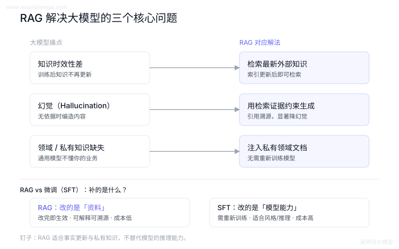

#### 详解

**【原题速答】**
RAG 通过检索已更新且可授权的外部资料，为生成补充时效知识、私有知识和可追溯证据，但不能替代模型推理。

**【考察意图】**
看似定义题，实则三重陷阱：① 能否说清 RAG 的**能力边界**（不替代推理）并举出反例；② 能否在 RAG / SFT / 长上下文 / RAG+微调 四条路线上做**决策**，且给出量化依据；③ 时效意识——2024 年"长上下文终结 RAG"论调流行，你能否用 2025-11 的数据把它纠正。

**【深度解析】**

*1. RAG 的三大增益与一个不增益*

| 问题 | RAG 如何解决 | 量化/机制支撑 |
| --- | --- | --- |
| **时效知识**（知识截止后发生） | 自检索注入，天级更新 | 参数记忆更新需重训/微调（周~月级），检索管道分钟级 |
| **私有/长尾知识**（企业内网、冷门文档） | 语料接进来就完事 | 模型再大也不含私域数据；微调过拟合风险与验证成本高 |
| **可追溯性**（引用，拒绝编造） | 答案绑定 chunk 引用 | 可后验 NLI/人工核验，幻觉审计有抓手 |
| **能力不增益：推理** | —— | 检索提供**事实前提**，多步演绎/规划仍是模型参数能力；强检索 + 弱推理照样错 |

"不能替代模型推理"的最小算例：问"若 A 公司 RPM 增长与 B 公司 GDP 增长的差值超过 2pt 是否触发风控"，检索能拉回公司与 GDP 两个数，但"差值>2pt 判断"依赖模型算术与多约束推理——检索拉长得越结果越对，检索拉失误数据反而更错。

*2. RAG vs SFT 决策表（原文追问）*

| 维度 | RAG | SFT | RAG+SFT |
| --- | --- | --- | --- |
| 知识类型 | 事实性/易变/长尾 | 行为/风格/领域讲法/输出格式 | 域内 log+事实双修 |
| 更新频率 | 小时天级 | 重新微调（周月级） | 语料端更新即可 |
| 数据量 | 大（百万 doc 也行，索引外置） | 中（千~十万样本，太多过略难） | 需要一个底座微调 + 索引 |
| 主要成本 | 每次检索+流水线运维 | 一次性训练+周期重训 | 两者叠加 |
| 典型反例 | 需要强格式输出时 RAG 救不了 | 事实类知识 SFT 容易把模型"记死"到过时版本 | 领域模型 + 企业知识库 |

判断口诀：**"知识进检索、技能进参数"**。原文追问"什么时候 RAG + 微调一起做"——当域内语言习惯/表格式输出被吐槽 + 域内事实密集（医疗/法律/金融），微调一个域底座 + RAG 挂知识，是 2025 年企业级标配。

*3. RAG vs 长上下文（2025-11 口径纠偏）*

【纠偏】2024 年中"100 万 token 上下文直接杀死 RAG"的声音曾流行，以 2025-11 官方口径为准，前沿模型上下文：Gemini 2.5 Pro 1M tokens；GPT-4.1（2025-04 发布）1M tokens；Claude Sonnet 4/4.5 标准 200k tokens（1M beta 已开放）；但任何上下文长度都不消灭三个问题：

- **成本**：长上下文按 token 计费与预填充时延线性上升——500 k token 输入一次 0.35 $/M（示例价）即 0.175 $/问，且 TTFT 秒级；RAG 只注入 2–8 k 相关 chunk，成本与延迟缩小两个数量级。
- **有效性与位置偏置**：needle-in-haystack 通过不等于多事实聚合通过；"Lost in the Middle"（Liu et al., TACL 2023）实测 20+ 模型在长文**中部**充其量性能回暖一半——检索式压缩正是回敬位置偏置的手段。
- **控制面**：权限（ACL）、版本、审计、上下文可解释性——这些都要求"选择相关子集"这个动作，RAG 天然就是这个动作。

结论：长上下文改变的是 RAG 的**注入预算**（从 2k 涨到 16k–128k 级别、父块/多路融合可更大方），不改变 RAG 的**存在性**。面试时把这句话说清，是顶配加分项。

*4. 一个"选型决策树"速查*

```
问"事实/文档型"吗？
 ├─ 否（行为、格式、语气）→ SFT（或提示词）
 ├─ 是 → 私有且更新快吗？
 │   ├─ 否 + 通用公开知识 → 参数知识（不折腾）
 │   ├─ 是 → 查询命中多个定位级证据 → RAG
 │   │        需要多跳关系/实体叙事 → RAG + GraphRAG（见 knowledge-graph 模块）
 │   └─ 是 + 还要域内推理风格 → 域底座 SFT + RAG
```

**【追问链纵深】**

1. **追问：RAG 能解决幻觉吗？** → 解决"事实型幻觉"（编造不存在的事实）大部分，不能解决" Products 语言幻觉"（推理跳步、算错）；而且引入新问题：忠实度幻觉（对检索错文过度顺从）。治理永远要"检索质量 + 生成约束"双端。
2. **追问：cite 什么的"证据"能不能进法律审计链？** → 可以做半审计：chunk 引用 + 版本号 + 检索时间戳可回放；但模型把证据迁移成结论的步骤不受强约束——高风险域仍需人工复核或要求 claim-level 引用对齐。
3. **追问：Agent 时代 RAG 怎么进化？** → Agentic RAG：把检索变成工具调用给 Agent，支持多跳、反思（Self-RAG 思想）、动态改写；对照本组 reranking Q01 的自迭代检索追问。
4. **追问：GraphRAG 是什么关系？（串联知识图谱组）** → 知识图谱把"实体—关系"做成结构化索引，可承接多跳/聚合问题（"A 公司投资过哪些 B 生态企业"），弥补向量检索"近邻=相关"的短处；详情见 modules/knowledge-graph.md 的 GraphRAG 题。

**【串联与资料】**
- 关联：`knowledge-graph.md`（GraphRAG），`evaluation-monitoring.md`（RAG 评测如何证成上述三大增益），`fine-tuning.md`（SFT 路），`inference-optimization.md`（长上下文成本）。
- 资料：Lewis et al., RAG（arXiv:2005.11401）一句话结论：**"参数序列模型 + 非参数检索库的联合边缘似然训练，在开放域 QA 与生成任务上显著优于纯参数化 SOTA"，这是"检索增强"作为范式的根基论文**。

---

## 二、文档处理（modules/document-processing.md · 1 题）

### 01. Chunking 策略怎么选?

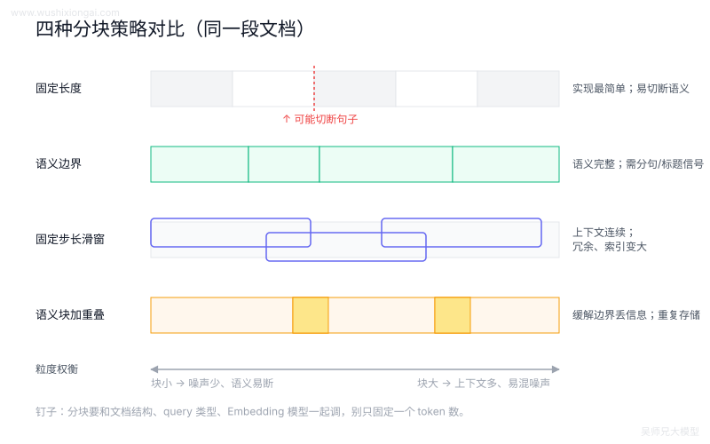

#### 详解

**【原题速答】**
分块需在语义完整、检索噪声、召回覆盖和存储成本间权衡，并依据文档结构与查询类型在评测集上选参。

**【考察意图】**
切块是 RAG 管道里**杠杆最高、玄学最多**的一环：考的是能否 (1) 把"块大小" trade-off 写成四维量化函数而不是背"256 vs 512"；(2) 懂得**一切策略必须回评测集验证**；(3) 对前沿技术（父子块检索、contextual retrieval、metadata 注入）有实现级认识而非停留在名词。

**【深度解析】**

*1. 四维权衡的数学描述*

把 chunking 看成目标函数优化：给定 chunk 策略 `π`（大小 s、重叠 o、切分方式 m），有

```
Q(π) = λ1·Completeness(π)      - λ2·Noise(π)       - λ3·MissRate(π)     - λ4·Cost(π)
（语义完整）        （噪声：无关文本进来稀释）
```

- **Chunk 太小（s 小）**：Completeness ↓（答案被劈在两个块内——"覆盖率"问题）、存储/索引条数 ↑（Cost ↑）；Noise ↓。典型症状：检索命中多条**半截句子**，单个 top-k 皆对不齐整答案。
- **Chunk 太大（s 大）**：Noise ↑（embedding 变"段落中心向量"，主题平均化后与 query 的余弦失准）、单条 token ↑（相同 top-k 下上下文膨胀）；Completeness ↑（但以lost-in-the-middle 为代价）。症状：召回看似相关页但**关键词未出现**或相关点在长文最末。
- **量化锚点**：设上下文预算 `B_ctx = 4k` tokens、top-k=8 → 单 chunk `s ≈ 400–500` tokens，原因就在推理链 `k × s ≤ B_ctx`；再设重叠 `o ≈ 10–15%`（~64 tokens）防止跨块边界句被腰斩。
- **存储成本算例**：100 万 chunk × 768 维 fp32 向量 ≈ 3 GB；chunk 若从 512 减到 128，chunk 数×4 → 索引 12 GB + 建图时间上行四倍——这就是"存储成本"不是虚数的证据。

*2. 策略族谱对比表*

| 策略 | 做法 | 定位 | 适用 | 风险 |
| --- | --- | --- | --- | --- |
| 固定窗口 | 512 tokens + overlap | 基线 | 纯文本/短文 | 边界腰斩、粒度不适合表格 |
| 递归切块 | 层级分隔符 `\n\n → \n → 。 → 空格` | 半结构化默认 | Markdown/自然段文档 | 对表格/代码弱 |
| 结构感知 | 按 Markdown 标题/HTML/合同条款切 | 结构文档 | 手册、条款、代码 | 结构缺失文档退化 |
| 语义切块 | 相邻句 embedding 相似度断崖处切 | 主题变化驱动 | 长论述文（报告/书籍） | 需 embedding 成本、边界判定不稳 |
| 表格/代码专项 | 表格整块或 HTML 结构保留、代码按函数/类 | 结构敏感 | 财务报表、代码库 | 表格极长需行级索引 |
| 父子块（small-to-big） | 检索小块（~200 tok）+ 生成父块（1k–2k tok） | 两段化链路 | 问答型 RAG | 需要额外的 mapping 与展开逻辑 |
| LLM 生成边界/命题切块（"proposition"式） | 用 LLM 把文档改写成独立可读命题 | 质量最高 | 高价值语料 | 离线成本高、需审校 |

*3. Chunking A/B 实验怎么设计（原文追问一）*

- **控制变量**：同一嵌入模型、同一检索栈（BM25+向量+重排）、同一 top-k 池子；只动 chunking 参数。
- **陷阱一**：不同 chunking 会改变 chunk 总数，固定 `top-k` 条数会引入"条数混淆"——**改用固定 token 预算**（如统一填到 4k tokens）代替固定 top-k。
- **陷阱二**：评测集不含切块不敏感问题会测不出差异——评测集应包含 30% 的"答案跨块"问题（需要父块/多块融合才能答对）。
- **指标**：`Recall@budget`(检索)、MRR、Faithfulness、端到端正确率、以及**每 docs 的索引/查询成本**；用 bootstrap 置信区间判显著（差异 < 1 pt 多为噪声）。

*4. Metadata 怎么补上下文（原文追问二）*

检索小 chunk 时把**祖先路径**回填到生成上下文或嵌入输入两端：

- **生成侧回填**：`[文档标题 > 章节 > 小节， 日期， 权限标记] + chunk 文本`，还原 chunk 的"户口"——对引用与去重都关键。
- **嵌入侧回填（Contextual Retrieval）**：Anthropic（2024 官方博客，数字已核实）做法是离线用 LLM 为每个 chunk 生成 1–2 句"该块在全文的位置语境"再拼入嵌入与 BM25 索引：top-20 检索失败率 5.7% → 只有 Contextual Embedding 3.7%（-35%）、+Contextual BM25 2.9%（-49%）、再加重排 1.9%（-67%）。成本方面用 prompt caching 可把逐块生成成本降到 ~0.1$/1M-token 级别。
- 元数据字段清单：`doc_id / title / section_path / date / author / acl / lang / version / type(表格|正文|代码)`；`date` 尤其关键——同主题新闻按时间排序即胶囊化"时效性"改写。

*5. 父子块检索怎么实现（原文追问三）*

```
索引层：child chunks (256 tok) 上倒排+向量索引；child_id → parent_id 映射
检索层：query → 召回 top-N children (如 N=12) → 去重 parent → 按 budget 取 parent 文本 (≤ 8 个父块)
生成层：parent 文本组装（query 与 parent 的精确匹配段可在生成前高亮）
```

效果机制：**检索的精度吃小块的"焦点"，生成的语义完整吃大块的"上下文"**——把原文同一个 trade-off 拆到两个子路径上，属于经典 "retrivability vs readability 解耦"。实现要点：父子映射在写入时就固化；父块去重用 parent_id 集合 union；预算收敛用 parent_id 分组后贪心装包。

**【追问链纵深】**

1. **追问：chunk 大小到底该多大？** → 无真理数字，只有预算约束下的搜索空间：从 `(s, o) ∈ {128,256,512} × {0, 64}` 起跑评测集；文本密度高的域（合同/病历）偏小、叙事型偏大。凡是给死数字的都是没跑过评测的。
2. **追问：表格、代码这类"不可分"对象怎么办？** → 表格整块 + 行级二级索引（schema+cell 命中）；代码按"函数/类定义"为最小结构单元（AST 感知切块），并把 import/注释并入该块。
3. **追问：overlap 会不会让同一段重复占位 top-k？** → 会。用 chunk 去重（同 parent 相邻块只保一）或对 top-k 做 **MMR 多样性排序**（`MMR = λ·rel - (1-λ)·max_sim` 兼顾相关性/冗余)。
4. **追问：上下文组装时再裁剪（contextual compression）跟 chunksize 啥关系？** → 大块 + 重排后**按句子压缩到预算内**是另一条路（reranking Q01 的后处理法），它在评测集上往往与"小块+父块"打平——选择由 RL（运维复杂度）决定。

**【串联与资料】**
- 关联：`rag-foundations.md` Q03/Q05（管道位置），`vector-search.md`（嵌入与索引），`reranking.md` Q01（生成前压缩），`multimodal.md`（PDF 图表解析）。
- 资料：Anthropic Contextual Retrieval（2024，数字已在本次写作时核实）一句话结论：**给每个 chunk 注入 LLM 生成的位置语境，可使 top-20 检索失败率相对基准下降 35%（仅向量）、49%（向量+BM25）、67%（加重排），是"切块物理"上语义完整的工程化路径**。

---

## 三、重排与优化（modules/reranking.md · 5 题）

### 01. RAG检索质量提升5法

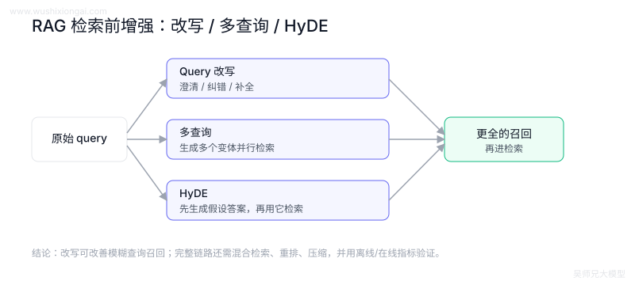

#### 详解

**【原题速答】**
RAG 可在检索前做查询改写、多查询和 HyDE 扩展召回，并配合混合检索、重排序、上下文压缩及迭代检索验证整体质量。

**【考察意图】**
考"工具箱全景 + 分阶段定位"：能否按**检索前 / 检索中 / 检索后 / 迭代**给质量提升手段分桶，说清每个手段的**起效机理与失效模式**，以及追问线（Self-RAG 反思机制、迭代次数控制）里能不能落到实现层。注意【纠偏】：原题题名"5 法"、原文速答里实际列了 7 个手法（改写/多查询/HyDE/混合检索/重排/压缩/迭代）——面试正确口径是**按流程段分成 4 组 5 法**，而不是死记条数。

**【深度解析】**

*1. 五法分桶（原答案的组织结构：检索前 3 + 检索中 1 + 检索后 1 + 迭代 1）*

| 桶 | 手段 | 机理 | 失效模式 |
| --- | --- | --- | --- |
| 查询处理 | ① 查询改写（规范词、去口语、补上下文代词） | 让 query 文本分布贴近文档分布 | 改写引入错误假设 |
| | ② 多查询扩展（n 个改写成 n 路召回） | 互补召回视角 | 重复与相关噪声 |
| | ③ HyDE：LLM 先生成"假设答案文档"再据其嵌入检索 | doc-doc 余弦 > query-doc 余弦（假设文档与真实文档同分布） | 幻觉假设带偏邻域 |
| 召回融合 | ④ 混合检索（BM25+向量，RRF 融合） | 词面精确匹配与语义相似互补 | 双路分数不可比的问题 |
| 后处理 | ⑤ 重排 + 上下文压缩 | cross-encoder 精排 + 无关句裁剪 | 时延与成本增加 |
| 整体闭环 | ⑥ 迭代检索（Self-RAG/FLARE 式） | 第一轮答案不全时追加检索 | 成本翻倍、循环抖动 |

*2. HyDE 为什么涨召回（机理推导）*

- 嵌入空间假设：答案空间中 query 与真实 doc 的余弦偏中低（**query 与 doc 属不同分布**）；HyDE 先用 LLM 生成 `d̂ ~ P(doc|query)`，`cos(d̂, d)` 天然更高，因为 d̂ 与 d 同为文档分布。
- 代价一次 LLM 生成（~200 tok，200–500 ms）+ embedding；风险是 d̂ 内的错误实体句把邻域带向错误方向——工程缓解：HyDE 只做**召回扩展**不做过滤，融合后由重排纠偏。
- 何时不用：query 短且明确含专有词（如错误码 `K-4023`）→ 改写反而损毁词面信息，**改成"不改写+BM25 直击"**。

*3. 上下文压缩的第一个形式化写法*

对外层已召回 top-k，用重要性打分做句子级裁剪回归预算 `B_ctx`：

```
score(s) = CE(query, s)        # 句子级相关分
选择：argmax Σ score(s) s.t. Σ len(s) ≤ B_ctx   （贪心）
```

实测在 open-domain QA 上可去 30–60% tokens、答案质量不降（压缩層抽 sole rewrite vs 摘要式重写取其一）。与"父块检索"互补：小到句子级精度、父块级上下文。

*4. Self-RAG 反思机制（原文追问首选）*

- 机制：训练 LM 在生成中输出**反思 token**四类：`Retrieve?`（是否需要检索）、`ISREL`（该段是否相关）、`ISSUP`（答案是否被该段支持）、`ISUSE`（答案是否有用）；每段带打分。
- 设计上=**把"何时检索/信不信检索"的决策学习成 LM 内建 token**：检索决策不需要外置控制器；推理时按 token 采样触发环（Retrieve=Yes → 检索 → 对每段打 ISREL/ISSUP → 过滤），并且可以**segment 级 beam search**选最可信段链。
- 与"迭代检索"的关系：Self-RAG 是**反思式迭代**的代表实现；另一实现 **FLARE**（Active Retrieval）是"生成中途置信低就检索"：在 token 概率低于阈值 θ 时，把当前生成的部分句作为 query 触发检索再续写——两者本质都是"**用模型自身的不确定度**触发检索"。

*5. 迭代次数控制（原文追问）*

三个闸门：

1. **硬上限**：`max_iter = 2–3`（含首检），防死循环。
2. **边际收益阈值**：新迭代相对上轮 `Δ(Recall@k) < ε` 或 `Δ(自评 score) < ε` 停；alarm 于"自评连续升但端到端没涨"（自我代糖）。
3. **预算约束**：总 token/时延预算（生成 1000 tok + 3 轮检索 < 5 s）打包作 stopping rule。

**【追问链纵深】**

1. **追问：多查询的手法如何合并多路结果？** → 用 RRF（rank 融合，见本组 Q05 完整推导）；不建议多查询结果直接并集去重——分数分布不同会系统化偏向某路。
2. **追问：HyDE 与多查询可否融合？** → 可以：把 LLC 生成的假设 doc 与改写 query 视作第 3 个透明路，加入 RRF；注意融合后 top-k 里重叠的 chunk 需要同 id 去重。
3. **追问：Self-RAG 训练数据怎么来？** → 频率为样本生成反思 token 标签（GPT-4 批判 + 众包验证），然后**继续预训练"反思 token 的词表)` + 微调**——模型先内构建检-评-用流程。
4. **追问：这些法到底训不训模型？** → 改写/多查询/HyDE/迭代都是**推理时方法**（zero-train），重排可用定制训练——"买不买索引升级 vs 训模型"是一对决策轴。
5. **追问：还有哪些"检索前文档侧"提升？** → 文档级：metadata 增强、断句清洗、同义词典（ES synonym filter）、parent-child 索引；可与 query 侧五法配套调优。

**【串联与资料】**
- 关联：`agent.md`（Agentic RAG/反思循环与本条 Self-RAG 直接同构），`reranking.md` 其余 4 题（重排与混合检索），`document-processing.md`（检索前也可从文档侧入手）。
- 资料：原文无附论；对应学术引文 Self-RAG（Asai et al., ICLR 2024）一句话结论：**训练 LM 输出反思 token，自适应决定检索并对证据自评分，超越总是检索的传统 RAG**；FLARE（Jiang et al., EMNLP 2023）一句话结论：**在生成时探测低置信 token 以当前输出为 query 触发检索，可显著降低幻觉**。

---

### 02. Reranker 训练数据怎么构造?

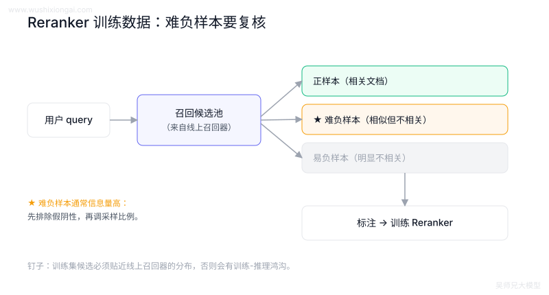

#### 详解

**【原题速答】**
Reranker 数据应包含真实相关正样本、线上召回分布中的难负样本和适量易负样本，并持续质检回流。

**【考察意图】**
考三链：数据链（正/难负/易负的配比和挖掘）、偏差链（点击日志的位置偏差怎么校正）、对齐链（离线 rank 指标 up 但端到端指标不动怎么办）。它实际上把 reranker 数据和**全组 Q11（点击去偏）**贯通，是 reranker 岗的**粮仓题**。

**【深度解析】**

*1. 三类样本的配比与理由*

| 样本 | 来源 | 读法 | 量级建议 |
| --- | --- | --- | --- |
| 正样本 | 人工标注 / 高置信点击（过滤后）/ LLM 判相关 | 一对一 `(q, d+)` | 核心盘子，1 万–10 万 `(q, d)` 对 |
| 难负样本 | **线上真实召回分布**：BM25/Dense 召回 topN 中未命中标注相关者 / 现行 reranker 打分 50–200 名 | 形似而不同：同主题不同事实 | 主力（60–80%），
每 query 5–30 条 |
| 易负样本 | 随机负例（库里任意 chunk）/ 闲聊对 | 长尾校准，防模型把"全场均值"当成高密度 | 5–20% 保持校准 |

- 为什么难负必须"来自线上召回分布"：训练 serving 一致性。若只拿 BM25 挖难负、线上却用 dense 召回，模型对 dense 召回试样泛化不足（人称**exposure bias / 分布漂移**)；更原型的反例：BM25 难负常是"词重叠多但语义偏"的假难负，dense 召回的难负则是"语义近但事实相反"，两类难负的判错分布完全不同。
- 为什么不能全用难负：**校准崩坏**——模型把所有"打到负的都变成了诗"（评分分布两极化），混入易负维持判别边界的多样性；经验：难负上 val set 时有 recall 下降，可考虑 10–20% easy。
- 【纠偏】原速答没提**易负的作用与比例**，这是常见面试追问盲区：易负不只是"凑数"，它保持 logistic head 的判别野、缓解【难负过采样→虚假难分】。

*2. Hard negative 挖掘四法（原文追问一）*

```
1) 召回法：BM25/Dense top-1000 − 缺标注相关 − 标注负
2) 模型法：当前 reranker 给未判定样本打分，取"分数中段（如 rank 50–200）”者为难度带
3) 聚类法：q-邻域按主题聚类，取同簇异事实样本，避免同质样重复（多样性）
4) LLM 判难：小 LLM 先粗判"貌似相关"为候选，精标注层核实
```

- 反例防线（防**假负**）：三路投票（稀疏+稠密+CE 中任两路认为相关 → 不标负，转人工）；否则 0.1–1% 的假负就能把该 query 的召回上限打穿。
- 量化例：10k query × 每条 10 样本训练集。若 0.5% 为假负 = 500 对，且其中 100 对出现在训练，会把相应 query 的 top-1 可得性拖到接近 0——训练前要配**负样本审计脚本**（同类聚簇 + 抽检）。

*3. 点击日志去偏（原文追问二 & 与 Q11 呼应）*

- **位置偏差模型**：`P(click|d, r) = P(examine|pos) × P(rel|d)`，用户只看前 p 条——排后面的真相关样本拿不到点击（**propensity bias**）。
- **IPS（逆倾向得分）修正**：

```
权重 w_i = 1 / p̂(exam_i)   （估计倾向分，可由随机交替/随机插线实验量得）
去偏损失 = (1/n) Σ w_i · ℓ(s_d, y_i)      （satisfy unbiased risk，variance 计算需 clip：p̂ ≥ c_min）
```

- 前置实验：**随机流量/交换实验（interleaving、随机排序段）** 估 p̂、或参考 Joachims 等人的人工多数偏好先验倾向分法。
- 收益量化：在企业搜索日志中常发现 top-1 点击占比 55%+——直接当就此训练，模型学会"抄位置"而非"测相关"；IPS 后训练交叉测试可显著改善（论文参考见 Q11）。

*4. 离线指标与端到端质量的贯通（原文追问三）*

- 痛点：`nDCG@10 ↑` 不必然致 `答案正确率 ↑`——端到端的瓶颈可能早挪到生成层。
- **对齐审计**：把评测集跑三层 ladders：

```
rerank nDCG 提升 ΔR → 但 recall@k 已饱和？→ 与 top-k 内 golden 排位相关性
答案正确率变化 ΔQ  → 对比 ΔR 的 stage-wise 贡献率
```

若 ΔR>1pt 且 ΔQ≈0 → 瓶颈在生成（提示/模型）或上下文组装，不必再卷 reranker；构造"瓶颈位形"评测（故意让 golden located在 7–10 位/多处干扰）作为 reranker 进步性验证集。
- **对齐指标列举**：`答案正确率（Judge 化）/ Faithfulness / 引用有效率`，与 rerank 指标同时报告；当两者不 jive，用“排名迁移敏感性曲线"找阈值。

**【追问链纵深】**

1. **追问：正样本不足怎么办？** → 弱监督三宝：LLM 批判标注（成本与人工 1:10～1:50）、从 FAQ/工单库的"干净配对"转化、合成 query（从 chunk 反向生成问题）；但合成 query 的域内特异性要抽检（易造成"query 模板偏易"）。
2. **追问：cross-encoder 训练分有哪些目标？** → pointwise（sigmoid 相关）/ pairwise（铰链 loss）/ listwise（softmax over 候选 & NDCG 加权）——工程上 listwise + 难负过采样经常最稳（因为评价本身是列表级）。
3. **追问：数据干净的 QA 流程** → 标注一致性（双标 κ > 0.7 入库、分歧上仲裁）、每周以线上 bad case 回流（badcase → 判定 → 新样本），这是第【质检回流】四字的落地动作。
4. **追问：怎么验证一个新难负挖掘法是否值得上？** → 对照组：固定老数据，只替换难负来源，评测关键三指标（nDCG@5、首因 top-1 翻三例率、线下端到端 proxy）+ 线上 1% 流量 A/B（见 Q11 在线验证部分）。

**【串联与资料】**
- 关联：`reranking.md` Q05（组合检索中 CE 的位置），`reranking.md` Q11（点击偏差校正完整数学），`vector-search.md`（dense 召回分布决定难负对口），`evaluation-monitoring.md`（评测集与端到端指标）。
- 资料：原题为教学整理无附论；对应学术文献可引 Nogueira & Cho（monoBERT, arXiv:1901.04085，原文"Passage Re-ranking with BERT"）一句话结论：**"BERT 当 cross-encoder 精排，小候选集上即可把 top 排序指标推向 SOTA，验证了'召回管宽、精排管准'的分工"**。

---

### 03. 精排精度高，为何不跳过召回粗排？

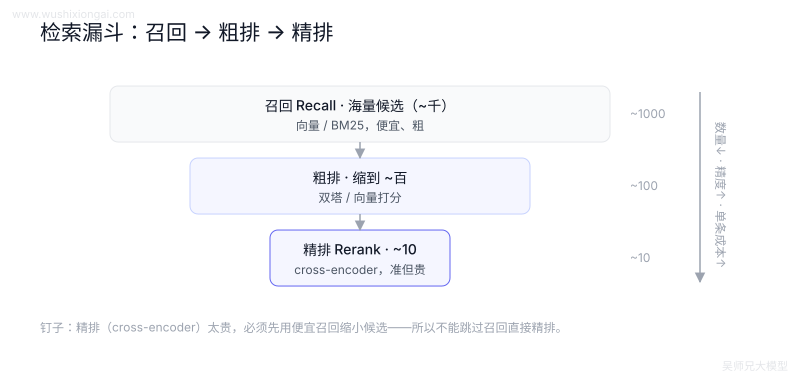

#### 详解

**【原题速答】**
精排需要对查询和候选做重型交互计算，无法覆盖百万级全集，因此先用廉价召回和粗排压缩候选，再对少量结果精细排序。

**【考察意图】**
经典"代价敏感架构"题：考 **漏斗每一层的计算复杂度账**（能否算出"为什么跳过不行"的数字），以及进阶理解——什么条件下可以合并、ColBERT late-interaction 怎么挑战漏斗、MoE 在在哪一环。这题的高分回答需要先"算清数字、再谈例外"，而不是背"召回负责宽、精排负责准"的口号。

**【深度解析】**

*1. 三种排序模型的成本账（跳不跳过的第一性原理）*

| 模型 | 形式 | 每对复杂度 | 100 万候选实测代价 |
| --- | --- | --- | --- |
| 召回（双塔/ANN） | `score = cos(E_q, E_d)`，E_d **离线预计算** | 查询时 1 次向量内积/点 (近似) | HNSW top-100 ≈ 5–10 ms |
| 粗排（bi-encoder 精度更高/LE 量级） | E_q 与预存 E_d 交互简单 | 每偶 ~0.1–0.5 ms | 1000 候选粗排 ≈ 10–50 ms |
| 精排（cross-encoder） | q、d 拼 token 序列，**全部 cross-attention** | 每对 ~2–20 ms（依长度/模型） | **100 万候选 ≈ 6.4×10^7·ms ≈ 17 小时**|

- 结论：cross-encoder 对每对计算 `O(L_q·L_d·d_hidden×层数)` 的交互注意力，且**不能离线预计算**（q 未知的搜索空间关系），故**数学上不可能**不级联。
- 召回层的意义：把 `O(N)` 的交互计算通过**离线预计算/索引近似**压到 `O(log N)` 存取；粗排存在意义：细粒度截断（把从 1000 到 50 的"冗余排序"用廉价 bi-encoder 干完，避免把 1000 条直接推进 CE）。

*2. 每层的作用（漏斗全图）*

```
全域 10^8
 → 召回 top1000（ANN/词面/多路，每路几十 ms）
 → 粗排 top200（bi-encoder/蒸馏 CE，几十 ms）
 → 精排 top20（cross-encoder，100–300 ms 预算内）
 → 上下文 top3–8（拼给 LLM）
```

漏斗里**每一层的另一半目标**: 召回管"存在性"（golden 有没有在进来）、粗排管"显著性"、精排管"顺序rightness"、上下文组装管"呈现"。跳层只在"这一层无信息增益"时才正确。

*3. 什么时候可以合并/跳层（原文追问）*

| 条件 | 允许动作 | 理由 |
| --- | --- | --- |
| 全库 ≤ 5 万条，d 向量 ≤ 512 | **跳过召回/粗排：直接精确打分**（矩阵内积一次算完） | batch 内积 5 万×768 ≈ 7.7 MFLOP，GPU 微秒级 |
| 单路已够（统计无词面例外） | 跳过 BM25 路数 | 多路融合收益 < 复杂度成本 |
| deep 但低延迟场景 | 用 ColBERT 式 late interaction 合并粗精排 | 见下 |
| 企业内部小语料(≤10 万 doc) + 强预算 | 每 query 用 CE 暴力 top-500 | CE 打 500 对 ≈ 1–2 s，交互产品吃不下就用粗排缓征 |

**例外注意**：企业语料库虽小，但**跨文档检索（亿级 chunk）**场景漏斗依旧存在。判断标准只有一条：**召回层+粗排层的离线预计算与近似检索是否换来了有界时延**。

*4. ColBERT 与 MoE 怎么用（原文追问）*

- **ColBERT（late interaction）**：文档 token 级向量**离线**预计算；查询时对每条候选计算：

```
Score(q, d) = Σ_{i=1..Lq} max_{j=1..Ld} (E_qi · E_dj)     （每 query token 找最佳 doc token 相似度再求和——MaxSim）
```

  它保留了 token 级交互（逼近 cross-encoder 精度）却仍可离线预计算 → 可以**同时充当"粗排+精排"**，用 PLAID 残差压缩后可检索亿级库。这也回答了" merging 条件下哪些架构能做到"——**late-interaction 是把顺排漏斗压到 2 层的主流架构**。
- **MoE 用法**：粗排/精排层用 mixture-of-experts（不同 domain/expert 分类器），按 query 特征路由 expert，用"少量专家总参数"覆盖多域排序；另一用法是**门控决定用便宜打分还是 CE**（算力分层，类似 cascade）。
- 【纠偏】原题面提示中"MoE 结构怎么用"语境含混：MoE 不是为"跳过召回"存在的，其价值在 **每 query 自适应算力**（进而允许把漏斗压得更平），不要把 MoE 与 ANN 竞争。

*5. 一个量化工程案例*

RAG 问答系统 1 亿 chunk、要求 E2E `retrieve < 400 ms`：

```
BM25(top50, 10ms) + HNSW(top500, 15ms) → RRF 融合 top-200（1 ms）
→ 粗排 bbi+ quant bi-encoder → top-40（30 ms）
→ cross-encoder 40 对（40 × 5 ms ≈ 200 ms，GPU 批）
→ top-5 上下文（400 tokens/条，2765 tokens 输入）
```

若无粗排直接 CE top-200：200×5 ms = 1 s，超出预算 2.5×。**粗排层用 30 ms 采购 400 ms 预算**——这就是其"存在必要性"的算术。

**【追问链纵深】**

1. **追问：能不能用大模型直接做rerank？**  → 精排最新潮流确实是 LLM pointwise/listwise rank（如 ranking-tuned LLM），精度超过 CE，但每对成本高一个数量级，只能用于 top-10 内的 **radicare 精排**（re-rank 后仍需要基础层把候选压到 10 以内）——漏斗更长而非消失。
2. **追问：召回 top-k=1000 还是 100 的选择依据？** → 评测集上画 `k vs 最终答案正确率`曲线找收益拐点 + 重排层时延约束；因为漏斗中级联，k 增大对召回率得边际收益递减而重排时延线性涨。
3. **追问：粗排模型一般怎么做？** → bi-encoder（大模型蒸馏到小模型）或 cross-encoder 蒸馏/bi-encoder+精排级联；工业成熟做法：**把 CE 的输出当作粗排模型知识蒸馏 lective目标**（rankKD 式），精度接近 CE、成本维持 bi-encoder。
4. **追问：漏斗调优的顺序** → 先保证召回不漏（ReCal@k 拟合），再优化粗排误杀解剖（把精排错杀的统计入盘点），最后精排边际——与 RAG Q05 的归因顺序一致。

**【串联与资料】**
- 关联：`vector-search.md`（召回层技术全部来自这里），`inference-optimization.md`（时延预算与批处理），`reranking.md` Q05（组合里精排的实际位置），`model-architecture.md`（MoE 本体）。
- 资料：Khattab & Zaharia, **ColBERT**（SIGIR 2020）一句话结论：**把文档 token 向量离线预计算 + 查询时 MaxSim 晚交互，检索精度逼近平全交互模型而速度与双塔同量级**；Santhanam et al. ColBERTv2（2022）一句话结论：**残差压缩 + 蒸馏使 late-interaction 可在 MS MARCO 上做到 MRR@10 = 0.414 的 SOTA 且存储减一个数量级**。

---

### 04. 多信号评分函数原理与陷阱

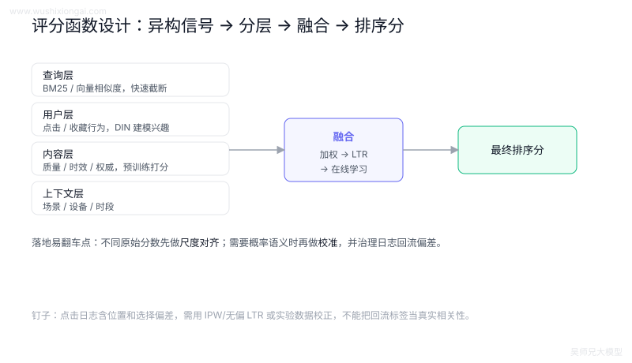

#### 详解

**【原题速答】**
评分函数需先定义目标与约束，再校准多源信号、处理日志偏差，并通过离线和在线实验联合验证。

**【考察意图】**
考"打分函数"这个万金油：三个信号、归一化、特征处理、多目标约束，一网打尽。区别于 reranking Q05（混合检索的 RRF），此题考虑**多个系统信号的相关排序 — 目标函数设计与偏差**（LTR/排序学习）的纯机器学习考题。面试官最想听到的三名词：**可微 proxy（LambdaRank）**、**IPC 校正**、**多目标一致性**。

**【深度解析】**

*1. 评分函数设计顺序（四步）*

```
① 定义目标：用户满意度 proxy（relevance、confidence、费效比）
② 约束：多样性/新鲜度/权限/业务置顶/底线标（hard constraints 不打分而是掩罩）
③ 校准多源信号到可比尺度（z-score / 秩变换 / 分位数）
④ 出现负效应（位置偏差、Goodhart）时补偏差校正与约束
```

**打分函数骨架：**

```
score(d) = Σ_r w_r · g_r(s_r(d))        （g_r 是校准变换，w_r 是权重）
constraints: ACL(d)=1, !spam(d), freshness(d) ≥ F_min   （不合格直接出局）
```

*2. 多源信号校准的三种手法*

| 手法 | 公式 | 用于 |
| --- | --- | --- |
| Z-score | `g(x) = (x - μ)/σ` | 分布稳定信号 |
| 分位数/秩变换 | `g(x) = CDF_r(x)` | 重尾信号（CTR、点击反式） |
| Rank 融合（RRF 呼应） | `1/(k + rank)` | 分数不可比较时 \\
（ BM25 无界 vs cosine ∈ [0,1]——**同尺不同终**） |

【纠偏】常见错误：直接线性加权"BM25 分 + 余弦分"——BM25 可达 25+、cos ≤ 1，等价于把 BM25 的系数放大 30 倍，融啥都是 BM25 主导。任何线性融合前必须**同尺度化**。

*3. LambdaMART：NDCG 不可微问题的完整方法论（对应原文引文一）*

- 问题：想优化列表级指标 NDCG，但它含排序 sort，不可微。
- RankNet 先把 pairwise 也写成可微：对 `s_i > s_j`（模型分），定义

```
P_ij = sigmoid(s_i − s_j)=[
C_ij = −(P_ij·log P_ij + (1−P_ij)·log(1−P_ij))
∂C_ij/∂s_i = σ(s_i − s_j) − P̂_ij = −∂C_ij/∂s_j
```

- LambdaRank 的飞跃：**给每对梯度乘上交换 i,j 后 NDCG 的绝对变化 `|ΔNDCG|`**：

```
λ_ij = |ΔNDCG(i↔j)| · ∂C_ij/∂s_i     （"换位收益越大、越值得学"）
```

  目标高位的互换（比如 1↔2）ΔNDCG 比 99↔100 大得多，则梯度也将到头部更用力。
- LambdaMART：把 λ 定义成梯度进 **梯度提升回归树（GBRT）**——"boosted tree 直接拟合 λ 权重"成为十年来离线 LTR 的最强基线（Burges 2010 综述一句话结论：**λ 加权让模型盯着"列表级指标的局部交换收益"学习，加速且排位指标实际提升明显**）。

*4. 点击日志偏差校正（对应原文引文二）*

- **位置偏差模型** `c(u,d|pos) = P(exam|pos)·P(rel|u,d)`，顶条件的点击被位置放大。
- **IPS 逆倾向加权**：估计 `p̂(pos)`（随机化/随机交替实验测得），构造无偏目标：

```
风险 = E_{cont)[ w(pos)·ℓ(s_d, y) ],  w = 1/p̂(pos)
variance 受点击稀疏拖累 → clip: p̂ ≥ c_min（方差-偏差先天折中）
```

  Joachims et al. 2016（原文引文二）一句话结论：**用点击模型/倾向分加权可将有偏反馈上的排序学习变得无偏，且无需逐对交换实验**。
- 再加两件小事：**去 query 依赖的同类重复曝光**（避免热门 query 的选择性）；**interleaving 做在线测**——比 A/B 更小流量即可达标，慣用的"一 tied grouping"设计。

*5. 多目标约束与陷阱*

- **Goodhart 陷阱**：CTR 权重高 → 点击诱导文本吃走相关性；多样性靠 MMR/分散惩罚打分而不是增加权重。
- **权重调法**：离线 grid search 在评测集上 + 在线 A/B（或 interleaving）双通道；**多目标标量化（scalarization）不等于 Pareto 最优**——必要时用约束优化（`max rel s.t. diversity ≥ δ`）替代权重法。
- 量化示例：`score = 0.7·z(CE) + 0.2·fresh_decay + 0.1·quality`，其中 `fresh = exp(-ln2·age/H)`，若时效半衰期 H = 7 天，当 14 天未更新则为 0.25×—（约束型做法最小权重直接为0）。

**【追问链纵深】**

1. **追问：LambdaMART 为什么至今在线上还在用？** → 便宜（推理是树查表）、可解释（feature importance）、样本少也能打；所以是"粗排/中间层"的主力，而不是被神经架构完全取代。
2. **追问：点击数据有哪些"第二层偏差"？** → 位置偏差、呈现偏差（slate 布局）、attraction bias、item selection bias；高级论文会区分 presentation 与 trust bias；数据侧常合并成"预期点击校正"。
3. **追问：多目标"逐个 A/B"还是"一起发"？** → 联合发（冲突信号必须看交互效应）；单目标流改变会污染其他指标——这是排序实验设计的高级话题（如 metric 交叉效应）。
4. **追问：遇到完全没有标注的冷启动怎么办？** → 用合成 query + LLM 判相关 bootstrapping；或元学习热启动；仍然要用少量人工标注锚定校准。

**【串联与资料】**
- 关联：`reranking.md` Q02（数据构造，本题是"指标与偏差"侧），Q05（RRF 是"无偏可信的信号融合"）、`evaluation-monitoring.md`（在线实验与 interleaving 实践）。
- 资料（原文引用，一句话核心结论）：
  - *Burges, "From RankNet to LambdaRank to LambdaMART"*：**基于 pairwise 交叉熵并按 |ΔNDCG| 交换收益加权 → Lambda 进 GBRT 后，离线 state-of-the-art 与稳定线上收益兼得**。
  - *Joachims et al., "Unbiased Learning-to-Rank with Biased Feedback"（arXiv:1608.04468，已核准）*：**用倾向分对点击加权（IPS, Propensity SVM-Rank）即可在有偏隐式反馈上做无偏排序学习，无需大量随机实验**。

---

### 05. BM25+向量+Cross-Encoder 怎么组合?

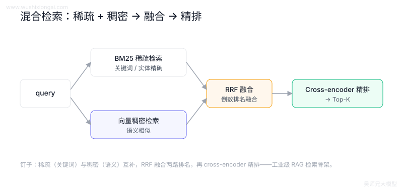

#### 详解

**【原题速答】**
BM25 负责关键词精确召回，向量检索补充语义召回，RRF 融合两路排名后由 Cross-Encoder 对小候选集重排。

**【考察意图】**
RAG 混合检索的标准工程题：能否写出 **BM25 公式 + RRF 公式并解释每个超参**，能否说出"为什么不能原始分直接相加"，能否给出一个预算内 pipeline 数字。加分位：RRF 的 k=60 为什么是 60、交叉重排候选池大小确定、双路何时反而拖后腿。

**【深度解析】**

*1. 第一路：BM25 完整公式与逐项拆解*

```
score(q, d) = Σ_{t ∈ q} IDF(t) · TF(t, d)

IDF(t) = ln( (N − df(t) + 0.5) / (df(t) + 0.5) + 1 )         （N 总文档， df 含 t 文档数）
TF    = f(t,d)·(k1+1) / ( f(t,d) + k1·(1 − b + b·|d|/avgdl) )   （f 词频， |d| 文档长， avgdl 平均长）
```

- **IDF 推例**：`N = 10^6, df = 10^3`：`IDF = ln( (10^6 − 10^3 + 0.5)/(10^3+0.5) + 1 ) = ln(999.5+1) ≈ ln(1000) ≈ 6.9`；若 df=500k（半库都有），IDF ≈ ln(1.5) ≈ 0.4——**接近停用词贡献极低**（这就是"+1"平滑的作用）。
- **TF 与 k1 饱和性**：分母随 f 线性增、分子常数 `k1+1`，词频增长收益**次线性饱和**（k1≈1.2 时 f=10 与 f=100 差别已有限）——规避了 TF-IDF "词频越大越线性吃分"的老问题。
- **b 的长度归一**：`|d| = 900, avgdl = 300, b = 0.75` → 归一因子 `1 − 0.75 + 0.75×3 = 1.75`；文档越长相同词频得分折得越多。**b=0 关闭长度惩罚（短 query 精确匹配场景）**，b=1 全惩罚。k1、b 典型 `k1=1.2, b=0.75`。
- BM25 的**不可替代面**：专称/token 错误陷阱、产品编号（MODEL-X402）、错误码（K-4023）、罕见人名——嵌入模型见得少时高语义召回反而是噪声；多路互补就是这个作用。

*2. 第二路：稀疏+稠密的分数空间不可比 → RRF 完整推导*

- 向量余弦 `cos ∈ [-1, 1]`，BM25 ∈ [0, 30+]（随语料规模浮动）；**直接加和在数值上等于 BM25 独裁**。
- **RRF（Reciprocal Rank Fusion，原文缺乏的准确公式）**：

```
RRF(d) = Σ_{r ∈ lists} w_r / (k + rank_r(d))        经典 k=60
```

  - `rank_r(d)`：文档在路 r 的排名（1 起）。k 越大，**排名差距被压平**（k→∞ 变"平均 rank"无先后），k 小则头部排名余数被放大。**k=60 是经验值**：它把"第一名 vs 第二名"的分数差收敛到 1% 量级（`1/61 vs 1/62`），使融合对单路的**排名噪声稳健**，同时对不同长度的列表不敏感。
  - 算例：doc A 两路 rank 1 和 100 → `1/61 + 1/160 = 0.0164 + 0.00625 = 0.0226`；doc B 两路 rank 5 和 5 → `1/65 × 2 = 0.0308` → B 胜。观察：rrf 对"两路一致的中排名"与"一路头部一路垫底"的响应能权衡，这正是"两路都认可"偏好的体现。
  - 变体：可用权重 `w_r`（BM25 0.4 / dense 0.6 等）按业务调；也可换 **相对 score 融合**（min-max 后加权）但需要校准，RRF 因免校准而优先推荐。
- 何时不开双路：库小（< 1 万 doc）且全是专有词（不需要语义)、或嵌入模型与域严重不匹配（纯噪声第二路）→ 双路收益喂不饱融合噪声。

*3. 第三路：Cross-Encoder 小候选集重排*

```
CE_score(q, d) = M( concat( q, [SEP], d ) )   # 带 full cross-attention 的单点打分
```

- 取 RRF top-N（典型 N=50， 时延预算 100–300 ms 批打分）→ 输出 top-3/5 供生成。
- **候选池大小 N** 的选取：评测集上画 `N vs 端到端质量`曲线找拐点；N 大召回兜住但时延线性涨、N 小可能漏掉"BM25 单第一名"。经验起点：N=50，k×预算 (50 对 × 5 ms ≈ 250 ms GPU 批)。
- 精排模型选型：monoBERT/colBERT/bge-reranker/jina-reranker/Qwen-reranker（2025 金融榜）——面试可提"按指令/多语/长文需要"，但需报出：**CE 的精度增益在 Recall足以覆盖的情况下才体现**（召回爆不了就没有精排空间，呼应 Q03）。

*4. 全链路 pipeline 与预算账（量化算例）*

```
Query 进（预计总预算 500 ms）
 ├ BM25   top-50    ≈  5-10 ms  （ES）
 ├ Dense  top-100   ≈ 10-20 ms  （GPU ANN）
 ├ RRF(k=60)        ≈  < 1 ms   （50 候选）
 ├ CE/top-50        ≈ 250 ms    （GPU 批）
 └ 上下文组装        ≈   5 ms
一致性：Recall@50 & 重排前/后 nDCG 监控 + 无结果率 + 总耗时 p99
```

*5. 问题求解案例：query "国盛 K-4023 报警代码含义"*

- Dense 路：错把近义设备编码都排回来（OOV 弱）。
- BM25 路：`K-4023` 全词精确命中正确手册章节 → rank 1。
- RRF 合并后正确条目稳定进 top-5；CE 判断"这是故障代码手册而非知识介绍" → top-1。
- 每路单独都无法勝任此查询，三路组合才稳——这就是"组合必要性"的叙事模板。

**【追问链纵深】**

1. **追问：随机负采样与难负采样的差异（原文追问一）？** → 该题询问的是 CE 训练数据：随机负让模型学会"一般判分"，难负教会"判细"（见 Q02 完整推导）；样本配比难负为主（~70%），随机负富集 10–20% 保校准。
2. **追问：点击日志怎么构造 CE 数据（原文追问二）？** → 点击链路：曝光位置 > 1 的被点条目转为弱正标、同 query 下被点前的未点条目为弱负标——**必须事后做位置去偏（IPS）与假负抽检**（参考 Q11）。
3. **追问：什么时候该把 BM25 换成 SPLADE 等学习型稀疏？** → 语料规模大、术语性强且要"索引可解释/可调"时；SPLADE 在 BEIR 上常胜 BM25，成本是训练+额外索引复杂度——升级前先测。
4. **追问：RRF k=60 换成 5 会怎样？** → 头部效应巨量化：某一路 rank 1 的分数被爆炸放大、融合倾向"单路冠军"；评测上 top-k 稳定性下降。**k 的意义 = 温度系数**。

**【串联与资料】**
- 关联：`vector-search.md`（dense 侧与 ANN），`reranking.md` Q02/Q03（精排数据与漏斗算术），`rag-foundations.md` Q05（失败归因到"哪一路弱"）。
- 资料（原文引用外可补两条，一句话结论）：
  - Cormack et al. 2009（RRF 原文）：**对多排名列表的倒数排名求和是免参融合的稳健基线**。
  - Robertson & Zaragoza（BM25 综述）：**概率检索框架（二值独立模型+词频饱和+长度归一）产生的 BM25 至今是稀疏检索最强基线之一**。

---

## 覆盖率核对（12/12）

| 模块 | 原文编号与题名 | 详解位置 |
| --- | --- | --- |
| rag-foundations | 01 增量式向量索引怎么更新? | 上文第 01 详解 |
| rag-foundations | 02 时间窗口对话管理机制 | 上文第 02 详解 |
| rag-foundations | 03 RAG 系统核心组件怎么搭? | 上文第 03 详解 |
| rag-foundations | 04 RAG意图识别原理与检索协同 | 上文第 04 详解 |
| rag-foundations | 05 RAG 三阶段原理与失败场景 | 上文第 05 详解 |
| rag-foundations | 06 RAG 解决了哪些核心问题? | 上文第 06 详解 |
| document-processing | 01 Chunking 策略怎么选? | 上文第 07 详解 |
| reranking | 01 RAG检索质量提升5法 | 上文第 08 详解 |
| reranking | 02 Reranker 训练数据怎么构造? | 上文第 09 详解 |
| reranking | 03 精排精度高，为何不跳过召回粗排？ | 上文第 10 详解 |
| reranking | 04 多信号评分函数原理与陷阱 | 上文第 11 详解 |
| reranking | 05 BM25+向量+Cross-Encoder 怎么组合? | 上文第 12 详解 |

> 写作过程中实时核实的两类事实（已标注在正文）：Joachims et al. arXiv:1608.04468 的准确题名/作者/结论（Joachims, Swaminathan, Schnabel，Propensity SVM-Rank，IPS 无偏排序学习）；Anthropic Contextual Retrieval 的官方数字（35% / 49% / 67%，top-20 检索失败率从 5.7% 降到 3.7% / 2.9% / 1.9%）。其余以【纠偏】标注处均为对原文含混/过时点的更新（模型路由偏好、长上下文 2025-11 口径、"5 法"实为分桶 6 手段、HNSW 删除能力、多信号直接加权的尺度陷阱）。
