# 向量检索 + 知识图谱 · 逐题深度详解

本文件对应 `modules/vector-search.md`（9 题）与 `modules/knowledge-graph.md`（2 题）的逐题深度详解（11 题全覆盖）。原文模块文件保持只读，本详解不替代原文：每题先沿用原题"30 秒回答"的浓缩版作为速答锚点，再展开五段式深度内容。图片引用沿用原文相对路径格式（`../images/...`），未做任何改动。

---

# 模块一：向量检索（9 题）

### 01. 混合检索怎么提升 RAG 召回?

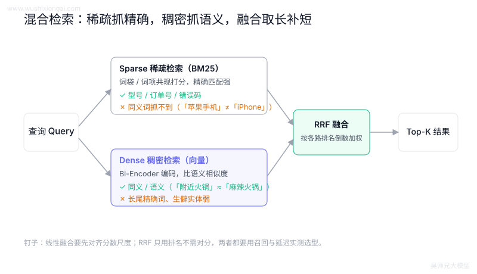

#### 详解

1. **【原题速答】** 混合检索利用 BM25 词面匹配与稠密语义召回的互补性，并通过名次融合、校准或重排合并结果。

2. **【考察意图】** 考察 RAG 检索层架构能力：你是否理解稀疏/稠密两路检索的"错误模式互补"是融合有效的前提；是否会写 RRF 融合公式并解释 k=60 的作用；是否能区分"融合解决召回集合问题"与"重排解决排序问题"两个不同层次的职责边界；以及在大规模工程里是否懂得分数校准和按查询类型路由。

3. **【深度解析】**

   **（1）为什么互补：两路的失效模式几乎不相交**

   - BM25（稀疏，词面）：强在"精确 token 命中"——罕见实体、产品型号、错误码（如 `0x80070057`）、代码标识符、缩写。弱在语义改写：同义表达、跨语言、间接描述会全部 miss。
   - 稠密检索（语义 embedding）：强在同义改写、上下文概括、跨语言迁移；弱在长尾词面：生僻 token、数字/版本号在词表里低频，query embedding 被"语义平均"稀释，召回极易被高频语义噪声淹没。
   - 融合起作用的前提是**两路错误相关性低**（union of recalls 明显大于单路）。这也是面试官想听到的第一性原理：不是"融合一定好"，而是"错误不重叠才好"。若两路候选高度重叠（例如两路都来自相似训练分布），融合收益趋近于零。

   **（2）名次融合（RRF）：公式与算例**

   $$\mathrm{score}(d) = \sum_{i \in S} \frac{1}{k + r_i(d)}, \quad r_i(d) = 文档 d 在第 i 路的名次（从 1 计，缺失则不累计）$$

   - RRF 只依赖**名次**而不依赖原始分数，天然免疫两路分数尺度不可比的问题——这是它胜过朴素加权求和的根本原因。
   - 并非所有路都等权时的加权 RRF：$\sum_i w_i / (k + r_i)$，权重按查询类型或业务先验设定。
   - 直觉推导：k 越大，不同名次之间的分差越平缓（头部与中部的"碾压效应"越小），融合越接近"平均排名"；k 越小越偏向各路第一名。k=60 是 Cormack et al. (2009) 论文的经验值，不是普适最优，跨语料应作为超参验证——**这里要纠正一个常见误读：k=60 是"稳健默认值"而非理论最优**。
   - 算例：query `"postgres deadlock 40P01"`（错误码 40P01 是长尾 token）。文档 A：BM25 第 1 名、dense 第 3 名 → $\frac{1}{61} + \frac{1}{63} = 0.0164 + 0.0159 = 0.0323$；文档 B：dense 第 1 名、BM25 未召回 → $0.0164$。A > B，说明 BM25 头部优势可以覆盖 dense 单路第一；而当 A 两路都是 rank 1 时分值高达 0.0327，稳压一切单路 first-rank 文档。

   **（3）分数校准与重排的分工**

   - 若必须用分数融合（希望保留"置信度"信息而非只看名次）：各路先做 min-max / z-score / 分位数映射（ISR、percentile 归一）到统一尺度再加权。缺点：分数分布漂移（换 embedding 模型、语料分布变化）会破坏映射，需要持续校准。
   - 更稳的层次分工：**融合只负责"把两路的正确答案送进候选集"**（recall 层面），排序质量交给 cross-encoder 重排器统一裁决（见 `reranking.md` 模块）。即：hybrid 的价值主要在 Recall@k，而不是最终排序顺序。

   **（4）按查询类型动态路由**

   - 实体型查询（含型号/错误码/ID）→ 提高 BM25 权重或配额；语义型（描述性、概括性）→ 偏向 dense；不确定 → 全开 + RRF。路由错误会造成覆盖损失，因此生产上更倾向**软路由**（调权重/配额）而非硬路由（只走一路）。

   **（5）量化收益示意**：自建含 30% 实体型、70% 语义型 query 的评测集，实测常见形态为 Recall@10 单路各 60–80%，RRF 融合后 80–90%；若融合后无增益，优先检查两路错误是否高度重叠、k 是否过小（头部碾压）或重排阶段吞掉了融合收益。

4. **【追问链深挖】**（原文追问方向：RRF 参数、分数校准、动态路由）

   - **追问 1：RRF 的 k 为什么取 60？调大会怎样？** 要害：k 是"名次平滑温度"。k=60 来自原论文实验且对多数基线稳健；加大 k 使低名次候选的影响相对上升、抑制单路第一名的碾压，适合"两路都很可信但头部差异大"的场景；调小则更信头部。没有闭式解最优，按验证集 Recall@k 网格搜索 5–200 即可。
   - **追问 2：RRF 和加权线性融合怎么选？** 要害：冷启动/无训练数据 → RRF（零调参、尺度无关）；有 labeled 数据和稳定分数分布 → 加权融合 + 校准，才能注入"某路更可信"的先验，且可为多目标（如业务偏好）blend。工程演进路线常是：RRF 起步 → 校准分数融合 → 学习型融合（LTR）。
   - **追问 3：按查询类型动态路由的失败成本怎么评估？** 要害：错误路由=该类查询丢失一路强召回，直接掉 Recall 上限。因此生产实践是"全开 + 权重调整"而非硬裁剪一路；离线要为每类 query 建路由混淆矩阵，评测每类的 Recall 差值。
   - **追问 4：与重排的完整分工？** 要害：融合产物是"粗排候选集"，必须再过 cross-encoder 统一语义与词面证据；若把 RRF 分数直接当最终排序，会保留词面弱分数的偏差——这是 hybrid 只解决 recall、不解决 precision 的经典陷阱，详见 `reranking.md`。

5. **【串联与资料】** 关联：`modules/reranking.md`（RRF/cross-encoder 重排的两个层次）、`modules/rag-foundations.md`（检索质量决定 RAG 上限）、`modules/evaluation-monitoring.md`（Recall@k/MRR 评测集建设）、本模块 02/04/08 题（BM25 与稠密检索公式的两端）。资料核心结论：**DPR**（Karpukhin et al. 2020）— 用 in-batch negatives 训练的双塔稠密检索，在 OpenQA benchmark 上 top-100 准确率比 BM25 高约 10–20 个百分点，证明语义检索可大幅超越词面检索；**RRF**（Cormack et al. 2009）— 名次倒数融合无需任何参数拟合即可稳定优于单路结果和 Condorcet 类融合，k=60 为稳健经验值。

---

### 02. BM25 原理与 TF-IDF 改进点

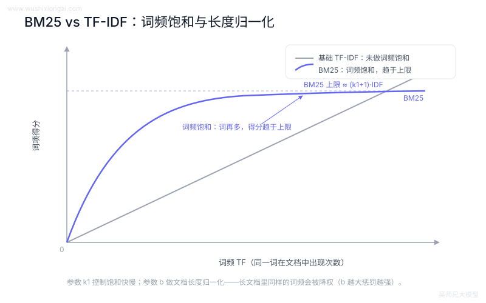

#### 详解

1. **【原题速答】** BM25 用 IDF 加权查询词，并以 k1 控制词频饱和、以 b 调节文档长度归一化，避免 TF 线性放大。

2. **【考察意图】** 经典排序模型的公式级功底：能否徒手写出 BM25 并解释每一项"为什么这样设计"；能否讲清 TF-IDF 的两个结构性缺陷（TF 无界、长度偏差）如何被 k1/b 分别修复；以及参数的工程调法。

3. **【深度解析】**

   **（1）完整公式**

   $$\mathrm{score}(Q, D) = \sum_{t \in Q} \mathrm{IDF}(t) \cdot \frac{f(t, D) \cdot (k_1 + 1)}{f(t, D) + k_1 \cdot \left(1 - b + b \cdot \frac{|D|}{\mathrm{avgdl}}\right)}$$

   其中 $f(t,D)$ 是词 t 在文档 D 中的频次，$|D|$ 为文档长度（词数），$\mathrm{avgdl}$ 为语料平均文档长度，Lucene/ES 的 IDF 实现：$\mathrm{IDF}(t) = \ln\left(1 + \frac{N - n_t + 0.5}{n_t + 0.5}\right)$（用 +1 平滑防止罕见词 IDF 为负——与 Robertson 原始 IDF 略不同，这是"实现与教科书公式有差异"的点）。

   **（2）TF 饱和：k1 的推导**

   文档无限长时（$f \to \infty$）词项得分取极限：

   $$\lim_{f \to \infty} \frac{f(k_1+1)}{f + k_1 s(D)} = k_1 + 1$$

   即单个词条项的得分有**上界 $k_1+1$，与文档长度无关**——这正是"饱和"的数学含义。增益曲线是凹的：1→2 次的边际增益远大于 10→11 次。极端点 $k_1 = 0$ 时得分为常数 1（退化为布尔加权），$k_1 \to \infty$ 趋向线性 TF 即回到 TF-IDF；常取 1.2–2 之间。
   对照：TF-IDF 中 TF 线性进入乘积，恶意堆砌关键词的长文档可以无界刷分——BM25 把它钳在 $k_1+1$。

   **（3）长度归一化：b 的推导**

   定义长度因子 $s(D) = 1 - b + b \cdot |D|/\mathrm{avgdl}$。b=0 时 $s \equiv 1$，完全不惩罚长度；b=1 时完全按长度比例惩罚（长文档的饱和项分母被放大 b·|D|/avgdl 倍）；经验值 0.75。注意 BM25 的长度信息**只进入饱和项的分母**、不改动饱和上界（上界恒为 $k_1+1$），这与"早期做法：整体分数除以 doclen"相比，避免了"长文档即使内容珍贵也被系统性压低"的问题——这是 BM25 相对朴素归一化更稳健的关键细节。

   **（4）算例**：取 $k_1=1.2, b=0.75$，avgdl=200，某长文档 |D|=400 → $s=1-0.75+0.75\times2=1.75$。该词项各 TF 的得分系数：

   | f(t,D) | 得分系数 | 边际增益 |
   |---|---|---|
   | 1 | 2.2/3.1 = **0.710** | — |
   | 2 | 4.4/4.1 = **1.073** | +0.363（+1 次） |
   | 5 | 11/7.1 = **1.549** | +0.159（+3 次） |
   | 10 | 22/12.1 = **1.818** | +0.269（+5 次，越加越薄） |
   | 50 | 110/52.1 ≈ **2.112**（趋近上界 2.2） | 趋近饱和 |

   加上 IDF 后乘上词权重。可见 TF 从 1→2 的增持几乎等于 5→10 的增持，词频证据边际递减，符合"出现两次了，再出现十次不一定更相关"的信息检索直觉。

   **（5）与 TF-IDF 的对比表**

   | 维度 | TF-IDF | BM25 |
   |---|---|---|
   | 权重组成 | TF × IDF 线性 | IDF × 饱和函数(TF, 长度) |
   | TF 处理 | 线性、无上界 | 凹饱和、上界 $k_1+1$ |
   | 长度处理 | 无显式归一（或朴素的除法） | 饱和项内插式归一（b 控制） |
   | 超参 | 无 | k1、b（少量、可调） |
   | 概率论基础 | 启发式 | PRF（概率排序框架）近似 |

4. **【追问链深挖】**（原文追问方向：Hybrid 融合、冲突排序）

   - **追问 1：现在dense 检索那么强，BM25 还值得学吗？** 要害：值得且必要。BEIR（Thakur et al. 2021）显示零样本设定下 BM25 在多个领域仍强于当时的稠密模型；早期 dense 的常见问题是分布外泛化脆弱。生产上 BM25 是唯一"免训练、可解释、对长尾词面可靠"的免费午餐，也是混合检索的强基线与安全网。
   - **追问 2：k1、b 怎么调？** 要害：常规区间 k1∈[1.2, 2]、b∈[0.3, 0.9]；标题/短文本类语料应降 b（长度信号无意义），长文新闻可升 b；用验证查询集的 NDCG@10 grid search，别用拍脑袋默认值。
   - **追问 3：BM25 和向量召回冲突时怎么排序？** 要害：回到 Q01 的两层结构——融合只产出候选集（RRF 或校准分数），最终序交给重排；若必须直接裁决，看错误模式：词面精确证据（错误码/ID 权重更高，如 `0x80070057` 精确命中的文档大概率是答案）压语义改写证据。精确句法命中天然可信度更高，词面精确性这种"硬信号"权重应高于改写证据。
   - **追问 4：字段级 BM25（BM25F）怎么处理？** 要害：把文档拆成 title/body/tags 等字段，按字段置信度加权聚合 TF，再走同一饱和；标题命中权重高于正文。Lucene/ES 用 multi_match + 字段权重近似实现。

5. **【串联与资料】** 关联：本模块 01 题（混合检索）、04 题（公式与实现细节）、08 题（稠密检索基本原理与评估）、`modules/rag-foundations.md`（检索层整体架构）、`modules/reranking.md`（冲突裁决与 LTR）。资料核心结论：**PRF 综述**（Robertson & Zaragoza）— BM25 是概率排序框架下"参数少而稳健"的最优排序函数族代表，饱和与归一是其经久不衰的理论根基；**Lucene BM25Similarity**（官方文档）— 工业实现差异：IDF 加 +1 平滑防负值、默认 k1=1.2/b=0.75，实现细节与教科书式差异需注意。

---

### 03. 召回 vs 粗排怎么分工?

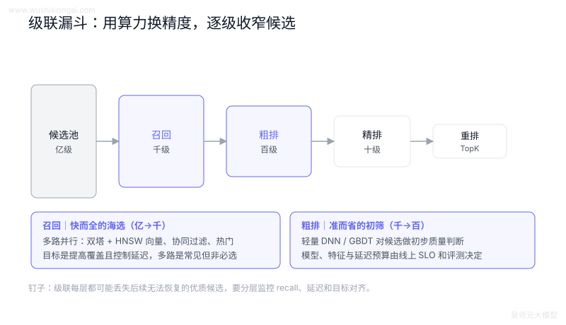

#### 详解

1. **【原题速答】** 召回以低成本保证候选覆盖，粗排按质量-成本曲线可选地减轻精排负担并避免过早漏掉优质项。

2. **【考察意图】** 漏斗架构观：是否理解"召回=可行集最大化（覆盖/多样性），粗排=在可行集内做质量-成本下的上采样，精排=统一目标高保真估计与排序"；是否能量化粗排存在的必要性边界（什么时候可以不做粗排）；对选择偏差（selection bias）等漏斗级系统问题是否有工程经验。

3. **【深度解析】**

   **（1）漏斗结构与量化成本**

   典型漏斗：全库（亿级）→ 多路召回（数千~数万）→ 粗排（数千）→ 精排（数百）→ 重排/业务规则（数十）。

   粗排存在的前提是一个算术题：
   - 精排单价 p（如 5ms/条、需要全特征 + 深层网络），候选 1000 条 → 5 秒，不可接受；
   - 粗排用双塔向量打分 0.02ms/条 × 10000 = 0.2s（ANN 加速后 <50ms），只把 top 500 送精排：500×5ms=2.5s 仍偏高，工业上会再分级——精排对 top 100 全量打分、top 50 进重排，或把精排换成更小的模型。
   - 结论：粗排是用"廉价但略不准的相关性打分"给贵模型减负，同时**守住覆盖率**（防止贵模型只看 top-N 时的盲区）。

   **（2）什么时候可以不做粗排（原题"可选"的正确展开）**

   - RAG 场景候选常只有几百条（ANN 已是召回+粗排合一：双塔打分本质就是粗排），cross-encoder 直接全量重排的成本可接受 → 跳过独立粗排。
   - 推荐系统亿级候选 → 粗排不可省。
   - 判断式：精排单价 × 候选规模 < 延迟预算 × 平行度 → 可跳过粗排。

   **（3）粗排的上限=精排可达上限（天花板公式）**

   令 R 表示"金标ItemAt集合"。粗排截断到 N 条送精排，则最终系统召回上限 ≤ 粗排 Recall@N。所以粗排的评估指标是**Recall@N（对精排 top 集的召回）**而非 AUC——原题答案强调"避免过早漏掉优质项"正是这个含义（漏斗每层都是"信息瓶颈"，瓶颈越靠上层损失越不可逆）。

   **（4）选择偏差（selection bias）**

   粗排训练样本来自"上一版粗排筛过后的曝光数据"，未曝光样本没有可靠负标签 → 训练分布天然向已曝光倾斜。治理：随机流量（ε-greedy 补曝光）、逆倾向加权（IPS：$w=1/p(\text{曝光})$）、精排/粗排联合训练减少层级不一致。

   **（5）多路召回配额**

   固定配额（每路 top-k 硬分配）简单但粗放：某路当天供给质量波动会占用次劣位置。优化：动态配额（按各路候选在验证集上的边际收益调整）或用召回质量评分（如各路分数经校准后统一进入贪心合并）。配额的本质是在"多样性覆盖 vs 单路过度挤占"之间取平衡，其调参必须有 AB 验证。

4. **【追问链深挖】**（原文追问方向：粗排蒸馏、选择偏差、多路召回配额）

   - **追问 1：粗排蒸馏为什么有效？** 要害：粗排与精排目标不一致（双塔打分 vs 精排复杂目标）会导致漏斗层级信息不一致（精排看好的被粗排截掉）。把精排的 top-N 输出（或打分分布，KL / pointwise / pairwise 方式）作为粗排的监督信号做蒸馏，使粗排决策与精排对齐，漏斗不一致率显著下降。
   - **追问 2：随机流量/IPS 怎么具体做？** 要害：拿 1% 均匀随机曝光构造无偏评估集；IPS 公式：$\hat r_{IPS} = \sum_{i \, \text{曝光}} \frac{r_i}{p(\text{ob}(i))}$，倾向 $p$ 用平滑后的曝光概率模型估计，方差大时用 self-normalized IPS；离线无偏指标与线上 AB 需对齐验证。
   - **追问 3：多路配额的调法与失败模式？** 要害：失败模式是"配额固定 → 某一路（如热门）的内容在 top 段填满、把小众但高匹配的候选挤出候选池"；调法=AB 验证配额组合 + 观察各路"送精排后进入最终曝光"的占比与点击贡献，动态配额按"该路当前批次的期望最优边际"分配。
   - **追问 4：粗排用双塔还是单塔？** 要害：双塔(用户/物品分离)可配合 ANN 兼召回+粗排，但只能表达"交互对齐"，且缺交叉特征；单塔轻模型（浅层几层 MLP 上交叉特征）精度更高但每条都要算、不能 ANN。工业常见做法：双塔做 ANN 粗筛 + 单塔轻模型做复核。

5. **【串联与资料】** 关联：本模块 05 题（ANN 即"召回兼粗排"）、06 题（多路召回 vs 排序的全景）、`modules/reranking.md`（精排/重排与多目标）、`modules/evaluation-monitoring.md`（漏斗级 AB 与无偏评估）。资料核心结论：**Deep Neural Networks for YouTube Recommendations**（Covington et al. 2016）— 确立"候选生成（/videos 级 sampled softmax 双塔）+ 排序（多目标加权）"的两阶段漏斗范式，并给出曝光年龄偏差修正的工程细节；**DLRM**（Naumov et al. 2019）— embedding 表 + 特征交互层 + MLP 的统一架构成为工业推荐排序/粗排模型的标准骨架。

---

### 04. BM25公式参数含义与TF-IDF对比

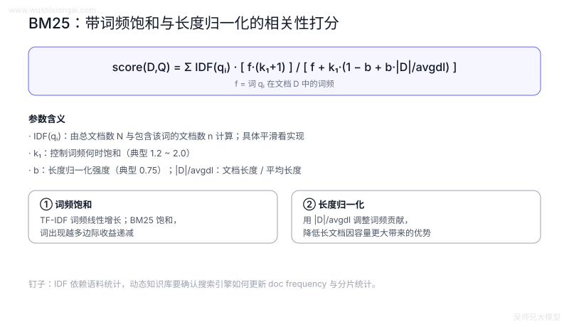

#### 详解

1. **【原题速答】** BM25 结合 IDF、词频饱和与长度归一化，公式实现和参数需按检索引擎与目标查询集验证。

2. **【考察意图】** 02 题的加强版：能否徒手默写公式并逐项给出"参数-行为"映射；是否知道**实现差异**（教科书 Robertson 公式 vs Lucene/ES 的具体变体）导致"同名不同分"的坑；是否拥有在真实查询分布上验证参数的方法论，而不是背默认值。

3. **【深度解析】**

   **（1）公式与逐项含义**（与 02 题公式相同，此处强调逐项）

   $$\mathrm{score}(Q,D) = \sum_{t \in Q} \underbrace{\ln\left(1 + \frac{N - n_t + 0.5}{n_t + 0.5}\right)}_{\text{IDF：稀有词增值}} \cdot \underbrace{\frac{f \cdot (k_1 + 1)}{f + k_1 (1 - b + b|D|/\mathrm{avgdl})}}_{\text{饱和的词频证据}}$$

   - **IDF**：稀有度加权。Lucene 变体在外层加 1 再取对数，保证罕见词也有正贡献，与原始 Robertson-Sparck Jones 公式 $\ln\frac{N-n_t+0.5}{n_t+0.5}$ 相比更平滑（纠正点：很多人背的是原始式，而 ES/Lucene 用的是含 1 的平滑式——同一文档在两套 IDF 定义下排序可能有差异）。
   - **k1**：TF 饱和速度。小 → 快速饱和（更信"是否出现"），大 → 更信频次增量；范围 [1.2, 2] 常用。
   - **b**：长度归一强度。b=0 不惩罚长度、b=1 完全按长度惩罚；0.75 默认。注意长度项只作用于饱和分母，**不改变单词项上界 $k_1+1$**。
   - **avgdl**：语料级统计量，作为归一基准。语料漂移（新增超长文档）会改变 avgdl，从而**隐性改变所有历史文档的排序**——这是"BM25 参数与语料耦合"的典型坑，也是原题答案强调"需按检索引擎与目标查询集验证"的原因之一。

   **（2）与 TF-IDF 的差异（进阶版对比）**

   | 维度 | TF-IDF | BM25 |
   |---|---|---|
   | 公式形态 | 乘积式 TF×IDF | 概率近似 + 饱和函数 |
   | 词频边际 | 线性（第 1 次=第 100 次边际） | 凹凹减（EM 边际递减，上界 $k_1+1$） |
   | 长度偏差 | 无显式处理（或整体除以 doclen，过于粗糙） | $b$ 平滑插入 d/sratio 归一，不压上界 |
   | 打分可解释性 | 高（线性乘积） | 中（需解释 k1/b 的行为） |
   | 跨语料稳健性 | 弱（长文档生态位失衡） | 强（上界均衡 + 两个超参可按域调） |
   | 概率推导 | 无 | PRF（2-Poisson 词频分布假设的近似） |

   **（3）参数验证方法论（原题"公式实现和参数需验证"的落地）**

   1. 固定语料与查询日志（分层抽样：导航型/信息型/混合型），构建 gold 集；
   2. 网格搜索 $k_1 \in \{0.9, 1.2, 1.5, 2.0\}$、$b \in \{0.3, 0.6, 0.75, 0.9\}$，指标 NDCG@10 / MRR@10；
   3. 比较引擎实现差：ES（默认 BM25）与自研引擎（若用原始 Robertson IDF）同文档得分可能不同 → 跨引擎迁移时**回归 gold 集重新校准**；
   4. 语料更新（文档分布漂移）触发重验证，因为 avgdl 漂移会隐性改变排序。

   **（4）算例（与 02 题一致参数下的不同文档）**：查询含词 t：IDF(t)=2.4。文档 X 长 200（等于 avgdl，s=1）、f=4 → 词项得分 $2.4 \cdot \frac{4 \times 2.2}{4+1.2 \times 1} = 2.4 \cdot \frac{8.8}{5.2} \approx 4.06$；文档 Y 长 600（s=2.5）、f=4 → $2.4 \cdot \frac{8.8}{4+3} = 2.4 \cdot 1.257 \approx 3.02$。同 TF 下长文档被压缩，且 f 继续增大时 X 的得分上界为 $2.4 \times 2.2 = 5.28$、Y 的上界也逐步逼近同一上界但被 $s$ 拖慢——两文档最终都会落在同一条饱和渐近线上，长度只影响"多快达到"不影响"最高多少"。

4. **【追问链深挖】**（原文追问方向：IDF 变体、字段 BM25、混合检索融合）

   - **追问 1：IDF 有哪些变体？** 要害：Robertson-Sparck Jones 原始式（可为负）、Lucene 平滑式（+1 外层）、Smoothed IDF、"idf = max(0, ln(...))" 截断式；某些引擎还有 term-dependent 的 Boost。关键点：**变体只影响权重幅度，不改变排序方向**，但跨引擎分数对不齐。
   - **追问 2：BM25F 是什么？** 要害：多字段版本——不同字段（title/body/url）的 TF 按字段置信度 $w_f$ 聚合进同一个饱和函数，避免"把多字段当多文档分别打分再加权"的次优（那样会在每个字段内分别饱和，破坏整体频率证据）。
   - **追问 3：为什么要"按目标查询集"验证参数？** 要害：导航型查询（找特定 URL/ID）与信息型查询（开放式语义）的最优 k1/b 显著不同；领域越长（学术/专利）越偏向"多 TF 证据更可信"，k1 可以大些。默认值是"平均影像"，不是你的场景最优。
   - **追问 4：BM25+ 又是什么？** 要害：在 `score` 外加上 `δ·IDF` 下界修正，防止长文档的总体低估过重（俗称"下界修正"）；思想类似把饱和曲线整体抬高而非缩放。

5. **【串联与资料】** 关联：本模块 02 题（原理级）、01 题（融合竞争力）、08 题（稠密侧公式与离线评估）、`modules/rag-foundations.md`（检索层评测方法）、`modules/evaluation-monitoring.md`（gold 集与分桶评估）。资料核心结论：**The Probabilistic Relevance Framework: BM25 and Beyond**（Robertson & Zaragoza）— BM25 源自 PRF 的 2-Poisson 词频假设近似，其饱和+长度的参数化是该框架的"最佳化最低成本"实现；**Apache Lucene BM25Similarity**（官方 Javadoc）— 工业实现差异：IDF 平滑、k1/b 默认值与可选的 norm/overlaps 处理，即同名算法在不同引擎下的具体数值行为不同。

---

### 05. RAG ANN 索引优化

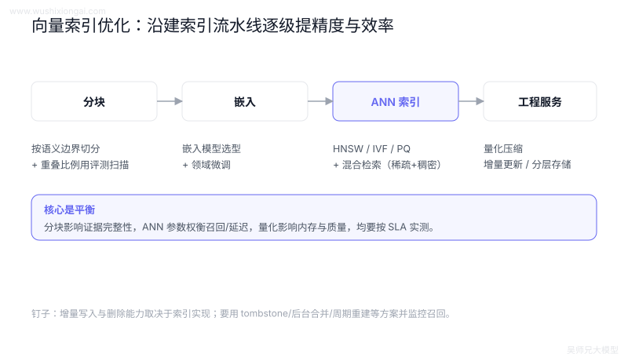

#### 详解

1. **【原题速答】** 向量索引优化应以精确近邻为基线，在召回、尾延迟、内存、构建和更新成本间寻找前沿。

2. **【考察意图】** ANN 工程深度：能否把"召回率-延迟-内存"讲成**定量的帕累托前沿**而不是口号；是否理解 HNSW/IVF-PQ/DiskANN 三大家族的机制差异与选型边界；是否掌握重打分与过滤执行顺序这类能直接决定线上正确性的工程细节；是否习惯"先建精确基线再谈优化"的实验纪律。

3. **【深度解析】**

   **（1）以精确近邻为基线（原题第一重的含义）**

   暴力精确搜索 N 条 d 维向量代价 $O(Nd)$。1M 条 × 768 维 × float32：内存 ≈ 3.0 GB，GPU 上一次 GEMM 亚秒级即可完成全量打分。因此"精确近邻为基线"不是保守主义，而是科学基线：**任何 ANN 必须在同一硬件、同一数据上用相同的 Recall@k 定义评估，先证明它打平或超过精确搜索的成本-收益曲线，才有存在价值**。实践中常见翻车：换了个 ANN 索引、Recall 降了 5% 而没人补"精确上限对照"实验。

   **（2）三大索引家族的机制与数学**

   - **HNSW**（arXiv 1603.09320）：多层可导航小世界图。上层稀疏做"快速跳跃"（对数级跳转距离），底层稠密做精确邻域。参数：M（每节点最大邻接度，上层=M、第 0 层最多 2M），efConstruction（建图候选队列长度），efSearch（查询 beam 宽度）。查询是贪心 beam search：召回与 efSearch 近单调，延迟与 efSearch 近线性正比；近邻路径的"可导航性"由理论证明（小世界性质 → 平均跳数 ~ log N）。
     - 内存：原图向量（$N \times d \times 4$B）+ 邻接表（第 0 层最多 2M 条链路，每链 ~8B：int32 id + float32 距离）。
     - 更新：插入/删除支持相对好，但增删会让图连通性退化（删除通常是标记而非物理移除），需要周期性 compact/reindex。
   - **IVF-PQ**：粗量化器 IVF（k-means 把空间切成 $n_{list}$ 个桶，查询只探测 $n_{probe}$ 个桶）+ 乘积量化（向量拆成 $m$ 个子空间，每段聚 256 个中心，编码为 m 字节）。单条候选距离用查表（Look-Up Table，LUT）近似：$D(x, y) = \sum_{i=1}^{m} \mathrm{LUT}_i[q_i(y)]$，复杂度 O(m) 而不是 O(d)，且 SIMD 友好。
     - 内存（存码后）：$N \times m$ 字节 + 码本 $m \times 256 \times d/m \times 4$B；量化误差 $\|x - \hat y\|^2 = \sum_i \|x_i - c_{q_i}(i)\|^2$——即量化噪声分维累计，是排序近似的根源。
     - 更新：桶分配随数据漂移；删除容易（倒排列表删 id）、新增易但分布漂移后需要重训（重训=重分桶=重建码本索引）。
   - **DiskANN**（Microsoft，2019）：单节点、单机 SSD 上十亿级向量。核心 = 内存驻留 PQ 近似向量 + 磁盘存完整精度向量 + Vamana 图导引的 beam search：用内存 PQ 做"便宜打分"决定读取哪些 SSD 节点，用 SSD 全精度向量做精确复核。千万级~十亿级单机 p99 可控制在毫秒量级，靠的是"SSD 顺序读 + beam 批量对齐 SSD 页"的 IO 设计，成本/内存远小于全内存 HNSW。

   **（3）召回-延迟-内存三角的量化算例**

   以 1M 条 768 维：
   - 精确/Flat：3.0 GB；HNSW（M=32）：~3.0 GB + 链接 ~0.5 GB ≈ 3.5 GB；
   - IVFFlat（不量化）：~3.0 GB + 中心表；IVFPQ m=96（每段 8 维）：96 MB + 码本 < 1 MB（**30 倍量级压缩**），R@10 常在 0.7~0.85，配合 rerank（取 PQ 距离 top-500 → 精确复核选 10）可回收到 0.93~0.98，代价是延迟线性加上精确复核的计算与原向量读取。
   - 结论模板：先给定延迟预算（如 p99 < 10ms）和候选规模，在同一 N 上跑三族参数网格，画出 Recall@10-p99-RAM 三维帕累托前沿，然后**由前沿选择**，而不是"哪个是 SOTA 用哪个"。

   **（4）重打分（refine/rerank）：量化索引的免采样回收器**

   PQ 查询得到的是**量化噪声下的近似序**。修法：用 PQ 分数取 top-r（如 top 500），再用**原始 float 向量**精确计算取 top-k。设量化的 Rec@10 为 q，未被打分孔洞zero的精确复核集合恰好包含真值的比例 p，则最终 Rec@10 ≈ q + p·(1-q) 下界提升，通常能把 q=0.75 推到 0.95+。延迟代价与 r 线性，内存代价是要**保留原向量**（哪怕存在另一台机器/磁盘，如 DiskANN 把原向量放 SSD）。

   **（5）过滤执行顺序（语义过滤 + 向量检索的顺序陷阱）**

   带标量/属性过滤（如 tenant_id、时间、状态）时：
   - **post-filter**：先 ANN 取 top-N，再过滤。过滤率高（如 90% 文档被过滤）时，top-N 里几乎没有能通过过滤的 → top-k 结果锐减甚至为空，**召回率隐藏崩塌**。
   - **pre-filter**：在 ANN 遍历中只访问可过滤的节点（HNSW 中跳过不合法节点、IVF 桶内 mask），保证输出 top-k 真实。
   - 经验：过滤率高（>80%）必须 pre-filter；过滤率低 (<50%) post-filter 简单且 ANN 效率高。很多库（Milvus/Qdrant/pgvector 新版本）都实现了 filtered-HNSW / filtered-IVF；**纠正一个常见误解："先过滤后向量检索一定对"不完全等价于"text 语义 + 属性"组合，pre-filter 的 HNSW 遍历可能因候选稀疏而退化成低效全图游走**，需要在库参数（如探索放大）上配平。

4. **【追问链深挖】**（原文追问方向：HNSW 扫参、量化重排、过滤执行顺序）

   - **追问 1：HNSW 的 efSearch/M 调参机制？** 要害：efSearch 是查询时的 beam 宽度，与 recall 近单调、与延迟近线性正比，是"线上旋钮"；M 是建图时的社交度，决定"图表达能力"与内存，调大使图更稠密 → 召回更稳但内存/构建成本变大。efSearch 应 ≥ k（常见 2k–5k 起步），M 常见 16–48。
   - **追问 2：量化重排的家族（SQ/OPQ/多码本/RaBitQ）？** 要害：SQ8 每维 1B（4 倍压缩、误差最均匀）；PQ 容量更大但子空间方差不均可致"某一段误差过大"；OPQ 学习正交旋转矩阵 R，把各子段能量均衡化（argmin 重构误差），且正交变换保内积/欧氏的排序（$x·y = Rx·Ry$），只改善"量化近似"这一项（不伤真实排序）；RaBitQ（含 1-bit 变体）是面向极低位宽的量化方法，带理论误差界修正，可作为需要极小存储时的底座。
   - **追问 3：标量过滤+删除/更新对图的伤害？** 要害：HNSW 删除=惰性标记（不清理出图），累积后图连通性变差；更新=先标删再插入，不重建则旧路径逐步失效；IVF-PQ 删易、重分桶重建难。生产实践：**增量 upsert + 定期 compact/全量重建（把"图连通性衰减"列为巡检指标）**。
   - **追问 4：分片/副本对召回的影响？** 要害：按 hash 分片会分割"近邻团"（kNN 天然局部不均匀），单分片 ANN top-k 对全局不是 top-k → 需要每分片扩量多取再合并（每 shard 取量随过滤/分片率放大）；这是"分片后 Top-K 不再是全局 Top-K"的经典坑。

5. **【串联与资料】** 关联：本模块 08 题（ANN 之前的基础链路）、09 题（FAISS 中 IVF-PQ 的具体实现）、07 题（Embedding 迁移=索引重建工程）、`modules/reranking.md`（refine 与重排双轨）、`modules/inference-optimization.md`（延迟预算/尾延迟工程）、`modules/rag-foundations.md`（检索层在 RAG 的位置）。资料核心结论：**HNSW**（Malkov & Yashunin 2016）— 分层可导航小世界图在毫秒级延迟下召回率远超 kd-tree 类树形索引，且召回-延迟可用 efSearch 平滑滑动；**Billion-scale similarity search with GPUs**（Johnson, Douze, Jégou 2017）— GPU 上的 IVFPQ 与 top-k 选择核优化让十亿级向量的建库/查询时间下降多个数量级；**DiskANN**（Jayaram Subramanya et al. 2019）— 内存 PQ + SSD 精确向量 + Vamana 图的分工使单节点在十亿级规模下达成 <1ms 级高召回 ANN。

---

### 06. 多路召回 vs 排序模型怎么分工?

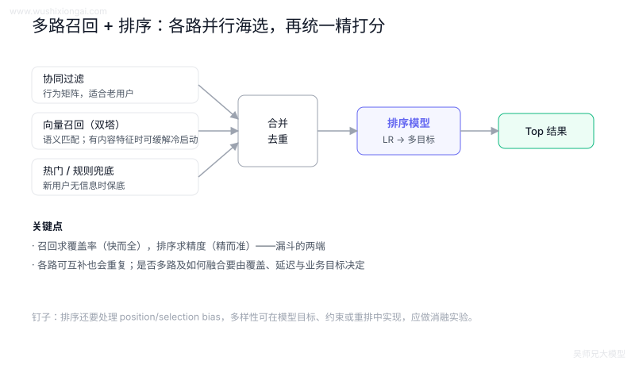

#### 详解

1. **【原题速答】** 多路召回扩大候选覆盖，排序统一估计业务目标，两层都需处理去重、校准、日志偏差和分桶评估。

2. **【考察意图】** 系统级架构观：是否理解召回层"每路独立假设、分数互不可比"与排序层"统一目标、分数可校准"的本质区别；是否会算各路贡献与去重损失；是否有日志偏差（曝光偏向）与分桶评估这类工业严谨性意识；RAG 视角下能否把"多路召回"映射为 hybrid + 结构化路。

3. **【深度解析】**

   **（1）分工的第一性原理**

   - 召回层：目标=**可行集最大化 + 多样性**（coverage）。每路召回有独立假设：向量兴趣路（语义泛化）、协同/行为路（"看过相似的人还看"）、Graph 路（ PinSage/SAGE 类，图结构召回）、热门/运营路（兜底与新鲜度）、检索路（BM25/关键词）。各路分数量纲、训练目标都不同 → **互相不可比**，融合只能靠配额+粗过滤或名次级融合。
   - 排序层：目标=**单一业务目标的统一估计**（pCTR/pVTR/停留/转化或其加权），分数是概率或回归值 → 可校准、可跨候选统一排序。排序的价值正是"统一比较"，把召回层的多假设证据放到同一个度量衡下。
   - 两者结合的正确叙述：召回负责"该出现的不漏"（Recall 上限），排序负责"排在前面的最好"（Precision/校准），两层的失败不互相替代。

   **（2）去重、校准、日志偏差（原题三个工程点各自深挖）**

   - **去重**：召回层各路会产生相同 item → 精确去重（item_id）+ 近似去重（SimHash/MinHash/vector dedup，处理同内容不同 id 的搬运）；RAG 语境 = chunk 去重（同篇不同 chunk 可保留但需 header 标注）。去重损失率 = (1 - 去重后数/各路之和)，是配额浪费的直接度量。
   - **校准**：排序分数要可直接比较（pCTR 预估准），常用 isotonic/Platt 校准；召回分数不必校准但需要"在路内可比"（路内排序被正确尊重）。
   - **日志偏差**：两处不同性质的偏差：召回层无曝光日志（样本只有"被召回后才可能被曝光"），用点击回传 + 反事实修正；排序层有曝光位偏差，用 position bias 模型（如基于点击模型的 counterfactual）。需强调：**召回层训练分布=上一版召回筛过的分布**，自指偏差要靠随机探查流量破除。

   **（3）分桶评估**

   - 分桶：按用户 hash 一致分桶 → 单用户只在一个桶（保证指标可加）；每层独立 AB（召回层 AB 不干扰排序层 AB 的事件 contamination）— 需要分层曝光隔离（如召回路独立 hash）。
   - 指标分层：召回层看"送精排候选的 gold recall";  排序层看 AUC/GAUC + 校准误差（ECE）；整体看业务北极星（时长/点击/采纳率）。
   - RAG 场景映射：向量路 = dense embedding（需配 hybrid）；结构化路= graph/BM25；排序 = cross-encoder rerank + LLM 生成。

   **（4）算例：五路召回的漏斗数字**

   设 5 路×各 top 1000（总计 5000 条），去重后 3200 条（损耗 36%），送粗排留 top 800，精排 top 100。若 gold 集中 90% 的"理想 item"在五路 top-1000 并集内 → 系统上限 90%；其中去重损耗通常不丢正确候选（同 item 重复出现在多路），但**配额截断**（每路只给 1000 名额）可能丢掉"该路第 1024 名的最优 item"——配额扩大实验的价值就是先测这个边际（扩到 2000 capture ~3% 新增正确候选）。

4. **【追问链深挖】**（原文追问方向：召回配额、倾向校正、多目标重排）

   - **追问 1：倾向校正（IPS）怎么做？** 要害：$\hat R_{IPS} = \frac{\sum_i r_i / p_i}{\sum_i 1/p_i}$（self-normalized），$p_i$ 是曝光概率；倾向估计过拟合 → 方差爆炸，需平滑/clip。离线无偏数据（随机流量）与 IPS 指标对齐验证后再信任。
   - **追问 2：多目标重排怎么融合？** 要害：pFinal = $f(pVTR, pCTR, \ldots)$，如 $pVTR \cdot \mathbb{E}[\text{时长}]$ 的期望形式融合，或线性加权、或用强化分子（gCN/EALayer 类）；关键是**业务目标统一**后再进重排，各目标先各自校准。
   - **追问 3：召回层训练与排序层训练的偏差传递？** 要害：召回双塔用 in-batch negatives + sampled softmax（对数偏修正）；若召回直接用排序的曝光日志训练，会把"上一版召回的偏好"固化。正确做法：用跨版本稳定的样本池采集（如随机探查流量构造无偏样本）。
   - **追问 4：各路召回的贡献怎么量化？** 要害：对每路径分别计算"该路径独家贡献的正确候选占比"（unique contribution）——把该路关闭后 gold recall 下降的比例即为该路边际收益；配额优化以边际收益/成本为依据。

5. **【串联与资料】** 关联：本模块 03 题（粗排是两层之间的桥）、01 题（hybrid 是"两路"特例）、07 题（召回模型的版本迁移）、`modules/evaluation-monitoring.md`（AB 与无偏评估）、`modules/reranking.md`（重排与多目标）、`modules/fine-tuning.md`（召回模型训练）。资料核心结论：**YouTube Recs**（Covington et al. 2016）— 双塔召回 + 目标加权的排序 + 老化偏差修正的三段范式是工业漏斗经典的 spawn 点；**PinSage**（Ying et al. 2018 KDD, GCN for Web-Scale Recommender Systems）— GraphSAGE 卷积在 Pinterest pin-board 图（30 亿点）上生成 item embedding，证明图召回路可在大规模工业系统稳定工作。

---

### 07. Embedding升级后向量对齐方案

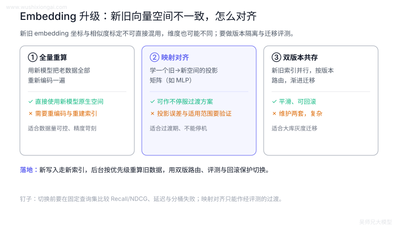

#### 详解

1. **【原题速答】** Embedding 升级时应隔离新旧向量空间，通过影子重建、双读评估、原子切换和回滚完成迁移。

2. **【考察意图】** 生产级模型发布能力（这在很多团队被低估）：是否理解"两个模型的 embedding 空间不可直接比对"的数学原因；是否有影子环境/灰度/回滚的发布纪律；是否考虑半途一致性（双写）与分数分布漂移的校准；是否知道"跨版本兼容训练"这一缓解手段及其代价。

3. **【深度解析】**

   **（1）为什么不能直接对齐（第一性原理）**

   新旧模型的 embedding 空间**不同构**：各向异性/旋转变换/温度缩放/语义流形都不一致；同一文本在新旧空间的余弦无对应关系，几何意义距离不同。数学上可尝试事后对齐：**Procrustes**（求正交/仿射变换 $W^* = \arg\min_W \|E_{old} W - E_{new}\|_F$）或 CCA 对齐两空间的顶层结构——但映射本身有残差，叠加检索层的量化/阈值误差后打分依然不可信。**纠正一个常见误解：跨模型直接算余弦是没有意义的**，除非两个模型有显式对齐约束（如向后兼容训练）。

   **（2）完整的影子迁移流程（原题四个词的落地）**

   1. **隔离**：新向量存独立索引（new index / new collection / 新 namespace），与线上旧空间物理隔离；
   2. **影子重建（shadow rebuild）**：新模型对全库离线重建（设计分批、幂等、断点续跑），不碍线上；
   3. **双读评估（dual read）**：同一查询同时请求旧/新索引，用黄金集（core intent 集合 + 线上真实 top queries 抽样）测 Recall@k/MRR/质量抽检；上线前先跑一段双读对照（同一入口对旧/新各取 top-k 比较差异）在线观测；
   4. **原子切换**：alias/按用户灰度，路由层切换到新索引应是"指针翻转"而非"数据换血"——切换必须是原子操作；
   5. **回滚 = 关 alias 指回旧索引**，前提是**切换窗口内新数据是双写**的（旧索引持续更新）——否则回滚后"新数据缺失"。

   **（3）双写一致性（原题追问）**

   写入顺序：先写旧（source of truth）后写新（shadow），主链路成功即返，新写入失败走重试队列避免**生产阻塞**；读以旧为准、影子读用于对照；切换完成后再切写顺序/废止老链路。若写放系数不可承受，可用 CDC（change-data-capture）从 binlog 派生双写，保证最终一致。

   **（4）跨版本分数校准**

   新模型的 cosine 分数分布不同（同一 similarity 分数在新模型下偏高/偏低、分布更宽更窄都可能）：所有**阈值型逻辑**（过滤阈值、混合检索的加权分数、路由分档）都要重校准。校准方法：在保留 gold 集 / 线上查询分布上 fit per-model scaler（温度缩放 / 分位数映射），存为模型版本元数据的一部分。

   **（5）跨版本兼容训练（向后兼容 representation learning）**

   若业务允许重训新模型，可加入对齐约束：把新模型输出投影到"旧模型的 Fish 中心"（论文 Backward-Compatible Representation Learning 的"Fish hypothesis"：同一 fish（实体）在不同模型/数据/模态下的中心点是稳定的），即以旧模型 embedding 的中心/超球面为 constraint 训练新模型 → 新旧空间可以跨版本比对。**代价**：对齐约束会限制新模型的容量上限（隐式假设：旧结构的密度推荐性更强），需要用实验验证"兼容性换损失"的取舍。该约束的适用性也是原题"向后兼容训练"追问的答案核心。

   **（6）成本量化算例**

   10 亿文档 × 平均 500 token：单核批量化吞吐按 100 docs/s 计，总量 = 1e9/100 = 1e7 核·秒（即单核需约 116 天）；2000 核并行 → 约数小时量级（取决于吞吐与排队）。若走 SaaS embedding API：$0.02/1M tokens × 5×10^11 tokens ≈ $10,000 量级预算。再加新索引构建成本（如 PQ m=96 → 约 96GB 码存储）与人工抽查时间。**结论：迁移是"周级"工程，先算预算再做影子重建与增量评价**，避免"换模型试试"心态。

4. **【追问链深挖】**（原文追问方向：双写一致性、分数校准、兼容训练）

   - **追问 1：双写失败时 source of truth 是哪边？** 要害：切换前旧索引为 truth 新为 shadow；写顺序"旧成功即返、新失败重试/补偿"，保回滚无损。切换后以新为 truth（旧弱化只读）。关键是**每次写入都在事务意义上最终一致**，用 CDC/队列补偿比双 API 同步更稳。
   - **追问 2：分数校准还想解决什么？** 要害：不仅排序阈值，混合检索的加权占比、路由分档、离线评测的蒂森界都要重新校准；校准数据要覆盖线上 query 分布分层（长短 query、领域切片），不然切片阈值漂移会被忽略。
   - **追问 3：向后兼容训练的取舍怎么量化？** 要害：损失=新模型在该约束下的能力上限（MTEB/Benchmark 对照），收益=未来版本可复用旧索引（少一次全量重建）。若新模型在兼容约束下掉点 >X%（业务阈值），宁可全量重建也别限容量——**兼容是工具不是目的**。
   - **追问 4：升级窗口内的质量监控？** 要害：灰度期间即观察线上互动率变化 + 召回质量抽检双指标，且设置守衡量自动化判据（质量抽检 pass rate、bad query 的 top-k 变化）执行/冻结。

5. **【串联与资料】** 关联：本模块 05 题（索引重建成本）、08 题（离线评测集）、`modules/evaluation-monitoring.md`（在线 AB/守衡量监控）、`modules/fine-tuning.md`（蒸馏与对齐训练）、`modules/model-training.md`（表示学习的目标函数）。资料核心结论：**Towards Backward-Compatible Representation Learning**（Shen et al. 2020）— 中心点不变的 Fish hypothesis：若把新模型的表示约束到旧表示的超球面中心附近，可不牺牲新模型能力实现跨版本兼容；**BEIR**（Thakur et al. 2021）— 稠密检索的零样本能力域间差异大，升级前后必须在多域基准+自建集上评估，"榜单新高≠你的场景变好"。

---

### 08. 向量检索基本原理是什么?

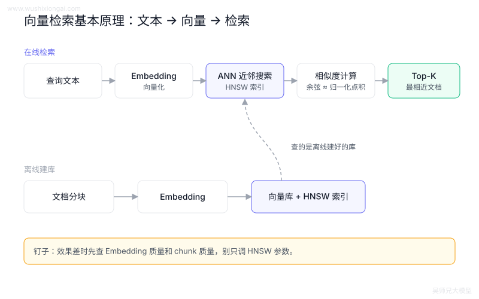

#### 详解

1. **【原题速答】** 向量检索先用同一嵌入模型编码文档与查询，再借助 ANN 索引按余弦、点积或欧氏距离召回 Top-K。

2. **【考察意图】** 概念链完整性：coding → 相似度度量 → ANN → 评测四个环节是否连成一条；是否知道"同一模型、同一预处理、同一度量"这三同原则；是否具备把"召回变差"归因到"模型 vs 索引"的诊断能力（这是原题追问一栏的核心）。

3. **【深度解析】**

   **（1）标准链路（可用一句导语背下来）**

   文档分块 → embedding（与 query 同模型同版本）→ 存入索引（原始向量 + ANN 结构）→ 查询 embed → ANN 检索 top-k →（重排）→ 交给生成。这条链路的每一环节都要做一致性检查：分块策略固定（chunk 大小/重叠/header 注入），embedding 模型版本固定（Q07），度量方式与模型训练时一致。

   **（2）三种度量的数学等价与选择**

   归一化后三者排序等价：

   $$\|a - b\|^2 = \|a\|^2 + \|b\|^2 - 2 a \cdot b \quad \xrightarrow{\|a\|=\|b\|=1} \quad 2 - 2\cos(a, b)$$

   即单位化后的余弦、内积、欧氏距离给出相同排序（内积大 ⇔ 余弦大 ⇔ 欧氏小）。选择规则：
   - 归一化训练且相似度=cosine 的模型（多数 sentence-transformers/BGE/GTE）：cos 与 dot 等价，任选（ANN 库实现里 dot 通常更省一次归一化，但一般已内置 L2-norm）。
   - 训练目标为未归一 dot 的双塔（如某些推荐召回）：必须用 dot。
   - 某些模型（如 早期 CLIP 类）给出 similarity=cosine/temperature 的建议，注意其 softmax 温度只用于训练，检索时是否除以温度不影响排序。
   - **陷阱**：换度量=换模型对应的检索条件，一定要确认模型的"训练度量"与"索引度量"一致，否则"训练度量 ≠ 检索度量"的偏差会被 ANN 放大。

   **（3）离线评测集与"模型 vs 索引"归因（原题追问核心）**

   - **黄金集**：query → 正确 doc 映射（人工标注 + 老系统强埋标 + 线上 query 抽样），分层抽样、含难负例（同义改写/易混淆 chunk），避免近似重复干扰。指标 Recall@k / MRR@10；规则：新模型/新索引上线前在固定黄金集上评估，并定期重构（分布漂移）。
   - **归因实验**：同一个模型固定不变，先用**暴力精确搜索**（FAISS IndexFlatL2/IP）当"理想 ANN 上限"：
     - 暴力（exhaustive）Recall 就低 → 问题在**模型/分块/预处理**；
     - 暴力 Recall 高而 ANN 低 → 问题在**索引**（参数 efSearch/nprobe、量化损失、分片去偏）；
     - 两者都高而线上仍差 → 问题可能在**query 侧**（rewrite/止血、语言不匹配、模型 serving 版本不一致）。
   这个"暴力上限对照"是快速定位召回问题最便宜的诊断方法，值得背下来。

   **（4）chunk 策略对召回的影响（衔接 document-processing）**

   embedding 的输入是 chunk 而非全文：chunk 过小 → 上下文信息丢失导致语义泛化差；过大 → 单向量多语义 → 语义稀释。常见折中 256–512 token + 重叠，重的分文档类型（标题/代码/表格分策略）。在评估中把"chunk 策略"也当成一个"模型参数"来实验。

4. **【追问链深挖】**（原文追问方向：如何评估 embedding 模型、离线检索集、模型 vs 索引归因）

   - **追问 1：怎么评估 embedding 模型本身？** 要害：通用能力看 MTEB/BEIR/RAG Eval 类榜单（但只用域内子集），**最终必须以自家黄金集为准**（同分块策略+同索引下对比多个模型的 Recall@k/MRR/端到端 quality），模型规模（小/中/大）另有成本-延迟-域内表现三维 trade-off。
   - **追问 2：离线检索集怎么构建才不会"自欺"？** 要害：三层来源：人工标注（贵但真）+ 强/弱标签（BM25 命中当弱正例有偏）+ 真实 query 抽样；分层覆盖长短 query/语言/领域切片；若用 LLM 生成 gold，要防"LLM 偏见"（生成与评分同一模型会自我困惑）→ 交叉验证。
   - **追问 3：召回问题来自模型还是索引的完整诊断树？** 要害：见（3），补充隐蔽项：节点间分片漂移与副本不一致、存储精度（fp16/量化导致 precision 下降）、embedding 版本不一致（如 dev 用 v1、线上用 v2）。
   - **追问 4：为什么"同一嵌入模型编码文档与查询"是硬要求？** 要害：embedding 空间的方向基与语义函数绑定于模型；一旦 query 与 doc 用不同模型编码，向量不再处于同一函数估计的空间（asymmetric 特例除外——如 colBERT/pairwise 索引式设计需要显式声明）。

5. **【串联与资料】** 关联：本模块 05/09 题（ANN 内部工程）、07 题（模型版本迁移与同条链路的发布治理）、`modules/document-processing.md`（chunk 策略）、`modules/rag-foundations.md`（RAG 整体架构）、`modules/reranking.md`（重排层）、`modules/evaluation-monitoring.md`（评估集建设）。资料核心结论：原文该题为教学整理（等级 C，未附专属资料），可补充 **BEIR**（Thakur et al. 2021）— 多域零样本评估揭示任意稠密检索模型都存在"domain 偏科"，评测必须贴近自家业务分布；与 **DPR**（Karpukhin et al. 2020）— "query 与 passage 同一 dual-encoder 编码 + in-batch negative 训练"是现代稠密检索的事实起点（技术基石）。

---

### 09. FAISS 怎么实现高效 ANN 搜索?

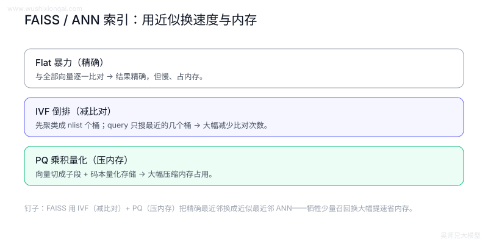

#### 详解

1. **【原题速答】** FAISS 通过 IVF 只探测部分聚类桶，并用 PQ 压缩向量和查表估距，以牺牲可控召回率换取大规模近似近邻的速度与内存收益。

2. **【考察意图】** 具体实现层的功底：能否完整讲述 IVF+PQ 的训练/编码/查询三阶段流水线；优化 lookup table 与 ADC/SDC 的区别；是否掌握内存/精度/延迟的算例化论证；是否知道 FAISS 的工程边界（纯库 vs Milvus/Qdrant 这类服务）。

3. **【深度解析】**

   **（1）IVF（倒排文件索引）：桶分治**

   - 训练：对训练样本 k-means 聚成 $n_{list}$ 个簇（经验 $\sqrt N$ 到 16√N 起步；FAISS 官方 FAQ 提示：训 k-means 每簇至少 ~39 个训练点，**纠正/补充口径：原文未提训练样本量要求，这是 FAISS 的具体实现约束**），把每条向量按最近中心入桶。
   - 查询：只探测与 query 最近的 $n_{probe}$ 个桶（1~$n_{list}$），桶内逐条算距离。
   - 召回损失来自"真值不在被探测的桶里"（coarse quantizer loss）；召回随 $n_{probe}$ 上升、延迟近线性上涨。

   **（2）PQ（乘积量化）：查表估算距离**

   - 编码阶段：把 d 维向量横切成 m 段，每段独立 k-means 到 $k^*=256$ 个质心（8 bit），向量被编码为 m 字节的"码字序列"。
   - 查询：**非对称距离计算（ADC）**：query 不量化，查询时先为它预计算 LUT：$\mathrm{LUT}_i[c] = \|x_i - c\|^2$（对每个子段 i 与 256 个码字 c）。一条候选距离 = $\sum_{i=1}^{m} \mathrm{LUT}_i[q_i]$，复杂度 O(m) 而不是 O(d)——速度上获得 **d/m 倍级别的打分加速**（128 维、m=16 即 8 倍）。vs **SDC（对称）**：query 也量化，误差双积分、一般不如 ADC 准，实践中 ADC 是默认；这也回答原文追问里的"非对称距离计算"。
   - LUT 代价：以 128 维、m=16 计，LUT = 16×256×4B = 16KB，按 query 构建一次即可复用；查表求和天然 SIMD 向量化，单核每秒可打分数万~数十万候选。

   **（3）内存算例（1M 条 128 维）**

   | 索引类型 | 大致内存 |
   |---|---|
   | IndexFlat (float32) | 512 MB |
   | IVFFlat | 512 MB + 中心点（可忽略） |
   | IVFPQ (m=16) | 16 MB + 中心（压缩 ~30×） |
   | HNSW (M=32) | 512 MB + 链接 ~0.1–0.2 GB |
   | IVFPQ+refine（留原向量） | 16 MB + 512 MB（原向量在别处） |

   **注意 IVFPQ 高压缩所付出的代价是"原始向量不再保留"**，大多数需要 refine 的高召回场景要用 IndexIDMap 等把原向量放深层（或放弃 IVFPQ 转用 SQ8/HNSW）。

   **（4）召回-延迟-内存的三角与调参优先级**

   IVF/PQ 两级误差可分层补偿：1）IVF 层：升 $n_{probe}$ → 探测到更准的桶 → 召回 ↑、延迟近线性上涨；2）PQ 层：升 m、用 ADC、refine（原向量精确复核 top-r）。调参优先级：**索引/码本训练质量 → nprobe → m/refine → OPQ**；如果需要特定目标（如 R@10>0.9）就用网格**画帕累托曲线**（same N, fixed hardware）。

   **（5）OPQ 与多码本（原文追问核心之一）**

   OPQ（Optimized Product Quantization）：在 PQ 前把向量做正交旋转 $R$，使子空间的能力均衡化，从而每段的量化误差整体显著下降；正交变换保内积/欧氏（$x\cdot y = Rx \cdot Ry$）→ **不改排序本身，只优化量化的近似的正确率**，训练时交替优化 k-means 与旋转矩阵。多码本思想则包括：残差量化（Residual，前级码字残差再量化）、多套码本（多次编码取最小偏差）等；极小内存场景可看 RaBitQ / 1-bit 变体。以上均属"码本与量化设计"层面的改进，与 IVF 分桶组合即构成广泛使用的 IVF-{PQ, OPQ, SQ, RQ, RaBitQ} 家族。

   **（6）FAISS 的工程定位**

   FAISS 是纯**库**：不含服务化（RPC、调度），元数据过滤、权限与自动 compaction 都要自建。生产两条路：以 FAISS 为自研检索的 core（自建 service 包一层），或直接选用 Milvus/Qdrant/Vespa/pgvector 这类已服务化、内置过滤与分布式管理的系统。面试时应能讲清其定位：**高性能原语与实现参考**，而非开箱可用的检索服务。

4. **【追问链深挖】**（原文追问方向：OPQ 原理、多码本/精度改进）

   - **追问 1：OPQ 为什么"旋转后重聚类"有效？** 要害：使各子段能量分布均匀，最小化 PQ 总重构误差 $\sum_i \|x_i - c_{q_i}\|^2$；旋转正交 → 相似度的排序不变 → 只改善"量化距离对真实距离"的近似。训练 = 交替【k-means 求码本 ↔ 对当前码本求解最优正交旋转（Procrustes/交替最小化）】，收敛到局部最优。
   - **追问 2：为什么 ADC 优于 SDC？** 要害：SDC 把 query 也量化 → 一笔"查询量化误差"叠加；ADC 保留 query 全精度（只有文档侧量化误差），精度更接近真实距离，且 LUT 预计算后单条打分便宜。
   - **追问 3：还有哪些提升 IVFPQ 精度的方法？** 要害：加大 m、refine/rerank（原向量复核 top-r）、多套码本（多次编码取最小偏差）、残差码本（多级 RQ）、SQ8 混合、用困难样本训练码本；以及 1-bit 变体（RaBitQ 一类）。
   - **追问 4：FAISS 的索引评估怎么做？** 要害：用 IndexFlat 精确索引产出 ground truth（或 FAISS 的评估工具集）做基准，扫 nprobe/m/refine 参数画 recall-latency 曲线；注意固定硬件、固定度量（L2/IP/cos）、固定 qps 设置（单 query / batch、单线程 / 多线程）以避免伪改进。

5. **【串联与资料】** 关联：本模块 05 题（索引家族大盘）、08 题（同一条基础链路）、03 题（双塔打分=ANN 粗排）；`modules/evaluation-monitoring.md`（recall-latency 曲线评测）。资料：原题（等级 C）未附专属参考资料，**补充**出处：**Product Quantization for Nearest Neighbor Search**（Jégou, Douze, Schmid 2011, TPAMI）— 分段 256 码本 + LUT + SIMD使乘积量化构建紧凑索引并保持召回在可控压缩比下；**Billion-scale similarity search with GPUs**（Johnson et al. 2017）— GPU 优化IVFPQ+k 选，使十亿级向量在毫秒级延迟可检索。若面试追问"参考出处"，给出这两篇是最稳妥的补充。

---

# 模块二：知识图谱（2 题）

### 01. GraphRAG 原理与构建方法

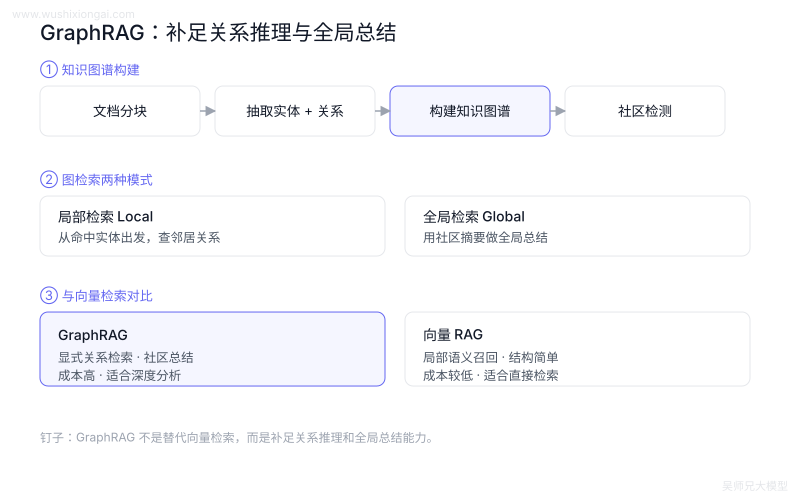

#### 详解

1. **【原题速答】** GraphRAG 从文档抽取实体关系、构建图和社区摘要，以局部关系检索与全局总结补充向量检索。

2. **【考察意图】** 对 GraphRAG（Microsoft, 2024–2025）的 pipeline 全景的理解：索引阶段（实体关系抽取→图构建→社区检测→层级摘要）与查询阶段（local / global / DRIFT、lazy 变体）；是否理解它相对向量 RAG 解决的是哪一类失败模式（全局性/多跳问题），以及构建成本与维护成本（面试官常接着追问增量更新）。

3. **【深度解析】**

   **（1）索引阶段（构建）流水线**

   1. **分块**：文档切 chunk（带全文上下文注入防指代丢失，衔接 document-processing）；
   2. **实体抽取**：LLM 按预定义实体类型（人物/组织/事件/Metric 等）抽取实体（名称、类型、描述），并抽关系（源实体-目标实体-关系类型-权重，权重常基于 co-occurrence 频次）；
   3. **gleaning（多轮追问自检）**：再对同一 chunk 追问 LLM"还漏了什么实体/关系"，多轮提升召回率（LLM 抽取的单轮召回不足是建设成本的主要来源之一）；
   4. **图构建与消歧**：按 (name, type) 归一实体、合并描述；跨 chunk 的同名实体合并为一个节点，边权重聚合；
   5. **社区检测**：用 **Leiden 算法**做层次化社区划分（层级 0/1/2...，粒度由粗到细）；
   6. **社区摘要**：每层每个社区由 LLM 生成摘要（包含被切出的子社区摘要），形成"层级化的语料结构摘要树"。

   **（2）查询阶段（检索）三模式**

   - **Local Search**：query 触达的实体锚点 → 抽取其 k-hop 邻域实体/边/社区摘要 → 组 context → LLM 生成。适合"X 和 Y 什么关系"这类局部问题。
   - **Global Search**：query → 指定社区层级（如 level 2）→ 对每个选中社区的摘要分别调用 LLM 产出"该社区与 query 相关的要点+分值"（Map）→ 汇总 reduce 成全局答案。适合"这批资料主要讨论什么/全篇归纳"类全局总结问题——**这正是向量 RAG 的结构性死角**（向量 top-k 拼接天然只能局部堆砌，无法表达语料整体结构）。
   - **DRIFT Search（2025 官方实现）**：local 与 global 的混合，先用社区摘要给出 draft + follow-up questions，再回退 local 检索补证，兼顾成本与质量。

   **（3）成本结构（量化）**

   - 索引阶段是成本大头：每个 chunk 至少 1–3 次 LLM 抽取调用（含 gleaning）+ 社区摘要按社区数量×层级数量再加一轮。百万 token 语料会消耗百万级以上 token 的抽取成本（多份第三方基准显示其索引成本比标准向量 RAG 高出一个量级），这是 GraphRAG 最大的采用门槛。
   - 查询阶段：global search 每次操作(指 Map-Reduce per-community)也是多次 LLM 调用（与社区数量成正比），local 便宜得多。2025 官方口径（microsoft/graphrag repo）：引入 **LazyGraphRAG / lazy context** ——把社区摘要延迟到查询时按需构建，大幅降低索引成本换取查询稍慢，并支持**增量索引**（新增文档在图上追加而非全量重算）——**纠正/补充口径：原文只提"支持增量更新"为追问方向，截至 2025-11 官方 repo 已将其产品化**。

   **（4）与向量 RAG 的对比表**

   | 维度 | 向量 RAG | GraphRAG |
   |---|---|---|
   | 数据结构 | 语义向量（局部 chunk 视角） | 实体关系图 + 层级社区摘要 |
   | 强项问题 | 局部事实检索、相似匹配 | 全局归纳、多跳关系、结构问答 |
   | 成本 | 低（一次 embedding） | 高（LLM 抽取 × 社区摘要） |
   | 检索路径 | ANN top-k | 实体锚点邻域 / Map-Reduce over 社区 |
   | 可解释性 | 中（可给原文） | 高（可给实体、关系、社区推理链） |
   | 维护 | 需重嵌入 | 需重抽取 + 社区重算（更贵） |

4. **【追问链深挖】**（原文追问方向：实体消歧、社区粒度评估、增量更新）

   - **追问 1：实体消歧怎么做？** 要害：三级流水线：标准化（name/type 归一、别名表）→ embedding 相似聚类（同描述嵌入聚类）→ LLM judge（跨类型同名、缩写歧义等疑难合并审查）；错误传播链要警惕：消歧错 → 社区错 → 全局摘要错，因此**消歧置信度低于阈值的实体放人工审查队列**是生产环节的标配。
   - **追问 2：社区粒度怎么评估？** 要害：层级化评估：a）低端社区是否已过粗（社区内文本 topic 分散）；b）摘要保真度（把摘要与社区内原文抽检 theme coverage）；c）端到端（对 gold set 的全局/局部 QA 正确率按社区 level 变化画曲线选够用的最低层）。经验：global 查询常用 level 1–2，粒度太细会导致多个社区重复覆盖同一主题。
   - **追问 3：GraphRAG 如何支持增量更新？** 要害：新 chunk 抽取后追加子图 → 触达的社区**局部重算**（Leiden 只在新旧交界处重新划分，或按社区判据决定是否重建摘要）；实体合并带来的"合并节点"会让跨 chunk 边重连。配套工程：文档级 lineage（哪个 chunk 产出了哪个节点/边）是可局部重算的前提。官方 repo（2025-11 口径）已提供增量 indexing 支持。
   - **追问 4：抽取错误如何控制？** 要害：幻觉治理靠"绑定 source span（每条关系可回溯 chunk id 与字符区间）+ 双模型交叉抽取一致性（agreement rate）+ 抽检审计 + 类型校验（不允许实体类型外的连接）"；关系权重可多次验证。

5. **【串联与资料】** 关联：`modules/rag-foundations.md`（向量 RAG 基线与其在全局性问题上的结构性短板）、`modules/document-processing.md`（chunk 与上下文注入）、`modules/prompt-engineering.md`（map-reduce 类多轮 prompt 设计）、`modules/evaluation-monitoring.md`（三层评估）。资料核心结论：**From Local to Global: A Graph RAG Approach to Query-Focused Summarization**（Edge et al. 2024）— 用 LLM 抽元数据构建层级社区摘要，再用 map-reduce 式对社区摘要做 query-focused summarization，在"语料级全局理解"类任务上，GraphRAG 于全面性/多样性/赋能性/直接性四个维度胜出两条 baseline——向量 RAG（局部 top-k 检索）与"逐 chunk 直接 map-reduce 总结"；**Microsoft GraphRAG**（官方 repo）— 将上述 pipeline 产品化，提供 standard/fast/lazy 模式、增量索引与 DRIFT search 等实现路径（2025 口径）。

---

### 02. GraphRAG 知识图谱构建有哪些挑战?

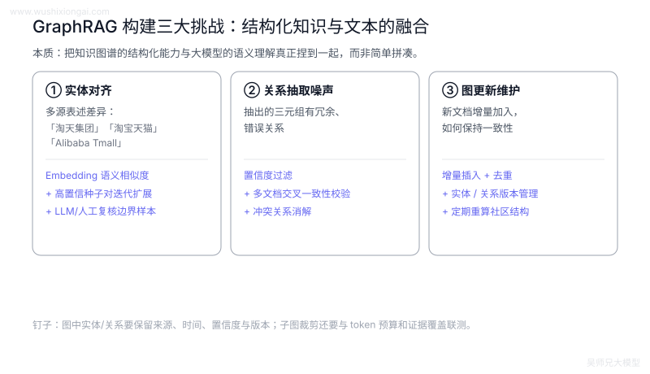

#### 详解

1. **【原题速答】** GraphRAG 可靠性取决于实体消歧、关系溯源、版本化更新、安全隔离和分层评估，而非图结构本身。

2. **【考察意图】** 工程判断力：是否明白"图好看不等于系统可靠"——瓶颈不在 Leiden/图算法本身，而在**数据治理链条**上；对每个挑战（实体消歧/幻觉传播/增量与版本/权限聚合风险/评估分层）是否有生产级的治理手段；能否说出"图坏比向量坏更难发现"的根因。

3. **【深度解析】**

   **（1）挑战一：实体消歧与错误传播**

   - 问题形态：同一实体多写法（"OpenAI"/"Open AI Inc"）、跨类型同名（"Apple 公司" vs "apple 水果"）、别名与缩写、"张三在 2023 年入职 A 公司"中的指代。
   - 治理流水线：归一化（name normal + 别名表）→ embedding 聚类 → LLM judge → 低置信度进人工审查队列。
   - **为什么它是首要挑战**：图上的错误会**通过社区摘要放大**——一个被错误合并的节点会影响其社区摘要，进而影响全篇 global 问答；向量检索的错误是"点失败"，图检索的错误是"结构失败"。

   **（2）挑战二：关系溯源与 LLM 幻觉**

   - LLM 会"补全"合理但不存在的关系（训练分布带来的默认模式）。治理：强制抽取输出绑定**source span**（chunk_id + 字符区间 + 原句），使每条边可审计；双模型交叉抽取（提高可靠性，成本上涨）；gleaning（追问自检）提升覆盖。
   - **典型翻车例**：query "这两家公司的竞合关系"时，LLM 极易从行业常识回填出"竞争关系"，但该关系可能完全不存在于语料——没有溯源就无法在被审计时反驳。

   **（3）挑战三：版本化更新与增量重算**

   - 图是**有状态**的：schema 演进（实体类型增删）、文档更新 → 部分子图替换；Leiden 社区分区在不同批次下不稳定（社区边界漂移），导致摘要"措辞与结构突然漂移"。
   - 治理：实体/边/社区都要版本化（时间戳 + lineage）；增量重算限定在受影响子图；关键工程意识：**full rebuild 的成本是 N×LLM 调用**，所以"哪些层级需要重算"需要设计（社区摘要的重算粒度是主要成本杠杆）。官方 repo（2025-11）已提供增量索引能力，但社区级摘要校准仍需业务层治理。

   **（4）挑战四：安全隔离（Graph 特有的隐私风险）**

   - 图的**聚合推理**能力是双刃剑：多步路径能把分散在多个受限文档中的敏感事实组合出来（如 "A 的联系人→A 的位置→该位置属性"）。治理：**子图级租户隔离**（索引与摘要均 per-tenant）、摘要生成的"信息层级"审计（摘要可能把受限文档的信息逃逸到可见层）、边上的权限标注与路径遍历时按权限裁剪。
   - 与向量 RAG 的本质差异：向量是"局部证据"，图可做"多跳聚合"，多跳路径可拼出**从未在任何单文档里明示的结论**——这在财税/医疗/人事类场景是合规硬风险。

   **（5）挑战五：分层评估（三层指标而非一个 AUC）**

   - L1 抽取层：实体/关系的 P/R（抽样人工或强 reviewer 模型交叉）；幻觉关系率（不可溯源边的占比）；
   - L2 结构层：社区摘要保真度（对社区内文本的主题覆盖一致率）、图连通性/孤立点率；
   - L3 端到端：local/global QA 准确率（分测试集），人工/LLM judge。
   - **关键洞察（原题点题）**：图质量与端到端答案质量**非线性**——某些社区摘要变差不必然影响最终答案太多，而一个关键实体的消歧错误可能毁掉一类全部查询；所以评估必须三层解耦，不能只看端到端。

   **（6）治理算例**：C 级审计边 = "有溯源 + 双模型一致 + 类型合法"才入库；抽 5% 社区摘要人工核查；幻觉率>2% 触发全量重新配置抽取 prompt。各层确认通过后，端到端 QA 才可信用于上线评估与 AB。

4. **【追问链深挖】**（原文追问方向：实体消歧、社区摘要失真、增量重算）

   - **追问 1：实体消歧的三种策略与适用边界？** 要害：规则+词典（便宜、覆盖不够、语料内 style 固定时有效）→ embedding 聚类（跨写法泛化好但跨类型的同形词会误合并，需 type-aware）→ LLM judge（最难类型如跨领域歧义，成本高）；生产=级联，每级输出置信度决定是否往下走。
   - **追问 2：社区摘要失真怎么发现与修复？** 要害：失真源：社区过大时 LLM 摘要不可避免信息压缩；schema/类型变化后摘要未同步；文档更新后社区重算不及时的"陈旧摘要"。_metrics：摘要 vs 社区原文的命题召回（用 NLI 模型判 entailment）；修复=局部重建或调粒度。
   - **追问 3：增量重算 vs 全量重建怎么决策？** 要害：决策变量 = 受影响子图占比 + schema 是否做了兼容变更 + 预算窗口。经验：小于几十% 文档修改可增量；schema 破坏性变更（实体类型删除/合并）→ 全量，但**社区摘要可部分复用**（保存 lineage）。
   - **追问 4：图构建线上化的成本基准？** 要害：抽取 API 成本（每 chunk × tokens × 单价）+ 审查成本 + 存储（图库/表结构）。预算做法：先对 1% 采样语料跑全 pipeline，测每 1M token 的抽取 token 消耗与运维审查工作量，再线性外推；**与原题"瓶颈不在结构而在治理"的判断一致、也是试点先行方法论的价值**。

5. **【串联与资料】** 关联：`modules/knowledge-graph.md` 01 题（GraphRAG 原理是本挑战题的前置知识）、`modules/evaluation-monitoring.md`（三层评估与 LLM judge 方法论）、`modules/document-processing.md`（chunk 与溯源 span）、`modules/rag-foundations.md`（对比向量 RAG 的维护成本）、`modules/rlhf-alignment.md`（抽取模型的行为校准视角）。资料核心结论：**From Local to Global**（Edge et al. 2024）— 层级社区摘要是 GraphRAG 全局问答能力的根本来源，**摘要质量≈答案质量上限** 这一消融结论正是"结构不是关键、质量链条才是"这一原题判断的实证；**Microsoft GraphRAG**（官方 repo）— 其增量索引、lazy/fast 模式与 audit 配置的演进，展示生产化挑战（版本/成本/隔离）如何被官方采纳为一级产品能力。

---

*本详解为 read-only 原模块文件的补充文档；原文模块与图片哈希约束不受影响。研究背景文档：无（本组未标注）。*
