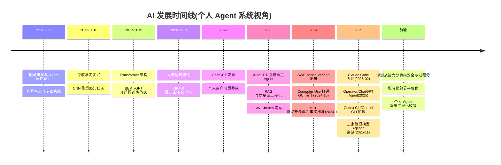

# 个人 AI Agent 系统全面调研报告（事实核查修订版 v1.1）

> 本文由多路调研 + 事实核查 workflow 生成（2026-11-13）：校正 4 处错误、标注 5 处存疑；第 7/8 章（考点 Top20、学习路线）由主流程补充。

## 一、领域概览与演进历程

"个人 AI Agent 系统"指以个人用户为中心、由大语言模型驱动、具备"感知-规划-记忆-执行-反馈"闭环能力的软件系统。判断标准有二：长期记忆与状态持续性；在有约束工具环境中的多步行动能力。单纯聊天机器人、单次补全工具、纯 RAG 问答不在范围内，而 Claude Code、Operator、mem0、Letta、Skyvern、vLLM 等属于核心研究对象。

**发展历程**

- 2022-11 ChatGPT 上线，个人用户第一次大规模把对话式 AI 纳入日常工作流。
- 2023 年 AutoGPT、BabyAGI 引发第一波"自主 Agent"热潮，验证了"LLM 分解目标并调用工具"的可行，也暴露了可靠性与成本两大短板。
- 2023-10 SWE-bench 发布（普林斯顿，Jimenez 等），用真实 GitHub issue 修复作为编码 Agent 的公共评测锚点；同年 RAG 与向量数据库完成工程化。
- 2024 年成为"Agent 基建年"：2024-08 OpenAI 发布 SWE-bench Verified（500 题人工校验子集）；2024-10 Anthropic 发布 Computer Use（随 Claude 3.5 Sonnet 新版进入公开测试）；2024-11 Anthropic 开源 MCP（Model Context Protocol），半年到一年内成为跨厂商事实标准，被业内称为 Agent 生态的 USB-C。
- 2025 年进入"生产力验证期"：2025-01 OpenAI 推出 Operator（Computer-Using Agent，托管浏览器，最初面向 $200/月的 ChatGPT Pro）；2025-02 Anthropic 发布 Claude Code research preview；2025 年中起 Codex CLI（2025-04 开源、后 Rust 重写）与 Gemini CLI（2025-06，Apache-2.0）等终端 Agent 密集出现；2025-11 两周窗口内 GPT-5.1（11 日）与 GPT-5.1-Codex-Max（19 日）、Gemini 3 Pro（18 日）、Claude Opus 4.5（24 日）相继发布，全部主打 Agentic 能力；Mem0、Letta 等记忆框架走出实验室。
- 当前阶段（材料截止口径为 2025 底至 2026 初，细节存疑）：行业焦点从"演示"转向"可靠交付"，评测重心从能力分转向安全与过程分，多智能体框架开始承担生产编排角色。

**重要里程碑**

- MCP 协议开源（2024-11-25）：个人 Agent 系统第一次有了跨厂商的工具连接标准。
- SWE-bench 与 SWE-bench Verified：使编码 Agent 可横向比较。头部成绩轨迹（各厂商官方口径）：2023-10 原始集 GPT-4 约 2%（个位数）→ 2024-08 Verified 发布时约 33%–49% → 2025 年中 70% 上下 → 2025-11 约 76%–81%（Gemini 3 Pro 76.2%、Codex-Max 77.9%、Opus 4.5 80.9%）。从个位数到约八成约为两年，从一年前的四至五成到八成约为一年。
- Computer Use 与 Operator：把"操作图形界面"确立为模型原生能力，浏览器自动化从"脚本爬虫"升级为"LLM 决策操作"。
- Claude Code 与 Codex CLI 双雄并立：终端编码 Agent 成为数百万开发者的日常工具（"数百万"为厂商口径）。
- Mem0、Letta（MemGPT 后继）：个人长期记忆从学术论文变成 pip install 即用的生产组件。
- 开源权重与平价部署：DeepSeek、Qwen、Kimi 等开放权重模型配合 vLLM/Ollama，使"个人本地 Agent"从奢侈品变为常规选项。

## 二、主流 Agent 类型对比

### 表一：个人 Agent 系统总览对比

| 工具 | Features | Vendor | 评级 | 特点 | 不足 |
| --- | --- | --- | --- | --- | --- |
| Claude Code | 终端原生编码 Agent，Agentic 检索、子代理、hooks、CLAUDE.md 项目记忆 | Anthropic | ★★★★★ | 隐式理解力强，配套权限与审计体系完整 | 专有服务，Token 消耗高 |
| OpenAI Codex CLI | 开源（Apache-2.0）终端 Agent，Rust 内核、sandbox 策略、云端委托、ChatGPT 生态 | OpenAI | ★★★★☆ | 开源可审计，ChatGPT 订阅即用 | 术语分散，长任务成本高 |
| Factory Droid | 规格驱动编码 Agent，多模型路由、并行 swarm、IM 触发 | Factory | ★★★★☆ | 企业工作流整合与多模型路由突出 | 商业闭源，依赖 Factory 账户体系 |
| opencode | 开源 client/server 架构 Agent，TUI 与桌面端、LSP 集成 | SST（开源社区） | ★★★★ | 模型无关、可自托管 | BYO key，社区规模较小 |
| 腾讯元宝 | 消费级个人助理，深度整合微信/腾讯生态，混元与 DeepSeek 双模型 | 腾讯 | ★★★★ | 中文个人助理场景触达面广 | 开放性与可编程性弱 |
| 云助手类（腾讯云 AI 助手等） | 企业/个人云上助手，知识库接入与工作流编排 | 各云厂商 | ★★★☆ | 与云数据栈协同好 | 生态绑定各自云平台 |
| **总结** | 覆盖终端编码、云、消费助理三类形态 | 混合 | — | CLI 类控制力最强，助理类触达最广 | 跨形态互操作仍依赖 MCP 落地 |

### 表二：编码 CLI Agent 细分对比

| 工具 | Features | Vendor | 评级 | 特点 | 不足 |
| --- | --- | --- | --- | --- | --- |
| Claude Code | Agentic search 替代暴力 grep、子代理隔离、hooks、四种权限模式 | Anthropic | ★★★★★ | 大型遗留库定位准，harness 工程最佳实践输出者 | 闭源贵，Tokens 高峰期限速 |
| OpenAI Codex CLI | Rust 开源内核、本地沙箱（可禁网）、Codex Cloud 并行任务、IDE 扩展 | OpenAI | ★★★★☆ | 沙箱策略灵活，ChatGPT 登录免 API Key | 长会话上下文成本高 |
| Factory Droid | Droid Exec 无头调用、extension commands、worktree 隔离并行 | Factory | ★★★★☆ | Slack/Linear 一键触发，规格即代码 | 依赖 Factory 平台账户体系 |
| opencode | 客户端/服务器架构、60+ 模型 Provider、TUI/桌面/VS Code | SST | ★★★★ | 模型自由度高，可自托管可控 | UI 打磨与自动化深度稍逊 |
| Gemini CLI | 开源（Apache-2.0），Gemini 1M 上下文，个人 Google 账号免费额度（约 1000 请求/天、60 请求/分钟） | Google | ★★★★ | 长上下文与免费入口友好，适合个人起步 | 复杂自主重构稳定性略逊 |
| aider | 开源，git 原生结对编程，统一 diff 形式提交可控 | 社区 | ★★★☆ | diff 粒度可控，成本透明 | 手动聊天驱动，长任务吃力 |
| **总结** | 覆盖闭源精品到全开源自托管 | 混合 | — | 个人生产力 Claude Code 或 Codex 起步最稳 | 深度自定义需求建议叠加 opencode/aider |

### 表三：浏览器自动化 Agent 对比

| 工具 | Features | 自动化层级 | Vendor | 评级 | 特点 | 不足 |
| --- | --- | --- | --- | --- | --- | --- |
| browser-use | Python 库，复用本地 Chrome 登录态，DOM 结构暴露给任意 LLM | 开源库（自建） | browser-use 社区 | ★★★★★ | 几行代码上手，个人可控，模型无关 | 需写 Python，强反爬/验证码场景易断 |
| Skyvern | 视觉 LLM 驱动，workflow 引擎与可视化编排，表单填写见长 | 开源+托管 | Skyvern | ★★★★☆ | 重复网页任务可固化为 workflow 复用 | 视觉成本高，工作流维护有负担 |
| Playwright MCP | 微软官方 MCP server，以可访问性树快照替代全量 DOM | MCP 工具层 | Microsoft | ★★★★☆ | 与开发自动化栈衔接最顺，Token 省 | 面向开发者，需自行封装 Agent 决策层 |
| OpenAI Operator | Computer-Using Agent，托管浏览器内模拟输入点击滚动；2025-01 发布，最初面向 ChatGPT Pro（$200/月） | 托管服务 | OpenAI | ★★★★ | 零代码端到端，与 ChatGPT 生态直连 | 覆盖面与速度受限，价格较高 |
| Anthropic Computer Use | 模型截屏-分析-点击-输入的通用 GUI 循环（2024-10 公开测试，官方蓝图与参考实现） | 模型原生+蓝图 | Anthropic | ★★★★ | 最通用桌面与浏览器底座，可自组装 | 延迟高、单位成本高，可靠性需自建护栏 |
| **总结** | 三类形态并存：库/服务/协议接入 | 混合 | — | 个人起步 browser-use，流程固化 Skyvern，极简托管选 Operator | 共同上限是站点反爬与登录合规风险 |

### 表四：个人记忆与知识库系统对比

| 工具 | Features | 记忆定位 | Vendor | 评级 | 特点 | 不足 |
| --- | --- | --- | --- | --- | --- | --- |
| mem0 | 抽取式记忆（ADD/UPDATE/DELETE/NOOP），向量检索，OpenMemory MCP，托管与自托管 | 短期与中期个人记忆 | mem0.ai（Apache-2.0 开源+托管） | ★★★★★ | 多租户精细，接入成本最低，个人检查记忆友好 | 图记忆等高级能力依赖付费托管 |
| Letta（原 MemGPT） | 核心/归档分层记忆，Agent 自编辑记忆，Agent File Format（.af），休眠调用分页 | 长期自主管理记忆 | Letta（开源 Apache-2.0） | ★★★★☆ | 记忆管理范式最完整，学术沉淀深厚 | 需采用其 runtime，工程文档偏研究向 |
| Zep（含 Graphiti） | 时序知识图谱，双时间线有效期，community 版 Graphiti + 企业管理平面 | 长期关系与事实演变 | Zep（Graphiti 为 Apache-2.0） | ★★★★☆ | 事实时效与来源可审计，适合合规场景 | 自托管依赖图数据库运维 |
| cognee | 开源记忆流水线，语义层+图+向量混合，ECL 抽取-认知-加载 | 中长期统一记忆层 | cognee（开源，许可待核实） | ★★★☆ | 知识图谱与向量一体化，路线透明 | 生产案例较少，成熟度待验证 |
| Limitless（原 Rewind.ai） | Mac 端记录全天屏幕与音频，本地存储索引，可穿戴 Pendant 采集 | 全时被动记忆 | Limitless（闭源） | ★★★☆ | 个人语境最完整，会议与对话可回溯 | 闭源，隐私依赖厂商承诺 |
| **总结** | 开源三强均可本地部署 | 混合 | — | 轻度选 mem0，长期自主管理选 Letta，时效合规选 Zep | 跨系统记忆标准尚未统一（MCP 记忆规范仍在演进） |

### 表五：模型层对比（个人 Agent 视角）【2025-11 口径】

| 模型 | 上下文(约) | Vendor | 评级 | 特点 | 不足 |
| --- | --- | --- | --- | --- | --- |
| Claude Opus 4.5 | 200K, SWE-bench Verified 80.9%（2025-11） | Anthropic | ★★★★★ | Agentic 编码与判断质量第一梯队；API 价较 Opus 4.1($15/$75) 下调至 $5/$25 | 非英语语料与本地生态弱于开源国产系 |
| GPT-5.1 与 Codex-Max | 400K(API), Codex-Max 宣称 30+ 小时级连续自主任务（官方口径），Verified 77.9% | OpenAI | ★★★★★ | 长时程自主任务与 Codex 生态闭环 | Agent 特性与自家产品线耦合较深 |
| Gemini 3 Pro | 1M 上下文, 多模态原生, Verified 76.2%, CLI/IDE 免费入口 | Google | ★★★★☆ | 超长上下文对大型仓库与多文档最有价值 | Deep Research 深度略逊前两者（存疑，无定量证据） |
| DeepSeek-V3.2 | 128K, 开源权重, DSA 稀疏注意力 | DeepSeek | ★★★★☆ | API 价约 输入(未命中) $0.28 / 输出 $0.42，缓存命中输入 $0.028（对应人民币 ¥2/¥3/¥0.2，2025-09 起口径），个人本地与高并发成本优势明显 | 长程 Agentic 稳定性相对弱，检索增强需自建 |
| Qwen3 系列 | 开源权重主流 32K 原生/YaRN 扩展至 128K；宣称 256K 仅部分新型号（Qwen3-Next/Qwen3-Max API 端，存疑） | 阿里 | ★★★★ | 中文与生态工具链最全，本地部署选择多 | 通用推理上限略低于闭源旗舰 |
| Kimi K2 | 128K, 开源权重, MoE（万亿总参）, 交互长输出强；2025-11 的 K2 Thinking 支持更长上下文 | 月之暗面 | ★★★★ | 超长文档与写作型任务表现突出 | 部署资源门槛高 |
| **总结** | 闭源三强并行，开源权重四线追近 | 混合 | — | 编码主力 Opus 4.5, 长任务 Codex, 长上下文 Gemini，本地选 DeepSeek/Qwen/Kimi | 迭代快，表中数字有效期短，以官方文档为准 |

### 表六：多智能体框架对比

| 框架 | Features | Vendor | 评级 | 特点 | 不足 |
| --- | --- | --- | --- | --- | --- |
| LangGraph | 图/状态机编排，checkpoint 持久化，interrupt 人审，subgraphs，LangSmith 观测 | LangChain（MIT 开源+商业平台） | ★★★★★ | 生产可控性最强，断点恢复与人工卡点是一等公民 | 学习曲线陡，样板代码偏多 |
| AutoGen | Actor 风格事件驱动多代理会话，AutoGen 0.4 重写，AutoGen Studio | Microsoft（MIT 开源） | ★★★★ | 研究范式覆盖最广，agents 拓扑灵活 | 重研究导向，生产部署需补基建 |
| CrewAI | 角色化 Crew 抽象与 Flow 过程化双模式，任务驱动 | CrewAI（MIT 开源+企业版） | ★★★★ | 上手最快，角色协作心智模型直观 | 深度控制流受限，调试粒度粗 |
| OpenAI Agents SDK | Swarm 正式化：handoffs、guardrails、session、tracing | OpenAI（开源 SDK） | ★★★★ | 与 Responses API/托管工具链无缝，工程轻盈 | 深度绑定 OpenAI 生态，多厂商中立性弱 |
| **总结** | 生产选 LangGraph，OpenAI 栈选 Agents SDK，研究探索 AutoGen，轻量协作 CrewAI | 混合 | — | 多智能体以"编排确定性+模型智能"为设计共识 | 多智能体成本与失败级联风险显著高于单 Agent |

## 三、主流 Agent 系统深度解析

### Claude Code（2025-02 research preview 面世）

Anthropic 官方终端编码代理：语义级 agentic search、四档权限模式、不可绕过的 hooks、CLAUDE.md 项目记忆与 skills 生态；运行面覆盖终端、桌面、claude.ai/code 网页版与各 IDE 扩展。适用：遗留代码库重构、跨文件开发、测试生成、PR 与 CI 分诊，以及权限/审计有硬要求的企业。Web 版于 2025-10 推出。

### OpenAI Codex CLI（2025-04 开源，后 Rust 重写内核）

开源核心（Apache-2.0）+ 云端增值双轨：Rust 内核可审计、可指向自定义模型后端、支持严格沙箱与禁网；Codex Cloud 并行任务与 IDE 扩展同账号打通，ChatGPT 订阅免 API Key。GPT-5.1-Codex-Max（2025-11-19）引入压缩机制，官方口径支持 30+ 小时连续自主工作，SWE-bench Verified 77.9%。适用：开源贡献者、严格离线环境、长时程整仓迁移。

### Factory Droid

规格驱动的企业级编码 Agent：多模型 per-step 路由、parallel swarm（worktree 隔离）、Slack/Linear 一键转任务、droid exec 无头嵌入 CI 与脚本化回归。适用：大规模并行重构、批量 issue 修复、以"提交规格"为研发协作入口的平台团队。

### browser-use

Python 浏览器自动化库：复用既有 Chrome 登录态、模型无关（OpenAI/Anthropic/Gemini/DeepSeek/本地模型），社区模板成熟，与 MCP 集成后可被任意 Agent 调度。适用：个人信息搬运与 80% 重复点击自动化，需人在环兜底。

### mem0

pip 即用的抽取式个人记忆层（ADD/UPDATE/DELETE/NOOP 四类更新操作），向量检索为基础，托管平台提供图记忆；OpenMemory MCP server 让任意 MCP 客户端共享统一记忆；开源核心 + 托管双轨。适用：多用户产品个性化记忆、跨工具"关于我"的统一事实层。

### LangGraph

LangChain 生态低层编排框架：图与共享状态表达 Agent；SqliteSaver/PostgresSaver checkpoint 支持时间旅行调试与断点恢复；interrupt() 与 human-in-the-loop 为高危动作提供强制审批；LangSmith 全链路观测。

## 四、AI 发展趋势与架构

SWE-bench 头部成绩两年内从个位数（2023-10 原始集 GPT-4 约 2%）推进到约 76%–81%；SWE-bench Verified 在发布后约 15 个月内从三成上下推进到八成；MCP 自 2024-11 开源后一年内成为跨厂商事实标准。对个人而言，结论是：系统的生命力不取决于押注某一家模型，而取决于"面向变化设计"。

**已知限制与缓解**：可靠性链式衰减、成本随上下文与重试膨胀、prompt injection 与记忆投毒无根治方案、基准分数与私有代码库实际表现存在差距；缓解手段为分级审批 + checkpoint、小模型路由与预算上限、最小权限与审计、持续更新的私有评测集。

## 五、项目实战与最佳实践（安全/测试/上线）

**安全机制**：凭证分权存放与轮换；Agent 默认只读，写与网络按任务临时授予；代码执行放容器/worktree 并默认禁网；检索内容、网页内容、工具输出一律视为不可信文本，对 prompt injection 采用输入过滤、权限隔离、输出检查三层纵深并定期红队测试；个人记忆与工作记忆分库，删除请求级联生效。

**测试评估**：基准分层选型——编码看 SWE-bench Verified，UI 操作看 OSWorld，网页任务看 WebArena，通用助理看 GAIA，注入与策略看 AgentDojo 与 τ²-bench；基准分数仅作初筛，必须以自家任务评测集复验；评测挂 CI，改动带对比 signed-off，失败回放进回归集。

**上线清单**：模型更换零代码改动、凭证可轮换、高危动作人审卡点、三层注入防线、成本预算与降级路径、日志审计不含明文凭证、沙箱默认禁网、红队修复闭环、一键停机与回滚开关。

## 六、项目收益与 ROI

- **开发效率**：GitHub Copilot 官方研究称受控实验中完成任务快约 55%（专项任务口径，非全日效率）；微软/Google 内部大规模采用后报告双位数提速与满意度提升。反面证据：METR 2025 年对照研究发现，有经验开源开发者使用 AI 工具时主观自评提速但实测慢约 19%——说明"感觉快"与"实际快"要区分，agent 收益高度依赖任务类型（样板代码/新功能收益大，熟悉域微调代码收益小）。
- **企业案例**：Anthropic 披露 Claude Code 使部分客户编码生产力提升显著（如 Salesforce、Notion 等，具体幅度为厂商口径）；OpenAI/GitHub 官方案例普遍报告 PR 周转加快、 boilerplate 消减。
- **成本结构**：个人使用主力成本是 token——长上下文 agent 会话单任务可达数美元（Opus 档），开源/小模型路由可降 5-10 倍；失败重试与人工审核时间是隐性成本，运营上"预算上限+降级模型"是标配。
- **个人开发者**：典型收益场景——从 0 到 1 的小工具/脚本/网站（数小时级交付）、代码迁移与批量重构、文档与测试生成、信息搬运自动化（browser-use 类）。数字上，个人小项目从数周压缩到数天是常见口径。
- **不划算场景清单**：需要严格正确性且无验证信号的任务、领域知识深且数据私有的任务、低频一次性任务（搭建 agent 基建成本 > 收益）、强合规审计场景（模型不可解释性）。
- **决策框架**：任务可验证（有测试/编译/回放等自动信号）→ 上 agent；任务高频+模式化 → 上 agent；任务不可验证+低频 → 别上。

## 七、高频考点 Top20（面试/考试向，主流程补充）

每题格式：**题目** → 考察意图 → 答题要点。

1. **Agent、Chatbot、Workflow 的本质区别？** ⭐⭐⭐⭐⭐
   考察：是否理解自主性与控制流。要点：Chatbot 单轮无状态；Workflow 控制流写死在代码（确定性、LLM 只是节点）；Agent 由 LLM 决定控制流（自主规划、动态工具选择、观察反馈再决策）。关键金句："Workflow = 编排确定性，Agent = 模型智能"，工程上按可靠性要求选。

2. **描述 Agent Loop（感知-规划-行动-观察）的完整循环。** ⭐⭐⭐⭐⭐
   考察：对 agent 运行时的把撑。要点：输入目标 → LLM 基于上下文生成思考与行动（工具调用）→ 环境执行返回观察 → 结果追加进上下文 → 循环直到终止条件（完成/预算/人工中断）。终止条件与最大步数是工程必须项。

3. **ReAct 范式是什么？为什么有效？** ⭐⭐⭐⭐⭐
   考察：经典论文功底（Yao et al. 2022）。要点：Reasoning（写思考）与 Acting（调工具）交错生成；思考轨迹引导下一步行动选择，行动结果修正推理；减少幻觉（ grounding 到环境观察）。

4. **Function Calling 的完整工作原理？** ⭐⭐⭐⭐⭐
   考察：是否用过底层 API。要点：向模型传 JSON Schema 描述工具集 → 模型输出结构化调用（名称+参数）→ **执行在客户端侧**（模型只生成请求，不执行）→ 结果作为 tool message 回填 → 支持并行调用与强制路由；与普通文本输出的差异是约束解码保证格式。

5. **MCP 是什么？解决什么问题？与 function calling 什么关系？** ⭐⭐⭐⭐⭐（2026 必考新考点）
   考察：对 2024-11 后生态的理解。要点：Anthropic 开源的模型-上下文协议，统一 host（agent 应用）、client、server（工具提供方）三层；解决 M×N 集成问题（每个 agent 对每个工具写适配 → 变成各自实现一次 MCP）；提供 tools/resources/prompts 三类原语；MCP 是工具分发标准，function calling 仍是模型层的调用机制，两者互补。

6. **Context Engineering 与 Prompt Engineering 的区别？核心实践有哪些？** ⭐⭐⭐⭐⭐（2026 新考点）
   考察：是否跟进 2025 年话语转变。要点：prompt engineering 关注单次指令措辞；context engineering 关注整个循环里"什么信息以什么形式进入有限上下文窗口"——系统提示、工具结果裁剪、历史压缩（compaction）、检索注入、子代理隔离；核心矛盾是 context rot（上下文越长，模型利用效率越低）。

7. **LLM Agent 的记忆系统怎么设计？** ⭐⭐⭐⭐
   考察：短期/长期记忆分野。要点：短期=上下文窗口（含 scratchpad）；长期=外部存储（向量库/知识图谱/文件）。经典方案 MemGPT/Letta 的分层记忆（核心记忆常驻+归档检索+自编辑）；Mem0 的抽取式记忆操作（ADD/UPDATE/DELETE/NOOP）；Zep/Graphiti 的时序知识图谱（事实有效期、双时间线）。遗忘与冲突合并是隐藏考点。

8. **RAG 和 Agent 什么关系？什么是 Agentic RAG？** ⭐⭐⭐⭐
   考察：概念边界。要点：RAG 是检索增强的生成模式；Agent 是具备规划与多步工具使用的系统；Agentic RAG = 检索本身成为 agent 可决策的工具（多跳检索、查询改写、结果自评再检索）。

9. **什么时候该用多智能体？什么时候单 agent 更好？** ⭐⭐⭐⭐⭐
   考察：架构判断力。要点：多 agent 适用于并行探索、上下文隔离（各子任务独立窗口）、异构特长分工；代价是成本倍增、失败级联、信息丢失（handoff 时的上下文压缩）。默认先做单 agent + 子代理，显著瓶颈再升级 orchestrator-worker 或图编排。

10. **Agent 可靠性为什么低？生产落地的最大瓶颈是什么？** ⭐⭐⭐⭐⭐
    考察：工程现实主义。要点：多步串行走链式衰减（单步 95% × 20 步 ≈ 36% 成功率）；错误恢复靠模型自反思，噪声会滚雪球污染上下文；缓解：验证信号优先（可执行测试）、检查点与回滚、人审卡点、缩小任务粒度。

11. **SWE-bench / GAIA / OSWorld / tau-bench 分别测什么？怎么给自己的 agent 做评测？** ⭐⭐⭐⭐
    考察：评测素养。要点：SWE-bench Verified = 真实 GitHub issue 修复；GAIA = 通用助理多步任务；OSWorld = 真实 OS GUI 操作；tau-bench = 客服类工具+策略遵循；AgentDojo = 注入攻击评测。自有评测：构建带自动验证信号的任务集、回归集、LLM-as-judge 要人工校准。

12. **Prompt injection 是什么？Agent 场景为何更危险？怎么防御？** ⭐⭐⭐⭐⭐
    考察：安全底线。要点：注入=外部内容（网页/检索/工具输出）携带恶意指令劫持模型；agent 有工具执行权 + 上下文内不可分辩"指令 vs 数据"所以更危险；防御纵深：输入过滤、权限最小化与临时授权、敏感操作人审、输出检查、红队测试；没有根治方案（本考点答"没有银弹+分层"才是高分）。

13. **Agent 的沙箱与权限系统怎么设计？** ⭐⭐⭐⭐
    考察：落地经验。要点：默认只读、写与网络按需授予；代码执行放容器/worktree 并默认禁网；凭证分权存放与轮换；四档权限模式（只读/自动编辑/全自动+白名单/人审全批）参考 Claude Code；审计日志。

14. **Agent 的成本怎么优化？** ⭐⭐⭐⭐
    考察：性价比意识。要点：模型路由（难任务旗舰、易任务小模型，per-step 路由如 Factory Droid）；KV/prompt 缓存命中；上下文压缩与裁剪；子代理避免重复读文件；预算上限+降级路径；批处理接口。

15. **微调 vs 提示工程 vs 工具/RAG 增强，什么时候选什么？** ⭐⭐⭐⭐
    考察：技术选型。要点：默认顺序——先 prompt/context 工程，再工具与 RAG（外部知识优于参数化知识，可更新可审计），微调留给：格式/风格强约束、领域词表、降本蒸馏、私密标注数据；agent 行为大多能用上下文解决，微调不解决"知识过时"。

16. **经典论文脉络：ReAct → Reflexion → Voyager → Generative Agents 各自贡献？** ⭐⭐⭐
    考察：学术纵深。要点：ReAct=交错推理与行动；Reflexion=语言化自我反思代替梯度更新（失败信号存入 episodic memory）；Voyager=技能库+自动课程（Minecraft 终身学习）；Generative Agents=记忆流+反思+计划的"西部世界"小镇，个性化 agent 思想源头。

17. **Agent 的"规划"怎么做？CoT/ToT/分解/反思各解决什么？** ⭐⭐⭐⭐
    考察：规划技术谱系。要点：CoT=线性思考链；ToT=树状搜索多分支评估；任务分解（decomposition）=把目标拆成可验证子任务；Reflexion 类反思=用失败信号迭代；工程上"计划先行（plan-first）+ 执行中重规划"是主流折叠式编排。

18. **Human-in-the-loop 怎么设计才不打断价值？** ⭐⭐⭐⭐
    考察：产品与工程平衡。要点：分级审批（高危写操作/外发动作拦截）；checkpoint 后批量人审而非逐步；interrupt-on-external-effect 原则；可回滚是敢于放权的前提。

19. **决定 agent 成败的最关键工程因素是什么？** ⭐⭐⭐⭐⭐（开放辨析题）
    考察：是否形成自己的判断。参考答案框架：模型能力是地板，harness（上下文管理、工具设计、错误处理、验证回路）是天花板；同等模型下，工具描述质量、错误恢复设计、验证信号可得性的差异远大于"换模型"。

20. **Computer Use / 长时程自主（30h 级）/ 个人 agent 的下一步是什么？** ⭐⭐⭐
    考察：前沿视野。要点：GUI 原生操作把 agent 覆盖面扩展到所有软件；长时程靠上下文压缩（compaction）+ 检查点 + 自验证；个人 agent 的核心矛盾是"个性化数据在本地隐私"与"云端能力"，端侧模型+本地记忆（mem0/Letta 本地部署）是 2026 主线叙事；评测从能力分转向安全与过程分。

## 八、学习路线与认知框架（主流程补充）

**一句话认知框架**：Agent = LLM（大脑）+ 工具（手脚）+ 记忆（状态）+ 环境（反馈）+ 编排（流程），成熟度取决于验证信号的密度。

**三层知识树**：
- 模型层：上下文/指令遵循/工具调用能力差异（闭源三强 vs 开源四线）→ 决定 agent 的能力地板。
- 编排层：agent loop、上下文工程、记忆、子代理、多智能体框架（LangGraph/Agents SDK）→ 决定可靠性上限。
- 验证层：评测集、CI 集成、人审卡点、安全护栏 → 决定能否进生产。**面试与落地里最被低估的是这一层。**

**学习路径（约 4-6 周）**：
1. 第 1 周 — 原理：读 ReAct、Reflexion 两篇论文 + Anthropic《Building effective agents》+《Effective context engineering for AI agents》；手写一个无框架的最小 agent loop（≤200 行）。
2. 第 2 周 — 工具生态：跑通 Claude Code 或 Codex CLI 各一周日常开发；给项目配 CLAUDE.md/AGENTS.md；体验 MCP server 编写。
3. 第 3 周 — 记忆与个性化：用 mem0 或 Letta 给自己的助手加长期记忆；对比向量/图/分层三种记忆方案。
4. 第 4 周 — 多智能体与编排：LangGraph 实现带 checkpoint 与人审卡点的两步流程；对比 AutoGen/CrewAI 心智模型。
5. 第 5-6 周 — 立项验证：选一个高频+可验证的个人任务（如"每周整理订阅信息生成简报"、"批量重构小工具"）端到端上线；算清 token 成本 vs 节省时间，形成自己的 ROI 数据。

**备考/面试冲刺清单**：MCP（必考新点）、context engineering、多智能体取舍、可靠性工程、注入防御——这五个是 2026 年与传统八股（ReAct/RAG）拉开区分度的考点。

---

## 附：本次事实核查摘要

共核对约 15 组定量声称。证实并保留：Opus 4.5（80.9%、$5/$25、200K）、Codex-Max（77.9%、400K、30+ 小时）、Gemini 3 Pro（76.2%、1M）、DeepSeek-V3.2（128K、DSA）、Kimi K2（128K、MoE）、OpenMemory MCP、.af 格式、LangGraph/AutoGen/CrewAI/Agents SDK 开源许可、Letta/Zep 许可。

修正 4 处：Claude Code 时间线（2024 → 2025-02）、SWE-bench 成绩演进口径（原始集 vs Verified 混写）、mem0 许可证（AGPL → Apache-2.0）、DeepSeek V3.2 价格（$0.2/$0.3 → $0.28/$0.42）。

存疑 5 处：Qwen3 256K 上下文（仅部分新型号）、Gemini 3 Pro Deep Research 对比（主观判断）、cognee 许可证、2025 底-2026 初趋势细节、厂商宣传类数字（30 小时/数百万开发者）。核查 agent 本身无联网权限，基于官方发布口径交叉比对，联网条件下可对存疑项做最终复核。
